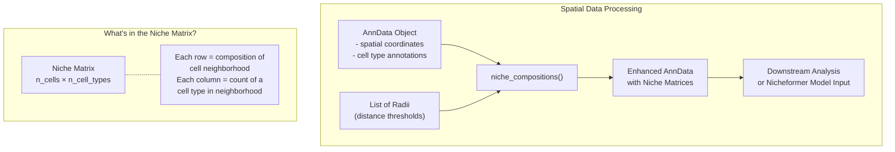
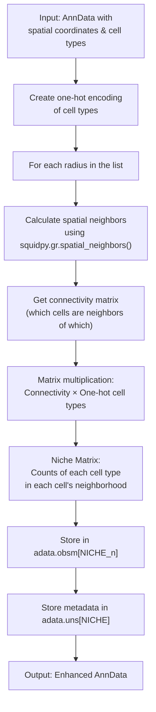
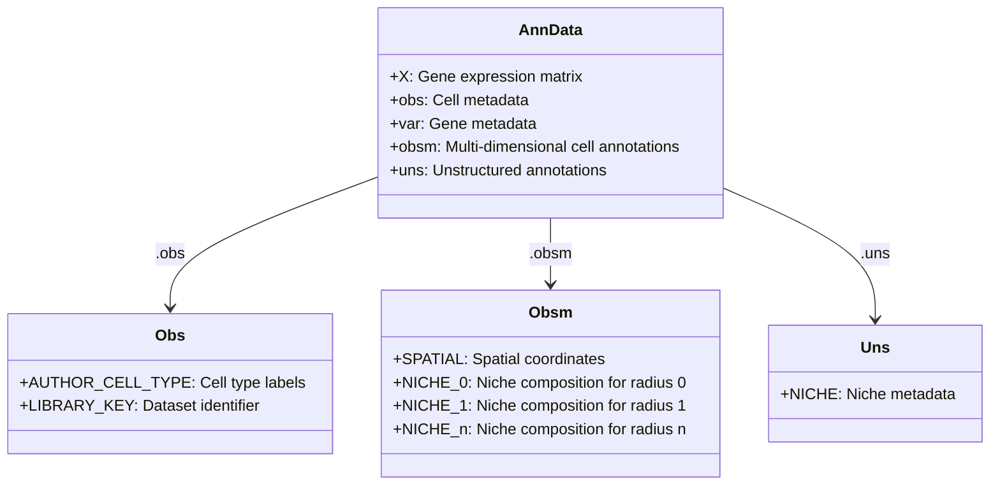
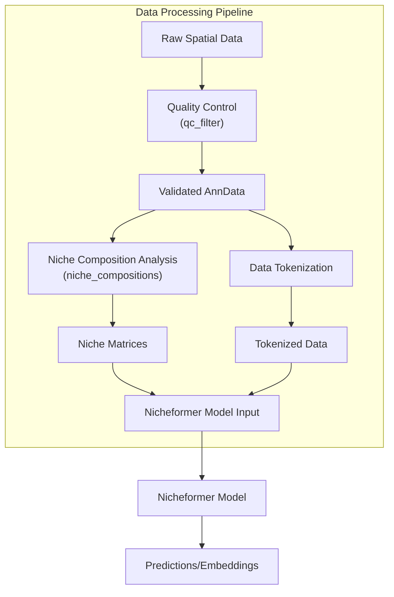

# Niche Composition Analysis

<details>
<summary>Relevant source files</summary>

The following files were used as context for generating this wiki page:

- [data/spatialcorpus-110M/dissociated/Lu_2021/preprocess_Lu_2021.py](data/spatialcorpus-110M/dissociated/Lu_2021/preprocess_Lu_2021.py)
- [src/nicheformer/data/tools/__init__.py](src/nicheformer/data/tools/__init__.py)
- [src/nicheformer/data/tools/basic_filtering.py](src/nicheformer/data/tools/basic_filtering.py)
- [src/nicheformer/data/tools/niche_compositions.py](src/nicheformer/data/tools/niche_compositions.py)

</details>


## Purpose and Scope

This document explains the niche composition analysis functionality in the Nicheformer system, which calculates the cellular neighborhood (niche) composition for cells in spatial transcriptomics data. This analysis is a critical preprocessing step that captures the spatial context of cells, allowing the Nicheformer model to leverage neighborhood information in its predictions. For information about other data processing steps like tokenization, see [Data Tokenization](#4.2).

## Overview of Niche Composition Analysis

Niche composition analysis examines the cellular environment surrounding each cell in spatial transcriptomics data by identifying neighboring cells within specified distances and quantifying the cell types present in these neighborhoods.



Sources: [src/nicheformer/data/tools/niche_compositions.py:9-51]()

## Implementation Details

The niche composition analysis is implemented in the `niche_compositions` function within the Nicheformer data processing tools.

### Function Signature

```python
def niche_compositions(
    adata: AnnData,
    radii: list[float]
) -> AnnData
```

This function:
1. Takes an AnnData object containing spatial data and cell type annotations
2. Takes a list of radius values defining the spatial neighborhoods
3. Returns the AnnData object enriched with niche composition matrices

Sources: [src/nicheformer/data/tools/niche_compositions.py:9-13]()

### Calculation Process



Sources: [src/nicheformer/data/tools/niche_compositions.py:28-50]()

### Key Steps in the Algorithm

1. **One-hot encoding of cell types**: Converts categorical cell type labels into a sparse binary matrix where each column represents a cell type
   ```python
   one_hot_ct = get_dummies(adata.obs[ObsConstants.AUTHOR_CELL_TYPE], dtype=int, sparse=True)
   ```

2. **Spatial neighborhood calculation**: For each radius, computes which cells are neighbors of which using squidpy's spatial_neighbors function
   ```python
   connectivities, _ = spatial_neighbors(
       adata, 
       spatial_key=ObsmConstants.SPATIAL,
       library_key=ObsConstants.LIBRARY_KEY,
       coord_type='generic',
       radius=radius,
       copy=True
   )
   ```

3. **Niche composition calculation**: Matrix multiplication of the connectivity matrix with the one-hot cell type matrix
   ```python
   niche = connectivities @ csr_matrix(one_hot_ct)
   ```

4. **Storage in AnnData**: The resulting niche matrix is stored in `adata.obsm` with metadata in `adata.uns`
   ```python
   adata.obsm[f"{ObsmConstants.NICHE}_{n}"] = niche
   adata.uns[UnsConstants.NICHE] = uns_niche
   ```

Sources: [src/nicheformer/data/tools/niche_compositions.py:29-50]()

## Data Structures and Format

### Input Requirements

The function requires an AnnData object with:
- `.obs[ObsConstants.AUTHOR_CELL_TYPE]`: Cell type annotations
- `.obsm[ObsmConstants.SPATIAL]`: Spatial coordinates of cells
- `.obs[ObsConstants.LIBRARY_KEY]`: Identifier for the dataset/library

### Output Format

The function adds to the AnnData object:
- `.obsm[f"{ObsmConstants.NICHE}_{n}"]`: For each radius (indexed by n), a matrix of dimensions n_cells × n_cell_types containing counts of each cell type in each cell's neighborhood
- `.uns[UnsConstants.NICHE]`: Metadata about the niche calculation, including:
  - List of cell type names
  - Radius values used
  - Average node degree (number of neighbors per cell)
  - Other configuration parameters



Sources: [src/nicheformer/data/tools/niche_compositions.py:13-27](), [src/nicheformer/data/tools/niche_compositions.py:42-50]()

## Integration with Nicheformer Pipeline

The niche composition analysis is a key preprocessing step in the Nicheformer pipeline, providing spatial context information that can be used by the model.



Sources: [src/nicheformer/data/tools/__init__.py:1-2](), [data/spatialcorpus-110M/dissociated/Lu_2021/preprocess_Lu_2021.py:1-88]()

## Technical Considerations

### Performance Optimization

- **Sparse Matrix Operations**: The function uses sparse matrices (`csr_matrix`) to efficiently handle the potentially large and sparse connectivity and one-hot encoding matrices.
- **Multiple Radii Analysis**: The function supports analyzing multiple neighborhood sizes in a single call, avoiding redundant calculations.

### Dependencies

The niche composition functionality relies on:
- **squidpy**: For calculating spatial neighborhoods
- **scipy.sparse**: For efficient sparse matrix operations
- **pandas**: For one-hot encoding of cell types

## Usage Example

The niche composition analysis is typically used in the data preprocessing stage. Here's an abstract example of how it might be used:

1. Load spatial data into an AnnData object with spatial coordinates and cell type annotations
2. Perform quality control with `qc_filter`
3. Calculate niche compositions with multiple radii
4. Use the enriched AnnData as input for the Nicheformer model

The niche matrices can also be used independently for spatial neighborhood analysis, such as identifying cellular organization patterns or studying cell-cell interactions.

Sources: [src/nicheformer/data/tools/basic_filtering.py:6-40](), [src/nicheformer/data/tools/niche_compositions.py:9-51]()

---