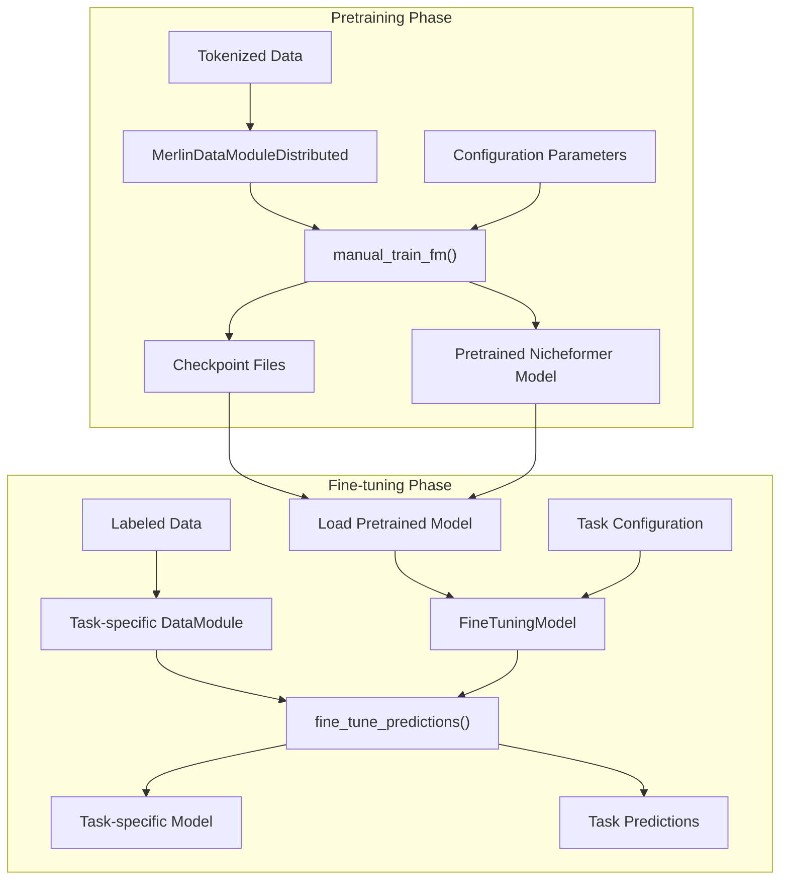
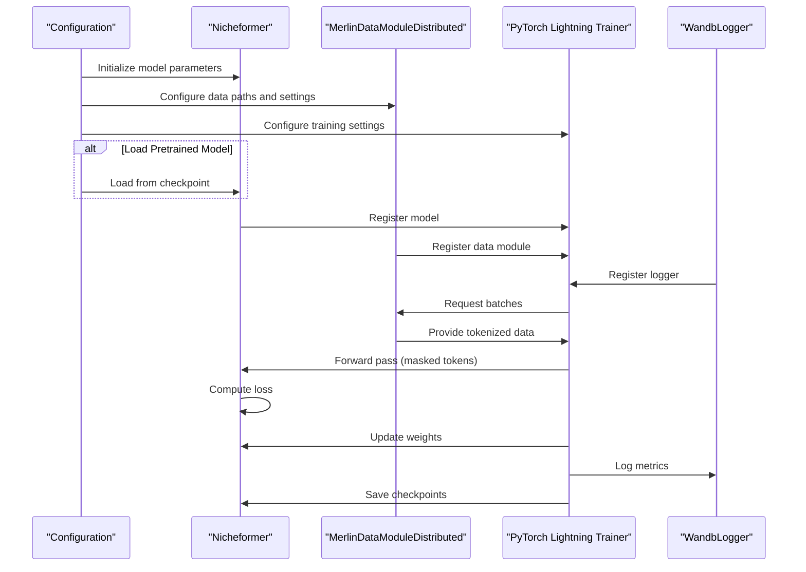
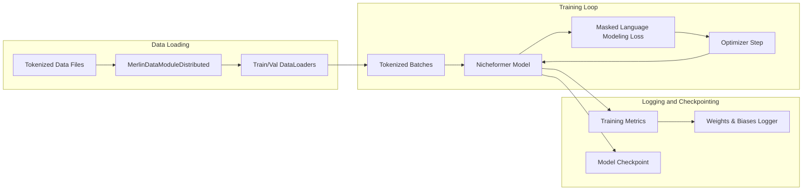
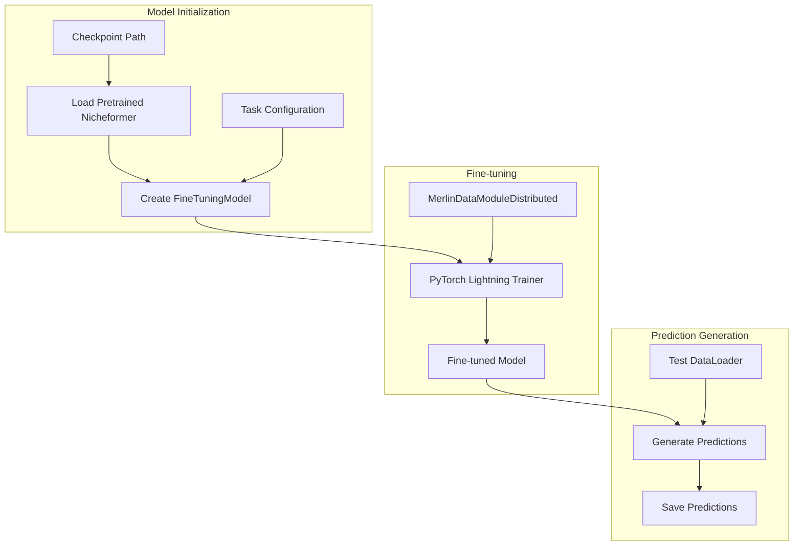
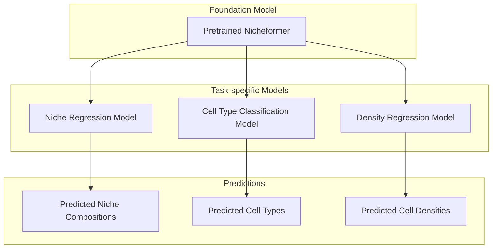
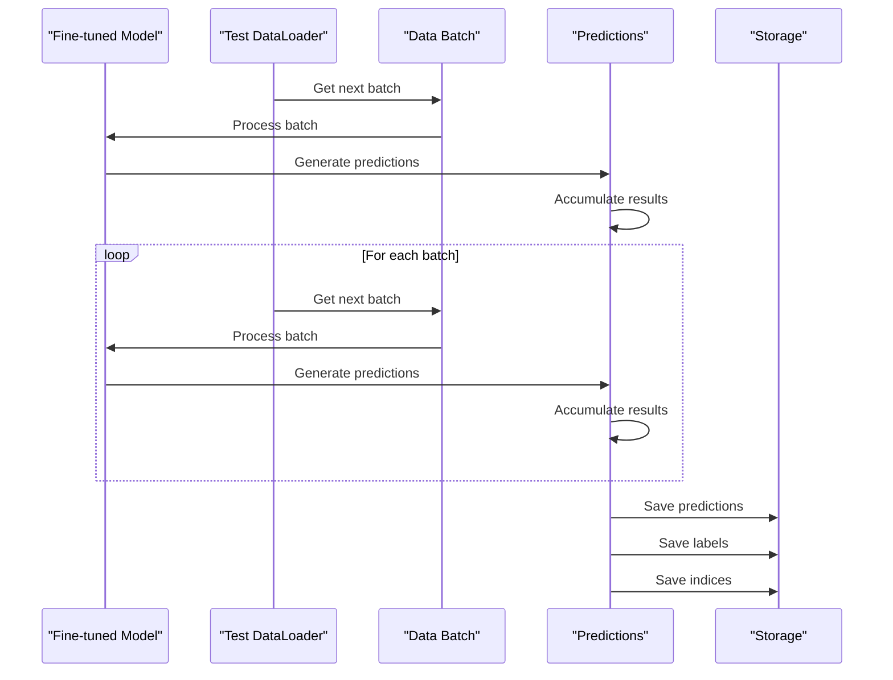
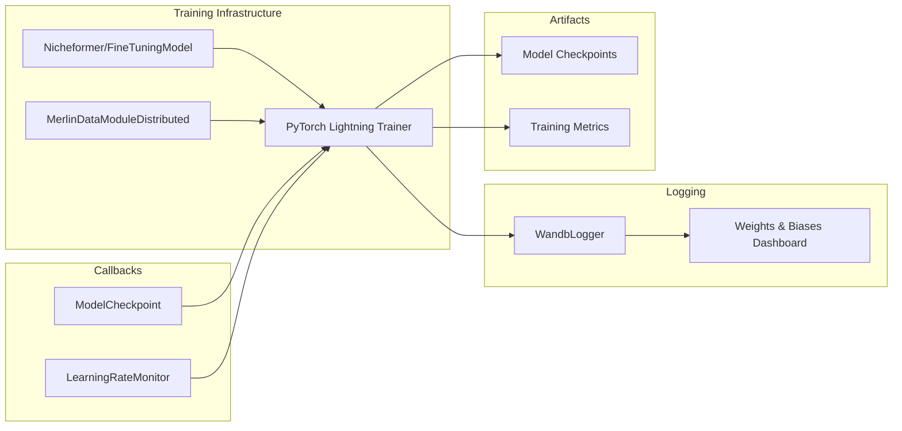

# Training and Fine-tuning

Relevant source files

The following files were used as context for generating this wiki page:

- [src/nicheformer/_fine_tune.py](src/nicheformer/_fine_tune.py)
- [src/nicheformer/_train.py](src/nicheformer/_train.py)

This document outlines the training and fine-tuning processes in the Nicheformer system. It covers how to pretrain the Nicheformer foundation model and how to fine-tune it for specific downstream tasks. For details on the model architecture, see [Model Architecture](#3), and for data preprocessing before training, see [Data Processing Pipeline](#4).

## Overview of Training and Fine-tuning Workflow

The Nicheformer training pipeline consists of two main phases:

1. **Pretraining**: Training the foundation model on large-scale single-cell and spatial omics data using masked language modeling
2. **Fine-tuning**: Adapting the pretrained model for specific downstream tasks such as niche regression, cell type classification, or density prediction

Sources: [src/nicheformer/_train.py:8-80](), [src/nicheformer/_fine_tune.py:12-129]()

## Pretraining the Nicheformer Model

The pretraining process creates a foundation model by training it on a large corpus of tokenized single-cell and spatial data. This is implemented in the `manual_train_fm` function.

### Pretraining Process

Sources: [src/nicheformer/_train.py:8-80]()

### Pretraining Configuration

The pretraining process is controlled by a configuration dictionary passed to the `manual_train_fm` function, which specifies model architecture and training parameters:

| Parameter | Description |
|-----------|-------------|
| `dim_model` | Dimension of the model's hidden representations |
| `nheads` | Number of attention heads in transformer layers |
| `dim_feedforward` | Dimension of the feedforward network in transformer layers |
| `nlayers` | Number of transformer encoder layers |
| `dropout` | Dropout rate for regularization |
| `masking_p` | Probability of masking tokens for masked language modeling |
| `n_tokens` | Number of tokens in the vocabulary |
| `context_length` | Maximum length of input token sequences |
| `warmup` | Number of warmup steps for learning rate scheduler |
| `lr` | Learning rate |
| `batch_size` | Batch size for training |
| `max_epochs` | Maximum number of training epochs |
| `autoregressive` | Whether to use autoregressive masking |
| `pool` | Pooling method for token representations |
| `supervised_task` | Type of supervised task (if any) |
| `pretrained_path` | Path to a pretrained model checkpoint (if continuing training) |

Sources: [src/nicheformer/_train.py:12-32]()

### Data Loading and Training

The pretraining process uses the `MerlinDataModuleDistributed` class to load tokenized data efficiently:

Sources: [src/nicheformer/_train.py:38-80]()

## Fine-tuning for Downstream Tasks

After pretraining, the Nicheformer model can be fine-tuned for specific downstream tasks. This is implemented in the `fine_tune_predictions` function.

### Fine-tuning Process

Sources: [src/nicheformer/_fine_tune.py:12-129]()

### Fine-tuning Configuration

The fine-tuning process uses the following key configuration parameters:

| Parameter | Description |
|-----------|-------------|
| `checkpoint_path` | Path to the pretrained Nicheformer model checkpoint |
| `freeze` | Whether to freeze the backbone model parameters |
| `extract_layers` | Which layers to extract features from |
| `function_layers` | Task-specific functional layers |
| `reinit_layers` | Whether to reinitialize certain layers |
| `extractor` | Feature extraction method |
| `baseline` | Whether to use a baseline model |
| `supervised_task` | Type of downstream task (e.g., 'niche_regression', 'niche_classification', 'density_regression') |
| `regress_distribution` | Whether to regress a distribution |
| `pool` | Pooling method for token representations |
| `dim_prediction` | Dimension of the prediction output |
| `n_classes` | Number of classes for classification tasks |
| `predict_density` | Whether to predict density |
| `organ` | Organ/tissue type for data selection |
| `label` | Label key for supervision |

Sources: [src/nicheformer/_fine_tune.py:21-40]()

### Downstream Tasks

The Nicheformer model can be fine-tuned for various downstream tasks:

1. **Niche Regression**: Predicting cellular neighborhood compositions
2. **Cell Type Classification**: Predicting cell types based on gene expression
3. **Density Regression**: Predicting cell density in spatial coordinates

Sources: [src/nicheformer/_fine_tune.py:21-40](), [src/nicheformer/_fine_tune.py:110-121]()

## Prediction Generation and Saving

After fine-tuning, the model can generate predictions on test data, which are collected and saved for downstream analysis:

Sources: [src/nicheformer/_fine_tune.py:99-129]()

## Monitoring and Logging

Both pretraining and fine-tuning processes use PyTorch Lightning's Trainer interface with Weights & Biases (wandb) logging for experiment tracking:

Sources: [src/nicheformer/_train.py:38-55](), [src/nicheformer/_fine_tune.py:49-64]()

## Hardware Requirements and Performance Optimizations

The training and fine-tuning processes utilize several performance optimizations:

1. **Distributed Data Parallel (DDP)**: Training across multiple GPUs
2. **Mixed Precision**: Using BF16 mixed precision for faster training
3. **Gradient Clipping**: Preventing exploding gradients
4. **Gradient Accumulation**: Effective larger batch sizes with limited memory

These optimizations allow efficient training on large datasets while maintaining numerical stability.

Sources: [src/nicheformer/_train.py:43-55](), [src/nicheformer/_fine_tune.py:54-64]()

---