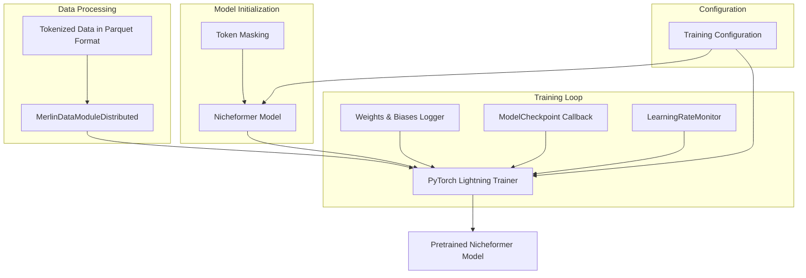
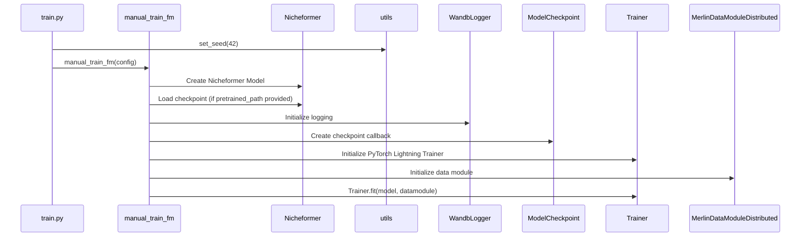
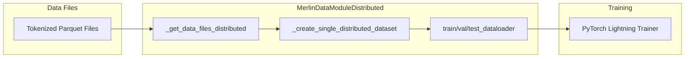
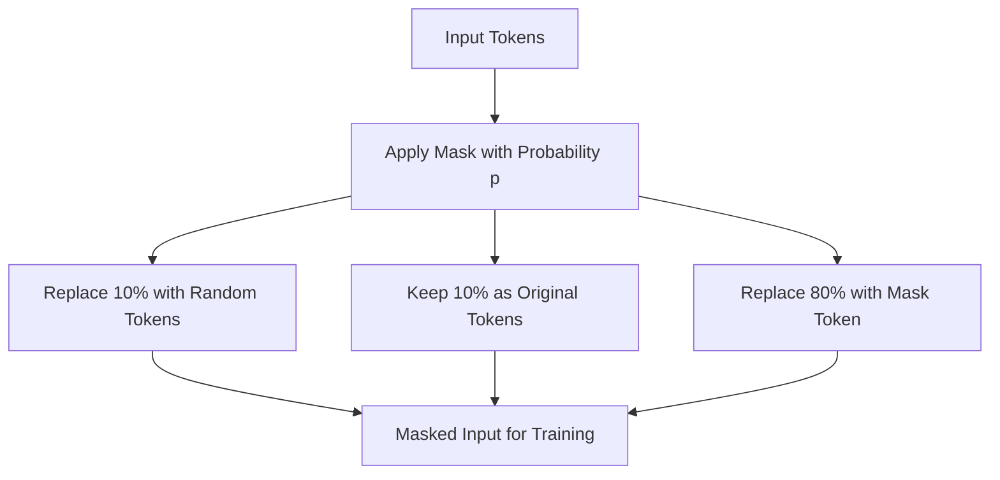
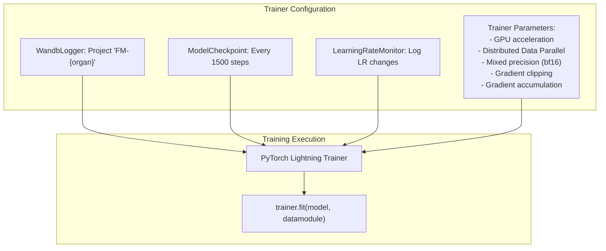
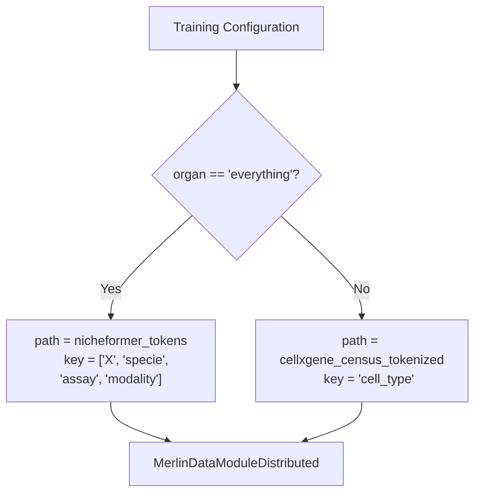
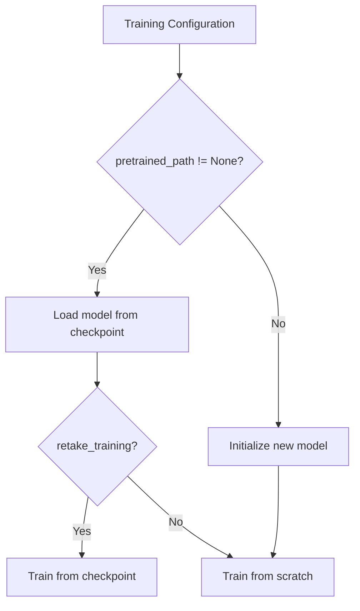
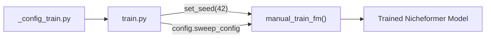

# Training Pipeline

Relevant source files

The following files were used as context for generating this wiki page:

- [src/nicheformer/_train.py](src/nicheformer/_train.py)
- [src/nicheformer/config_files/_config_fine_tune.py](src/nicheformer/config_files/_config_fine_tune.py)
- [src/nicheformer/config_files/_config_train.py](src/nicheformer/config_files/_config_train.py)
- [src/nicheformer/data/datamodules.py](src/nicheformer/data/datamodules.py)
- [src/nicheformer/fine_tune.py](src/nicheformer/fine_tune.py)
- [src/nicheformer/models/_utils.py](src/nicheformer/models/_utils.py)
- [src/nicheformer/train.py](src/nicheformer/train.py)

## Purpose and Scope

This document details the pre-training pipeline for the Nicheformer model, explaining how the foundation model is trained on a large corpus of single-cell and spatial omics data. The training pipeline implements a masked language modeling approach to learn gene expression patterns across different cell types and niches. For information about fine-tuning the pre-trained model for specific downstream tasks, see [Fine-tuning Pipeline](#5.2).

## Training Pipeline Overview

The Nicheformer training pipeline consists of several components working together to train the model on tokenized gene expression data. The pipeline uses PyTorch Lightning for efficient distributed training across multiple GPUs.

**Diagram: Nicheformer Training Pipeline Overview**

Sources: [src/nicheformer/_train.py:8-80](), [src/nicheformer/train.py:1-16]()

## Model Configuration and Initialization

The Nicheformer training process begins with model configuration and initialization. The configuration parameters are defined in `_config_train.py` and passed to the `manual_train_fm` function. The model is then initialized with these parameters.

### Key Configuration Parameters

| Parameter | Description | Default Value |
|-----------|-------------|---------------|
| `dim_model` | Dimension of the model embeddings | 512 |
| `nheads` | Number of attention heads | 16 |
| `dim_feedforward` | Dimension of the feedforward network | 1024 |
| `nlayers` | Number of transformer layers | 12 |
| `dropout` | Dropout probability | 0.0 |
| `masking_p` | Probability of masking tokens | 0.15 |
| `n_tokens` | Size of the token vocabulary | 20340 |
| `context_length` | Maximum sequence length | 1500 |
| `lr` | Learning rate | 7e-4 |
| `warmup` | Number of warmup steps | 100000 |
| `batch_size` | Batch size per GPU | 6 |

Sources: [src/nicheformer/config_files/_config_train.py:1-25]()

### Model Initialization Code Flow

**Diagram: Model Initialization Flow**

Sources: [src/nicheformer/_train.py:8-37](), [src/nicheformer/train.py:1-16]()

## Data Loading with MerlinDataModuleDistributed

The Nicheformer training pipeline uses the `MerlinDataModuleDistributed` class to efficiently load and prepare data for distributed training. This class handles the distribution of data across multiple GPUs.

### Data Loading Process

**Diagram: Data Loading Process**

Sources: [src/nicheformer/data/datamodules.py:118-185](), [src/nicheformer/_train.py:69-73]()

The `MerlinDataModuleDistributed` class:
1. Distributes parquet files across available GPUs
2. Creates merlin.io Dataset objects for each GPU
3. Provides train, validation, and test dataloaders

Key implementation details:
- Uses Merlin IO for efficient data loading
- Supports distributed training by assigning specific files to each GPU
- Handles dataset schema definition for tokenized data

Sources: [src/nicheformer/data/datamodules.py:90-116](), [src/nicheformer/data/datamodules.py:175-185]()

## Token Masking for Pre-training

The Nicheformer model is pre-trained using a masked language modeling (MLM) approach, where a percentage of input tokens are masked and the model is trained to predict the original tokens. This process is handled by the `complete_masking` function.

### Masking Strategy

**Diagram: Token Masking Strategy**

Sources: [src/nicheformer/models/_utils.py:6-47]()

The masking process:
1. Replaces padding tokens (0) with the padding token identifier (1)
2. Masks tokens with probability `p` (default: 0.15)
3. For masked tokens:
   - 80% are replaced with a mask token (0)
   - 10% are replaced with a random token
   - 10% are kept as the original token
4. Never masks special tokens (padding tokens and CLS tokens)

This approach follows the BERT-style masked language modeling, allowing the model to learn contextual representations of gene expression patterns.

Sources: [src/nicheformer/models/_utils.py:6-47]()

## Training Process with PyTorch Lightning

The training process is managed by PyTorch Lightning, which handles the training loop, device management, and logging. The `manual_train_fm` function sets up the trainer and starts the training process.

### Training Setup

**Diagram: Training Setup with PyTorch Lightning**

Sources: [src/nicheformer/_train.py:38-55](), [src/nicheformer/_train.py:74-80]()

Key training parameters:
- Uses mixed precision training (`bf16-mixed`) for improved performance
- Applies gradient clipping (value: 1) to prevent exploding gradients
- Uses gradient accumulation (10 batches) to simulate larger batch sizes
- Logs metrics to Weights & Biases every 100 steps
- Saves model checkpoints every 1500 steps

Sources: [src/nicheformer/_train.py:38-55]()

## Data Path Configuration and Organ-Specific Training

The training pipeline supports training on specific organs or on the entire dataset. The path and key configuration depends on the `organ` parameter in the configuration.

**Diagram: Data Path Configuration**

Sources: [src/nicheformer/_train.py:57-67]()

The training pipeline supports:
- Training on specific organs (using cell type annotations)
- Training on the entire dataset (using species, assay, and modality annotations)

This flexibility allows for both general and organ-specific model training.

Sources: [src/nicheformer/_train.py:57-67]()

## Resuming Training from Checkpoints

The training pipeline supports resuming training from a checkpoint, allowing for continued training of a previously trained model.

**Diagram: Resuming Training from Checkpoints**

Sources: [src/nicheformer/_train.py:34-80]()

The process for resuming training:
1. Set `pretrained_path` to the path of the checkpoint file
2. Set `retake_training` to `True` to continue training from that checkpoint
3. The trainer will load the model state and optimizer state from the checkpoint

This allows for continued training after interruptions or for extending the training of a model with more data.

Sources: [src/nicheformer/_train.py:34-37](), [src/nicheformer/_train.py:75-80]()

## Running the Training Pipeline

To run the training pipeline, use the `train.py` script, which sets the random seed and calls the `manual_train_fm` function with the configuration from `_config_train.py`.

**Diagram: Running the Training Pipeline**

Sources: [src/nicheformer/train.py:1-16](), [src/nicheformer/config_files/_config_train.py:1-25]()

Key steps in the execution flow:
1. Import configuration from `_config_train.py`
2. Set random seed for reproducibility
3. Call `manual_train_fm` with the configuration
4. The function handles model initialization, data loading, and training

This script provides a simple entry point to start the training process with the predefined configuration.

Sources: [src/nicheformer/train.py:1-16]()

## Summary

The Nicheformer training pipeline implements a robust and efficient process for pre-training the Nicheformer model on large-scale gene expression data. The pipeline:

1. Configures the model architecture and training parameters
2. Initializes the Nicheformer model
3. Loads and distributes tokenized data across multiple GPUs
4. Applies token masking for masked language modeling
5. Trains the model using PyTorch Lightning
6. Logs training progress and saves checkpoints

This pre-trained model serves as a foundation for various downstream tasks through fine-tuning, which is covered in [Fine-tuning Pipeline](#5.2).

---