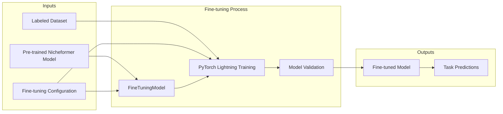
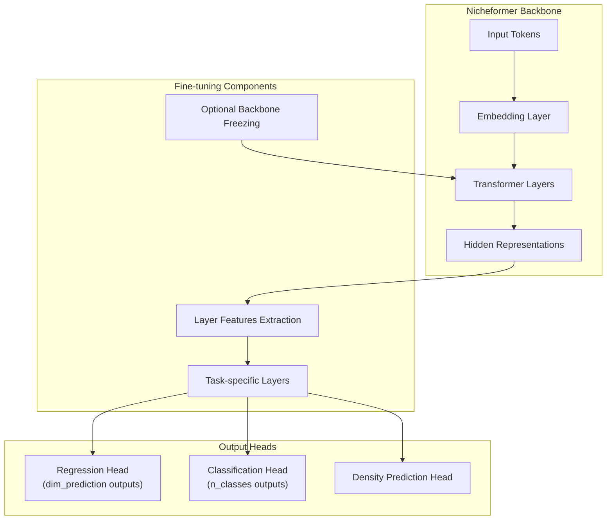
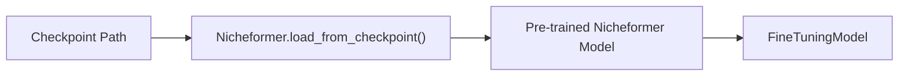
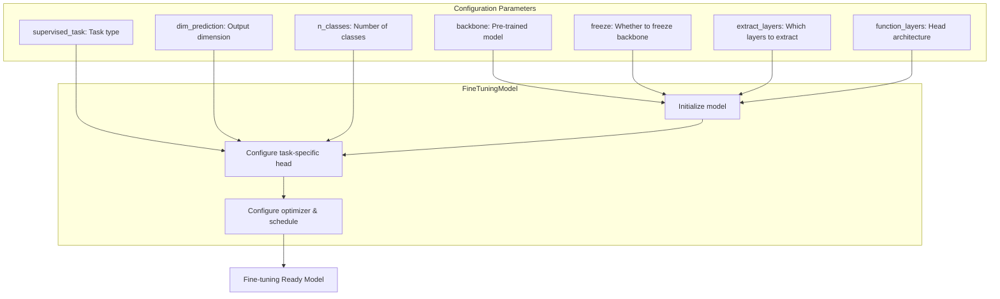
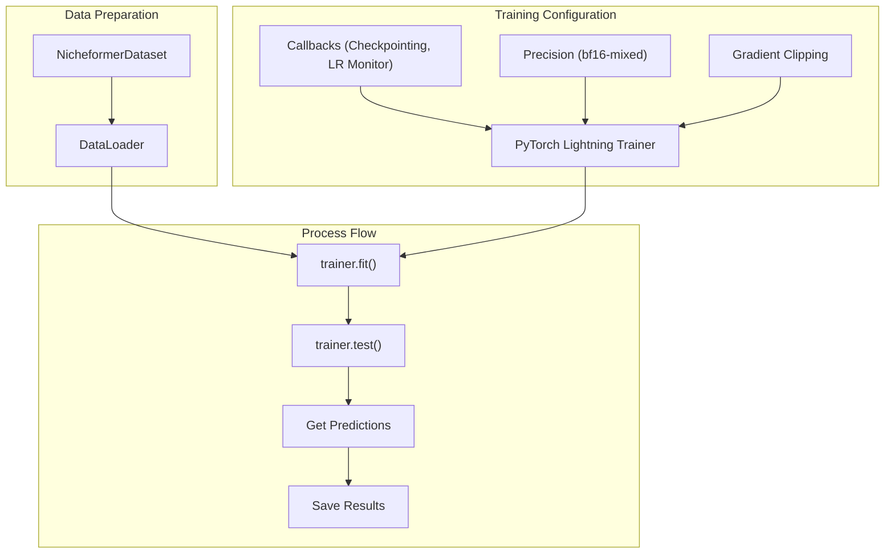
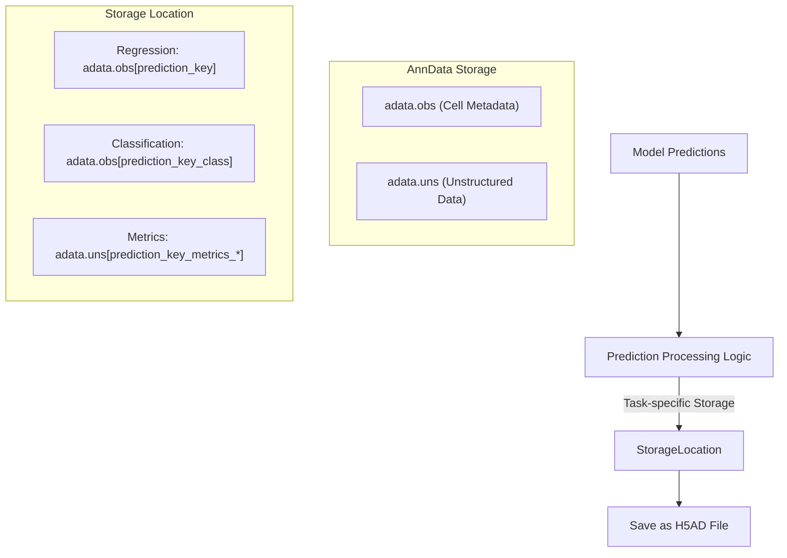

# Fine-tuning Pipeline

<details>
<summary>Relevant source files</summary>

The following files were used as context for generating this wiki page:

- [notebooks/experiments/downstream_fine_tune.ipynb](notebooks/experiments/downstream_fine_tune.ipynb)
- [src/nicheformer/_fine_tune.py](src/nicheformer/_fine_tune.py)
- [src/nicheformer/experiments/downstream_fine_tune.py](src/nicheformer/experiments/downstream_fine_tune.py)

</details>


This page documents the fine-tuning pipeline in Nicheformer, which enables utilizing pre-trained Nicheformer models for various downstream tasks. The fine-tuning pipeline allows adaptation of the general-purpose foundation model to specific prediction tasks like niche composition regression, cell type classification, and density prediction.

For information about the pre-training process, see [Training Pipeline](#5.1).

## 1. Pipeline Overview

The fine-tuning pipeline takes a pre-trained Nicheformer model and adapts it for specific downstream tasks by adding task-specific prediction heads while optionally freezing the pre-trained parameters.



Sources: [src/nicheformer/_fine_tune.py:12-129](), [src/nicheformer/experiments/downstream_fine_tune.py:17-174]()

## 2. Key Components

### 2.1 Fine-tuning Model Architecture

The fine-tuning pipeline uses the `FineTuningModel` which wraps the pre-trained Nicheformer backbone and adds task-specific prediction heads:



Sources: [src/nicheformer/_fine_tune.py:20-40]()

### 2.2 Supported Downstream Tasks

The fine-tuning pipeline supports multiple downstream tasks configured via the `supervised_task` parameter:

| Task | Description | Output Dimensions |
|------|-------------|-------------------|
| `niche_regression` | Predicts niche composition vectors | `dim_prediction` |
| `niche_classification` | Classifies cells into niche types | `n_classes` |
| `density_regression` | Predicts cellular density | 1 |

Sources: [src/nicheformer/_fine_tune.py:31-39](), [src/nicheformer/experiments/downstream_fine_tune.py:88-109]()

## 3. Fine-tuning Workflow

### 3.1 Loading a Pre-trained Model

The pipeline starts by loading a pre-trained Nicheformer model from a checkpoint:



Sources: [src/nicheformer/_fine_tune.py:19](), [src/nicheformer/experiments/downstream_fine_tune.py:85]()

### 3.2 Creating the Fine-tuning Model

The `FineTuningModel` is instantiated with the pre-trained backbone and configuration parameters:



Sources: [src/nicheformer/_fine_tune.py:21-40](), [src/nicheformer/experiments/downstream_fine_tune.py:88-109]()

### 3.3 Training and Generating Predictions

The PyTorch Lightning trainer handles the training, validation, and prediction generation:



Sources: [src/nicheformer/_fine_tune.py:49-128](), [src/nicheformer/experiments/downstream_fine_tune.py:122-173]()

## 4. Configuration Parameters

The fine-tuning pipeline is highly configurable through various parameters:

### 4.1 Core Model Parameters

| Parameter | Description | Default |
|-----------|-------------|---------|
| `checkpoint_path` | Path to pre-trained model checkpoint | Required |
| `freeze` | Whether to freeze the backbone model | True |
| `extract_layers` | Which layers to extract features from | [11] |
| `function_layers` | Architecture for the prediction head | mean |
| `reinit_layers` | Whether to reinitialize layers | False |
| `extractor` | Whether to use feature extractor mode | False |

### 4.2 Task-specific Parameters

| Parameter | Description | Default |
|-----------|-------------|---------|
| `supervised_task` | Type of downstream task | Required |
| `dim_prediction` | Output dimension for regression | Task-dependent |
| `n_classes` | Number of classes for classification | Task-dependent |
| `regress_distribution` | Whether to regress a distribution | True |
| `predict_density` | Whether to predict density | False |
| `ignore_zeros` | Whether to ignore zeros in prediction | False |
| `pool` | Pooling type for embeddings | mean |

### 4.3 Training Parameters

| Parameter | Description | Default |
|-----------|-------------|---------|
| `lr` | Learning rate | 1e-4 |
| `warmup` | Number of warmup epochs | 10 |
| `max_epochs` | Maximum number of training epochs | 100 |
| `batch_size` | Batch size for training | 32 |
| `gradient_clip_val` | Gradient clipping value | 1.0 |
| `accumulate_grad_batches` | Gradient accumulation steps | 10 |

Sources: [src/nicheformer/_fine_tune.py:21-40](), [src/nicheformer/experiments/downstream_fine_tune.py:88-109](), [notebooks/experiments/downstream_fine_tune.ipynb:55-89]()

## 5. Running the Fine-tuning Pipeline

There are three main ways to run the fine-tuning pipeline:

### 5.1 Using the Python Function

```python
from nicheformer import fine_tune_predictions

config = {
    'checkpoint_path': 'path/to/checkpoint.ckpt',
    'supervised_task': 'niche_regression',
    'freeze': True,
    'extract_layers': [11],
    # Additional parameters...
}

fine_tune_predictions(config)
```

### 5.2 Using the Command-line Script

```bash
python -m nicheformer.experiments.downstream_fine_tune --config config.yaml
```

Where `config.yaml` contains all the necessary parameters.

### 5.3 Using the Jupyter Notebook

The notebook `notebooks/experiments/downstream_fine_tune.ipynb` provides an interactive way to run the fine-tuning pipeline with step-by-step execution.

Sources: [src/nicheformer/_fine_tune.py:12-129](), [src/nicheformer/experiments/downstream_fine_tune.py:176-185](), [notebooks/experiments/downstream_fine_tune.ipynb:22-177]()

## 6. Output and Prediction Storage

After fine-tuning, the pipeline stores the predictions in the AnnData object:



Sources: [src/nicheformer/experiments/downstream_fine_tune.py:156-172](), [notebooks/experiments/downstream_fine_tune.ipynb:294-313]()

## 7. Practical Considerations

### 7.1 Memory Efficiency

For large datasets, consider:
- Reducing batch size
- Using gradient accumulation (via `accumulate_grad_batches`)
- Using mixed precision training (via `precision='bf16-mixed'`)

### 7.2 Model Selection

When fine-tuning:
- Freezing the backbone (`freeze=True`) is faster and prevents overfitting on small datasets
- For more complex tasks or larger datasets, consider unfreezing the backbone (`freeze=False`)
- Experiment with different `extract_layers` to find the optimal feature representation

Sources: [src/nicheformer/_fine_tune.py:51-64](), [src/nicheformer/experiments/downstream_fine_tune.py:122-130]()

---