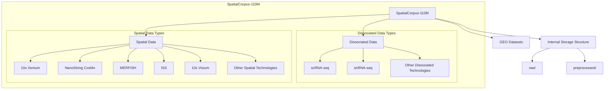
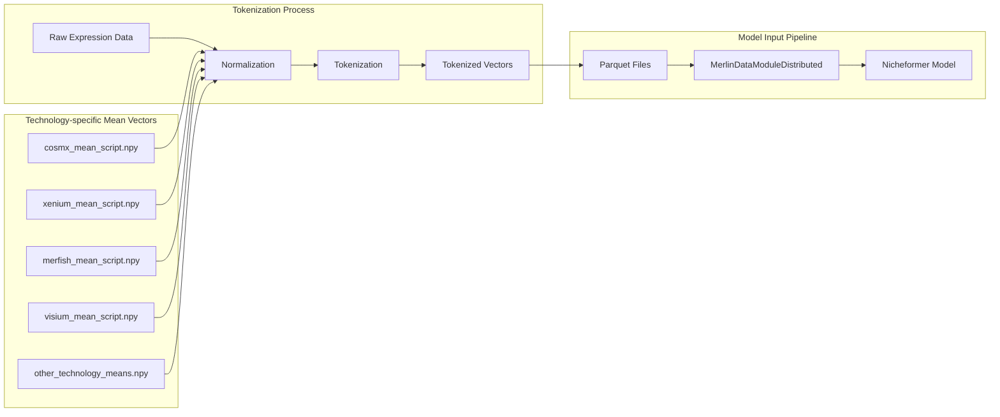
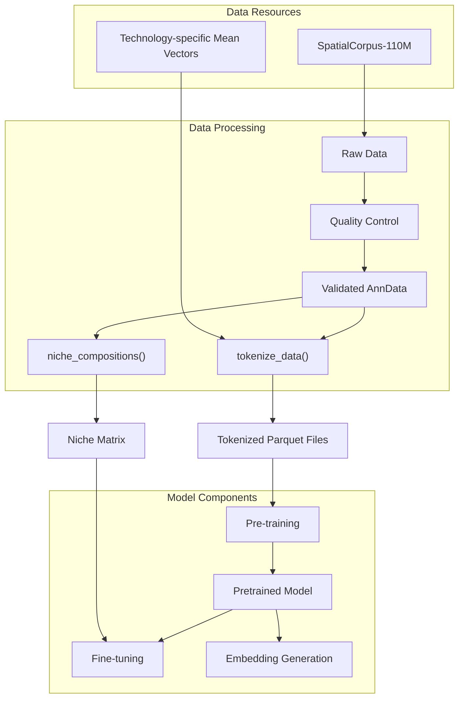
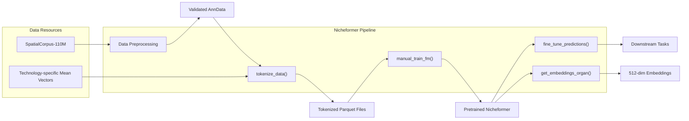

# Data Resources

Relevant source files

The following files were used as context for generating this wiki page:

- [data/model_means/cosmx_mean_script.npy](data/model_means/cosmx_mean_script.npy)
- [data/model_means/iss_mean_script.npy](data/model_means/iss_mean_script.npy)
- [data/model_means/xenium_mean_script.npy](data/model_means/xenium_mean_script.npy)
- [data/spatialcorpus-110M/README.md](data/spatialcorpus-110M/README.md)

## Purpose and Scope

This document provides an overview of the key data resources used in the Nicheformer framework. It describes the fundamental datasets and reference vectors that power the model's training, fine-tuning, and inference capabilities. For information about data processing pipelines, see [Data Processing Pipeline](#4), and for tokenization details, see [Data Tokenization](#4.2).

## SpatialCorpus-110M Overview

The SpatialCorpus-110M is the primary data resource used for training and evaluating the Nicheformer model. This large-scale collection of single-cell omics data encompasses both dissociated and spatial transcriptomics datasets from multiple technologies and tissue sources.

Sources: [data/spatialcorpus-110M/README.md]()

### Organization and Structure

The SpatialCorpus-110M follows a consistent organization pattern:

1. Top-level division between dissociated and spatial data
2. Each dataset is stored in a specified directory structure with:
   - `raw/` directory containing unprocessed data
   - `preprocessed/` directory containing quality-controlled and formatted data

The corpus has been curated from various sources including GEO datasets and direct sequencing data from spatial technologies like Xenium, CosMx, MERFISH, and ISS.

## Technology-specific Mean Vectors

Technology-specific mean vectors are critical reference data used in the tokenization process. These vectors contain the mean expression values for each gene across samples from a specific technology platform.

Sources: [data/model_means/cosmx_mean_script.npy]()

### Purpose in Data Processing

The technology-specific mean vectors serve several critical functions:

1. **Normalization**: They help standardize gene expression values across different technology platforms
2. **Technology bias correction**: They account for systematic biases in gene detection between technologies
3. **Cross-dataset compatibility**: They enable the model to generalize across data from different sources

Each mean vector is stored as a NumPy array file (`.npy`) containing the average expression values for all genes in the model's vocabulary for a specific technology.

## Data Flow in the Nicheformer System

The data resources integrate into the broader Nicheformer system through a well-defined processing pipeline:

Sources: [data/spatialcorpus-110M/README.md]()

## Data Storage Formats

The Nicheformer pipeline uses several data storage formats at different stages:

| Stage | Format | Description | Purpose |
|-------|--------|-------------|---------|
| Raw data | Various (.mtx, .h5ad, .csv) | Original data from experiments | Input to pipeline |
| Processed data | AnnData (.h5ad) | Quality-controlled data in AnnData format | Standardized representation |
| Tokenized data | Parquet (.parquet) | Tokenized vectors in columnar format | Efficient model input |
| Mean vectors | NumPy arrays (.npy) | Technology-specific reference means | Normalization reference |
| Model outputs | AnnData (.h5ad) | Embeddings and predictions stored back in AnnData | Analysis and visualization |

## Access and Utilization

The SpatialCorpus-110M and technology-specific mean vectors are used within the Nicheformer framework through dedicated loading and processing functions. Example scripts for loading different parts of the corpus are provided in the repository.

To work with these data resources:

1. Specify a data storage location that contains `raw/` and `preprocessed/` subdirectories
2. Use the appropriate loading scripts from the `data/spatialcorpus-110M/` directory
3. Apply technology-specific mean vectors during tokenization to normalize the data

## Data Resource Integration

The following diagram illustrates how the data resources integrate with the Nicheformer model architecture:

Sources: [data/spatialcorpus-110M/README.md]()

## Technology Coverage

The SpatialCorpus-110M and associated mean vectors cover a range of single-cell and spatial technologies, making Nicheformer applicable to diverse data types:

- **Dissociated**: scRNA-seq, snRNA-seq
- **Spatial**: 10x Xenium, NanoString CosMx, MERFISH, In Situ Sequencing (ISS), 10x Visium

For each supported technology, a corresponding mean vector file is available to enable proper tokenization and normalization of data from that platform.

---