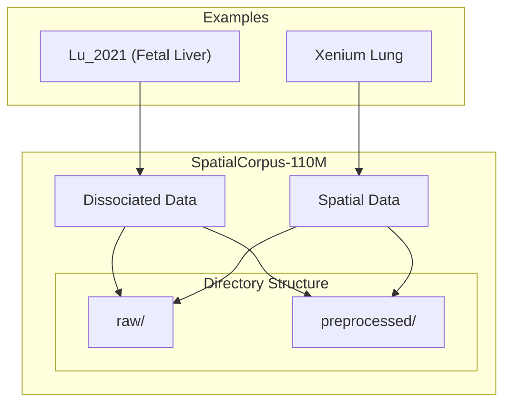
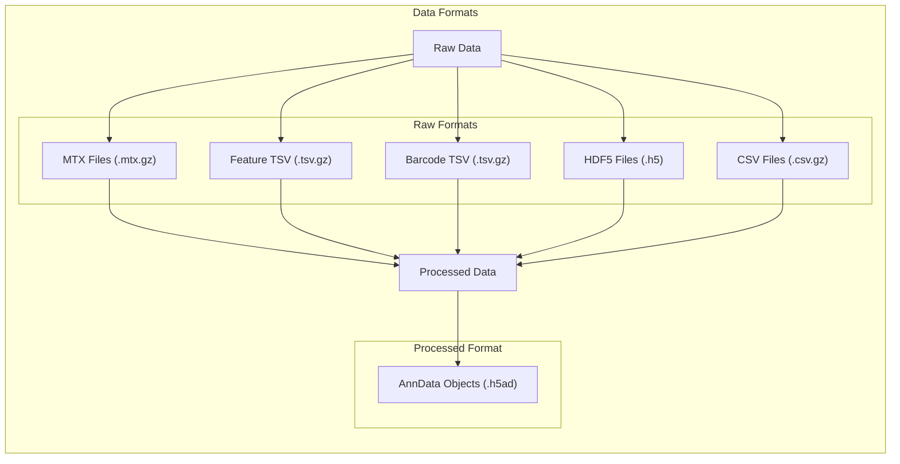
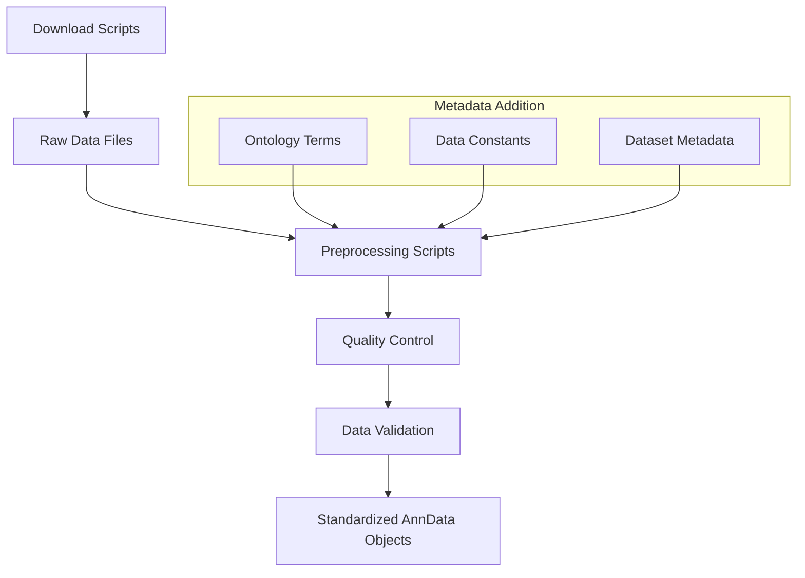
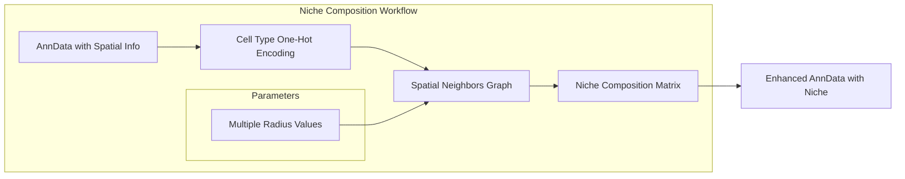
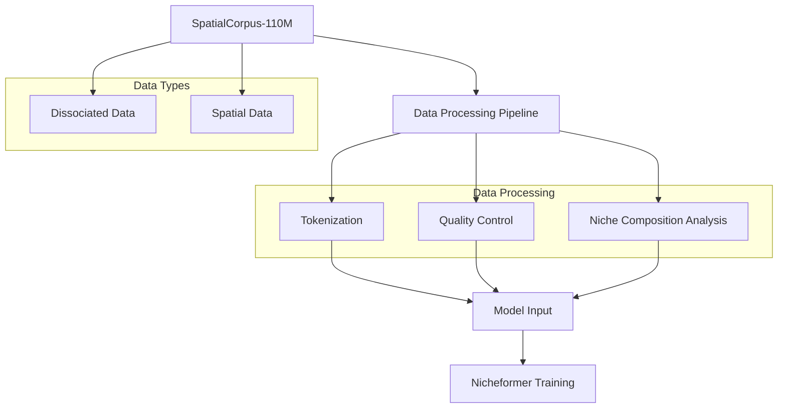

# SpatialCorpus-110M

<details>
<summary>Relevant source files</summary>

The following files were used as context for generating this wiki page:

- [data/spatialcorpus-110M/README.md](data/spatialcorpus-110M/README.md)
- [data/spatialcorpus-110M/dissociated/Lu_2021/preprocess_Lu_2021.py](data/spatialcorpus-110M/dissociated/Lu_2021/preprocess_Lu_2021.py)
- [data/spatialcorpus-110M/spatial/examplary-Xenium/README.md](data/spatialcorpus-110M/spatial/examplary-Xenium/README.md)
- [data/spatialcorpus-110M/spatial/examplary-Xenium/download_xenium_lung.py](data/spatialcorpus-110M/spatial/examplary-Xenium/download_xenium_lung.py)
- [data/spatialcorpus-110M/spatial/examplary-Xenium/preprocess_xenium_lung.py](data/spatialcorpus-110M/spatial/examplary-Xenium/preprocess_xenium_lung.py)
- [src/nicheformer/data/tools/niche_compositions.py](src/nicheformer/data/tools/niche_compositions.py)

</details>


## Purpose and Overview

The SpatialCorpus-110M serves as the primary data resource for the Nicheformer foundation model. It is a comprehensive collection of both dissociated single-cell and spatial transcriptomics datasets, comprising approximately 110 million cells in total. This corpus provides the necessary scale and diversity of data for training, validating, and testing the Nicheformer model across various tissues, organisms, and experimental conditions.

This document describes the structure, content, and processing of the SpatialCorpus-110M. For information about technology-specific mean vectors used in data tokenization, see [Technology-specific Mean Vectors](#6.2).

Sources: [data/spatialcorpus-110M/README.md:1-9]()

## Dataset Structure

The SpatialCorpus-110M is organized into two main categories of data, reflecting the fundamental data types in single-cell genomics:



**Dataset Categories:**
- **Dissociated Data**: Single-cell RNA sequencing datasets where cells have been dissociated from tissues, losing spatial context.
- **Spatial Data**: Datasets from spatial transcriptomics technologies that preserve the location of cells within tissues.

**Directory Structure:**
- **raw/**: Contains the original data files as downloaded from their sources.
- **preprocessed/**: Contains the standardized AnnData objects after preprocessing and validation.

Sources: [data/spatialcorpus-110M/README.md:1-9](), [data/spatialcorpus-110M/dissociated/Lu_2021/preprocess_Lu_2021.py:16-21](), [data/spatialcorpus-110M/spatial/examplary-Xenium/preprocess_xenium_lung.py:16-22]()

## Data Sources and Formats

### Dissociated Data

Dissociated data primarily comes from GEO (Gene Expression Omnibus) and similar repositories, containing single-cell RNA sequencing datasets across various tissues, organisms, and experimental conditions.

**Example Dataset: Lu_2021 (GEO ID: GSE172127)**
- **Source**: Mouse fetal liver single-cell RNA sequencing
- **Technologies**: 10x Genomics 3' v2
- **File Formats**: Matrix Market format (.mtx.gz), feature and barcode TSV files

### Spatial Data

Spatial data comes from various spatial transcriptomics technologies that preserve the spatial context of cells within tissues.

**Example Dataset: Xenium Lung**
- **Source**: 10x Genomics Xenium platform
- **Description**: Human non-diseased lung tissue
- **File Formats**: HDF5 cell feature matrix, CSV cell metadata



Sources: [data/spatialcorpus-110M/dissociated/Lu_2021/preprocess_Lu_2021.py:24-45](), [data/spatialcorpus-110M/spatial/examplary-Xenium/preprocess_xenium_lung.py:24-31](), [data/spatialcorpus-110M/spatial/examplary-Xenium/download_xenium_lung.py:15-19]()

## Data Processing Pipeline

Data in the SpatialCorpus-110M undergoes a standardized processing pipeline to ensure consistency and quality across datasets:



### Download Process

Example scripts are provided to download data from repositories:

```python
# Example from download_xenium_lung.py
download_zip(
    url="https://cf.10xgenomics.com/samples/xenium/1.3.0/...",
    save_path=f"{out_path}/raw",
    fn="Xenium_Preview_Human_Non_diseased_Lung_With_Add_on_FFPE_outs"
)
```

### Preprocessing Steps

1. **Data Loading**: Reading raw data files into memory
2. **Metadata Annotation**: Adding standardized metadata including:
   - Ontology terms (assay, organism, sex, tissue)
   - Dataset-specific identifiers (donor ID, condition)
   - Technology information
3. **Quality Control**: Filtering cells and genes based on quality metrics
4. **Validation**: Ensuring the data meets the required schema and structure
5. **Output**: Saving as standardized AnnData objects (.h5ad format)

### Key Metadata Fields

| Metadata Category | Examples | Purpose |
|-------------------|----------|---------|
| Ontology Terms | AssayOntologyTermId, OrganismOntologyTermId | Standardized classification |
| Sample Identifiers | DONOR_ID, CONDITION_ID | Sample tracking |
| Technology Info | ASSAY, SUSPENSION_TYPE | Technology context |
| Spatial Data | SPATIAL_X, SPATIAL_Y, LIBRARY_KEY | Spatial coordinates and regions |

Sources: [data/spatialcorpus-110M/dissociated/Lu_2021/preprocess_Lu_2021.py:27-87](), [data/spatialcorpus-110M/spatial/examplary-Xenium/preprocess_xenium_lung.py:24-70](), [data/spatialcorpus-110M/spatial/examplary-Xenium/download_xenium_lung.py:15-19]()

## Niche Composition Analysis for Spatial Data

For spatial datasets, SpatialCorpus-110M incorporates niche composition analysis, which quantifies the cellular neighborhood around each cell:



### Niche Calculation Process

1. **Cell Type Encoding**: Convert cell type annotations into one-hot encoded matrix
2. **Spatial Graph Construction**: Create a graph of cell-cell connections within specified radius
3. **Niche Matrix Computation**: Calculate the composition of cell types in each cell's neighborhood
4. **Storage**: Add the niche matrices to the AnnData object in `obsm`

### Implementation

The niche composition analysis is implemented in the `niche_compositions` function:

```python
# Example usage
adata = niche_compositions(adata=spatial_data, radii=[50, 100, 200])
```

This process creates multiple niche matrices at different radii, allowing analysis of cellular neighborhoods at various scales. Each matrix represents the count of different cell types within the specified radius of each cell.

Sources: [src/nicheformer/data/tools/niche_compositions.py:1-51]()

## Integration with Nicheformer System

The SpatialCorpus-110M serves as the foundation for the Nicheformer model training and evaluation pipeline:



### Usage in the Nicheformer Pipeline

1. **Data Source**: Provides the primary training and evaluation data
2. **Preprocessing**: Standardized preparation ensures consistent input format
3. **Tokenization**: Processed data is tokenized for model input (see [Technology-specific Mean Vectors](#6.2))
4. **Training**: Used to train the Nicheformer foundation model
5. **Evaluation**: Provides diverse test cases for model evaluation

The standardized structure of SpatialCorpus-110M enables seamless integration with the Nicheformer model, allowing for effective training across heterogeneous single-cell and spatial datasets.

Sources: [data/spatialcorpus-110M/README.md:1-9]()

## Scale and Composition

The SpatialCorpus-110M contains approximately 110 million cells across multiple tissues, organisms, and experimental conditions, making it one of the largest integrated collections of single-cell and spatial data. The corpus includes:

- **Diverse Tissues**: Liver, lung, brain, and many other tissues
- **Multiple Organisms**: Human, mouse, and other model organisms
- **Various Technologies**: 10x Genomics, Xenium, MERFISH, and other platforms
- **Different Conditions**: Normal, disease, developmental, and perturbed states

This diversity enables the Nicheformer model to learn generalizable representations across biological contexts and technical platforms.

## Conclusion

The SpatialCorpus-110M provides a comprehensive and standardized data foundation for the Nicheformer model. Through careful preprocessing, quality control, and integration of spatial context, this corpus enables effective training and evaluation of foundation models for single-cell and spatial transcriptomics.

---