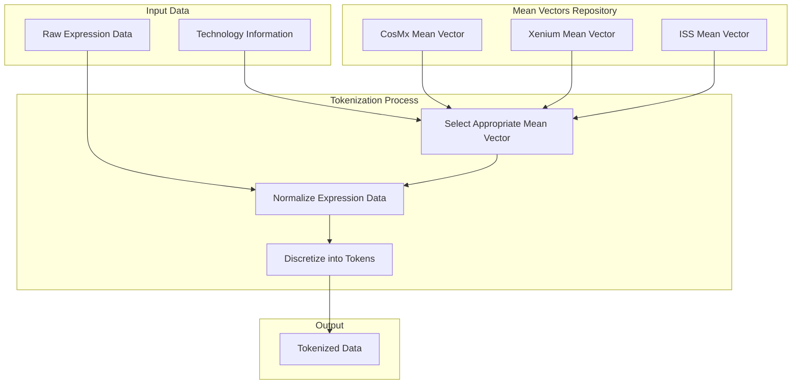
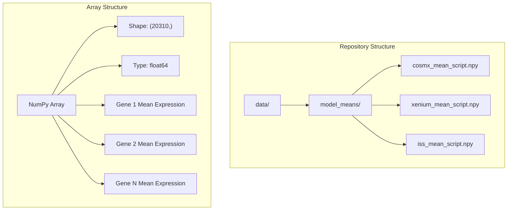
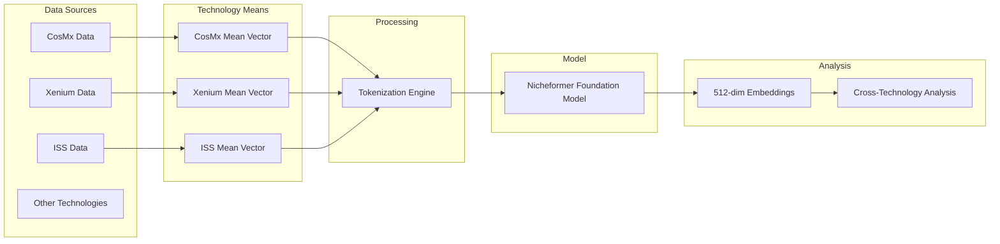

# Technology-specific Mean Vectors

Relevant source files

The following files were used as context for generating this wiki page:

- [data/model_means/cosmx_mean_script.npy](data/model_means/cosmx_mean_script.npy)
- [data/model_means/iss_mean_script.npy](data/model_means/iss_mean_script.npy)
- [data/model_means/merfish_mean_script.npy](data/model_means/merfish_mean_script.npy)
- [data/model_means/model.h5ad](data/model_means/model.h5ad)
- [data/model_means/xenium_mean_script.npy](data/model_means/xenium_mean_script.npy)

## Purpose and Scope

This document explains the technology-specific mean vectors used in the Nicheformer system, their purpose, and their role in the data processing pipeline. Technology-specific mean vectors are critical reference profiles that enable consistent tokenization of gene expression data across different spatial transcriptomics platforms. These vectors serve as technology-specific baselines for normalizing gene expression data before it's fed into the Nicheformer model.

For information about the overall data processing pipeline, see [Data Processing Pipeline](#4).

Sources: `data/model_means/cosmx_mean_script.npy`, `data/model_means/xenium_mean_script.npy`, `data/model_means/iss_mean_script.npy`

## Overview

Technology-specific mean vectors are numerical arrays that represent the average gene expression values for each gene across a large dataset for a specific spatial transcriptomics technology. Nicheformer currently supports mean vectors for three key technologies:

- **CosMx**: NanoString CosMx Spatial Molecular Imager
- **Xenium**: 10x Genomics Xenium In Situ platform
- **ISS**: In Situ Sequencing technology

These mean vectors are stored as NumPy arrays (.npy files) in the repository and contain expression values for 20,310 genes, matching the gene space used by the Nicheformer model.

### Role in Data Processing

Technology-specific mean vectors are essential for the tokenization process, which converts raw gene expression data into normalized tokens suitable for input to the Nicheformer model. By accounting for technology-specific biases and expression patterns, these mean vectors enable cross-technology compatibility and improve model performance.

## Technical Implementation

### File Format and Structure

The technology mean vectors are stored as NumPy arrays with the following characteristics:

- **File format**: `.npy` (NumPy binary format)
- **Shape**: (20,310,) - corresponding to the number of genes in the Nicheformer gene space
- **Data type**: 64-bit floating point (`float64`)
- **Storage location**: `data/model_means/` directory

Each array element represents the mean expression value for a specific gene measured with the corresponding technology.

Sources: `data/model_means/cosmx_mean_script.npy`, `data/model_means/xenium_mean_script.npy`, `data/model_means/iss_mean_script.npy`

### Mean Vector Generation

Mean vectors are generated by computing the average expression value for each gene across large datasets of a specific technology. This process typically involves:

1. Collecting a comprehensive dataset of samples from the same technology
2. Quality control to remove outliers and low-quality samples
3. Computing the mean expression for each gene
4. Storing the resulting vector for use in the tokenization process

This preprocessing step is crucial for establishing technology-specific baselines and ensuring consistent data representation across platforms.

## Integration with Tokenization Pipeline

Technology-specific mean vectors are integrated into the data processing pipeline during the tokenization step. The diagram below illustrates how these vectors are used in the tokenization process:

### Data Tokenization Process

Sources: `data/model_means/cosmx_mean_script.npy`, `data/model_means/xenium_mean_script.npy`, `data/model_means/iss_mean_script.npy`

### Key Steps in the Process

1. **Mean Vector Selection**: Based on the technology information of the input data, the appropriate technology-specific mean vector is selected.

2. **Data Normalization**: Raw gene expression data is normalized using the technology-specific mean vector to account for platform-specific biases.

3. **Discretization**: Normalized expression values are discretized into tokens according to predefined thresholds, creating a tokenized representation suitable for the Nicheformer model.

## Data Architecture and Storage

The mean vectors are organized in the repository as follows:

Sources: `data/model_means/cosmx_mean_script.npy`, `data/model_means/xenium_mean_script.npy`, `data/model_means/iss_mean_script.npy`

## Technology-specific Effects on Data Representation

Different spatial transcriptomics technologies have distinct characteristics that affect gene expression measurements:

| Technology | Key Characteristics | Impact on Expression Data | Mean Vector Adjustment |
|------------|---------------------|---------------------------|------------------------|
| CosMx      | Targeted panel with high sensitivity | High dynamic range for measured genes | Compensates for panel bias |
| Xenium     | In situ hybridization with multiplex capability | Balanced sensitivity across genes | Accounts for hybridization efficiency |
| ISS        | In situ sequencing with padlock probes | Variable efficiency across transcripts | Corrects for probe-specific biases |

The technology-specific mean vectors account for these platform-specific biases, enabling more comparable data representation across technologies.

## Role in Cross-Platform Integration

Technology-specific mean vectors play a crucial role in the broader context of the Nicheformer system, particularly for cross-platform analysis:

Sources: `data/model_means/cosmx_mean_script.npy`, `data/model_means/xenium_mean_script.npy`, `data/model_means/iss_mean_script.npy`

By normalizing data with technology-specific mean vectors, Nicheformer can generate comparable embeddings for cells profiled using different spatial transcriptomics platforms, enabling integrative analyses across technologies.

## Best Practices for Working with Technology Mean Vectors

When working with the Nicheformer system, it's important to:

1. **Use the correct mean vector** for your data's technology platform
2. **Keep mean vectors updated** as new data becomes available or technologies evolve
3. **Document technology information** in your analysis pipeline to ensure reproducibility
4. **Consider technology effects** when interpreting model outputs or embeddings

Following these practices ensures optimal performance of the Nicheformer model and enhances the comparability of results across different spatial transcriptomics technologies.

---