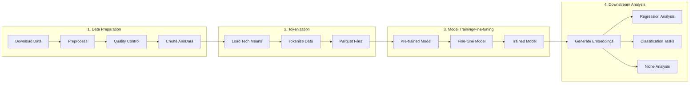
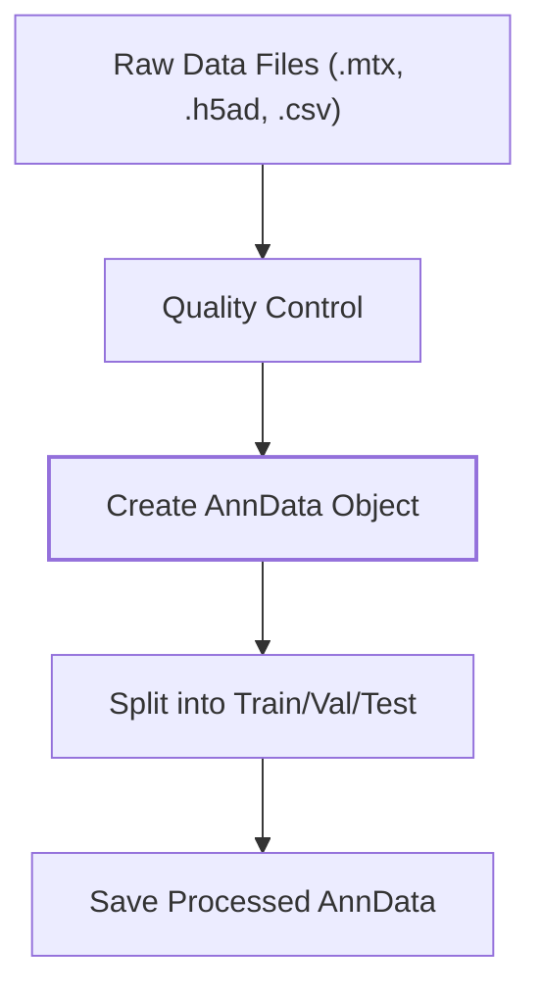
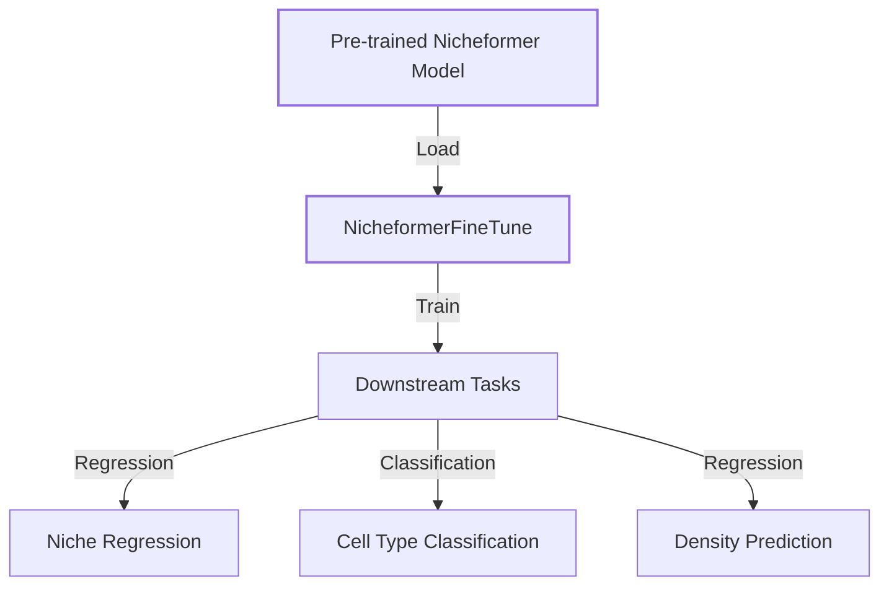
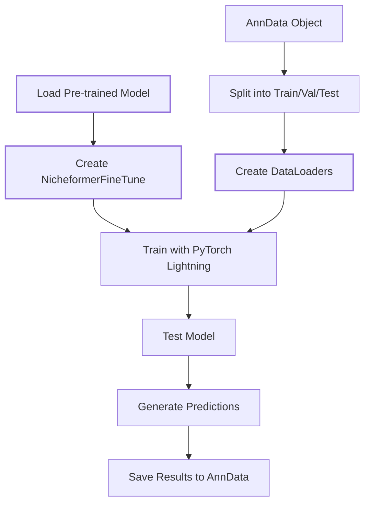
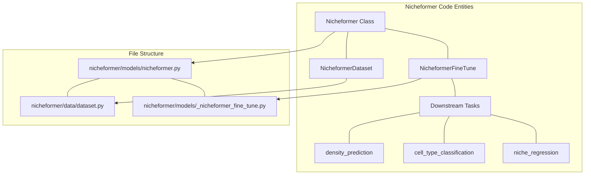
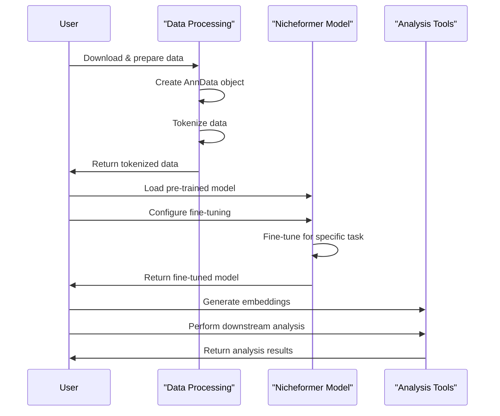

# Usage Examples

<details>
<summary>Relevant source files</summary>

The following files were used as context for generating this wiki page:

- [notebooks/README.md](notebooks/README.md)
- [notebooks/experiments/downstream_fine_tune.ipynb](notebooks/experiments/downstream_fine_tune.ipynb)

</details>


This page provides practical examples of using the Nicheformer system for single-cell and spatial omics data analysis. We'll cover the main workflows and usage patterns, demonstrating how to work with the system from data preparation to downstream analysis. For specific detailed examples, please refer to the subsequent child pages:

- For data acquisition and preparation details, see [Data Download and Preprocessing](#7.1)
- For detailed tokenization workflows, see [Tokenization Examples](#7.2)
- For performing analyses with Nicheformer, see [Downstream Analysis Examples](#7.3)

## Typical Workflow

The typical workflow for using Nicheformer consists of four main stages: data preparation, data tokenization, model training/fine-tuning, and downstream analysis.



Sources: [notebooks/README.md:3-5]()

## Data Preparation Example

Before using Nicheformer, you'll need to prepare your data in the correct format. The system works with AnnData objects, which store gene expression data and associated metadata.



Sources: [notebooks/experiments/downstream_fine_tune.ipynb:110-116]()

## Basic Tokenization

Tokenization converts gene expression data into tokens that can be processed by the Nicheformer model. This example shows how to tokenize data using technology-specific mean vectors.

```python
# Example of how to create and use a dataset for tokenization
train_dataset = NicheformerDataset(
    adata=adata,  # Your AnnData object
    technology_mean=technology_mean,  # Technology-specific mean vectors
    split='train',  # Data split to use
    max_seq_len=1500,  # Maximum sequence length
    aux_tokens=30,  # Number of auxiliary tokens
    chunk_size=1000,  # Chunk size for processing
    metadata_fields = {
        'obs': ['author_cell_type'],  # Optional metadata fields
    }
)
```

Sources: [notebooks/experiments/downstream_fine_tune.ipynb:118-129]()

## Fine-tuning for Downstream Tasks

Nicheformer can be fine-tuned for various downstream tasks such as niche regression, cell type classification, and density prediction.



Sources: [notebooks/experiments/downstream_fine_tune.ipynb:197-222]()

### Example Configuration for Fine-tuning

Below is a table of common configuration parameters for fine-tuning the Nicheformer model:

| Parameter | Description | Example Value |
|-----------|-------------|---------------|
| `supervised_task` | Type of fine-tuning task | `'niche_regression'` |
| `extract_layers` | Model layers to extract features from | `[11]` |
| `dim_prediction` | Dimension of output prediction vector | `33` |
| `freeze` | Whether to freeze backbone model | `True` |
| `pool` | Pooling method for embeddings | `'mean'` |
| `label` | Target variable to predict | `'X_niche_1'` |
| `lr` | Learning rate | `1e-4` |
| `max_epochs` | Maximum training epochs | `100` |

Sources: [notebooks/experiments/downstream_fine_tune.ipynb:55-90]()

## Fine-tuning Complete Workflow

This diagram shows the complete workflow for fine-tuning a pre-trained Nicheformer model and generating predictions.



Sources: [notebooks/experiments/downstream_fine_tune.ipynb:253-313]()

## Code Entity to Function Mapping

The following diagram maps Nicheformer system components to their corresponding code entities:



Sources: [notebooks/experiments/downstream_fine_tune.ipynb:31-33]()

## Example Usage Flow

The following sequence diagram shows an example user workflow with the Nicheformer system:



Sources: [notebooks/experiments/downstream_fine_tune.ipynb:40-43](), [notebooks/README.md:3-5]()

## Common Usage Scenarios

Below is a table of common usage scenarios with Nicheformer:

| Scenario | Description | Key Components |
|----------|-------------|----------------|
| Cell Type Classification | Classify cells based on gene expression | `NicheformerFineTune` with `supervised_task='cell_type_classification'` |
| Niche Composition Prediction | Predict the cellular composition of a niche | `NicheformerFineTune` with `supervised_task='niche_regression'` |
| Density Prediction | Predict cell density in spatial data | `NicheformerFineTune` with `predict_density=True` |
| Feature Extraction | Generate cell embeddings for downstream analysis | Use pre-trained model with `extractor=True` |

Sources: [notebooks/experiments/downstream_fine_tune.ipynb:76-90]()

For detailed examples of each workflow stage, please refer to the specific child pages linked at the top of this document.

---