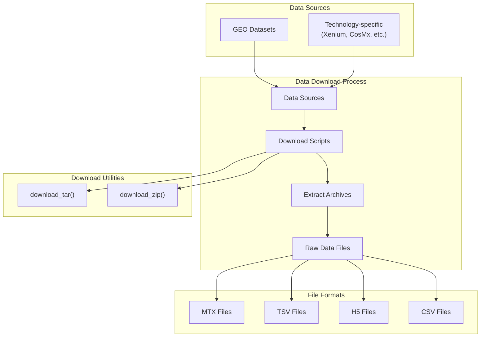
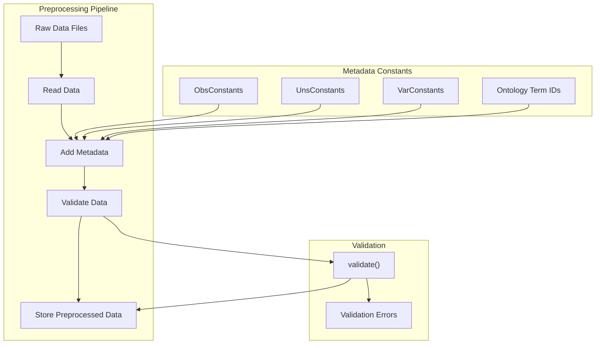
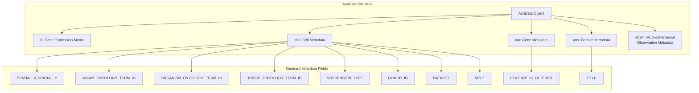

# Data Download and Preprocessing

<details>
<summary>Relevant source files</summary>

The following files were used as context for generating this wiki page:

- [data/spatialcorpus-110M/dissociated/Lu_2021/README.md](data/spatialcorpus-110M/dissociated/Lu_2021/README.md)
- [data/spatialcorpus-110M/dissociated/Lu_2021/download_Lu_2021.py](data/spatialcorpus-110M/dissociated/Lu_2021/download_Lu_2021.py)
- [data/spatialcorpus-110M/spatial/examplary-Xenium/README.md](data/spatialcorpus-110M/spatial/examplary-Xenium/README.md)
- [data/spatialcorpus-110M/spatial/examplary-Xenium/download_xenium_lung.py](data/spatialcorpus-110M/spatial/examplary-Xenium/download_xenium_lung.py)
- [data/spatialcorpus-110M/spatial/examplary-Xenium/preprocess_xenium_lung.py](data/spatialcorpus-110M/spatial/examplary-Xenium/preprocess_xenium_lung.py)
- [src/nicheformer/data/geo_data_extract.py](src/nicheformer/data/geo_data_extract.py)

</details>


## Purpose and Scope

This page provides instructions and examples for downloading and preprocessing data for use with the Nicheformer system. It covers the acquisition of raw data from public repositories and the transformation of this data into validated AnnData objects that serve as inputs for the Nicheformer pipeline. For information about tokenizing the preprocessed data, see [Tokenization Examples](#7.2). For downstream analysis of the processed data, see [Downstream Analysis Examples](#7.3).

## Data Download Process

The Nicheformer system uses a standardized approach to download data from various public repositories, such as GEO (Gene Expression Omnibus) and technology-specific datasets. The system includes utility functions for downloading and extracting compressed files.



Sources: [src/nicheformer/data/geo_data_extract.py](), [data/spatialcorpus-110M/dissociated/Lu_2021/download_Lu_2021.py](), [data/spatialcorpus-110M/spatial/examplary-Xenium/download_xenium_lung.py]()

## Data Preprocessing Pipeline

After downloading raw data, preprocessing transforms it into standardized AnnData objects with consistent metadata and validation. This ensures compatibility with the Nicheformer model and downstream analysis tools.



Sources: [data/spatialcorpus-110M/dissociated/Lu_2021/preprocess_Lu_2021.py](), [data/spatialcorpus-110M/spatial/examplary-Xenium/preprocess_xenium_lung.py:22-70]()

## Example 1: Downloading and Preprocessing Dissociated Data

This example demonstrates how to download and preprocess a dissociated dataset (Lu_2021, GSE172127) from GEO.

### Step 1: Download the Data

To download the data, use the provided download script:

```bash
python3 download_Lu_2021.py [optional_output_path]
```

The script:
1. Uses default path (`DefaultPaths.DISSOCIATED`) or custom path from command line
2. Creates a raw directory if it doesn't exist
3. Downloads the tar archive using `download_tar()` utility
4. Specifies expected file formats (mtx, tsv)

### Step 2: Preprocess the Data

After downloading, preprocess the data with:

```bash
python3 preprocess_Lu_2021.py [optional_input_path]
```

The preprocessing script:
1. Reads the raw data files
2. Adds standardized metadata using constants from Nicheformer's data module
3. Validates the data structure
4. Saves the processed data as a .h5ad file

Sources: [data/spatialcorpus-110M/dissociated/Lu_2021/README.md](), [data/spatialcorpus-110M/dissociated/Lu_2021/download_Lu_2021.py]()

## Example 2: Downloading and Preprocessing Spatial Data

This example shows how to download and preprocess a spatial dataset (Xenium Lung).

### Step 1: Download the Data

To download the Xenium Lung dataset:

```bash
python3 download_xenium_lung.py [optional_output_path]
```

The script:
1. Uses default path (`DefaultPaths.SPATIAL`) or custom path from command line
2. Creates a raw directory if it doesn't exist
3. Downloads a zip file using `download_zip()` utility
4. Extracts the contents to the specified path

### Step 2: Preprocess the Data

After downloading, preprocess the data with:

```bash
python3 preprocess_xenium_lung.py [optional_input_path]
```

The preprocessing script:
1. Reads the 10X h5 file and CSV metadata using scanpy
2. Adds spatial coordinates (x and y centroids)
3. Assigns standardized metadata using ontology terms and constants
4. Validates the data
5. Saves the processed data as a .h5ad file

Sources: [data/spatialcorpus-110M/spatial/examplary-Xenium/README.md](), [data/spatialcorpus-110M/spatial/examplary-Xenium/download_xenium_lung.py](), [data/spatialcorpus-110M/spatial/examplary-Xenium/preprocess_xenium_lung.py]()

## Standard Metadata Structure

The preprocessing scripts add standardized metadata to ensure compatibility with the Nicheformer pipeline. Key metadata fields include:

| Metadata Category | Description | Constants |
|-------------------|-------------|-----------|
| Observation (.obs) | Cell-level metadata | ObsConstants |
| Variables (.var) | Gene-level metadata | VarConstants |
| Unstructured (.uns) | Dataset-level metadata | UnsConstants |
| Spatial coordinates | Location of cells in spatial data | ObsConstants.SPATIAL_X, ObsConstants.SPATIAL_Y |
| Ontology terms | Standardized identifiers for assay, organism, tissue, etc. | AssayOntologyTermId, OrganismOntologyTermId, etc. |



Sources: [data/spatialcorpus-110M/spatial/examplary-Xenium/preprocess_xenium_lung.py:35-68]()

## Data Download Utilities

The Nicheformer repository includes utilities for downloading various file formats:

### download_tar Utility

Used for downloading and optionally extracting tar archives, often used for GEO datasets:

```python
download_tar(
    url,                # URL of the tar archive
    save_path,          # Path to save the downloaded file
    file_format=None,   # List of file formats to extract (e.g., ["mtx", "tsv"])
    extract=True        # Whether to extract the archive
)
```

### download_zip Utility

Used for downloading and extracting zip archives, often used for technology-specific datasets:

```python
download_zip(
    url,                # URL of the zip archive
    save_path,          # Path to save the extracted contents
    fn=None             # Optional filename
)
```

Sources: [data/spatialcorpus-110M/dissociated/Lu_2021/download_Lu_2021.py:19-23](), [data/spatialcorpus-110M/spatial/examplary-Xenium/download_xenium_lung.py:15-19]()

## File Organization

The standard file organization for downloaded and preprocessed data in Nicheformer follows this pattern:

```
data/
├── spatialcorpus-110M/
│   ├── dissociated/
│   │   ├── Dataset1/
│   │   │   ├── raw/
│   │   │   │   └── [raw data files]
│   │   │   ├── preprocessed/
│   │   │   │   └── [preprocessed .h5ad files]
│   │   │   ├── download_Dataset1.py
│   │   │   └── preprocess_Dataset1.py
│   │   └── ...
│   ├── spatial/
│       ├── Dataset2/
│       │   ├── raw/
│       │   │   └── [raw data files]
│       │   ├── preprocessed/
│       │   │   └── [preprocessed .h5ad files]
│       │   ├── download_Dataset2.py
│       │   └── preprocess_Dataset2.py
│       └── ...
```

This organization separates dissociated and spatial data, with each dataset having its own directory containing raw data, preprocessed data, and the scripts used for downloading and preprocessing.

Sources: [data/spatialcorpus-110M/dissociated/Lu_2021/README.md](), [data/spatialcorpus-110M/spatial/examplary-Xenium/README.md]()

---