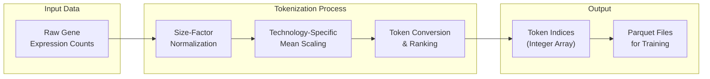
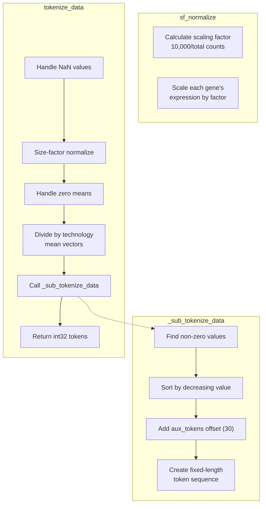
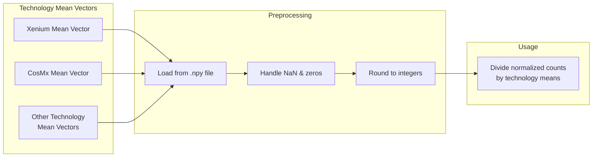
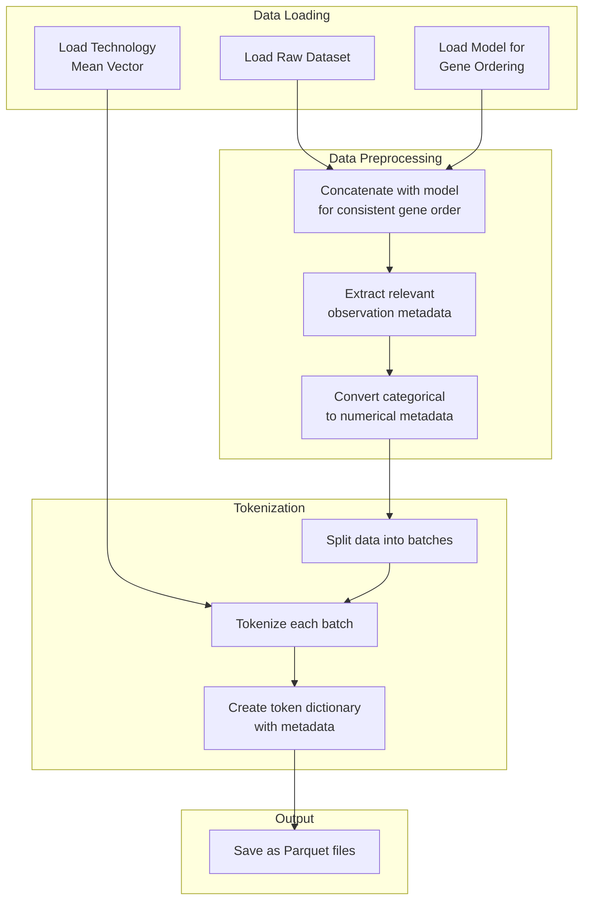
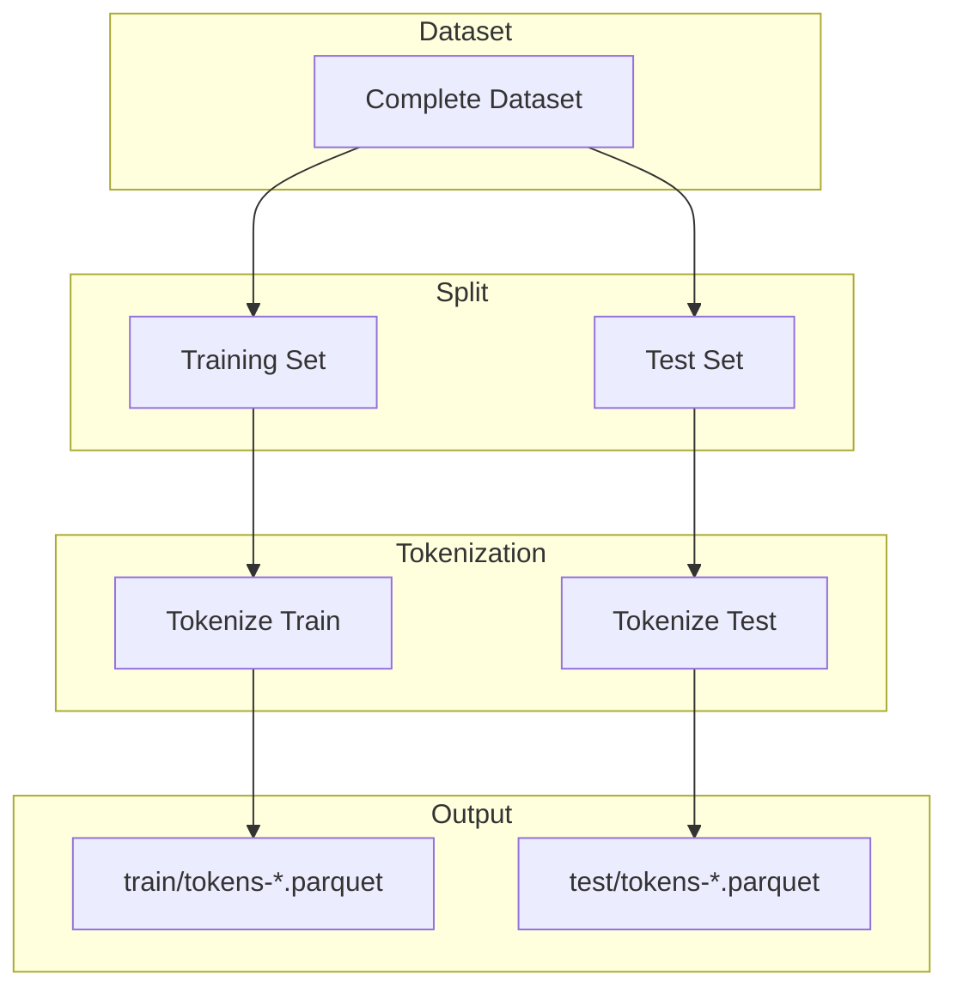

# Tokenization Examples

<details>
<summary>Relevant source files</summary>

The following files were used as context for generating this wiki page:

- [notebooks/tokenization/cosmx_human_liver.ipynb](notebooks/tokenization/cosmx_human_liver.ipynb)
- [notebooks/tokenization/cosmx_human_lung.ipynb](notebooks/tokenization/cosmx_human_lung.ipynb)
- [notebooks/tokenization/scRNAseq_mouse_brain_haviv.ipynb](notebooks/tokenization/scRNAseq_mouse_brain_haviv.ipynb)
- [notebooks/tokenization/xenium_human_colon.ipynb](notebooks/tokenization/xenium_human_colon.ipynb)
- [notebooks/tokenization/xenium_human_lung.ipynb](notebooks/tokenization/xenium_human_lung.ipynb)

</details>


This page provides detailed examples of the data tokenization process in Nicheformer. Tokenization is a critical preprocessing step that converts gene expression data from different technologies into a standardized token representation that can be fed into the Nicheformer model. For general information about the data processing pipeline, see [Data Processing Pipeline](#4).

## Tokenization Overview

Tokenization in Nicheformer converts gene expression values into token indices that can be used by the foundation model. This process involves normalizing expression data, scaling with technology-specific mean vectors, and converting the most highly expressed genes into tokens.



Sources: [notebooks/tokenization/xenium_human_colon.ipynb:120-165](), [notebooks/tokenization/cosmx_human_lung.ipynb:150-205]()

## Tokenization Functions

Nicheformer implements tokenization through a set of specialized functions:

1. **Size-Factor Normalization** - Normalizes cell expression to a standard library size (10,000 counts)
2. **Technology Mean Scaling** - Adjusts for technology-specific bias by dividing by mean expression values
3. **Token Conversion** - Ranks genes by expression and converts to integer tokens with reserved offset



Sources: [notebooks/tokenization/xenium_human_colon.ipynb:120-165](), [notebooks/tokenization/cosmx_human_lung.ipynb:150-205]()

### Key Tokenization Functions

The three main functions that handle tokenization are:

1. `sf_normalize` - Normalizes gene expression counts to a standard library size (10,000)
2. `_sub_tokenize_data` - Performs the actual tokenization by selecting and sorting top expressed genes
3. `tokenize_data` - Main function that orchestrates the entire tokenization process

#### sf_normalize Function

```python
def sf_normalize(X):
    X = X.copy()
    counts = np.array(X.sum(axis=1))
    # avoid zero division error
    counts += counts == 0.
    # normalize to 10000. counts
    scaling_factor = 10000. / counts

    if issparse(X):
        sparsefuncs.inplace_row_scale(X, scaling_factor)
    else:
        np.multiply(X, scaling_factor.reshape((-1, 1)), out=X)

    return X
```

Sources: [notebooks/tokenization/xenium_human_colon.ipynb:121-134](), [notebooks/tokenization/cosmx_human_lung.ipynb:161-174]()

#### _sub_tokenize_data Function

This function, optimized with Numba, converts normalized expression values to token integers:

```python
@numba.jit(nopython=True, nogil=True)
def _sub_tokenize_data(x: np.array, max_seq_len: int = -1, aux_tokens: int = 30):
    scores_final = np.empty((x.shape[0], max_seq_len if max_seq_len > 0 else x.shape[1]))
    for i, cell in enumerate(x):
        nonzero_mask = np.nonzero(cell)[0]    
        sorted_indices = nonzero_mask[np.argsort(-cell[nonzero_mask])][:max_seq_len] 
        sorted_indices = sorted_indices + aux_tokens # reserve some tokens for padding etc
        if max_seq_len:
            scores = np.zeros(max_seq_len, dtype=np.int32)
        else:
            scores = np.zeros_like(cell, dtype=np.int32)
        scores[:len(sorted_indices)] = sorted_indices.astype(np.int32)
        
        scores_final[i, :] = scores
        
    return scores_final
```

Sources: [notebooks/tokenization/xenium_human_colon.ipynb:136-151](), [notebooks/tokenization/cosmx_human_lung.ipynb:176-191]()

#### tokenize_data Function

This is the main function that orchestrates the tokenization process:

```python
def tokenize_data(x: np.array, median_counts_per_gene: np.array, max_seq_len: int = None):
    """Tokenize the input gene vector to a vector of 32-bit integers."""

    x = np.nan_to_num(x) # fill NaN values with 0s
    x = sf_normalize(x)
    median_counts_per_gene += median_counts_per_gene == 0
    out = x / median_counts_per_gene.reshape((1, -1))

    scores_final = _sub_tokenize_data(out, 4096, 30)

    return scores_final.astype('i4')
```

Sources: [notebooks/tokenization/xenium_human_colon.ipynb:154-165](), [notebooks/tokenization/cosmx_human_lung.ipynb:194-205]()

## Technology-Specific Mean Vectors

Each sequencing technology introduces its own biases in gene expression measurement. To account for these biases, Nicheformer uses technology-specific mean vectors that represent the average expression of each gene for a particular technology.



Sources: [notebooks/tokenization/xenium_human_colon.ipynb:190-227](), [notebooks/tokenization/cosmx_human_lung.ipynb:242-267]()

### Mean Vector Preparation

Before being used for tokenization, technology-specific mean vectors are prepared with the following steps:

1. Loading from a pre-computed `.npy` file
2. Handling NaN values by replacing them with zeros
3. Rounding values to integers or handling zero values to avoid division by zero errors

```python
# Example of loading and preparing a technology-specific mean vector
xenium_mean = np.load(f"{BASE_PATH}/xenium_mean_script.npy")
xenium_mean = np.nan_to_num(xenium_mean)
rounded_values = np.where((xenium_mean % 1) >= 0.5, np.ceil(xenium_mean), np.floor(xenium_mean))
xenium_mean = np.where(xenium_mean == 0, 1, rounded_values)
```

Sources: [notebooks/tokenization/xenium_human_colon.ipynb:211-227](), [notebooks/tokenization/cosmx_human_lung.ipynb:242-267]()

## Gene Expression Dictionary Mappings

For efficient storage and processing, Nicheformer uses numerical dictionaries to map categorical metadata to integers:

| Category | Key Examples | Value Range |
|----------|-------------|-------------|
| Modality | 'dissociated', 'spatial' | 3-4 |
| Species | 'human', 'mouse' | 5-6 |
| Technology | 'merfish', 'cosmx', 'Xenium', etc. | 7-18 |
| Author Cell Type | Technology-specific cell types | Varies |
| Niche Labels | Microenvironment classifications | Varies |
| Region Labels | Anatomical regions | Varies |

Sources: [notebooks/tokenization/xenium_human_colon.ipynb:56-83](), [notebooks/tokenization/cosmx_human_lung.ipynb:56-123]()

## Tokenization Example Workflow

This section demonstrates the complete tokenization workflow using different datasets:



Sources: [notebooks/tokenization/xenium_human_colon.ipynb:134-417](), [notebooks/tokenization/cosmx_human_lung.ipynb:321-430]()

### Example: CosMx Human Lung Tokenization

This example demonstrates the tokenization of CosMx human lung data:

1. **Load the data and reference model**:
   ```python
   model = sc.read_h5ad(f"{BASE_PATH}/model.h5ad")
   cosmx = sc.read_h5ad(f"{DATA_PATH}/nanostring_lung_annotated.h5ad")
   cosmx_mean = np.load(f"{BASE_PATH}/cosmx_mean_script.npy")
   ```

2. **Concatenate with model for consistent gene order**:
   ```python
   adata = ad.concat([model, cosmx], join='outer', axis=0)
   cosmx = adata[1:].copy()  # Keep only the CosMx data with model gene ordering
   ```

3. **Extract and convert metadata**:
   ```python
   cosmx.obs = cosmx.obs[['assay', 'organism', 'nicheformer_split', 'batch', 'niche', 'region', 'author_cell_type']]
   cosmx.obs['modality'] = 'spatial'
   cosmx.obs['specie'] = cosmx.obs.organism
   cosmx.obs.replace({'specie': specie_dict}, inplace=True)
   cosmx.obs.replace({'modality': modality_dict}, inplace=True)
   cosmx.obs.replace({'assay': technology_dict}, inplace=True)
   ```

4. **Tokenize data**:
   ```python
   for batch in range(N_BATCHES):
       obs_tokens = obs_cosmx_split.iloc[batch*chunk_len:chunk_len*(batch+1)].copy()
       cosmx_tokenized = tokenize_data(cosmx_split.X[batch*chunk_len:chunk_len*(batch+1)], cosmx_mean, 4096)
       
       # Create token dictionary with metadata
       obs_tokens['X'] = [cosmx_tokenized[i, :] for i in range(cosmx_tokenized.shape[0])]
       
       # Add niche composition information
       for i in np.arange(5):
           niche = cosmx_split.obsm[f"X_niche_{i}"].toarray()[batch*chunk_len:chunk_len*(batch+1)]
           obs_tokens[f"X_niche_{i}"] = [niche[i, :] for i in range(niche.shape[0])]
       
       # Save as parquet file
       total_table = pyarrow.Table.from_pandas(obs_tokens)
       pq.write_table(total_table, f'{join(OUT_PATH, SPLIT)}/tokens-{batch}.parquet',
                      row_group_size=1024)
   ```

Sources: [notebooks/tokenization/cosmx_human_lung.ipynb:321-472]()

## Parquet Output Format

The tokenization process produces Parquet files with the following structure:

| Column | Description | Type |
|--------|-------------|------|
| assay | Technology code (e.g., 8 for CosMx) | Integer |
| specie | Species code (e.g., 5 for human) | Integer |
| modality | Modality code (e.g., 4 for spatial) | Integer |
| idx | Original cell index | Integer |
| author_cell_type | Cell type code | Integer |
| niche | Niche label code | Integer |
| region | Region label code | Integer |
| X | Array of gene token indices | Integer array |
| X_niche_0 to X_niche_4 | Niche composition vectors | Float array |

Example record from tokenized CosMx data:
```
{
  "assay": 8,
  "specie": 5,
  "modality": 4,
  "idx": 593988,
  "author_cell_type": 2,
  "niche": 8,
  "region": 0,
  "X": [252, 18331, 2140, 2853, 8959, ...],
  "X_niche_0": [0.0, 0.0, 0.0, ...],
  "X_niche_1": [0.0, 0.0, 3.0, ...],
  ...
}
```

Sources: [notebooks/tokenization/cosmx_human_lung.ipynb:487-588]()

## Handling Different Dataset Types

Nicheformer supports tokenization for various dataset types, each with specific preprocessing requirements:

### Spatial Datasets (CosMx, Xenium)

- Spatial coordinates are maintained in the `spatial` obsm field
- Spatial neighbors can be computed for niche composition
- Technology-specific tokens account for unique gene panels

### Single-cell RNA-seq Datasets

- Dissociated data doesn't have spatial information
- Usually has more genes detected per cell
- Uses technology-specific mean vectors like 10x Chromium

Sources: [notebooks/tokenization/xenium_human_colon.ipynb:56-83](), [notebooks/tokenization/scRNAseq_mouse_brain_haviv.ipynb:57-149]()

## Train/Test Splits

For model training and evaluation, data is typically split into training and test sets:



Sources: [notebooks/tokenization/cosmx_human_lung.ipynb:365-472](), [notebooks/tokenization/cosmx_human_lung.ipynb:726-833]()

The splitting process:

1. Filter the dataset by the `nicheformer_split` field
2. Process each split separately using the same tokenization pipeline
3. Save each split to its dedicated directory (e.g., "train", "test")

This produces tokenized data that can be used directly for model training and evaluation.

---