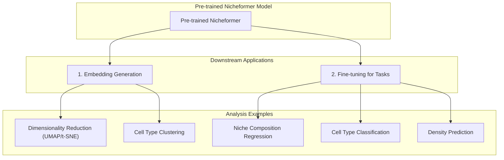
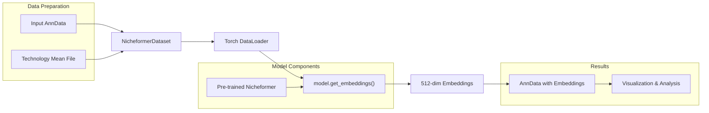
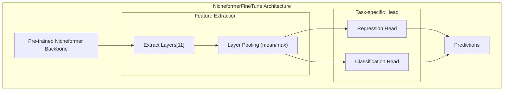
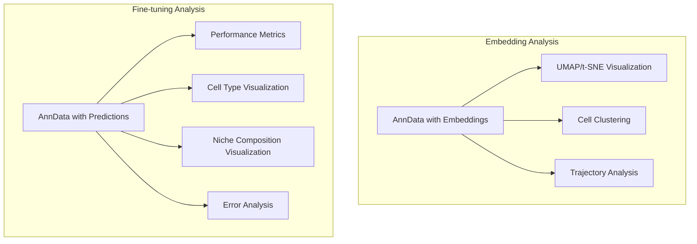

# Downstream Analysis Examples

<details>
<summary>Relevant source files</summary>

The following files were used as context for generating this wiki page:

- [notebooks/experiments/downstream_fine_tune.ipynb](notebooks/experiments/downstream_fine_tune.ipynb)
- [notebooks/experiments/get_embeddings.ipynb](notebooks/experiments/get_embeddings.ipynb)

</details>


## Purpose and Scope

This page provides detailed examples of how to perform downstream analysis using the Nicheformer foundation model after pre-training. It covers two main types of downstream applications: (1) extracting embeddings from pre-trained models for further analysis and (2) fine-tuning the model for specific tasks such as niche composition regression, cell type classification, or density prediction. For information about the pre-training process, see [Training Pipeline](#5.1), and for data preparation, see [Data Preprocessing](#4.1) and [Tokenization Examples](#7.2).

## Overview of Downstream Applications

Nicheformer is designed to be a versatile foundation model for single-cell and spatial omics data. After pre-training, the model can be used in different ways depending on your research goals:



Sources: [notebooks/experiments/get_embeddings.ipynb:6-10](), [notebooks/experiments/downstream_fine_tune.ipynb:6-10]()

## 1. Generating Embeddings for Downstream Analysis

Embedding generation extracts fixed-dimensional vector representations from the pre-trained Nicheformer model. These embeddings capture the biological features of cells and can be used for various downstream analyses such as clustering, visualization, or as input to other machine learning models.

### Embedding Generation Workflow



Sources: [notebooks/experiments/get_embeddings.ipynb:27-38](), [notebooks/experiments/get_embeddings.ipynb:85-103](), [notebooks/experiments/get_embeddings.ipynb:283-303]()

### Configuration Parameters for Embedding Generation

The following table summarizes the key configuration parameters for embedding generation:

| Parameter | Description | Example Value |
|-----------|-------------|---------------|
| `data_path` | Path to input AnnData file | `/path/to/data.h5ad` |
| `technology_mean_path` | Path to technology-specific mean vector | `/path/to/technology_mean.npy` |
| `checkpoint_path` | Path to pre-trained model checkpoint | `/path/to/checkpoint.ckpt` |
| `output_path` | Where to save embeddings | `data_with_embeddings.h5ad` |
| `batch_size` | Batch size for data loading | `32` |
| `max_seq_len` | Maximum sequence length | `1500` |
| `aux_tokens` | Number of auxiliary tokens | `30` |
| `embedding_layer` | Which layer to extract embeddings from (-1 for last) | `-1` |
| `embedding_name` | Name suffix for embedding in obsm | `embeddings` |

Sources: [notebooks/experiments/get_embeddings.ipynb:54-69]()

### Example: Extracting Embeddings

Here's a step-by-step example of how to extract embeddings from a pre-trained Nicheformer model:

1. **Load the pre-trained model**:
   ```python
   model = Nicheformer.load_from_checkpoint(checkpoint_path=config['checkpoint_path'], strict=False)
   model.eval()  # Set to evaluation mode
   ```

2. **Set up the data**:
   ```python
   # Load AnnData and technology mean
   adata = ad.read_h5ad(config['data_path'])
   technology_mean = np.load(config['technology_mean_path'])
   
   # Set necessary metadata fields for tokenization
   adata.obs['modality'] = 4  # spatial
   adata.obs['specie'] = 5    # human
   adata.obs['assay'] = 8     # cosmx
   ```

3. **Create dataset and dataloader**:
   ```python
   dataset = NicheformerDataset(
       adata=adata,
       technology_mean=technology_mean,
       split='train',
       max_seq_len=1500,
       aux_tokens=30,
       chunk_size=1000,
       metadata_fields={'obs': ['modality', 'specie', 'assay']}
   )
   
   dataloader = DataLoader(
       dataset,
       batch_size=32,
       shuffle=False,
       num_workers=4,
       pin_memory=True
   )
   ```

4. **Extract the embeddings**:
   ```python
   embeddings = []
   with torch.no_grad():
       for batch in dataloader:
           # Move batch to device
           batch = {k: v.to(device) if isinstance(v, torch.Tensor) else v
                  for k, v in batch.items()}
           
           # Get embeddings
           emb = model.get_embeddings(
               batch=batch,
               layer=-1  # Use last layer
           )
           embeddings.append(emb.cpu().numpy())
   
   # Concatenate all embeddings
   embeddings = np.concatenate(embeddings, axis=0)
   ```

5. **Store embeddings in the AnnData object**:
   ```python
   embedding_key = f"X_niche_{config.get('embedding_name', 'embeddings')}"
   adata.obsm[embedding_key] = embeddings
   adata.write_h5ad(config['output_path'])
   ```

Sources: [notebooks/experiments/get_embeddings.ipynb:244-254](), [notebooks/experiments/get_embeddings.ipynb:284-303](), [notebooks/experiments/get_embeddings.ipynb:319-326]()

## 2. Fine-tuning for Specific Tasks

Fine-tuning adapts the pre-trained Nicheformer model for specific downstream tasks by adding task-specific heads to the model architecture and training on labeled data.

### Fine-tuning Architecture



Sources: [notebooks/experiments/downstream_fine_tune.ipynb:200-222]()

### Supported Downstream Tasks

Nicheformer supports fine-tuning for several downstream tasks:

| Task | Description | Configuration |
|------|-------------|--------------|
| Niche Regression | Predict cellular neighborhood composition | `supervised_task='niche_regression'` |
| Cell Type Classification | Classify cells into predefined cell types | `supervised_task='classification'` |
| Density Prediction | Predict cell density in spatial data | `supervised_task='regression', predict_density=True` |

Sources: [notebooks/experiments/downstream_fine_tune.ipynb:76-89]()

### Configuration Parameters for Fine-tuning

The following table summarizes the key configuration parameters for fine-tuning:

| Category | Parameter | Description | Example Value |
|----------|-----------|-------------|---------------|
| **Data** | `data_path` | Path to input AnnData file | `/path/to/data.h5ad` |
| | `technology_mean_path` | Path to technology mean file | `/path/to/mean.npy` |
| | `label` | Target variable to predict | `X_niche_1` |
| **Model** | `checkpoint_path` | Path to pre-trained model | `/path/to/checkpoint.ckpt` |
| | `supervised_task` | Type of task | `niche_regression` |
| | `extract_layers` | Which layers to use | `[11]` |
| | `function_layers` | Architecture of head | `mean` |
| | `dim_prediction` | Output dimension | `33` |
| | `freeze` | Whether to freeze backbone | `True` |
| **Training** | `batch_size` | Batch size | `32` |
| | `max_epochs` | Maximum training epochs | `100` |
| | `lr` | Learning rate | `1e-4` |
| | `warmup` | Warmup epochs | `10` |

Sources: [notebooks/experiments/downstream_fine_tune.ipynb:55-90]()

### Example: Fine-tuning for Niche Regression

Here's a step-by-step example of how to fine-tune a pre-trained Nicheformer model for niche composition regression:

1. **Load data and create datasets**:
   ```python
   # Load AnnData and technology mean
   adata = ad.read_h5ad(config['data_path'])
   technology_mean = np.load(config['technology_mean_path'])
   
   # Create train/val/test datasets
   train_dataset = NicheformerDataset(
       adata=adata,
       technology_mean=technology_mean,
       split='train',
       max_seq_len=1500,
       aux_tokens=30,
       metadata_fields={'obs': ['author_cell_type']}
   )
   # Similar setup for val_dataset and test_dataset
   ```

2. **Create dataloaders**:
   ```python
   train_loader = DataLoader(
       train_dataset,
       batch_size=config['batch_size'],
       shuffle=True,
       num_workers=4,
       pin_memory=True
   )
   # Similar setup for val_loader and test_loader
   ```

3. **Load pre-trained model and create fine-tuning model**:
   ```python
   # Load pre-trained model
   model = Nicheformer.load_from_checkpoint(checkpoint_path=config['checkpoint_path'], strict=False)
   
   # Create fine-tuning model
   fine_tune_model = NicheformerFineTune(
       backbone=model,
       supervised_task='niche_regression',
       extract_layers=[11],  # Use last transformer layer
       function_layers='mean',
       lr=1e-4,
       warmup=10,
       max_epochs=100,
       dim_prediction=33,  # Number of cell types in niche
       freeze=True,        # Freeze backbone
       regress_distribution=True,
       label='X_niche_1'   # Target feature
   )
   ```

4. **Train and evaluate the model**:
   ```python
   # Configure trainer
   trainer = pl.Trainer(
       max_epochs=config['max_epochs'],
       accelerator='gpu' if torch.cuda.is_available() else 'cpu',
       devices=1,
       gradient_clip_val=1.0,
       accumulate_grad_batches=10
   )
   
   # Train
   trainer.fit(
       model=fine_tune_model,
       train_dataloaders=train_loader,
       val_dataloaders=val_loader
   )
   
   # Test
   test_results = trainer.test(
       model=fine_tune_model,
       dataloaders=test_loader
   )
   
   # Get predictions
   predictions = trainer.predict(fine_tune_model, dataloaders=test_loader)
   ```

5. **Save results**:
   ```python
   # Store predictions in AnnData
   prediction_key = f"predictions_{config.get('label', 'X_niche_1')}"
   test_mask = adata.obs.nicheformer_split == 'test'
   
   # For regression tasks
   adata.obs.loc[test_mask, prediction_key] = predictions
   
   # Save updated AnnData
   adata.write_h5ad(config['output_path'])
   ```

Sources: [notebooks/experiments/downstream_fine_tune.ipynb:110-177](), [notebooks/experiments/downstream_fine_tune.ipynb:197-222](), [notebooks/experiments/downstream_fine_tune.ipynb:253-275](), [notebooks/experiments/downstream_fine_tune.ipynb:294-313]()

## 3. Analyzing Results from Downstream Tasks

After generating embeddings or fine-tuning the model, you can perform various analyses on the results:



Sources: [notebooks/experiments/downstream_fine_tune.ipynb:294-313](), [notebooks/experiments/get_embeddings.ipynb:319-326]()

### Example Analysis Workflow

1. **Embedding analysis with Scanpy**:
   ```python
   import scanpy as sc
   
   # Load AnnData with embeddings
   adata = ad.read_h5ad('data_with_embeddings.h5ad')
   
   # Extract embeddings from obsm
   embeddings = adata.obsm['X_niche_embeddings']
   
   # Create a copy of AnnData with embeddings as X for Scanpy analysis
   adata_emb = ad.AnnData(X=embeddings)
   adata_emb.obs = adata.obs.copy()
   
   # Run UMAP
   sc.pp.neighbors(adata_emb)
   sc.tl.umap(adata_emb)
   
   # Run clustering
   sc.tl.leiden(adata_emb)
   
   # Visualization
   sc.pl.umap(adata_emb, color=['leiden', 'author_cell_type'])
   ```

2. **Fine-tuning prediction analysis**:
   ```python
   import matplotlib.pyplot as plt
   import numpy as np
   import pandas as pd
   
   # Load AnnData with predictions
   adata = ad.read_h5ad('data_with_predictions.h5ad')
   
   # Extract ground truth and predictions
   true_values = adata.obsm['X_niche_1'][adata.obs.nicheformer_split == 'test']
   predictions = adata.obs['predictions_X_niche_1'][adata.obs.nicheformer_split == 'test']
   
   # Calculate metrics
   from sklearn.metrics import r2_score, mean_squared_error
   r2 = r2_score(true_values, predictions)
   rmse = np.sqrt(mean_squared_error(true_values, predictions))
   
   # Visualization
   plt.figure(figsize=(12, 8))
   plt.scatter(true_values, predictions, alpha=0.5)
   plt.plot([0, 1], [0, 1], 'r--')
   plt.xlabel('True Values')
   plt.ylabel('Predictions')
   plt.title(f'Niche Regression Results (R² = {r2:.3f}, RMSE = {rmse:.3f})')
   ```

## Summary

Downstream analysis with Nicheformer provides powerful tools for exploring and understanding single-cell and spatial omics data. The two main approaches—embedding generation and fine-tuning—offer flexibility for different research questions:

1. **Embedding generation** creates fixed-dimensional vector representations of cells that can be used for unsupervised analysis, visualization, and exploration.

2. **Fine-tuning** adapts the pre-trained model for specific supervised tasks such as predicting niche composition, classifying cell types, or estimating cell density.

By following the examples in this guide, you can apply Nicheformer to your own datasets and research questions, leveraging the power of foundation models for single-cell and spatial omics analysis.