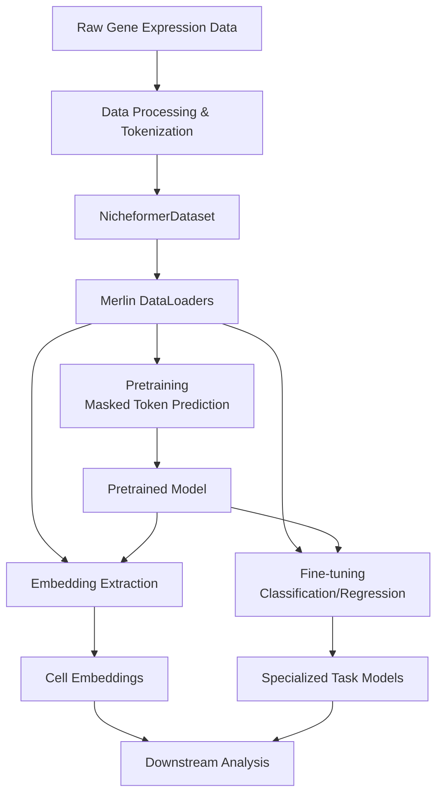

Nicheformer is a foundation model designed for single-cell and spatial omics analysis, leveraging transformer architecture to learn comprehensive representations from gene expression data across multiple technologies and tissues. The project provides pretrained models, training pipelines, and tools for downstream analysis tasks including classification, regression, and embedding extraction. By training on large-scale multi-technology datasets like the SpatialCorpus-110M, Nicheformer learns transferable representations that capture fundamental biological patterns in cellular microenvironments across diverse experimental conditions.

Sources: [README.md](README.md#L1-L65), [pyproject.toml](pyproject.toml#L1-L45)

## Architecture and Design

Nicheformer implements a transformer-based architecture optimized for gene expression data analysis, following the masked language modeling paradigm similar to BERT but adapted for spatial transcriptomics. The core model architecture consists of 12 transformer layers with 16 attention heads, a 512-dimensional model representation, and 1024-dimensional feedforward layers. The model processes tokenized gene expression sequences with a context length of 1500 tokens, incorporating auxiliary tokens to encode metadata such as species, assay type, and tissue modality, enabling it to learn technology-agnostic representations.

The data processing pipeline transforms raw gene expression matrices into tokenized sequences using technology-specific mean vectors. Spatial data incorporates neighborhood information through niche composition features (X_niche_0 through X_niche_4), representing the top 5 most frequent cell types in each cell's microenvironment. This design allows the model to learn both intrinsic gene expression patterns and spatial context simultaneously. The system supports both dissociated single-cell data and spatial transcriptomics technologies including CosMX, MERFISH, Xenium, and ISS.

Sources: [src/nicheformer/models/_nicheformer.py](src/nicheformer/models/_nicheformer.py#L1-L100), [src/nicheformer/data/datamodules.py](src/nicheformer/data/datamodules.py#L14-L54), [src/nicheformer/config_files/_config_train.py](src/nicheformer/config_files/_config_train.py#L1-L26)

## Core Components

The Nicheformer framework is organized into four main functional areas: data processing and tokenization, model training and pretraining, fine-tuning for downstream tasks, and embedding extraction for analysis. The data module provides utilities for filtering, normalization, and tokenization of gene expression data, with specialized support for niche composition analysis in spatial datasets. The training module implements distributed training using PyTorch Lightning, supporting multi-GPU setups and experiment tracking through Weights & Biases.



The model architecture includes a standard Transformer encoder with learnable positional embeddings, supporting configuration for auxiliary tokens including specie, assay, and modality embeddings. During pretraining, the model uses masked token prediction with a 15% masking probability, following a distribution where 80% of masked tokens are replaced with a mask token, 10% with random tokens, and 10% kept unchanged. This strategy enables the model to learn robust representations while preventing trivial solutions.

Sources: [src/nicheformer/models/_nicheformer.py](src/nicheformer/models/_nicheformer.py#L62-L100), [src/nicheformer/models/_utils.py](src/nicheformer/models/_utils.py#L9-L63), [src/nicheformer/_train.py](src/nicheformer/_train.py#L8-L81)

## Project Structure

The repository follows a modular structure separating core functionality from configuration and experiments. The source code is organized in the `src/nicheformer/` directory, with main entry points for training (`train.py`), fine-tuning (`fine_tune.py`), and embedding extraction (`get_embeddings.py`). Configuration files are centralized in `config_files/`, providing easy customization for different workflows. The `data/` directory contains pretrained model weights and loading scripts for the SpatialCorpus-110M dataset.

```
nicheformer/
├── src/nicheformer/          # Core source code
│   ├── models/               # Model architectures
│   │   ├── _nicheformer.py  # Main transformer model
│   │   ├── _fine_tune_model.py
│   │   └── _utils.py        # Utility functions
│   ├── data/                 # Data processing modules
│   │   ├── dataset.py       # Dataset implementation
│   │   ├── datamodules.py   # Merlin data loaders
│   │   └── tools/           # Data processing utilities
│   ├── experiments/         # Experiment scripts
│   └── config_files/        # Configuration modules
├── data/                     # Data and model weights
│   ├── model_means/         # Technology mean vectors
│   └── spatialcorpus-110M/  # Dataset loading scripts
├── notebooks/                # Example notebooks
│   ├── experiments/          # Training and fine-tuning
│   └── tokenization/         # Data tokenization examples
└── docs/                     # Documentation
```

Configuration-driven design allows researchers to easily adapt the system to their specific use cases. Key configuration parameters include model architecture dimensions (dim_model, nheads, nlayers), training hyperparameters (learning rate, warmup steps, batch size), and data specifications (context_length, n_tokens, masking_p). The system supports multiple downstream tasks including classification tasks (e.g., cell type annotation), regression tasks (e.g., density prediction), and embedding extraction for unsupervised analysis.

Sources: [src/nicheformer/__init__.py](src/nicheformer/__init__.py#L1-L8), [data/README.md](data/README.md#L1-L5), [notebooks/README.md](notebooks/README.md#L1-L5)

## Supported Technologies and Applications

Nicheformer supports a wide range of single-cell and spatial transcriptomics technologies, making it applicable to diverse research scenarios. For spatial technologies, the system includes tokenization notebooks for CosMX (human liver and lung), MERFISH (mouse brain), and Xenium (human colon and lung). For dissociated single-cell data, it supports standard scRNA-seq datasets and in situ sequencing (ISS) technologies. This broad compatibility enables cross-technology transfer learning and generalization across tissue types and experimental platforms.

> [!TIP]
> The model's strength lies in its ability to learn unified representations from heterogeneous data sources, making it particularly valuable for cross-technology analysis and transfer learning scenarios where limited training data is available for specific platforms or tissues.

Pretrained model weights are available for download from Mendeley Data, providing researchers with models trained on the complete SpatialCorpus-110M dataset containing 110 million cells across multiple technologies and tissues. These pretrained weights can be used for direct embedding extraction or as initialization points for fine-tuning on specific downstream tasks. The fine-tuning pipeline supports flexible layer extraction strategies, allowing researchers to choose which layers to use for specific applications or reinitialize layers for better adaptation to new tasks.

Sources: [README.md](README.md#L38-L44), [data/spatialcorpus-110M/README.md](data/spatialcorpus-110M/README.md#L1-L9), [notebooks/experiments/get_embeddings.ipynb](notebooks/experiments/get_embeddings.ipynb#L1-L80)

## Key Features and Capabilities

Nicheformer provides several advanced features that distinguish it from other single-cell analysis frameworks. Distributed training support enables efficient training on large datasets across multiple GPUs, leveraging PyTorch Lightning for simplified multi-device orchestration. The data loading pipeline uses Merlin dataloaders optimized for large-scale Parquet datasets, supporting efficient data streaming and memory management for datasets with millions of cells. Experiment tracking integration with Weights & Biases facilitates reproducible research and systematic hyperparameter optimization.

The tokenization strategy preserves biological information while enabling efficient model training. Gene expression values are normalized and tokenized using technology-specific mean vectors, accounting for systematic differences between platforms. For spatial data, the system incorporates niche composition features by counting the top 5 most frequent cell types in each cell's neighborhood, providing the model with explicit spatial context information. This design enables the model to learn representations that capture both gene expression patterns and spatial relationships simultaneously.

Configuration flexibility allows researchers to adapt the system to their specific needs. The three main workflows—training, fine-tuning, and embedding extraction—are each configured through dedicated configuration modules. Key configuration options include architectural dimensions, training hyperparameters, data specifications, and task-specific settings. This modular design supports rapid experimentation and facilitates systematic comparison of different modeling approaches.

Sources: [src/nicheformer/data/datamodules.py](src/nicheformer/data/datamodules.py#L56-L91), [src/nicheformer/config_files/_config_train.py](src/nicheformer/config_files/_config_train.py#L1-L26), [src/nicheformer/fine_tune.py](src/nicheformer/fine_tune.py#L1-L17)

## Getting Started

To begin using Nicheformer, you'll need to install the package in a Python 3.9+ environment. The recommended approach is to create a dedicated conda environment and install from source using the development version. After installation, you can access pretrained model weights and technology mean vectors from Mendeley Data, placing them in the `data/` subdirectory. The project provides example notebooks demonstrating common workflows including data tokenization for various technologies, embedding extraction from pretrained models, and fine-tuning for downstream classification or regression tasks.

The three primary use cases for Nicheformer correspond to the three main entry points: `train.py` for pretraining new models from scratch, `fine_tune.py` for adapting pretrained models to specific downstream tasks, and `get_embeddings.py` for extracting cell-level representations from existing models. Each workflow has its own configuration file in `config_files/`, allowing you to customize parameters without modifying source code. The notebooks directory provides concrete examples for each of these workflows, with technology-specific tokenization examples for the supported platforms.

For beginners, we recommend starting with the embedding extraction workflow to become familiar with the data format and model outputs before attempting training or fine-tuning. The [Quick Start](2-quick-start) guide provides step-by-step instructions for this workflow, while subsequent sections cover installation, data downloading, and advanced usage patterns. As you become more comfortable with the system, you can explore fine-tuning for specific research questions or even train custom models on your own datasets.
