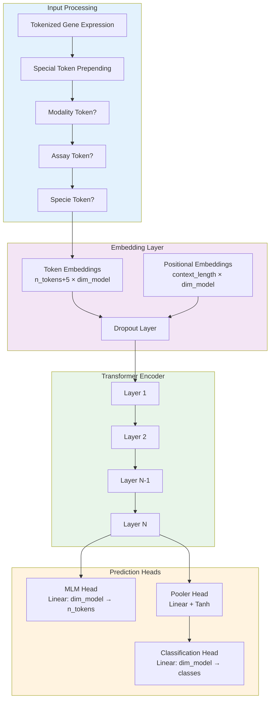

The Nicheformer architecture is a sophisticated transformer-based model designed specifically for spatial transcriptomics and single-cell gene expression analysis. Built on PyTorch Lightning, it leverages masked language modeling (MLM) pretraining to learn rich representations of cellular niches and gene expression patterns. This document examines the architectural components, design decisions, and implementation details that enable Nicheformer to effectively process spatial omics data.

## Architecture Overview

Nicheformer implements a encoder-only transformer architecture adapted for gene expression token sequences. The model processes tokenized gene expression data through multiple layers of self-attention, enabling it to capture complex spatial dependencies between genes and cells. The architecture comprises five core components: token embeddings, positional encodings, a multi-layer transformer encoder, task-specific prediction heads, and a flexible fine-tuning framework.

Sources: [_nicheformer.py](src/nicheformer/models/_nicheformer.py#L15-L83), [_config_train.py](src/nicheformer/config_files/_config_train.py#L1-L26)

## Core Transformer Components

### Token Embedding Layer

The token embedding layer converts discrete gene expression tokens into continuous vector representations. Nicheformer uses a learned embedding matrix with `n_tokens + 5` rows to accommodate regular gene tokens plus five special tokens (mask, padding, CLS, and two auxiliary tokens). The embedding dimension is configurable, with a default of 512. Each token index is mapped to a dense vector of size `dim_model`, providing the model with a rich representational space for gene expression patterns.

The embedding layer includes a padding index parameter that prevents the embedding of padding tokens from being updated during training, improving efficiency and preventing unnecessary parameter modifications.

Sources: [_nicheformer.py](src/nicheformer/models/_nicheformer.py#L101-L108), [_nicheformer.py](src/nicheformer/models/_nicheformer.py#L17-L24)

### Positional Encoding Strategy

Nicheformer supports two positional encoding approaches: learnable positional embeddings (default) and sinusoidal positional encodings.

**Learnable Positional Embeddings**: This approach initializes learnable positional embeddings as model parameters, allowing the network to adapt position information to the specific structure of gene expression sequences. Each position in the context window (up to `context_length` tokens) receives a unique embedding vector that is added to the token embeddings. The combined embeddings then pass through a dropout layer for regularization.

**Sinusoidal Positional Encodings**: When learnable positional embeddings are disabled, Nicheformer uses the classic sinusoidal positional encoding scheme from the original Transformer paper. This approach computes position encodings using sine and cosine functions of different frequencies, providing fixed positional information that doesn't require additional parameters. The encoding is computed once and registered as a buffer, then added to token embeddings during the forward pass.

The choice between approaches depends on the specific use case—learnable embeddings offer flexibility and potentially better performance on domain-specific patterns, while sinusoidal encodings provide a parameter-efficient solution with proven theoretical properties.

Sources: [_nicheformer.py](src/nicheformer/models/_nicheformer.py#L110-L122), [_nicheformer.py](src/nicheformer/models/_nicheformer.py#L309-L326), [_nicheformer.py](src/nicheformer/models/_nicheformer.py#L215-L220)

> [!TIP]
> The positional encoding choice significantly impacts model behavior—learnable embeddings adapt to your data distribution, while sinusoidal encodings provide inductive biases from the original Transformer architecture. For spatial transcriptomics data with unique positional patterns, learnable embeddings are recommended.

### Transformer Encoder Architecture

The core of Nicheformer consists of a stack of transformer encoder layers, built using PyTorch's `nn.TransformerEncoder` and `nn.TransformerEncoderLayer`. Each encoder layer implements multi-head self-attention followed by position-wise feed-forward networks, with layer normalization and residual connections applied after each sub-layer.

**Multi-Head Self-Attention**: The attention mechanism allows the model to weigh the importance of different positions when computing representations for each token. With `nheads` attention heads (default 16), each head independently learns different attention patterns, enabling the model to capture multiple types of dependencies simultaneously. The attention mechanism is bidirectional (not causal), allowing each token to attend to all other tokens in the sequence—essential for capturing spatial relationships in cell niches.

**Feed-Forward Networks**: Each encoder layer contains a position-wise feed-forward network with two linear transformations and a ReLU activation. The intermediate dimension (`dim_feedforward`, default 1024) is typically larger than the model dimension, providing additional capacity for feature transformation.

**Layer Configuration**: The model uses `nlayers` transformer encoder layers (default 12), with dropout applied within each layer for regularization. Layer normalization uses a small epsilon value (1e-12) for numerical stability.

Sources: [_nicheformer.py](src/nicheformer/models/_nicheformer.py#L84-L99), [_nicheformer.py](src/nicheformer/models/_nicheformer.py#L143-L147)

### Special Token Handling

Nicheformer incorporates several special tokens to handle different aspects of the data:

- **MASK_TOKEN (0)**: Used during masked language modeling pretraining, indicates tokens to be predicted
- **Padding Token (1)**: Marks padded positions in variable-length sequences, excluded from attention computations
- **CLS_TOKEN (2)**: Special classification token prepended to sequences for downstream classification tasks
- **Modality/Assay/Specie Tokens**: Optional special tokens that can be prepended to provide contextual information about data provenance

During batch processing, the model prepends optional special tokens (modality, assay, specie) to the input sequences when the corresponding flags are enabled. This allows the model to incorporate metadata about experimental conditions directly into the token stream.

The masking strategy excludes padding and CLS tokens from being masked during training, ensuring that these special tokens remain intact throughout the pretraining process.

Sources: [_nicheformer.py](src/nicheformer/models/_nicheformer.py#L12-L13), [_nicheformer.py](src/nicheformer/models/_nicheformer.py#L229-L251), [_utils.py](src/nicheformer/models/_utils.py#L8-L25)

## Prediction Heads and Task Components

Nicheformer includes three specialized prediction heads that serve different purposes in the model's functionality.

### MLM Head (Masked Language Modeling)

The MLM head predicts the original token IDs for masked positions during pretraining. It consists of a single linear layer that maps the transformer output dimension (`dim_model`) to the vocabulary size (`n_tokens`), followed by learned bias parameters. This head is used during the pretraining phase to compute cross-entropy loss between predicted and actual token values at masked positions.

The loss computation only considers masked tokens, with padding positions assigned a target value of -100 to exclude them from loss calculation via PyTorch's cross-entropy loss implementation.

Sources: [_nicheformer.py](src/nicheformer/models/_nicheformer.py#L124-L127), [_nicheformer.py](src/nicheformer/models/_nicheformer.py#L194-L213)

### Pooler Head

The pooler head processes the transformer output to produce a single representation vector for classification tasks. It applies a linear transformation followed by a hyperbolic tangent (tanh) activation function. In the base Nicheformer model, the pooler operates on the mean of all token representations (or can be modified to operate on CLS token embeddings). The output dimension matches the model dimension (`dim_model`), providing a fixed-size representation suitable for downstream classification.

Sources: [_nicheformer.py](src/nicheformer/models/_nicheformer.py#L129-L130)

### Classification Head

The classification head performs final predictions for supervised tasks. It consists of a linear layer mapping from the pooler output dimension to the number of classes (default 164 for cell type classification). This head is only used when supervised training is enabled, allowing the model to perform tasks such as cell type annotation alongside or instead of MLM pretraining.

Sources: [_nicheformer.py](src/nicheformer/models/_nicheformer.py#L131)

## Masked Language Modeling Strategy

Nicheformer employs a sophisticated masking strategy adapted from BERT's approach, specifically designed for gene expression token sequences.

### Masking Procedure

The masking process follows these steps:

1. **Token Conversion**: Original padding tokens (value 0) are converted to padding index 1 to align with standard transformer conventions
2. **Mask Generation**: A binary mask is generated using Bernoulli sampling with probability `masking_p` (default 0.15)
3. **Special Token Protection**: Padding and CLS tokens are excluded from masking, ensuring critical structural tokens remain intact
4. **Mask Token Assignment**: 80% of masked positions are replaced with MASK_TOKEN (0)
5. **Random Token Replacement**: 10% of masked positions receive random gene tokens
6. **Original Token Preservation**: 10% of masked positions retain their original token values

This strategy introduces noise into the input while providing the model with varied learning signals—the model learns to predict masked tokens, distinguish random tokens from correct ones, and recognize unchanged tokens.

Sources: [_utils.py](src/nicheformer/models/_utils.py#L6-L47)

### Loss Computation

The loss is computed using cross-entropy between predictions and target values at masked positions only. The target tensor contains -100 for non-masked positions, which PyTorch's cross-entropy loss function automatically ignores. When masking probability is 0.0 (such as during fine-tuning or embedding extraction), the loss function returns a zero tensor to prevent unnecessary computation.

Sources: [_nicheformer.py](src/nicheformer/models/_nicheformer.py#L206-L213)

## Fine-Tuning Architecture

The fine-tuning architecture extends the pre-trained Nicheformer backbone with task-specific components, enabling adaptation to various downstream tasks including classification, regression, and density prediction.

### Backbone Integration

The fine-tuning model wraps a pre-trained Nicheformer backbone, optionally freezing its parameters to preserve learned representations. The backbone's masking probability is set to 0.0, disabling MLM loss during fine-tuning. Layer reinitialization can be performed on specified layers, allowing the model to adapt higher-level representations to new tasks while preserving lower-level features.

Sources: [_nicheformer_fine_tune.py](src/nicheformer/models/_nicheformer_fine_tune.py#L67-L77)

### Layer Extraction and Combination

A key feature of the fine-tuning architecture is the ability to extract and combine representations from multiple transformer layers. The model supports:

- **Extract Layers**: Specify which transformer layer outputs to collect (e.g., last layer, penultimate layer, or multiple layers)
- **Combination Functions**: Choose how to combine extracted layer outputs:
  - `mean`: Average representations across selected layers
  - `sum`: Add representations across selected layers
  - `concat`: Concatenate representations across selected layers (increases dimensionality)

This flexibility allows experimentation with different layer aggregation strategies, enabling the model to leverage both low-level and high-level features depending on the task requirements.

Sources: [_nicheformer_fine_tune.py](src/nicheformer/models/_nicheformer_fine_tune.py#L133-L151)

### Task-Specific Heads

The fine-tuning model includes specialized prediction heads for different task types:

**Classification Head**: Linear layer mapping to class logits, used with cross-entropy loss for multi-class prediction tasks.

**Regression Head**: Linear layer mapping to continuous predictions, used with mean squared error loss for tasks such as niche composition prediction. Can optionally include softmax activation for predicting probability distributions.

**Density Head**: Maps representations to a single scalar value for cell density prediction tasks.

All heads support an optional MLP extractor (pooler head with tanh activation) that provides additional non-linear transformation before the final prediction layer.

Sources: [_nicheformer_fine_tune.py](src/nicheformer/models/_nicheformer_fine_tune.py#L93-L119)

### Context Token Handling

The fine-tuning model provides flexibility in whether to include special context tokens (modality, assay, specie) in the final representation. The `without_context` parameter controls whether to exclude the first three tokens (special tokens) when computing the mean representation used for predictions. This allows the model to focus purely on gene expression patterns when context information is not relevant to the downstream task.

Sources: [_nicheformer_fine_tune.py](src/nicheformer/models/_nicheformer_fine_tune.py#L154-L166)

## Model Configuration and Default Hyperparameters

Nicheformer provides a comprehensive set of configurable hyperparameters that control model architecture and training behavior.

### Architecture Configuration

| Parameter | Default | Description |
|-----------|---------|-------------|
| `dim_model` | 512 | Dimensionality of token embeddings and hidden states |
| `nheads` | 16 | Number of attention heads in transformer layers |
| `dim_feedforward` | 1024 | Dimensionality of feed-forward networks in encoder layers |
| `nlayers` | 12 | Number of transformer encoder layers |
| `dropout` | 0.0 | Dropout probability for regularization |
| `batch_first` | True | Whether batch dimension comes before sequence dimension |
| `n_tokens` | 20340 | Number of unique gene tokens in vocabulary |
| `context_length` | 1500 | Maximum sequence length for inputs |

### Training Configuration

| Parameter | Default | Description |
|-----------|---------|-------------|
| `lr` | 7e-4 | Learning rate for AdamW optimizer |
| `warmup` | 100000 | Number of warmup steps for learning rate scheduler |
| `max_epochs` | 30661140 | Maximum training epochs (effectively steps for large datasets) |
| `masking_p` | 0.15 | Probability of masking tokens during pretraining |
| `weight_decay` | 0.1 | L2 regularization coefficient |

### Token Configuration

| Parameter | Default | Description |
|-----------|---------|-------------|
| `learnable_pe` | True | Whether to use learnable positional embeddings |
| `specie` | True | Whether to prepend specie token |
| `assay` | True | Whether to prepend assay token |
| `modality` | True | Whether to prepend modality token |

> [!TIP]
> The default configuration is optimized for large-scale pretraining on the SpatialCorpus-110M dataset. For smaller datasets or specific tasks, consider reducing `nlayers` and `dim_feedforward` to improve computational efficiency while maintaining performance.

Sources: [_nicheformer.py](src/nicheformer/models/_nicheformer.py#L16-L61), [_config_train.py](src/nicheformer/config_files/_config_train.py#L1-L26), [_nicheformer.py](src/nicheformer/models/_nicheformer.py#L253-L262)

## Weight Initialization

Nicheformer applies Xavier normal initialization to all linear layer weights, with biases initialized to zero. This initialization strategy ensures that activations have consistent variance across layers at the start of training, promoting stable gradient flow. The initialization is applied during model construction, before training begins.

For fine-tuning scenarios, specific layers can be reinitialized after loading pre-trained weights, allowing the model to adapt selected layers to new tasks while preserving learned representations in other layers.

Sources: [_nicheformer.py](src/nicheformer/models/_nicheformer.py#L264-L271)

## Embedding Extraction

The architecture supports extracting cell embeddings from any transformer layer, enabling analysis of learned representations at different depths. The `get_embeddings` method processes input through the transformer up to a specified layer, optionally excluding context tokens from the final representation. The mean of token embeddings (excluding special tokens when `with_context=False`) is returned as the cell-level representation.

This functionality is crucial for downstream analysis tasks such as clustering, visualization, and feature extraction for other machine learning models.

Sources: [_nicheformer.py](src/nicheformer/models/_nicheformer.py#L272-L306)

## Next Steps

To deepen your understanding of Nicheformer's architecture and implementation:

- Explore [Positional Encoding Strategies](11-positional-encoding-strategies) for detailed analysis of position representation approaches
- Study [Masked Token Prediction for Pretraining](12-masked-token-prediction-for-pretraining) for comprehensive coverage of the pretraining objective
- Review [Model Configuration and Hyperparameters](14-model-configuration-and-hyperparameters) for guidance on tuning the architecture for your use case
- Examine [Extracting Cell Embeddings from Pre-trained Models](23-extracting-cell-embeddings-from-pre-trained-models) for practical guidance on using the `get_embeddings` functionality