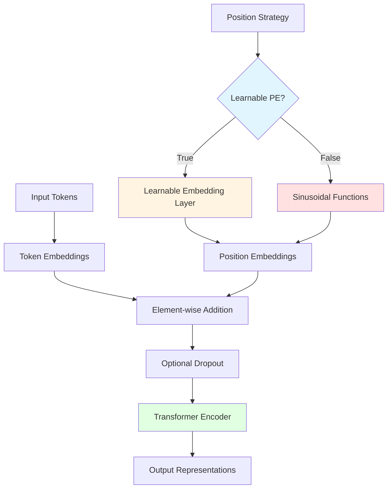

Positional encodings provide the fundamental mechanism by which Nicheformer injects sequence position information into the model, enabling the transformer architecture to process gene expression data with spatial awareness. The Nicheformer architecture implements two complementary positional encoding strategies that can be selected based on the specific requirements of your training or fine-tuning workflow. This documentation examines both strategies, their implementation details, and how they integrate with the broader transformer architecture.

## Architectural Overview

The positional encoding module operates as a critical bridge between the token embeddings derived from gene expression data and the transformer encoder itself. Unlike natural language processing where position corresponds to word order in a sentence, Nicheformer uses positional encodings to represent the relative positioning of genes within the context window, which may reflect spatial organization or expression patterns in single-cell and spatial omics data.

The architecture supports two fundamentally different approaches to encoding position information, selectable through the `learnable_pe` hyperparameter. Both strategies produce embeddings of the same dimensionality as the model's hidden state (`dim_model`), ensuring seamless addition to the token embeddings through element-wise operations.



The flow diagram illustrates how positional encodings integrate into the forward pass, demonstrating that both strategies converge on the same fundamental operation: adding position information to token embeddings before they enter the transformer encoder.

## Learnable Positional Encoding Strategy

Learnable positional encodings are the default strategy in Nicheformer, implemented as a learnable embedding layer that captures position-specific patterns during training. This approach treats each position in the sequence as an embedding vector that is optimized jointly with the rest of the model parameters.

### Implementation Architecture

The learnable positional encoding is implemented using PyTorch's `nn.Embedding` layer, initialized with random weights and updated through backpropagation during training. The embedding layer is configured with `num_embeddings=context_length` and `embedding_dim=dim_model`, creating a learnable parameter matrix where each row corresponds to a specific position in the sequence.

Sources: [src/nicheformer/models/_nicheformer.py](src/nicheformer/models/_nicheformer.py#L110-L118)

The embedding layer is initialized in the `_init_embeddings` method when `learnable_pe=True`, which is the default configuration. The model also creates a position index tensor `self.pos = torch.arange(0, context_length, dtype=torch.long)` that serves as the input to the embedding layer, generating embeddings for each position in the sequence.

### Forward Pass Integration

During the forward pass, the learnable positional encoding is retrieved by passing the position indices through the embedding layer, then added element-wise to the token embeddings. This operation is performed in both the `_apply_positional_encoding` method and the main `forward` method, with dropout applied afterward to improve generalization.

Sources: [src/nicheformer/models/_nicheformer.py](src/nicheformer/models/_nicheformer.py#L215-L220)

The dropout regularization is only applied when using learnable positional encodings, as the sinusoidal strategy uses fixed encodings that don't benefit from stochastic regularization. This design choice reflects the different learning dynamics between the two approaches.

### Configuration Parameters

The learnable positional encoding strategy is controlled by several key parameters in the model configuration:

| Parameter | Description | Default Value | Impact |
|-----------|-------------|---------------|--------|
| `learnable_pe` | Toggle between learnable and sinusoidal encodings | `True` | Strategy selection |
| `context_length` | Maximum sequence length for positional embeddings | `1500` | Embedding layer size |
| `dim_model` | Dimensionality of positional embeddings | `512` | Model capacity |
| `dropout` | Dropout probability applied after adding PE | `0.0` | Regularization strength |

Sources: [src/nicheformer/config_files/_config_train.py](src/nicheformer/config_files/_config_train.py#L8-L20)

> [!TIP]
> The context length parameter must be sufficient to accommodate the longest sequence in your training data. Sequences longer than the configured context length will be truncated during tokenization, potentially losing important information. The default value of 1500 is designed to handle most single-cell and spatial omics datasets, but you may need to increase it for applications with larger neighborhoods or more genes per cell.

## Sinusoidal Positional Encoding Strategy

The sinusoidal positional encoding strategy implements the classic fixed-position encoding approach originally introduced in the Transformer architecture. This strategy uses sine and cosine functions of different frequencies to generate position embeddings, providing a strong inductive bias that allows the model to generalize to sequence lengths not seen during training.

### Mathematical Foundation

Sinusoidal encodings are generated using the mathematical formulation:

```
PE(pos, 2i) = sin(pos / 10000^(2i/d_model))
PE(pos, 2i+1) = cos(pos / 10000^(2i/d_model))
```

Where `pos` is the position index, `i` is the dimension index, and `d_model` is the embedding dimensionality. The alternating sine and cosine functions across different dimensions create a multi-frequency representation that enables the model to learn relative positional relationships.

Sources: [src/nicheformer/models/_nicheformer.py](src/nicheformer/models/_nicheformer.py#L314-L319)

The implementation creates a pre-computed encoding matrix of shape `(max_seq_len, d_model)` using vectorized operations for efficiency. The encoding is registered as a buffer rather than a parameter, indicating it remains fixed during training and is not updated by gradient descent.

### Fixed Encoding Benefits

The sinusoidal strategy provides several theoretical and practical advantages:

- **Extrapolation capability**: The model can process sequences longer than those seen during training since the encoding function is defined for any position
- **Zero learnable parameters**: Reduces model complexity and memory requirements
- **Deterministic behavior**: Provides reproducible position representations across runs
- **Strong inductive bias**: Encodes the assumption that nearby positions are related through smooth sine/cosine functions

Sources: [src/nicheformer/models/_nicheformer.py](src/nicheformer/models/_nicheformer.py#L309-L327)

The sinusoidal encoding is applied by simple addition to the token embeddings in the forward pass, without any dropout regularization since the encodings are fixed and not subject to overfitting.

## Strategy Comparison and Selection

Choosing between learnable and sinusoidal positional encodings depends on your specific use case, data characteristics, and computational constraints. The following comparison outlines the key differences to inform your decision.

| Characteristic | Learnable PE | Sinusoidal PE |
|---------------|--------------|---------------|
| **Parameter Count** | context_length × dim_model | 0 |
| **Training Dynamics** | Optimized with gradients | Fixed during training |
| **Extrapolation** | Limited to trained lengths | Theoretically unlimited |
| **Memory Usage** | Higher (learnable parameters) | Lower (pre-computed) |
| **Inductive Bias** | Flexible, data-driven | Strong, mathematically constrained |
| **Training Speed** | Slightly slower (gradient computation) | Faster (no updates) |
| **Default Setting** | Yes | No |
| **Dropout Applied** | Yes | No |

> [!TIP]
> For most downstream fine-tuning applications with fixed context lengths matching the pretraining configuration, the default learnable positional encoding is recommended. The sinusoidal strategy may be preferred for tasks requiring extrapolation to longer sequences, or when computational resources are limited and the extra parameters are prohibitive.

### Context Length Considerations

The context length parameter is critical for both strategies but has different implications. With learnable positional encodings, the context length defines the size of the embedding layer and constrains the maximum sequence length. With sinusoidal encodings, the context length determines the size of the pre-computed encoding buffer, but the mathematical function can theoretically generate encodings for any position.

Sources: [src/nicheformer/config_files/_config_train.py](src/nicheformer/config_files/_config_train.py#L13)

The default context length of 1500 is based on empirical analysis of single-cell and spatial omics datasets, where typical neighborhoods contain fewer than 1500 genes. However, applications with larger spatial neighborhoods or different tokenization strategies may require adjusting this parameter upward.

## Integration with Token Embeddings

Positional encodings are integrated with token embeddings through element-wise addition, creating a combined representation that contains both token identity and position information. This integration occurs immediately after token embeddings are generated and before the data enters the transformer encoder.

Sources: [src/nicheformer/models/_nicheformer.py](src/nicheformer/models/_nicheformer.py#L133-L141)

The token embeddings are generated by an `nn.Embedding` layer that maps discrete gene tokens to continuous vectors, with vocabulary size `n_tokens + 5` to accommodate special tokens including MASK_TOKEN (0), padding token (1), and CLS_TOKEN (2). The addition operation preserves the dimensionality of both components, maintaining consistency with the transformer's expected input format.

### Tokenization Context

Understanding positional encodings requires awareness of how gene expression data is tokenized. The tokenization process converts continuous gene expression values into discrete token IDs using technology-specific mean values for normalization. This process is implemented in the `tokenize_data` function and uses an auxiliary token allocation scheme to handle metadata and special tokens.

Sources: [src/nicheformer/data/dataset.py](src/nicheformer/data/dataset.py#L48-L50)

The resulting token sequence has a fixed length determined by `max_seq_len`, which must match the context length used for positional encodings. Mismatches between these parameters will cause runtime errors during model execution.

## Practical Implementation Guidelines

When configuring positional encodings for your Nicheformer workflow, consider the following practical recommendations based on the implementation details and default configurations.

### Pretraining Configuration

For pretraining from scratch, the default learnable positional encoding with `context_length=1500` and `dim_model=512` provides a well-validated starting point. These parameters balance model capacity with computational efficiency and have been shown to work well across diverse single-cell and spatial omics datasets.

Sources: [src/nicheformer/config_files/_config_train.py](src/nicheformer/config_files/_config_train.py#L9-L13)

If your data contains neighborhoods consistently larger than 1500 genes, increase the context length accordingly. This will increase the number of learnable parameters linearly, so monitor memory usage and adjust your batch size if necessary.

### Fine-Tuning Configuration

When fine-tuning pre-trained models, maintain the same positional encoding strategy and context length used during pretraining. Changing these parameters will require either truncating or re-initializing the positional embedding layer, which may disrupt the learned position representations and reduce fine-tuning effectiveness.

Sources: [src/nicheformer/models/_nicheformer_fine_tune.py](src/nicheformer/models/_nicheformer_fine_tune.py)

If your fine-tuning data requires a different context length, consider using the sinusoidal strategy for fine-tuning only, which will allow you to maintain compatibility with the pre-trained model while accommodating different sequence lengths.

## Advanced Customization

For researchers requiring specialized positional encoding strategies beyond the two provided implementations, the architecture supports extension through inheritance from the base module.

### Custom Positional Encoding Development

To implement a custom positional encoding strategy:

1. Create a new class inheriting from `nn.Module`
2. Implement the `__init__` method with appropriate parameters
3. Implement the `forward` method that accepts and returns tensors with shape `(batch_size, seq_len, dim_model)`
4. Modify the `_init_embeddings` method in the Nicheformer class to instantiate your custom strategy

The key requirement is that the custom strategy must produce output tensors compatible with the element-wise addition operation in the forward pass, maintaining the same dimensionality as the token embeddings.

### Spatial Position Integration

For spatial omics applications requiring explicit spatial coordinate integration, researchers have extended Nicheformer by incorporating relative spatial distances or absolute coordinate embeddings alongside or instead of the positional encodings. These approaches typically involve:

- Adding separate spatial embedding channels
- Modifying the encoding generation to use spatial coordinates
- Combining multiple position-related embeddings (temporal, spatial, sequence)

Sources: [src/nicheformer/data/tools/niche_compositions.py](src/nicheformer/data/tools/niche_compositions.py#L9-L13)

The niche composition analysis tools provide spatial context that could inform custom positional encoding designs, particularly for applications where cell-cell interactions follow spatial gradients rather than linear sequences.

## Troubleshooting Common Issues

Several common issues may arise when working with positional encodings in Nicheformer. Understanding these issues and their solutions will help you debug and optimize your implementations.

### Dimensionality Mismatches

The most common error occurs when the embedding dimensionality doesn't match between positional encodings and token embeddings. This typically happens when modifying the model configuration without ensuring consistency across all parameters. Symptoms include runtime errors during the forward pass or training failure.

**Solution**: Verify that `dim_model` is consistent across the embedding layers, positional encodings, and transformer encoder configuration. The value should be identical in all components.

### Context Length Exceeded

When input sequences exceed the configured context length, the model will either truncate the sequences or fail with indexing errors, depending on the specific implementation. This often occurs when preprocessing parameters don't match model configuration.

**Solution**: Either increase the context length parameter or adjust your data preprocessing to ensure all sequences fit within the specified limit. Remember that increasing context length requires re-initializing learnable positional embeddings.

### Device Placement Issues

Positional encoding buffers and parameters must be on the same device as the input tensors during the forward pass. Multi-GPU training setups sometimes encounter device mismatch errors if positional encodings aren't properly moved to the correct device.

**Solution**: The implementation handles device placement automatically by calling `.to(token_embedding.device)` on position indices when using learnable encodings. For custom implementations, ensure proper device transfer in the forward method.

## Next Steps

Understanding positional encoding strategies provides a foundation for exploring related architectural components. Continue your deep dive into the Nicheformer architecture with these related topics:

- **Masked Token Prediction for Pretraining**: Learn how masked tokens interact with positional information during the pretraining process and how the model learns to predict gene expression tokens [Masked Token Prediction for Pretraining](12-masked-token-prediction-for-pretraining)

- **Model Configuration and Hyperparameters**: Explore the complete configuration system and how positional encoding parameters integrate with other model settings [Model Configuration and Hyperparameters](14-model-configuration-and-hyperparameters)

- **Extracting Cell Embeddings from Pre-trained Models**: Understand how positional encodings influence the final embedding representations and how to extract them for downstream analysis [Extracting Cell Embeddings from Pre-trained Models](23-extracting-cell-embeddings-from-pre-trained-models)

The careful design of positional encoding strategies is one of the key architectural innovations that enables Nicheformer to effectively learn from single-cell and spatial omics data. By selecting the appropriate strategy for your use case and configuring it properly, you can leverage these encodings to capture meaningful patterns in gene expression data while maintaining the flexibility to handle diverse experimental designs and data types.
