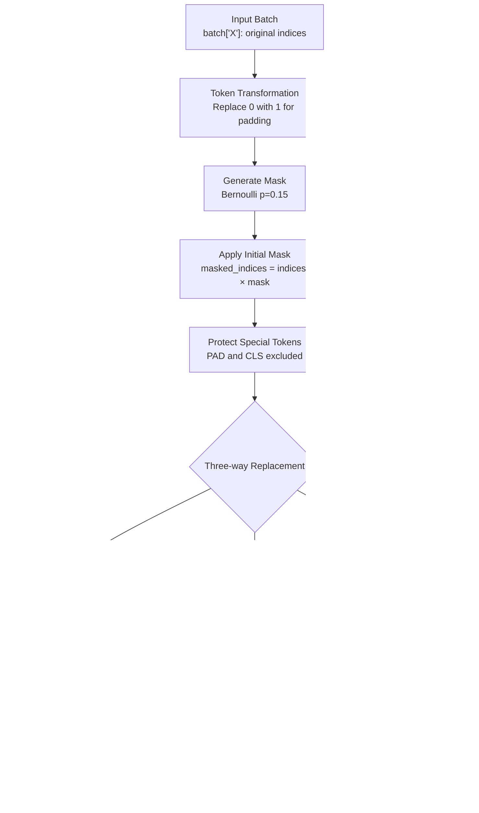
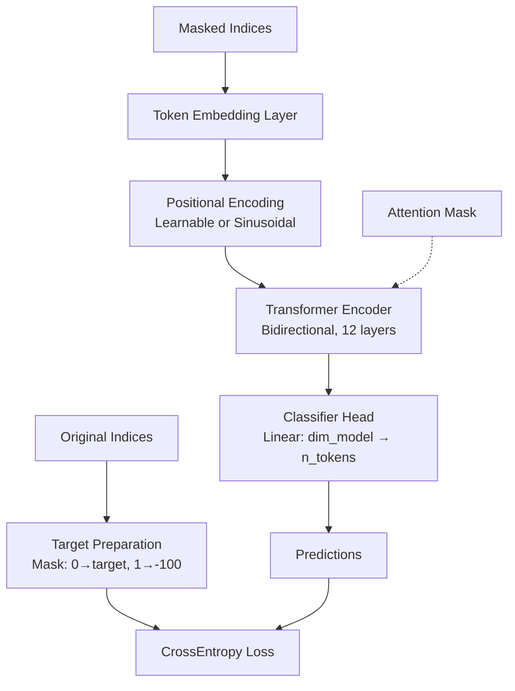

The masked token prediction objective serves as the cornerstone of Nicheformer's self-supervised pretraining strategy, enabling the model to learn rich biological representations from single-cell and spatial omics data without requiring explicit labels. This documentation explains how masking works, the specific implementation details, and how it differs from standard language model pretraining approaches.

## The Masked Language Modeling Objective

Nicheformer employs a masked token prediction objective similar to BERT, where the model learns to predict original gene expression tokens from their corrupted context. The core principle is straightforward: randomly mask a subset of input tokens and train the model to reconstruct them based on surrounding context. This forces the model to capture dependencies between genes within cells and across spatial neighborhoods.

The masking probability is configured to 15% by default, meaning approximately 15% of tokens in each sequence are subject to masking operations [Sources: src/nicheformer/config_files/_config_train.py#L6]. This percentage represents a careful balance—too high masking loses too much signal, while too low masking reduces the learning challenge and representation quality.

## Masking Strategy Implementation

Nicheformer implements a sophisticated three-way masking strategy that follows the BERT distribution: 80% masked tokens, 10% random tokens, and 10% original tokens. This distribution is critical for preventing the model from simply learning that "the masked position is always replaced with the special MASK token."

```python
# 80% of masked indices are masked
# 10% of masked indices are a random token
# 10% of masked indices are the real token

random_tokens = torch.randint(10, n_tokens, size=masked_indices.shape, device=masked_indices.device)
random_tokens = random_tokens * torch.bernoulli(torch.ones_like(random_tokens)*0.1).type(torch.int64) 

masked_indices = torch.where(masked_indices == 0, random_tokens, masked_indices) # put random tokens just in the previously masked tokens

same_tokens = indices.clone()
same_tokens = same_tokens * torch.bernoulli(torch.ones_like(same_tokens) * 0.1).type(torch.int64)

masked_indices = torch.where(masked_indices == 0, same_tokens, masked_indices) # put same tokens just in the previously masked tokens
```

Sources: [src/nicheformer/models/_utils.py#L27-L39]

The implementation proceeds through several distinct steps. First, padding tokens are protected from masking to ensure the model focuses only on meaningful gene expression data. The padding token value is changed from 0 to 1 during the masking process [Sources: src/nicheformer/models/_utils.py#L8-L14]. Then a Bernoulli distribution generates the initial mask with probability p=0.15. The CLS token (value 3) is also explicitly protected from masking since it serves a special representational purpose [Sources: src/nicheformer/models/_utils.py#L24-L25].

The three-way replacement strategy is then applied: tokens marked for masking are first set to 0 (the MASK token). Of these, 10% are replaced with randomly sampled tokens from the vocabulary (offset by 10 to skip special tokens), and another 10% are restored to their original values. This creates a robust learning signal where the model must use contextual information rather than memorizing simple patterns.

## Token Schema and Special Tokens

Nicheformer's tokenization scheme includes several special tokens that play specific roles in the masking and training pipeline:

| Token | Value | Description | Masking Behavior |
|-------|-------|-------------|-----------------|
| MASK_TOKEN | 0 | Special token indicating masked positions | Used as replacement for 80% of masked tokens |
| PADDING_TOKEN | 1 | Padding token for sequence padding | Never masked, mask set to 1 to exclude from loss |
| CLS_TOKEN | 3 | Classification token prepended to sequences | Never masked, mask set to 1 to exclude from loss |

Sources: [src/nicheformer/models/_nicheformer.py#L12-L13], [src/nicheformer/models/_utils.py#L8-L25]

The embedding layer accommodates these special tokens by defining num_embeddings as `n_tokens + 5` [Sources: src/nicheformer/models/_nicheformer.py#L104-L107], ensuring all gene tokens plus auxiliary tokens fit within the vocabulary. The padding index is explicitly set to 1, allowing PyTorch's embedding layer to handle padding correctly.

## Complete Masking Pipeline

The masking operation transforms an input batch through a structured pipeline that can be visualized as follows:



Sources: [src/nicheformer/models/_utils.py#L6-L47]

The `complete_masking` function orchestrates this entire process, returning a modified batch dictionary containing:
- `masked_indices`: The corrupted input sequence
- `mask`: Binary mask indicating which positions are masked (0 for masked, 1 for unmasked)
- `attention_mask`: Boolean mask for the transformer's attention mechanism (True for padding)

Sources: [src/nicheformer/models/_utils.py#L41-L46]

## Training Step Integration

During training, the masking operation is applied at the beginning of each step within a `torch.no_grad()` context to prevent gradient tracking through the stochastic masking process:

```python
def training_step(self, batch: dict[str, torch.Tensor], batch_idx: int) -> torch.Tensor:
    """Execute training step."""
    with torch.no_grad():
        batch = complete_masking(batch, self.hparams.masking_p, self.hparams.n_tokens)

    masked_indices = batch['masked_indices']
    mask = batch['mask']
    real_indices = batch['X']
    attention_mask = batch['attention_mask']

    predictions = self.forward(masked_indices, attention_mask)
    mlm_predictions = predictions['mlm_prediction']

    real_indices = self._prepare_target_indices(mask, real_indices)
    loss = self._compute_loss(mlm_predictions, real_indices)
    
    self.log('train_loss', loss, sync_dist=True, prog_bar=True, reduce_fx='mean')
    return loss
```

Sources: [src/nicheformer/models/_nicheformer.py#L156-L173]

The masked indices serve as input to the transformer, while the original indices serve as targets. The critical link is the `_prepare_target_indices` method, which converts the binary mask into targets for the loss function: masked positions receive the original token value, while unmasked positions receive -100 (PyTorch's ignore index for CrossEntropyLoss) [Sources: src/nicheformer/models/_nicheformer.py#L198-L204].

## Loss Computation

The loss function implementation is deceptively simple yet carefully designed:

```python
def _compute_loss(self, predictions: torch.Tensor, targets: torch.Tensor) -> torch.Tensor:
    """Compute loss for training/validation."""
    predictions = predictions.view(-1, self.hparams.n_tokens)
    targets = targets.view(-1)

    if self.hparams.masking_p == 0.0:
        return torch.tensor(0.0, device=predictions.device)
    return self.loss(predictions, targets)
```

Sources: [src/nicheformer/models/_nicheformer.py#L206-L213]

The predictions are reshaped from `[batch_size, seq_len, n_tokens]` to `[batch_size × seq_len, n_tokens]`, and targets are flattened similarly. PyTorch's CrossEntropyLoss automatically handles the -100 ignore index, meaning the model only receives gradients for the masked positions. A special case handles when masking is disabled (masking_p=0.0), returning zero loss for fine-tuning scenarios [Sources: src/nicheformer/models/_nicheformer.py#L74].

> [!TIP]
> The three-way masking distribution (80/10/10) is crucial for model robustness. If all masked tokens were simply replaced with the MASK token, the model would learn to ignore it during inference. The random and kept tokens force the model to genuinely use contextual information rather than developing shortcut heuristics.

## Model Architecture for Masked Prediction

The Nicheformer architecture is specifically designed to support the masked prediction objective:



Sources: [src/nicheformer/models/_nicheformer.py#L133-L154], [src/nicheformer/models/_nicheformer.py#L84-L131]

The forward pass involves embedding the masked indices (size `[batch_size, seq_len]`), adding positional information (either learnable embeddings or sinusoidal encodings), passing through a bidirectional Transformer encoder, and finally projecting through a linear classifier head to predict token logits over the vocabulary [Sources: src/nicheformer/models/_nicheformer.py#L133-L154].

The key architectural choice is the bidirectional encoder (as opposed to autoregressive decoding), which allows the model to use information from both left and right contexts when predicting masked tokens. This is essential for capturing gene-gene interactions in spatial omics data where relationships are not inherently directional.

## Configuration Parameters

The masking behavior is controlled through several key hyperparameters in the training configuration:

| Parameter | Default Value | Description |
|-----------|---------------|-------------|
| `masking_p` | 0.15 | Probability of masking each token |
| `n_tokens` | 20340 | Vocabulary size (excluding special tokens) |
| `dim_model` | 512 | Transformer hidden dimension |
| `nlayers` | 12 | Number of transformer encoder layers |
| `nheads` | 16 | Number of attention heads |

Sources: [src/nicheformer/config_files/_config_train.py#L4-L11]

These parameters define both the intensity of the pretraining objective (masking_p) and the model capacity to learn from it (dim_model, nlayers, nheads). The vocabulary size (n_tokens=20340) corresponds to the number of unique genes or features in the spatial transcriptomics dataset [Sources: src/nicheformer/config_files/_config_train.py#L11].

## Validation Behavior

The validation step applies the exact same masking procedure as training, ensuring that validation metrics reflect the model's generalization ability on the same pretraining objective:

```python
def validation_step(self, batch: dict[str, torch.Tensor], batch_idx: int) -> torch.Tensor:
    """Execute validation step."""
    with torch.no_grad():
        batch = complete_masking(batch, self.hparams.masking_p, self.hparams.n_tokens)

    masked_indices = batch['masked_indices']
    mask = batch['mask']
    real_indices = batch['X']
    attention_mask = batch['attention_mask']

    predictions = self.forward(masked_indices, attention_mask)
    mlm_predictions = predictions['mlm_prediction']

    real_indices = self._prepare_target_indices(mask, real_indices)
    loss = self._compute_loss(mlm_predictions, real_indices)

    self.log('val_loss', loss, sync_dist=True, prog_bar=True, reduce_fx='mean')
    return loss
```

Sources: [src/nicheformer/models/_nicheformer.py#L175-L192]

This consistent masking between training and validation prevents evaluation discrepancies and ensures that the validation loss accurately represents the model's pretraining progress.

## Biological Interpretation

The masked token prediction objective has a natural interpretation in the context of spatial omics data. Each token represents a gene or feature in a cell's transcriptomic profile. By masking certain genes and asking the model to predict them, we force the model to learn the co-expression patterns that define cell types and tissue microenvironments.

The bidirectional nature of the encoder is particularly appropriate for spatial data, where gene-gene interactions form complex, non-directional networks. Unlike language where temporal order matters, gene expression relationships are inherently symmetric—knowing gene A is expressed helps predict gene B just as knowing gene B helps predict gene A.

> [!TIP]
> For downstream applications, the embeddings learned through masked prediction capture rich biological context without requiring task-specific labels. This enables transfer learning across tissues, technologies, and organisms, as demonstrated by the model's ability to generalize from dissociated single-cell data to spatial transcriptomics platforms.

## Integration with Training Workflow

The masked prediction objective is tightly integrated into the broader training workflow. The training configuration specifies both the model architecture and the masking parameters, which are passed to the Nicheformer Lightning module during initialization:

```python
self.save_hyperparameters()
```

Sources: [src/nicheformer/models/_nicheformer.py#L62]

This automatic hyperparameter logging ensures that all masking settings (masking_p, n_tokens) are tracked alongside other training parameters, enabling reproducibility and easy hyperparameter sweeps.

The masking operation itself occurs in the training and validation steps, applied fresh to each batch. This stochasticity is essential for the self-supervised learning paradigm—each batch presents a different masking pattern, forcing the model to generalize rather than memorize specific masked configurations.

## Summary

Nicheformer's masked token prediction for pretraining represents a carefully designed adaptation of language model pretraining techniques to spatial omics data. The implementation balances several key principles:

- **Protective masking**: Special tokens (padding, CLS) are never masked to preserve their semantic roles
- **Three-way replacement**: The 80/10/10 distribution prevents the model from learning shortcut patterns
- **Bidirectional encoding**: The transformer architecture can use information from all positions to predict masked tokens
- **Efficient loss computation**: Only masked positions contribute to gradients, focusing learning on the challenging predictions

This objective enables Nicheformer to learn powerful representations of cells and tissue microenvironments without requiring any labeled annotations, forming the foundation for the model's strong performance across diverse downstream tasks in spatial biology.

To understand how the masking integrates with the overall model architecture, continue reading about the [Nicheformer Transformer Architecture](10-nicheformer-transformer-architecture). For details on how positional information complements the masked prediction, see [Positional Encoding Strategies](11-positional-encoding-strategies). To learn about the complete pretraining workflow, explore [Pretraining Nicheformer on Large-Scale Data](15-pretraining-nicheformer-on-large-scale-data).