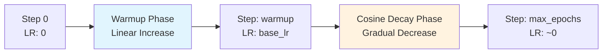
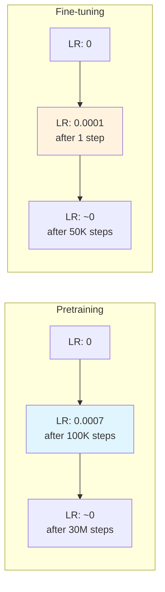

Learning rate scheduling with warmup is a critical optimization technique for training deep transformer models like Nicheformer. This documentation explains the implementation of the cosine annealing scheduler with linear warmup, its configuration parameters, mathematical foundation, and practical application in both pretraining and fine-tuning workflows. Understanding this scheduler is essential for achieving stable convergence and optimal model performance across diverse spatial transcriptomics datasets and downstream tasks.

Sources: [src/nicheformer/models/_nicheformer.py](/src/nicheformer/models/_nicheformer.py#L329-L348)

## The CosineWarmupScheduler Implementation

The `CosineWarmupScheduler` is a custom learning rate scheduler that combines linear warmup with cosine annealing decay, implemented as a PyTorch `._LRScheduler`. This two-phase schedule addresses the instability issues commonly encountered when training large transformer models with constant learning rates. During the warmup phase, the learning rate linearly increases from a minimal value to the target learning rate, allowing the model to establish stable gradient patterns before transitioning to the cosine decay phase. The scheduler operates on a per-step basis, making it suitable for large-scale pretraining where the number of steps is the relevant unit of progress rather than epochs.

```python
class CosineWarmupScheduler(optim.lr_scheduler._LRScheduler):
    """Learning rate scheduler with cosine annealing and warmup."""
    
    def __init__(self, optimizer: optim.Optimizer, warmup: int, max_epochs: int):
        self.warmup = warmup
        self.max_num_epochs = max_epochs
        super().__init__(optimizer)
```

The scheduler is initialized with three key parameters: the optimizer instance, the number of warmup steps, and the total training duration. The `interval: 'step'` configuration ensures the scheduler updates the learning rate after each training batch rather than after each epoch, which is crucial for long-running pretraining tasks where epochs are ill-defined due to the massive dataset size.

Sources: [src/nicheformer/models/_nicheformer.py](/src/nicheformer/models/_nicheformer.py#L329-L336), [src/nicheformer/models/_nicheformer.py](/src/nicheformer/models/_nicheformer.py#L253-L262)

## Mathematical Foundation

The learning rate schedule follows a piecewise function with two distinct phases. During the warmup phase (steps 0 to `warmup`), the learning rate factor increases linearly from 0 to 1:

$$\text{lr\_factor} = \frac{\text{epoch}}{\text{warmup}} \quad \text{if } \text{epoch} \leq \text{warmup}$$

After warmup completes, the scheduler transitions to cosine annealing decay, smoothly decreasing the learning rate from the maximum value to zero over the remaining training steps:

$$\text{lr\_factor} = 0.5 \times \left(1 + \cos\left(\frac{\pi \times \text{epoch}}{\text{max\_num\_epochs}}\right)\right) \quad \text{if } \text{epoch} > \text{warmup}$$

The final learning rate is computed as the product of the base learning rate and the learning rate factor, with a minimum floor of `1e-5` to prevent numerical instability:

$$\text{lr} = \max(10^{-5}, \text{base\_lr} \times \text{lr\_factor})$$

This mathematical formulation ensures smooth transitions between phases and prevents abrupt changes in the learning rate that could destabilize training. The minimum learning rate floor maintains a non-zero gradient signal even in late training stages, which can be beneficial for continued fine-grained optimization.

```python
def get_lr_factor(self, epoch: int) -> float:
    """Calculate learning rate factor based on epoch."""
    lr_factor = 0.5 * (1 + np.cos(np.pi * epoch / self.max_num_epochs))
    if epoch <= self.warmup:
        lr_factor *= epoch * 1.0 / self.warmup
    return lr_factor
```

Sources: [src/nicheformer/models/_nicheformer.py](/src/nicheformer/models/_nicheformer.py#L342-L347), [src/nicheformer/models/_nicheformer.py](/src/nicheformer/models/_nicheformer.py#L337-L340)

## Learning Rate Schedule Visualization

The following diagram illustrates the learning rate trajectory across the full training duration, showing both the linear warmup phase and the subsequent cosine annealing decay:



The schedule transitions smoothly between phases without discontinuities. The warmup phase prevents early training instability by gradually increasing the learning rate, allowing the model to adapt its momentum and gradient statistics. The cosine decay phase then provides a gentle reduction in learning rate that helps the model converge to better local minima.

Sources: [src/nicheformer/models/_nicheformer.py](/src/nicheformer/models/_nicheformer.py#L342-L347)

## Configuration Parameters and Typical Values

Nicheformer uses different hyperparameter configurations for pretraining and fine-tuning workflows, reflecting the distinct optimization challenges of each phase:

| Parameter | Pretraining | Fine-tuning | Description |
|-----------|-------------|-------------|-------------|
| Base Learning Rate | `7e-4` | `1e-4` | Maximum learning rate after warmup |
| Warmup Steps | `100,000` | `1` | Number of linear warmup steps |
| Maximum Steps | `30,661,140` | `50,000` | Total training duration |
| Weight Decay | `0.1` | `0.001` | L2 regularization strength |
| Minimum LR | `1e-5` | `1e-5` | Floor for learning rate |

The pretraining configuration uses a much longer warmup period (100K steps) to accommodate the massive scale of the spatial transcriptomics datasets and the complexity of learning robust representations from scratch. In contrast, fine-tuning uses a minimal warmup (1 step) since the model already has pretrained representations that only need gentle adaptation to downstream tasks. The base learning rate is also reduced during fine-tuning to preserve the pretrained knowledge while allowing sufficient flexibility for task-specific adaptation.

Sources: [src/nicheformer/config_files/_config_train.py](/src/nicheformer/config_files/_config_train.py#L14-L16), [src/nicheformer/config_files/_config_fine_tune.py](/src/nicheformer/config_files/_config_fine_tune.py#L7-L9)

## Integration with PyTorch Lightning

The scheduler is integrated into the PyTorch Lightning training workflow through the `configure_optimizers` method in both the `Nicheformer` and `FineTuningModel` classes. This method returns a tuple containing the optimizer and a dictionary specifying the scheduler configuration:

```python
def configure_optimizers(self) -> tuple:
    """Configure optimizer and learning rate scheduler."""
    optimizer = optim.AdamW(self.parameters(), lr=self.hparams.lr, weight_decay=0.1)
    scheduler = CosineWarmupScheduler(
        optimizer,
        warmup=self.hparams.warmup,
        max_epochs=self.hparams.max_epochs
    )
    
    return [optimizer], [{'scheduler': scheduler, 'interval': 'step'}]
```

The `'interval': 'step'` parameter is crucial for step-level granularity, which is necessary because pretraining often runs for millions of steps where epoch boundaries are meaningless due to the massive dataset size. PyTorch Lightning automatically handles scheduler state management, checkpointing, and resumption, ensuring the learning rate schedule continues correctly across distributed training sessions and checkpoint recoveries.

The training loop also incorporates a `LearningRateMonitor` callback to log the learning rate at each step, enabling visualization and debugging of the schedule during training:

```python
lr_monitor = LearningRateMonitor(logging_interval='step')
trainer = pl.Trainer(callbacks=[checkpoint_callback, lr_monitor], ...)
```

This monitoring capability is essential for verifying that the warmup and decay phases are functioning as expected, particularly when experimenting with different hyperparameter configurations.

Sources: [src/nicheformer/models/_nicheformer.py](/src/nicheformer/models/_nicheformer.py#L253-L262), [src/nicheformer/_train.py](/src/nicheformer/_train.py#L41), [src/nicheformer/models/_fine_tune_model.py](/src/nicheformer/models/_fine_tune_model.py#L325-L332)

## Comparison Between Pretraining and Fine-tuning Schedules

The following diagram illustrates the distinct learning rate trajectories for pretraining and fine-tuning workflows:



The key differences between these schedules are:

- **Warmup Duration**: Pretraining uses 100,000 steps (~0.33% of total training) to establish stable optimization dynamics, while fine-tuning effectively skips warmup to immediately leverage pretrained knowledge
- **Learning Rate Magnitude**: Pretraining uses a higher base rate (7e-4) for representation learning from scratch, while fine-tuning uses a lower rate (1e-4) to preserve pretrained features
- **Total Duration**: Pretraining runs for over 30 million steps on diverse datasets, while fine-tuning typically converges within 50,000 steps on task-specific data
- **Regularization**: Pretraining uses stronger weight decay (0.1) to prevent overfitting to the massive pretraining corpus, while fine-tuning uses milder regularization (0.001) to avoid suppressing task-specific adaptation

These design choices reflect the different optimization objectives: pretraining aims to learn general-purpose biological representations, while fine-tuning targets specific downstream performance metrics.

> [!TIP]
> The warmup period length should be proportionally scaled with your training duration—aim for warmup to cover approximately 0.1-0.5% of total steps for large-scale pretraining and minimal warmup (0-10 steps) for fine-tuning from pretrained checkpoints.

Sources: [src/nicheformer/config_files/_config_train.py](/src/nicheformer/config_files/_config_train.py#L1-L26), [src/nicheformer/config_files/_config_fine_tune.py](/src/nicheformer/config_files/_config_fine_tune.py#L1-L21)

## Practical Implementation Details

The scheduler implementation includes several practical considerations for production training workflows. The learning rate factor calculation uses numpy's cosine function for numerical stability across the full range of training steps. The minimum learning rate floor of `1e-5` prevents the optimizer from becoming completely inert in late training stages, which could prevent final convergence to optimal solutions.

The scheduler is automatically invoked by PyTorch Lightning's training loop after each batch, ensuring consistent behavior across single-GPU and multi-GPU distributed training scenarios. The scheduler state is included in model checkpoints, allowing seamless resumption of training after interruptions without resetting the learning rate schedule.

```python
def get_lr(self) -> list[float]:
    """Get learning rates for all parameter groups."""
    lr_factor = self.get_lr_factor(epoch=self.last_epoch)
    return [max(1e-5, base_lr * lr_factor) for base_lr in self.base_lrs]
```

This implementation supports multiple parameter groups if needed, though Nicheformer typically uses a single learning rate for all model parameters. The scheduler works with any PyTorch optimizer, though Nicheformer specifically uses AdamW for its adaptive learning rate capabilities and decoupled weight decay, which synergizes well with the cosine annealing schedule.

Sources: [src/nicheformer/models/_nicheformer.py](/src/nicheformer/models/_nicheformer.py#L337-L340)

## Optimization Strategy and Best Practices

The cosine warmup schedule is particularly well-suited for transformer-based models like Nicheformer for several reasons. Transformers contain layer normalization and attention mechanisms that exhibit optimization dynamics sensitive to learning rate magnitude, making the gradual warmup essential for stable training. The cosine decay provides a smoother transition than step decay schedules, preventing oscillations in the loss landscape during later training stages.

When configuring the scheduler for your experiments, consider the following best practices:

1. **Scale warmup proportionally**: Set warmup to 0.1-0.5% of your total training steps for pretraining, and 0-10 steps for fine-tuning
2. **Monitor learning rate logs**: Use the `LearningRateMonitor` callback to verify the schedule follows expected trajectory
3. **Adjust base LR for task scale**: Spatial transcriptomics datasets with more diverse cell types may benefit from slightly lower base rates
4. **Combine with gradient clipping**: Nicheformer uses `gradient_clip_val=1` in conjunction with the scheduler for additional stability
5. **Validate convergence**: Plot training and validation loss curves alongside learning rate to identify optimal schedule parameters

The current default configurations have been validated across multiple spatial transcriptomics platforms (CosMx, MERFISH, Xenium) and demonstrate robust convergence characteristics across diverse tissue types and experimental designs.

Sources: [src/nicheformer/_train.py](/src/nicheformer/_train.py#L43-L55), [src/nicheformer/config_files/_config_train.py](/src/nicheformer/config_files/_config_train.py#L14-L15)

## Next Steps

To deepen your understanding of the complete training pipeline, explore these related topics:

- **[Model Configuration and Hyperparameters](14-model-configuration-and-hyperparameters)** - Learn about the full set of hyperparameters that interact with learning rate scheduling
- **[Pretraining Nicheformer on Large-Scale Data](15-pretraining-nicheformer-on-large-scale-data)** - Understand how the scheduler integrates with distributed pretraining workflows
- **[Distributed Training with PyTorch Lightning](16-distributed-training-with-pytorch-lightning)** - Explore how learning rate scheduling works across multiple GPUs and nodes
- **[Fine-Tuning Model Architecture](18-fine-tuning-model-architecture)** - Compare scheduler behavior in pretraining versus fine-tuning scenarios

The learning rate scheduler is a fundamental component that interacts with nearly every aspect of the training pipeline, from data loading to model architecture to distributed training infrastructure.