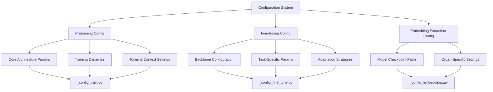
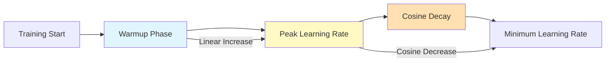
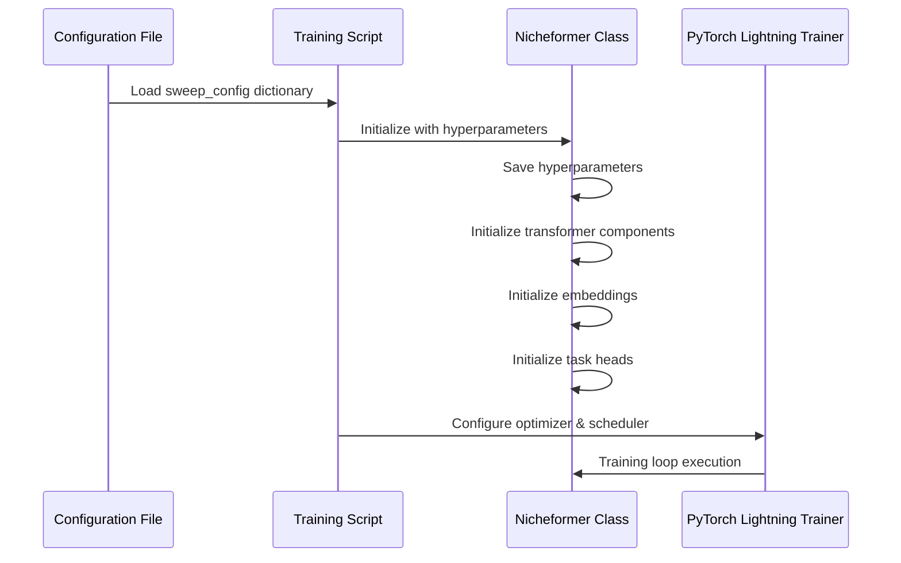

Understanding Nicheformer's configuration system is essential for effectively training and adapting the model to various spatial transcriptomics analysis tasks. This document comprehensively covers the architecture hyperparameters, training configurations, and fine-tuning strategies that enable Nicheformer to learn from large-scale gene expression data while maintaining flexibility for downstream applications.

## Configuration Architecture Overview

Nicheformer employs a modular configuration system organized around three distinct training workflows, each with dedicated configuration files that specify parameters for model architecture, training dynamics, and task-specific adaptations. The configuration architecture enables rapid experimentation and reproducible research by separating concerns between pretraining, fine-tuning, and embedding extraction phases.



The modular approach ensures that each training phase operates with appropriately tuned hyperparameters while maintaining consistency across the model lifecycle.

Sources: [src/nicheformer/config_files/_config_train.py](/src/nicheformer/config_files/_config_train.py#L1-L26), [src/nicheformer/config_files/_config_fine_tune.py](/src/nicheformer/config_files/_config_fine_tune.py#L1-L21), [src/nicheformer/config_files/_config_embeddings.py](/src/nicheformer/config_files/_config_embeddings.py#L1-L6)

## Core Architecture Hyperparameters

Nicheformer's transformer architecture is defined by a comprehensive set of hyperparameters that control model capacity, computational complexity, and representation learning capabilities. These parameters are specified during model initialization and remain consistent throughout the training process.

The standard Nicheformer configuration employs a **12-layer transformer** with **512-dimensional embeddings** and **16 attention heads**, representing a balanced architecture that scales effectively to large spatial transcriptomics datasets while maintaining computational efficiency.

| Parameter | Default Value | Description | Impact |
|-----------|---------------|-------------|--------|
| `dim_model` | 512 | Dimensionality of token embeddings and transformer hidden states | Controls representational capacity and memory usage |
| `nheads` | 16 | Number of attention heads in multi-head attention mechanism | Enables parallel attention computation |
| `dim_feedforward` | 1024 | Dimensionality of feed-forward networks in transformer blocks | Controls capacity of position-wise transformations |
| `nlayers` | 12 | Number of transformer encoder layers | Determines depth and hierarchical feature extraction |
| `dropout` | 0.0 | Dropout probability for regularization | Prevents overfitting (currently disabled) |
| `batch_first` | True | Whether batch dimension precedes sequence dimension | Affects tensor shape conventions |

Sources: [src/nicheformer/config_files/_config_train.py](/src/nicheformer/config_files/_config_train.py#L5-L14), [src/nicheformer/models/_nicheformer.py](/src/nicheformer/models/_nicheformer.py#L16-L36)

## Token and Context Configuration

Nicheformer operates on discretized gene expression data where genes and expression levels are mapped to tokens through a specialized tokenization process. The token and context hyperparameters define the vocabulary size, sequence length constraints, and masking strategies essential for masked language modeling pretraining.

The configuration supports **20,340 distinct tokens** representing various gene expression levels across multiple spatial transcriptomics platforms, with a maximum context window of **1,500 tokens** per sequence. The masking probability of **15%** follows standard masked language modeling practices used in BERT and related architectures.

| Parameter | Default Value | Description |
|-----------|---------------|-------------|
| `n_tokens` | 20,340 | Total number of unique tokens in vocabulary (excluding auxiliary tokens) |
| `context_length` | 1,500 | Maximum sequence length for input gene expression profiles |
| `masking_p` | 0.15 | Probability of randomly masking tokens during pretraining |
| `learnable_pe` | True | Whether to use learnable positional embeddings instead of fixed sinusoidal encodings |
| `autoregressive` | False | Whether to use autoregressive modeling (currently disabled) |

Sources: [src/nicheformer/config_files/_config_train.py](/src/nicheformer/config_files/_config_train.py#L9-L10), [src/nicheformer/models/_nicheformer.py](/src/nicheformer/models/_nicheformer.py#L101-L103)

## Training Dynamics and Optimization

The training configuration defines the optimization landscape including learning rate schedules, batch sizes, and training duration. Nicheformer employs a sophisticated **cosine warmup scheduler** that gradually increases the learning rate during an initial warmup period before applying cosine annealing, enabling stable training convergence on large-scale datasets.

Pretraining utilizes a **warmup period of 100,000 steps** with a maximum epoch count configured for continuous training, while fine-tuning employs a shorter **single-step warmup** with more aggressive learning rates to quickly adapt to downstream tasks.

### Optimization Parameters

| Parameter | Pretraining | Fine-tuning | Description |
|-----------|-------------|-------------|-------------|
| `lr` | 7e-4 | 1e-4 | Initial learning rate for optimizer |
| `warmup` | 100,000 | 1 | Number of warmup steps before peak learning rate |
| `max_epochs` | 30,661,140 | 50,000 | Maximum training epochs |
| `batch_size` | 6 | 12 | Number of samples per batch |

The learning rate scheduler implements a cosine decay curve following the warmup period:



Sources: [src/nicheformer/config_files/_config_train.py](/src/nicheformer/config_files/_config_train.py#L14-L17), [src/nicheformer/models/_nicheformer.py](/src/nicheformer/models/_nicheformer.py#L329-L344), [src/nicheformer/models/_nicheformer_fine_tune.py](/src/nicheformer/models/_nicheformer_fine_tune.py#L391-L393)

## Special Token and Modality Configuration

Nicheformer incorporates **special token embeddings** to capture biological metadata including species, assay technology, and data modality. These tokens enable the model to learn representations that generalize across different spatial transcriptomics platforms and organismal contexts.

The configuration supports three boolean flags that control the inclusion of these metadata tokens:

| Parameter | Default | Description |
|-----------|---------|-------------|
| `specie` | True | Add species-specific token to input sequence |
| `assay` | True | Add assay-specific token for spatial technology identification |
| `modality` | True | Add modality token distinguishing spatial vs. dissociated data |
| `organ` | "everything" | Organ/tissue filter for training data selection |

When enabled, these special tokens are prepended to the gene expression sequence and processed through the transformer architecture alongside gene tokens, allowing the model to learn joint representations that capture both expression patterns and experimental context.

Sources: [src/nicheformer/config_files/_config_train.py](/src/nicheformer/config_files/_config_train.py#L20-L23), [src/nicheformer/models/_nicheformer.py](/src/nicheformer/models/_nicheformer.py#L32-L35)

## Fine-Tuning Configuration Parameters

Fine-tuning adapts the pre-trained Nicheformer backbone to specific downstream tasks through a flexible configuration system that supports classification, regression, and density prediction tasks. The fine-tuning configuration defines task-specific parameters, adaptation strategies, and architectural modifications while maintaining the core transformer architecture.

### Backbone Adaptation

| Parameter | Default | Description |
|-----------|---------|-------------|
| `freeze` | False | Whether to freeze all backbone parameters during fine-tuning |
| `reinit_layers` | None | Specific layers to reinitialize (list of layer indices) |
| `extractor` | False | Whether to add MLP extractor before final prediction layer |
| `pool` | "mean" | Pooling strategy: "mean", "cls", or None for aggregating sequence representations |

### Task-Specific Parameters

| Parameter | Default | Description |
|-----------|---------|-------------|
| `supervised_task` | "niche_classification" | Type of task: "niche_classification", "niche_regression", or "density_regression" |
| `n_classes` | 17 | Number of output classes for classification tasks |
| `dim_prediction` | 1 | Output dimension for regression tasks |
| `predict_density` | False | Whether to predict scalar cell density |
| `regress_distribution` | False | Whether to predict probability distribution instead of point estimates |
| `ignore_zeros` | False | Whether to ignore zero-valued labels in loss computation |

> [!TIP]
> The `reinit_layers` parameter enables layer-wise reinitialization strategies where specific transformer layers can be reset to random initialization while keeping others frozen, facilitating effective transfer learning across different tissue types or experimental conditions.

Sources: [src/nicheformer/config_files/_config_fine_tune.py](/src/nicheformer/config_files/_config_fine_tune.py#L3-L21), [src/nicheformer/models/_nicheformer_fine_tune.py](/src/nicheformer/models/_nicheformer_fine_tune.py#L19-L92)

## Fine-Tuning Adaptation Strategies

Nicheformer supports multiple adaptation strategies for transferring pre-trained representations to downstream tasks, offering flexibility between feature extraction, full fine-tuning, and hybrid approaches.

```mermaid
flowchart TD
    A[Pre-trained Backbone] --> B{Adaptation Strategy}
    
    B --> C[Feature Extraction]
    B --> D[Partial Fine-tuning]
    B --> E[Full Fine-tuning]
    
    C --> F[freeze=True<br/>reinit_layers=None]
    D --> G[freeze=False<br/>reinit_layers=[0,1,2]]
    E --> H[freeze=False<br/>reinit_layers=None]
    
    F --> I[Task Head Training]
    G --> I
    H --> I
    
    I --> J[Final Model]
    
    style C fill:#c8e6c9
    style D fill:#fff9c4
    style E fill:#ffccbc
```

### Layer Extraction and Combination

The `extract_layers` and `function_layers` parameters control which transformer layers contribute to the final representation and how they are combined:

| Parameter | Type | Description |
|-----------|------|-------------|
| `extract_layers` | list[int] | Indices of layers to extract features from (e.g., [8, 9, 10, 11]) |
| `function_layers` | str | How to combine layer outputs: "mean", "sum", or "concat" |

These parameters enable sophisticated feature extraction strategies where representations from specific layers can be pooled or concatenated before the task-specific prediction head, balancing low-level and high-level features as appropriate for the downstream task.

Sources: [src/nicheformer/models/_nicheformer_fine_tune.py](/src/nicheformer/models/_nicheformer_fine_tune.py#L24-L24), [src/nicheformer/models/_fine_tune_model.py](/src/nicheformer/models/_fine_tune_model.py#L107-L162)

## Embedding Extraction Configuration

Extracting high-quality cell embeddings from pre-trained Nicheformer models requires minimal configuration, primarily specifying checkpoint paths and target organs for analysis. The embedding extraction configuration focuses on model loading rather than architectural modifications.

| Parameter | Default | Description |
|-----------|---------|-------------|
| `checkpoint_path` | Path to .ckpt file | Path to pre-trained model checkpoint |
| `fine_tuned_checkpoint_path` | Path to .ckpt file | Optional path to fine-tuned checkpoint for domain-specific embeddings |
| `organ` | "everything" | Organ filter for data processing during extraction |

The embedding extraction process leverages the trained model's internal representations without requiring reconfiguration of architectural hyperparameters, making it straightforward to generate embeddings for downstream analysis tasks.

Sources: [src/nicheformer/config_files/_config_embeddings.py](/src/nicheformer/config_files/_config_embeddings.py#L1-L6), [src/nicheformer/_embeddings.py](/src/nicheformer/_embeddings.py)

## Configuration Workflow Integration

The configuration system integrates with Nicheformer's training pipelines through unified configuration dictionaries that are passed to model constructors and training scripts. This enables seamless integration between hyperparameter specification, model initialization, and distributed training execution.



The configuration workflow ensures reproducibility by saving all hyperparameters with model checkpoints, enabling exact reconstruction of training conditions for debugging and continuation.

> [!TIP]
> The `save_hyperparameters()` method in PyTorch Lightning automatically persists all initialization arguments, ensuring that model checkpoints can be reloaded with identical configuration for reproducible experiments and continued training.

Sources: [src/nicheformer/_train.py](/src/nicheformer/_train.py#L8-L81), [src/nicheformer/models/_nicheformer.py](/src/nicheformer/models/_nicheformer.py#L49-L49)

## Best Practices for Hyperparameter Selection

Effective hyperparameter selection balances computational constraints, model capacity, and dataset characteristics. Based on the default configurations, several best practices emerge for configuring Nicheformer for different scenarios:

### Pretraining on Large-Scale Data
- Use the default architecture (dim_model=512, nlayers=12, nheads=16) for datasets >10 million cells
- Employ aggressive warmup (100,000 steps) with gradual cosine decay
- Mask 15% of tokens following standard masked language modeling practices
- Include specie, assay, and modality tokens when training across platforms

### Fine-Tuning on Specific Tasks
- Reduce learning rate (1e-4) compared to pretraining (7e-4)
- Use smaller batch sizes (12) to maximize data efficiency
- Consider freezing backbone layers for small datasets (<10,000 cells)
- Implement layer-wise reinitialization for domain adaptation across tissues

### Embedding Extraction
- Use fine-tuned checkpoints when available for task-specific representations
- Extract from intermediate layers (8-11) for balanced abstraction
- Apply mean pooling for robust cell-level representations

For deeper understanding of how these hyperparameters interact with the model architecture, refer to [Nicheformer Transformer Architecture](10-nicheformer-transformer-architecture). To learn about practical training workflows, continue to [Pretraining Nicheformer on Large-Scale Data](15-pretraining-nicheformer-on-large-scale-data) or explore [Fine-Tuning Model Architecture](18-fine-tuning-model-architecture) for task-specific adaptations.
