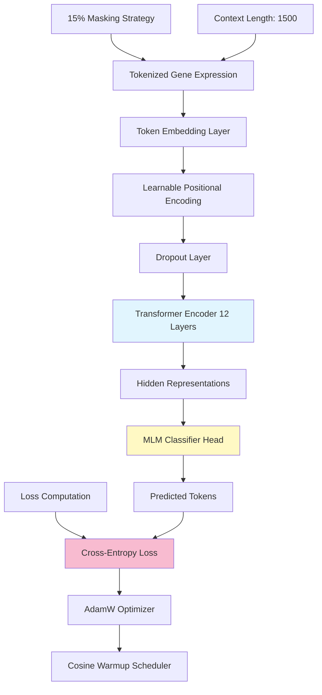
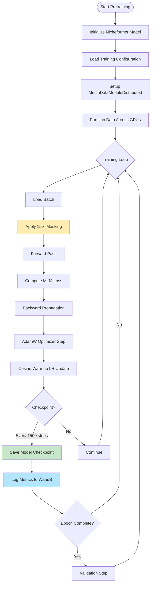

Pretraining Nicheformer involves training a transformer-based foundation model on large-scale single-cell and spatial omics data using masked language modeling (MLM). This process enables the model to learn robust gene expression representations that capture complex biological patterns across tissues, species, and experimental modalities. The pretraining pipeline leverages distributed training infrastructure to efficiently process millions of cells from the SpatialCorpus-110M dataset, which contains approximately 110 million cells from both dissociated single-cell and spatial transcriptomics technologies.

Sources: [train.py](src/nicheformer/train.py), [_train.py](src/nicheformer/_train.py), [_nicheformer.py](src/nicheformer/models/_nicheformer.py)

## Pretraining Architecture Overview

Nicheformer's pretraining architecture follows a transformer encoder design adapted for gene expression sequences. The model processes tokenized gene expression data through a series of self-attention layers, learning to predict masked tokens based on context. The core components include token embeddings, learnable positional encodings, a multi-layer transformer encoder, and a classification head for MLM predictions.



The architecture employs a transformer encoder with 12 layers, each containing 16 attention heads and 1024-dimensional feedforward networks. The embedding dimension is set to 512, enabling rich representation learning while maintaining computational efficiency. Learnable positional encodings allow the model to capture position-dependent patterns in gene expression sequences without relying on fixed sinusoidal encodings.

Sources: [_nicheformer.py](src/nicheformer/models/_nicheformer.py#L84-L132), [_config_train.py](src/nicheformer/config_files/_config_train.py)

## Distributed Data Loading Pipeline

Nicheformer utilizes Merlin's distributed data loading infrastructure to efficiently process large-scale datasets across multiple GPUs. The `MerlinDataModuleDistributed` handles data partitioning, ensuring each GPU processes a subset of the training data while maintaining load balance. Data is stored in parquet format following a structured schema that includes gene expression values, niche information, and various metadata columns.

> [!TIP]
> The distributed data loading strategy divides parquet files across devices using modulo arithmetic on file indices. This ensures each GPU gets approximately equal data partitions, which is critical for maintaining training efficiency and avoiding device imbalance during distributed training.

| Column Name | Data Type | Description |
|-------------|-----------|-------------|
| X | int32 | Tokenized gene expression values |
| X_niche_0 to X_niche_4 | int32 | Niche context features |
| density_0 to density_4 | float32 | Density measurements |
| cell_type | int64 | Cell type annotations |
| specie | int64 | Species identifiers |
| assay | int64 | Experimental assay types |
| modality | int64 | Data modality (spatial/dissociated) |

Sources: [datamodules.py](src/nicheformer/data/datamodules.py#L1-L50), [datamodules.py](src/nicheformer/data/datamodules.py#L90-L118)

## Pretraining Workflow

The pretraining process follows a systematic workflow from data loading to model optimization. PyTorch Lightning orchestrates the training loop, handling distributed training coordination, checkpointing, and logging through Weights & Biases.



The training loop processes batches with gradient accumulation of 10 steps, effectively achieving a batch size of 60 across 6 samples per batch. Checkpoints are saved every 1500 training steps to `/pretrained` directory, with Weights & Biases logging training metrics every 100 steps. Validation occurs every 50 epochs, though the extremely high `max_epochs` parameter suggests training is typically controlled by step count rather than epoch count.

Sources: [_train.py](src/nicheformer/_train.py#L9-L81), [train.py](src/nicheformer/train.py#L1-L23)

## Masked Language Modeling Strategy

Nicheformer employs masked language modeling (MLM) as its pretraining objective, following principles similar to BERT but adapted for gene expression data. The masking strategy replaces 15% of tokens with a special mask token, with the original token values serving as targets for the loss computation. The masking implementation carefully preserves special tokens like CLS and PAD to maintain sequence structure.

The masking distribution follows the classic BERT pattern:
- **80%** of masked tokens are replaced with `[MASK]` token (value 0)
- **10%** are replaced with random tokens from the vocabulary
- **10%** remain unchanged (original tokens)

This strategy forces the model to learn contextual representations rather than simply copying token identities. Padding tokens (originally value 0, converted to 1) and CLS tokens (value 3) are never masked, ensuring the model can always identify valid content positions and sequence boundaries.

> [!TIP]
> The masking operation uses Bernoulli sampling to determine which tokens to mask, with the final mask tensor identifying positions where loss should be computed. Positions with padding tokens or CLS tokens are marked with value 1 in the mask, which the loss function interprets as "ignore these positions" through target value -100.

Sources: [_utils.py](src/nicheformer/models/_utils.py#L8-L60), [_nicheformer.py](src/nicheformer/models/_nicheformer.py#L156-L208)

## Hyperparameter Configuration

Pretraining hyperparameters are configured through a sweep configuration dictionary that controls all aspects of model architecture and training behavior. The configuration supports pretraining on all available data (`organ: "everything"`) or specific organs, with flexibility to incorporate species, assay, and modality information.

| Parameter | Value | Description |
|-----------|-------|-------------|
| dim_model | 512 | Transformer embedding dimension |
| nheads | 16 | Number of attention heads per layer |
| nlayers | 12 | Number of transformer encoder layers |
| dim_feedforward | 1024 | Feedforward network dimension |
| dropout | 0.0 | Dropout probability (disabled for pretraining) |
| n_tokens | 20340 | Size of the gene expression vocabulary |
| context_length | 1500 | Maximum sequence length per batch |
| masking_p | 0.15 | Probability of masking each token |
| batch_size | 6 | Batch size per GPU |
| lr | 7e-4 | Peak learning rate |
| warmup | 100000 | Number of warmup steps |
| learnable_pe | True | Use learnable positional embeddings |

The learning rate schedule employs cosine annealing with warmup, linearly increasing the learning rate from 0 to 7e-4 over the first 100,000 steps, then following a cosine decay curve toward a minimum of 1e-5. The optimizer uses AdamW with weight decay of 0.1 for regularization. Gradient clipping with value 1.0 prevents exploding gradients during training.

Sources: [_config_train.py](src/nicheformer/config_files/_config_train.py), [_nicheformer.py](src/nicheformer/models/_nicheformer.py#L253-L270), [_nicheformer.py](src/nicheformer/models/_nicheformer.py#L329-L348)

## Training Step Implementation

Each training step follows a clear sequence of operations: masking, forward pass, loss computation, and logging. The process occurs within the `training_step` method of the Nicheformer LightningModule, which receives batches from the Merlin data loader.

The masking operation is performed under `torch.no_grad()` context since it doesn't require gradient computation. The forward pass takes the masked indices and attention mask as input, producing MLM predictions and transformer output. Loss is computed only on masked positions using cross-entropy, with unmasked positions assigned a target value of -100 to exclude them from loss computation.

```python
# Training step workflow
batch = complete_masking(batch, self.hparams.masking_p, self.hparams.n_tokens)
predictions = self.forward(masked_indices, attention_mask)
mlm_predictions = predictions['mlm_prediction']
loss = self._compute_loss(mlm_predictions, real_indices)
```

The validation step follows an identical process, enabling consistent evaluation of model performance on held-out data. Training metrics are logged with distributed synchronization across GPUs, ensuring accurate loss aggregation.

Sources: [_nicheformer.py](src/nicheformer/models/_nicheformer.py#L156-L177), [_nicheformer.py](src/nicheformer/models/_nicheformer.py#L206-L214)

## Model Initialization and Weight Initialization

Model weight initialization follows Xavier (Glorot) normal distribution for linear layers, with biases initialized to zero. This initialization strategy works well for transformer architectures, helping prevent vanishing or exploding gradients during early training. The embedding layers use default PyTorch initialization, which typically uses uniform distributions scaled by the square root of the embedding dimension.

The model can be initialized from scratch or loaded from a pretrained checkpoint using PyTorch Lightning's `load_from_checkpoint` method. When `pretrained_path` is specified in the configuration, the model loads weights from the checkpoint, enabling transfer learning or continued training. The `retake_training` flag controls whether training continues from the checkpoint or starts from the loaded weights as a fixed initialization.

Sources: [_nicheformer.py](src/nicheformer/models/_nicheformer.py#L264-L270), [_train.py](src/nicheformer/_train.py#L12-L25)

## Practical Pretraining Execution

To initiate pretraining, execute the main training script with appropriate configuration. The script automatically detects available GPUs and configures distributed training accordingly. The command below starts pretraining from scratch:

```bash
python src/nicheformer/train.py
```

The training process logs progress to Weights & Biases under the project name `FM-{organ}`, allowing real-time monitoring of training metrics, learning rates, and model performance. Checkpoints are automatically saved at regular intervals, enabling recovery from training interruptions or analysis of intermediate model states.

For production pretraining on large datasets like SpatialCorpus-110M, ensure adequate GPU resources and storage are available. The distributed training setup with DDP (Distributed Data Parallel) efficiently scales across multiple GPUs, with each GPU processing a partition of the training data. The `precision='bf16-mixed'` configuration enables bfloat16 mixed precision training, reducing memory requirements and potentially accelerating training speed.

After pretraining completes, the learned representations can be extracted for downstream analysis or the model can be fine-tuned for specific tasks. For detailed information on fine-tuning, see [Fine-Tuning Model Architecture](18-fine-tuning-model-architecture), and for embedding extraction methods, refer to [Extracting Cell Embeddings from Pre-trained Models](23-extracting-cell-embeddings-from-pre-trained-models).

Sources: [train.py](src/nicheformer/train.py#L7-L16), [_train.py](src/nicheformer/_train.py#L27-L52)

## Next Steps

For a deeper understanding of distributed training strategies used in pretraining, continue to [Distributed Training with PyTorch Lightning](16-distributed-training-with-pytorch-lightning). To learn about configuring different training workflows and experiments, proceed to [Configuring Training Workflows](17-configuring-training-workflows). For comprehensive information on model architecture details, revisit [Nicheformer Transformer Architecture](10-nicheformer-transformer-architecture).