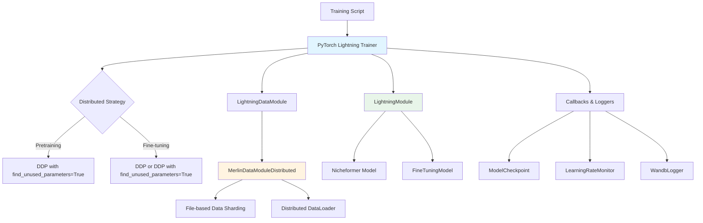
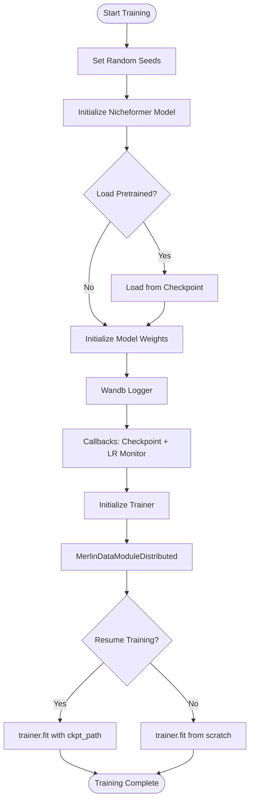

Nicheformer leverages PyTorch Lightning's distributed training capabilities to scale foundation model pretraining across multiple GPUs efficiently. This document explains the distributed training architecture, configuration strategies, and practical implementation details for training large-scale transformer models on spatial omics data.

## Distributed Training Architecture

The distributed training system in Nicheformer follows a modular architecture that integrates PyTorch Lightning's trainer with Merlin's distributed data loading infrastructure. The system supports both pretraining and fine-tuning workflows across multiple GPUs using Distributed Data Parallel (DDP) strategy.



The architecture separates concerns between training orchestration (Lightning Trainer), data distribution (LightningDataModule), and model logic (LightningModule), enabling flexible distributed training configurations. The trainer manages the distributed process group, device allocation, and gradient synchronization, while the data module ensures each GPU processes its designated data shard.

Sources: [src/nicheformer/_train.py](src/nicheformer/_train.py#L33-L52), [src/nicheformer/data/datamodules.py](src/nicheformer/data/datamodules.py#L118-L132)

## DDP Strategy Configuration

Nicheformer employs PyTorch's Distributed Data Parallel (DDP) strategy with specific configuration options optimized for transformer training. The core DDP setup uses the `ddp_find_unused_parameters_true` strategy for pretraining, which allows for flexible architectures where not all parameters are used in every forward pass (common with auxiliary task heads).

The trainer configuration includes:

| Configuration Parameter | Value | Purpose |
|------------------------|-------|---------|
| `accelerator` | `'gpu'` | Target hardware for training |
| `devices` | `-1` | Use all available GPUs |
| `strategy` | `"ddp_find_unused_parameters_true"` | DDP with unused parameter detection |
| `precision` | `'bf16-mixed'` | Mixed precision training with BF16 |
| `gradient_clip_val` | `1` | Gradient clipping threshold |
| `accumulate_grad_batches` | `10` | Gradient accumulation for effective larger batch size |

This configuration enables training on up to 8 GPUs (or more depending on hardware) with automatic gradient synchronization and mixed precision optimization. The BF16 mixed precision training reduces memory footprint and increases throughput while maintaining numerical stability.

> [!TIP]
> The `ddp_find_unused_parameters_true` strategy is essential for Nicheformer's multi-task architecture where different prediction heads may be conditionally active. However, it incurs a small performance overhead compared to standard DDP. For pure pretraining without auxiliary tasks, standard DDP may provide marginal speed improvements.

Sources: [src/nicheformer/_train.py](src/nicheformer/_train.py#L33-L47)

## Trainer Initialization and Workflow

The training workflow is encapsulated in the `manual_train_fm` function, which orchestrates the complete distributed training process:



The trainer initialization includes logging and monitoring infrastructure:

- **WandbLogger**: Tracks experiments with project naming convention `FM-{organ}`
- **ModelCheckpoint**: Saves checkpoints every 1500 training steps to `/pretrained` directory
- **LearningRateMonitor**: Logs learning rate changes every step

The checkpointing strategy saves all checkpoints (`save_top_k=-1`) rather than only the best models, enabling flexible selection during downstream evaluation.

Sources: [src/nicheformer/_train.py](src/nicheformer/_train.py#L8-L52), [src/nicheformer/train.py](src/nicheformer/train.py#L7-L15)

## Distributed Data Loading with Merlin

Nicheformer implements a sophisticated distributed data loading strategy using NVIDIA Merlin's framework. The `MerlinDataModuleDistributed` class extends PyTorch Lightning's `LightningDataModule` to handle file-based data sharding across multiple GPUs efficiently.

### Data Sharding Strategy

The data module distributes parquet files across GPUs using modulo-based partitioning:

```python
# Files are assigned to GPUs based on file index modulo world_size
for device in range(world_size):
    files = [file for file in os.listdir(join(base_path, split)) 
             if (int(file.split('.')[0].split('-')[1]) % world_size) == device]
```

This approach ensures that each GPU processes a distinct subset of files, minimizing inter-GPU communication for data loading. The system supports train/validation/test splits with consistent sharding patterns across splits.

> [!TIP]
> The file-based sharding strategy assumes files are named with sequential indices (e.g., `part-000-123.parquet`). For custom data organization, modify the `_get_data_files_distributed` function to implement appropriate partitioning logic.

Sources: [src/nicheformer/data/datamodules.py](src/nicheformer/data/datamodules.py#L90-L102)

### DataLoader Configuration

The Merlin DataLoader configuration includes:

| Parameter | Training Value | Inference Value | Purpose |
|-----------|----------------|-----------------|---------|
| `parts_per_chunk` | `8` | `1` | Number of files processed per chunk |
| `shuffle` | `True` | `False` | Randomize data order during training |
| `drop_last` | Configurable | `False` | Handle incomplete batches |

Each GPU accesses its designated dataset shard using `get_rank()`, ensuring that dataloaders across GPUs return consistent data ordering when shuffling is disabled (essential for deterministic evaluation).

Sources: [src/nicheformer/data/datamodules.py](src/nicheformer/data/datamodules.py#L67-L76), [src/nicheformer/data/datamodules.py](src/nicheformer/data/datamodules.py#L175-L182)

## Model Integration with Lightning

The `Nicheformer` model extends `pl.LightningModule`, implementing the PyTorch Lightning interface for distributed training. Key distributed training methods include:

### Training Step Implementation

```python
def training_step(self, batch: dict[str, torch.Tensor], batch_idx: int) -> torch.Tensor:
    """Execute training step with distributed logging."""
    with torch.no_grad():
        batch = complete_masking(batch, self.hparams.masking_p, self.hparams.n_tokens)
    
    # Forward pass and loss computation
    predictions = self.forward(masked_indices, attention_mask)
    loss = self._compute_loss(mlm_predictions, real_indices)
    
    # Distributed logging with synchronization
    self.log('train_loss', loss, sync_dist=True, prog_bar=True, reduce_fx='mean')
    return loss
```

The critical `sync_dist=True` parameter ensures that logged metrics are synchronized across all processes before logging, preventing discrepancies between GPU metrics during distributed training.

### Validation Step Implementation

Validation follows the same pattern with `sync_dist=True` for the `val_loss` metric, ensuring consistent evaluation across all GPUs.

Sources: [src/nicheformer/models/_nicheformer.py](src/nicheformer/models/_nicheformer.py#L156-L177)

## Multi-GPU Training Execution

To execute distributed training, simply run the training script with PyTorch Lightning's launcher or let Lightning handle process spawning automatically:

```bash
# Automatic multi-GPU training (uses all available GPUs)
python src/nicheformer/train.py
```

The training script first detects available GPUs:

```python
if torch.cuda.is_available():
    num_gpus = torch.cuda.device_count()
    print(f"Number of GPUs available: {num_gpus}")
```

Lightning's `devices=-1` configuration automatically utilizes all detected GPUs. Each GPU runs a separate process with its own rank, and the DDP strategy handles gradient synchronization.

### Effective Batch Size Calculation

With the configuration of `batch_size=6` per GPU and `accumulate_grad_batches=10`, the effective batch size is calculated as:

```
Effective Batch Size = batch_size × num_gpus × accumulate_grad_batches
                      = 6 × 8 × 10 = 480
```

This effective batch size enables training stability while fitting within GPU memory constraints.

Sources: [src/nicheformer/train.py](src/nicheformer/train.py#L7-L15), [src/nicheformer/config_files/_config_train.py](src/nicheformer/config_files/_config_train.py#L20)

## Fine-Tuning in Distributed Mode

Fine-tuning workflows support the same distributed infrastructure with flexible strategy selection based on model freezing requirements:

```python
strategy="ddp_find_unused_parameters_true" if config['freeze']==False else "ddp"
```

When freezing the backbone model (fine-tuning only task-specific heads), standard DDP is sufficient since all parameters are used. When training the full model, `find_unused_parameters=True` accommodates the flexible architecture.

The fine-tuning trainer uses similar configuration:

| Parameter | Value | Difference from Pretraining |
|-----------|-------|-----------------------------|
| `max_epochs` | `1` | Typically shorter than pretraining |
| `check_val_every_n_epoch` | `None` | Custom validation schedule |
| `checkpoint frequency` | `every_n_train_steps=5000` | Less frequent than pretraining |

Sources: [src/nicheformer/_fine_tune.py](src/nicheformer/_fine_tune.py#L48-L59), [src/nicheformer/fine_tune.py](src/nicheformer/fine_tune.py#L7-L9)

## Configuration Management

Training configurations are centralized in YAML-like Python dictionaries for easy modification and reproducibility. Key configuration parameters for distributed training:

### Pretraining Configuration

```python
sweep_config = {
    'dim_model': 512,
    'nheads': 16,
    'nlayers': 12,
    'batch_size': 6,
    'lr': 7e-4,
    'warmup': 100000,
    'organ': "everything",
    'specie': True,
    'assay': True,
    'modality': True,
}
```

### Fine-Tuning Configuration

```python
sweep_config = {
    'checkpoint_path': "/path/to/pretrained.ckpt",
    'freeze': False,
    'batch_size': 12,
    'lr': 1e-4,
    'supervised_task': 'niche_classification',
    'organ': 'brain',
}
```

The configuration system enables quick experimentation with different distributed training parameters without modifying core training code.

Sources: [src/nicheformer/config_files/_config_train.py](src/nicheformer/config_files/_config_train.py#L1-L26), [src/nicheformer/config_files/_config_fine_tune.py](src/nicheformer/config_files/_config_fine_tune.py#L1-L21)

## Monitoring and Experiment Tracking

Distributed training metrics are tracked through integrated logging systems:

1. **Wandb Integration**: Automatic experiment tracking with:
   - Per-epoch loss logging (synchronized across GPUs)
   - Learning rate monitoring at step granularity
   - Hardware utilization metrics
   - Checkpoint management

2. **Progress Bar**: Real-time training progress with `prog_bar=True` in logging

3. **Checkpointing**: Regular model snapshots enabling:
   - Training resumption from checkpoints
   - Model selection for downstream tasks
   - Debugging and analysis

The logging frequency (`log_every_n_steps=100`) balances monitoring granularity with I/O overhead, particularly important in distributed settings where disk contention can occur.

Sources: [src/nicheformer/_train.py](src/nicheformer/_train.py#L35-L36), [src/nicheformer/_train.py](src/nicheformer/_train.py#L38-L39)

## Best Practices and Considerations

When scaling Nicheformer training across multiple GPUs, consider these practical recommendations:

1. **Memory Management**: Monitor GPU memory usage with `batch_size` and `accumulate_grad_batches` tuning. The current configuration (6 samples per GPU with 10x accumulation) balances memory efficiency with training stability.

2. **Data Layout**: Ensure parquet files are distributed evenly across shards. Imbalanced file distribution can lead to GPU underutilization.

3. **Checkpoint Frequency**: Balance checkpoint frequency with storage overhead. Pretraining checkpoints every 1500 steps provide reasonable granularity without excessive storage.

4. **Gradient Clipping**: The `gradient_clip_val=1` prevents gradient explosion, particularly important with large effective batch sizes.

5. **Precision Training**: BF16 mixed precision training reduces memory usage by approximately 50% while maintaining model quality compared to FP32.

6. **Seeding**: Consistent random seeds (`pl.seed_everything(42)`) ensure reproducibility across distributed runs.

Sources: [src/nicheformer/_train.py](src/nicheformer/_train.py#L9-L10), [src/nicheformer/_train.py](src/nicheformer/_train.py#L44-L46)

## Next Steps

To deepen your understanding of Nicheformer's training system, explore these related topics:

- **Pretraining Workflow**: See [Pretraining Nicheformer on Large-Scale Data](15-pretraining-nicheformer-on-large-scale-data) for the complete pretraining pipeline
- **Training Configuration**: Review [Configuring Training Workflows](17-configuring-training-workflows) for advanced training customization
- **Fine-Tuning**: Understand [Fine-Tuning Model Architecture](18-fine-tuning-model-architecture) for transfer learning strategies
- **Model Architecture**: Study the [Nicheformer Transformer Architecture](10-nicheformer-transformer-architecture) for architectural details

For practical implementation, refer to the training scripts in the repository:
- Pretraining: [src/nicheformer/train.py](src/nicheformer/train.py)
- Fine-tuning: [src/nicheformer/fine_tune.py](src/nicheformer/fine_tune.py)