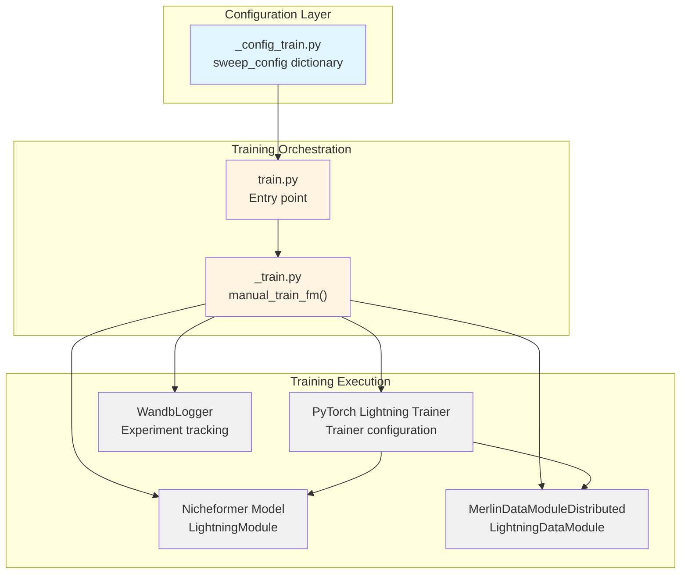
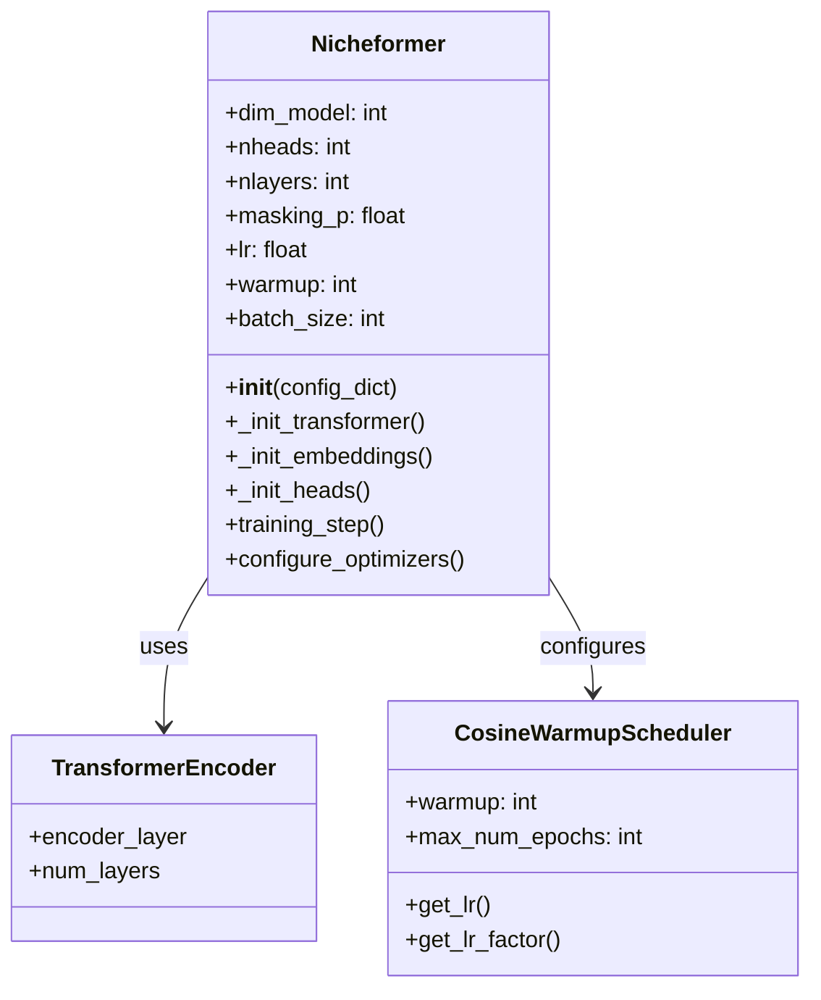
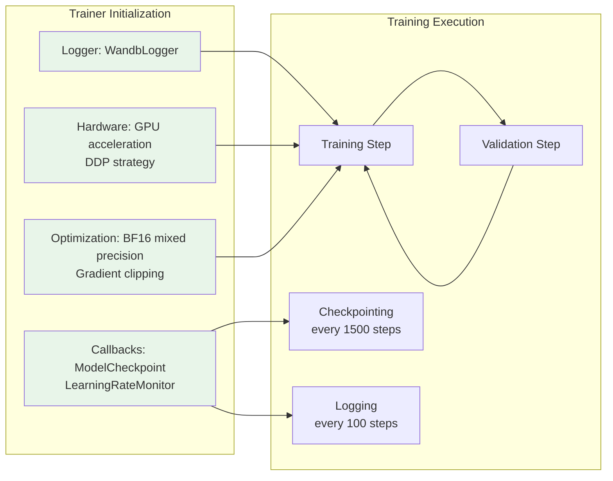
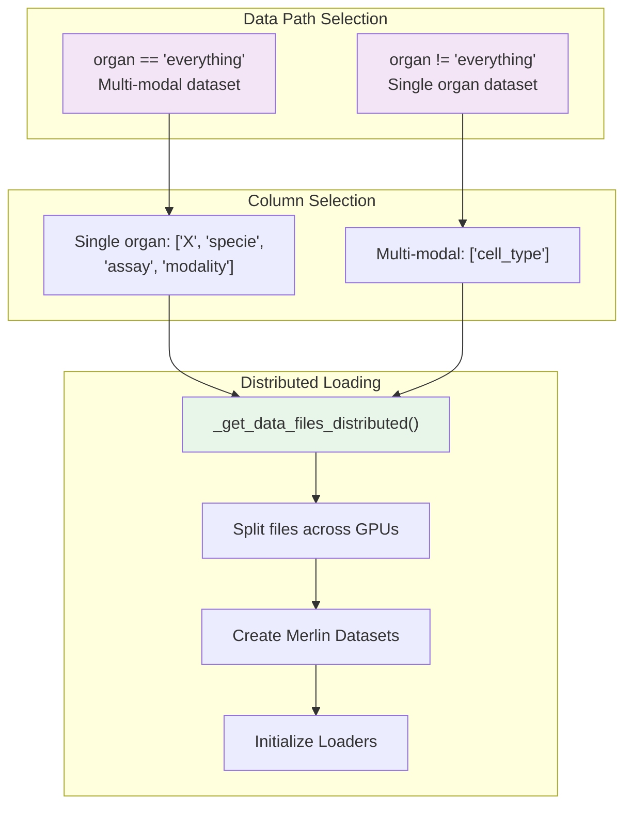
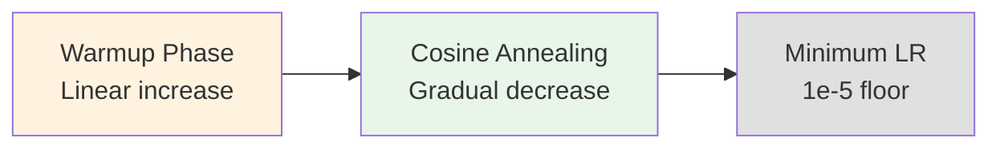
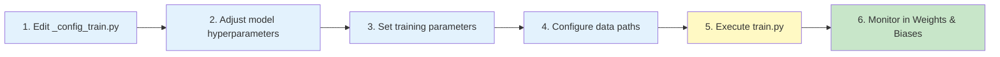

Configuring training workflows in Nicheformer requires orchestrating multiple components: model architecture parameters, PyTorch Lightning trainer settings, distributed data loading with Merlin, and experiment tracking with Weights & Biases. This guide provides comprehensive configuration strategies for effective pretraining and fine-tuning workflows.

## Training Workflow Architecture

The training workflow architecture follows a modular design where configuration drives all training components through a central configuration dictionary. The system separates concerns into three layers: configuration definition, training orchestration, and distributed execution.



The workflow initiates from `train.py` which imports the configuration and calls `manual_train_fm()`, orchestrating model initialization, data module creation, and trainer setup with distributed training capabilities.

Sources: [train.py](src/nicheformer/train.py#L1-L16), [_train.py](src/nicheformer/_train.py#L8-L81)

## Configuration File Structure

Nicheformer uses Python dictionary-based configuration stored in `config_files/` directory, providing type-safe parameter management for different training modes.


The primary configuration for pretraining is `_config_train.py`, while fine-tuning uses `_config_fine_tune.py`. Each configuration contains hyperparameters organized by functional categories: model architecture, training hyperparameters, and experimental metadata.

Sources: [_config_train.py](src/nicheformer/config_files/_config_train.py#L1-L26), [_config_fine_tune.py](src/nicheformer/config_files/_config_fine_tune.py#L1-L21)

### Core Configuration Parameters

The training configuration dictionary (`sweep_config`) contains all hyperparameters necessary to initialize and train the model.

| Parameter Category | Key Parameters | Purpose | Default Values |
|-------------------|----------------|---------|----------------|
| **Model Architecture** | `dim_model`, `nheads`, `nlayers`, `dim_feedforward` | Transformer dimension, attention heads, layers, FFN size | 512, 16, 12, 1024 |
| **Training Hyperparameters** | `lr`, `warmup`, `batch_size`, `max_epochs` | Learning rate, warmup steps, batch size, training duration | 7e-4, 100000, 6, 30661140 |
| **Data Configuration** | `n_tokens`, `context_length`, `masking_p` | Vocabulary size, sequence length, masking probability | 20340, 1500, 0.15 |
| **Regularization** | `dropout`, `learnable_pe` | Dropout rate, positional encoding type | 0.0, True |
| **Task Configuration** | `supervised_task`, `autoregressive`, `pool` | Training mode, architecture variants | False, False, None |
| **Metadata Tags** | `organ`, `specie`, `assay`, `modality` | Dataset metadata tokens for embedding | "everything", True, True, True |

Sources: [_config_train.py](src/nicheformer/config_files/_config_train.py#L1-L26)

## Model Configuration

The `Nicheformer` class inherits from PyTorch Lightning's `LightningModule` and receives configuration parameters through its constructor, enabling flexible architecture specification.



Model initialization proceeds through three private methods: `_init_transformer()` creates the encoder layers, `_init_embeddings()` sets up token and positional embeddings, and `_init_heads()` prepares output prediction heads for the masked token prediction task.

Sources: [_nicheformer.py](src/nicheformer/models/_nicheformer.py#L15-L83), [_train.py](src/nicheformer/_train.py#L12-L32)

### Architectural Configuration Details

The transformer architecture uses PyTorch's `TransformerEncoderLayer` with specific configurations optimized for genomic data patterns.

> [!TIP]
> The `batch_first=True` parameter in the transformer configuration is critical for compatibility with Merlin data loaders, which provide batches in the format `[batch_size, sequence_length]` rather than the default `[sequence_length, batch_size]`.

The encoder layer configuration includes `layer_norm_eps=1e-12` for numerical stability, and `enable_nested_tensor=False` to ensure consistent behavior across different PyTorch versions when working with variable-length sequences.

Sources: [_nicheformer.py](src/nicheformer/models/_nicheformer.py#L84-L99)

## Trainer Configuration

PyTorch Lightning's `Trainer` class provides high-level training orchestration with built-in support for distributed training, mixed precision, and automatic checkpoint management.



The trainer configuration enables distributed training using `strategy="ddp_find_unused_parameters_true"`, which is necessary when the model has auxiliary parameters that may not be used in every forward pass.

Sources: [_train.py](src/nicheformer/_train.py#L43-L55)

### Critical Trainer Parameters

| Parameter | Value | Purpose |
|-----------|-------|---------|
| `accelerator` | `'gpu'` | Use GPU acceleration |
| `devices` | `-1` | Use all available GPUs |
| `strategy` | `"ddp_find_unused_parameters_true"` | Distributed data parallel with parameter safety |
| `precision` | `'bf16-mixed'` | Mixed precision training for memory efficiency |
| `gradient_clip_val` | `1` | Clip gradients to prevent exploding gradients |
| `accumulate_grad_batches` | `10` | Accumulate gradients across multiple batches |
| `log_every_n_steps` | `100` | Log metrics frequency |
| `check_val_every_n_epoch` | `50` | Validation frequency |

Sources: [_train.py](src/nicheformer/_train.py#L43-L55)

## Data Module Configuration

Distributed data loading is managed through `MerlinDataModuleDistributed`, which handles efficient data distribution across multiple GPUs using Merlin's optimized loaders.



The data module automatically determines whether to load multi-modal data (when `organ="everything"`) or single-organ datasets, adjusting the column selection and data paths accordingly.

Sources: [_train.py](src/nicheformer/_train.py#L58-L73), [datamodules.py](src/nicheformer/data/datamodules.py#L118-L176)

### Data Module Parameters

| Parameter | Purpose | Default |
|-----------|---------|---------|
| `path` | Base path to tokenized data | Organism-specific |
| `columns` | Columns to load from parquet files | `'cell_type'` or multi-modal list |
| `batch_size` | Batch size per GPU | From config |
| `world_size` | Number of GPUs for distributed training | From trainer |
| `sub_sample_frac` | Fraction of data to use | 1.0 (full dataset) |
| `splits` | Whether to use train/val/test splits | True |

Sources: [datamodules.py](src/nicheformer/data/datamodules.py#L120-L132)

## Learning Rate Scheduling

Nicheformer employs a custom `CosineWarmupScheduler` that combines linear warmup with cosine annealing, a strategy proven effective for transformer training.



The scheduler calculates the learning rate factor based on the current epoch, applying linear scaling during the warmup phase and cosine decay afterward. A minimum learning rate floor of `1e-5` prevents the learning rate from becoming too small.

Sources: [_nicheformer.py](src/nicheformer/models/_nicheformer.py#L329-L348)

### Scheduling Configuration

The scheduling parameters are configured through the main configuration dictionary:

| Parameter | Description | Typical Values |
|-----------|-------------|----------------|
| `lr` | Base learning rate | 7e-4 (pretraining), 1e-4 (fine-tuning) |
| `warmup` | Warmup steps | 100000 (pretraining), 1 (fine-tuning) |
| `max_epochs` | Total training duration | 30661140 steps, or epoch-based |

During warmup, the learning rate increases linearly from 0 to the base learning rate. After warmup, it follows a cosine decay curve until reaching the minimum value.

Sources: [_config_train.py](src/nicheformer/config_files/_config_train.py#L15-L16), [_nicheformer.py](src/nicheformer/models/_nicheformer.py#L342-L347)

## Experiment Tracking Configuration

Weights & Biases integration provides comprehensive experiment tracking, logging metrics, hyperparameters, and model artifacts throughout training.

> [!TIP]
> The Wandb project name is dynamically generated as `FM-{organ}`, allowing automatic grouping of experiments by tissue type or training scope in the Weights & Biases dashboard.

Two callbacks are configured: `ModelCheckpoint` saves model checkpoints every 1500 training steps with `save_top_k=-1` to keep all checkpoints, and `LearningRateMonitor` tracks the learning rate schedule for analysis.

Sources: [_train.py](src/nicheformer/_train.py#L38-L41)

### Checkpoint Configuration

| Setting | Value | Purpose |
|---------|-------|---------|
| `dirpath` | `'/pretrained'` | Directory for checkpoint storage |
| `every_n_train_steps` | `1500` | Checkpoint frequency |
| `monitor` | `'train_loss'` | Metric to monitor |
| `save_top_k` | `-1` | Save all checkpoints |

Sources: [_train.py](src/nicheformer/_train.py#L40)

## Training Workflow Configuration Steps

Configuring a complete training workflow involves modifying the configuration dictionary and executing the training script.



### Step-by-Step Configuration

1. **Modify Model Architecture**: Adjust `dim_model`, `nheads`, `nlayers`, and `dim_feedforward` based on available compute resources and model capacity requirements
2. **Set Training Parameters**: Configure `lr`, `warmup`, `batch_size`, and `max_epochs` appropriate for your dataset size and training objectives
3. **Configure Data Loading**: Set `organ` parameter to specify dataset scope and ensure data paths point to correctly tokenized data
4. **Adjust Regularization**: Modify `dropout` and `masking_p` to balance model capacity and generalization
5. **Execute Training**: Run `python src/nicheformer/train.py` to initiate the training workflow

Sources: [train.py](src/nicheformer/train.py#L7-L16)

## Pretraining vs. Fine-Tuning Configuration

Configuration requirements differ significantly between pretraining and fine-tuning workflows, with fine-tuning typically using smaller batch sizes, higher learning rates, and shorter warmup periods.

| Aspect | Pretraining | Fine-Tuning |
|--------|-------------|-------------|
| **Learning Rate** | 7e-4 | 1e-4 |
| **Warmup** | 100000 steps | 1 epoch |
| **Batch Size** | 6 | 12 |
| **Task** | Masked token prediction | Supervised classification/regression |
| **Configuration File** | `_config_train.py` | `_config_fine_tune.py` |
| **Pretrained Path** | None | Required checkpoint path |

Fine-tuning configurations additionally specify the downstream task type (`supervised_task`), prediction dimension (`dim_prediction`), and optional layer reinitialization (`reinit_layers`) strategies.

Sources: [_config_train.py](src/nicheformer/config_files/_config_train.py#L1-L26), [_config_fine_tune.py](src/nicheformer/config_files/_config_fine_tune.py#L1-L21)

## Continuing Training from Checkpoints

The workflow supports resuming training from checkpoints, enabling experiment continuation or transfer learning across different datasets.

When both `pretrained_path` and `retake_training` are set in the configuration, the training script loads the model from the checkpoint and continues training on the new dataset while preserving learned representations.

```python
# From _train.py
if config['pretrained_path'] is not None and config['retake_training']:
    print(f"Training model in {config['organ']} from checkpoint!")
    trainer.fit(model=model, datamodule=module, ckpt_path=config['pretrained_path'])
```

Sources: [_train.py](src/nicheformer/_train.py#L75-L77), [_train.py](src/nicheformer/_train.py#L34-L36)

<blog>

# Configuring Training Workflows

Configuring training workflows in Nicheformer requires orchestrating multiple components: model architecture parameters, PyTorch Lightning trainer settings, distributed data loading with Merlin, and experiment tracking with Weights & Biases. This guide provides comprehensive configuration strategies for effective pretraining and fine-tuning workflows.

## Training Workflow Architecture

The training workflow architecture follows a modular design where configuration drives all training components through a central configuration dictionary. The system separates concerns into three layers: configuration definition, training orchestration, and distributed execution.


The workflow initiates from `train.py` which imports the configuration and calls `manual_train_fm()`, orchestrating model initialization, data module creation, and trainer setup with distributed training capabilities.

Sources: [train.py](src/nicheformer/train.py#L1-L16), [_train.py](src/nicheformer/_train.py#L8-L81)

## Configuration File Structure

Nicheformer uses Python dictionary-based configuration stored in `config_files/` directory, providing type-safe parameter management for different training modes.


The primary configuration for pretraining is `_config_train.py`, while fine-tuning uses `_config_fine_tune.py`. Each configuration contains hyperparameters organized by functional categories: model architecture, training hyperparameters, and experimental metadata.

Sources: [_config_train.py](src/nicheformer/config_files/_config_train.py#L1-L26), [_config_fine_tune.py](src/nicheformer/config_files/_config_fine_tune.py#L1-L21)

### Core Configuration Parameters

The training configuration dictionary (`sweep_config`) contains all hyperparameters necessary to initialize and train the model.

| Parameter Category | Key Parameters | Purpose | Default Values |
|-------------------|----------------|---------|----------------|
| **Model Architecture** | `dim_model`, `nheads`, `nlayers`, `dim_feedforward` | Transformer dimension, attention heads, layers, FFN size | 512, 16, 12, 1024 |
| **Training Hyperparameters** | `lr`, `warmup`, `batch_size`, `max_epochs` | Learning rate, warmup steps, batch size, training duration | 7e-4, 100000, 6, 30661140 |
| **Data Configuration** | `n_tokens`, `context_length`, `masking_p` | Vocabulary size, sequence length, masking probability | 20340, 1500, 0.15 |
| **Regularization** | `dropout`, `learnable_pe` | Dropout rate, positional encoding type | 0.0, True |
| **Task Configuration** | `supervised_task`, `autoregressive`, `pool` | Training mode, architecture variants | False, False, None |
| **Metadata Tags** | `organ`, `specie`, `assay`, `modality` | Dataset metadata tokens for embedding | "everything", True, True, True |

Sources: [_config_train.py](src/nicheformer/config_files/_config_train.py#L1-L26)

## Model Configuration

The `Nicheformer` class inherits from PyTorch Lightning's `LightningModule` and receives configuration parameters through its constructor, enabling flexible architecture specification.


Model initialization proceeds through three private methods: `_init_transformer()` creates the encoder layers, `_init_embeddings()` sets up token and positional embeddings, and `_init_heads()` prepares output prediction heads for the masked token prediction task.

Sources: [_nicheformer.py](src/nicheformer/models/_nicheformer.py#L15-L83), [_train.py](src/nicheformer/_train.py#L12-L32)

### Architectural Configuration Details

The transformer architecture uses PyTorch's `TransformerEncoderLayer` with specific configurations optimized for genomic data patterns.

> [!TIP]
> The `batch_first=True` parameter in the transformer configuration is critical for compatibility with Merlin data loaders, which provide batches in the format `[batch_size, sequence_length]` rather than the default `[sequence_length, batch_size]`.

The encoder layer configuration includes `layer_norm_eps=1e-12` for numerical stability, and `enable_nested_tensor=False` to ensure consistent behavior across different PyTorch versions when working with variable-length sequences.

Sources: [_nicheformer.py](src/nicheformer/models/_nicheformer.py#L84-L99)

## Trainer Configuration

PyTorch Lightning's `Trainer` class provides high-level training orchestration with built-in support for distributed training, mixed precision, and automatic checkpoint management.


The trainer configuration enables distributed training using `strategy="ddp_find_unused_parameters_true"`, which is necessary when the model has auxiliary parameters that may not be used in every forward pass.

Sources: [_train.py](src/nicheformer/_train.py#L43-L55)

### Critical Trainer Parameters

| Parameter | Value | Purpose |
|-----------|-------|---------|
| `accelerator` | `'gpu'` | Use GPU acceleration |
| `devices` | `-1` | Use all available GPUs |
| `strategy` | `"ddp_find_unused_parameters_true"` | Distributed data parallel with parameter safety |
| `precision` | `'bf16-mixed'` | Mixed precision training for memory efficiency |
| `gradient_clip_val` | `1` | Clip gradients to prevent exploding gradients |
| `accumulate_grad_batches` | `10` | Accumulate gradients across multiple batches |
| `log_every_n_steps` | `100` | Log metrics frequency |
| `check_val_every_n_epoch` | `50` | Validation frequency |

Sources: [_train.py](src/nicheformer/_train.py#L43-L55)

## Data Module Configuration

Distributed data loading is managed through `MerlinDataModuleDistributed`, which handles efficient data distribution across multiple GPUs using Merlin's optimized loaders.


The data module automatically determines whether to load multi-modal data (when `organ="everything"`) or single-organ datasets, adjusting the column selection and data paths accordingly.

Sources: [_train.py](src/nicheformer/_train.py#L58-L73), [datamodules.py](src/nicheformer/data/datamodules.py#L118-L176)

### Data Module Parameters

| Parameter | Purpose | Default |
|-----------|---------|---------|
| `path` | Base path to tokenized data | Organism-specific |
| `columns` | Columns to load from parquet files | `'cell_type'` or multi-modal list |
| `batch_size` | Batch size per GPU | From config |
| `world_size` | Number of GPUs for distributed training | From trainer |
| `sub_sample_frac` | Fraction of data to use | 1.0 (full dataset) |
| `splits` | Whether to use train/val/test splits | True |

Sources: [datamodules.py](src/nicheformer/data/datamodules.py#L120-L132)

## Learning Rate Scheduling

Nicheformer employs a custom `CosineWarmupScheduler` that combines linear warmup with cosine annealing, a strategy proven effective for transformer training.


The scheduler calculates the learning rate factor based on the current epoch, applying linear scaling during the warmup phase and cosine decay afterward. A minimum learning rate floor of `1e-5` prevents the learning rate from becoming too small.

Sources: [_nicheformer.py](src/nicheformer/models/_nicheformer.py#L329-L348)

### Scheduling Configuration

The scheduling parameters are configured through the main configuration dictionary:

| Parameter | Description | Typical Values |
|-----------|-------------|----------------|
| `lr` | Base learning rate | 7e-4 (pretraining), 1e-4 (fine-tuning) |
| `warmup` | Warmup steps | 100000 (pretraining), 1 (fine-tuning) |
| `max_epochs` | Total training duration | 30661140 steps, or epoch-based |

During warmup, the learning rate increases linearly from 0 to the base learning rate. After warmup, it follows a cosine decay curve until reaching the minimum value.

Sources: [_config_train.py](src/nicheformer/config_files/_config_train.py#L15-L16), [_nicheformer.py](src/nicheformer/models/_nicheformer.py#L342-L347)

## Experiment Tracking Configuration

Weights & Biases integration provides comprehensive experiment tracking, logging metrics, hyperparameters, and model artifacts throughout training.

> [!TIP]
> The Wandb project name is dynamically generated as `FM-{organ}`, allowing automatic grouping of experiments by tissue type or training scope in the Weights & Biases dashboard.

Two callbacks are configured: `ModelCheckpoint` saves model checkpoints every 1500 training steps with `save_top_k=-1` to keep all checkpoints, and `LearningRateMonitor` tracks the learning rate schedule for analysis.

Sources: [_train.py](src/nicheformer/_train.py#L38-L41)

### Checkpoint Configuration

| Setting | Value | Purpose |
|---------|-------|---------|
| `dirpath` | `'/pretrained'` | Directory for checkpoint storage |
| `every_n_train_steps` | `1500` | Checkpoint frequency |
| `monitor` | `'train_loss'` | Metric to monitor |
| `save_top_k` | `-1` | Save all checkpoints |

Sources: [_train.py](src/nicheformer/_train.py#L40)

## Training Workflow Configuration Steps

Configuring a complete training workflow involves modifying the configuration dictionary and executing the training script.


### Step-by-Step Configuration

1. **Modify Model Architecture**: Adjust `dim_model`, `nheads`, `nlayers`, and `dim_feedforward` based on available compute resources and model capacity requirements
2. **Set Training Parameters**: Configure `lr`, `warmup`, `batch_size`, and `max_epochs` appropriate for your dataset size and training objectives
3. **Configure Data Loading**: Set `organ` parameter to specify dataset scope and ensure data paths point to correctly tokenized data
4. **Adjust Regularization**: Modify `dropout` and `masking_p` to balance model capacity and generalization
5. **Execute Training**: Run `python src/nicheformer/train.py` to initiate the training workflow

Sources: [train.py](src/nicheformer/train.py#L7-L16)

## Pretraining vs. Fine-Tuning Configuration

Configuration requirements differ significantly between pretraining and fine-tuning workflows, with fine-tuning typically using smaller batch sizes, higher learning rates, and shorter warmup periods.

| Aspect | Pretraining | Fine-Tuning |
|--------|-------------|-------------|
| **Learning Rate** | 7e-4 | 1e-4 |
| **Warmup** | 100000 steps | 1 epoch |
| **Batch Size** | 6 | 12 |
| **Task** | Masked token prediction | Supervised classification/regression |
| **Configuration File** | `_config_train.py` | `_config_fine_tune.py` |
| **Pretrained Path** | None | Required checkpoint path |

Fine-tuning configurations additionally specify the downstream task type (`supervised_task`), prediction dimension (`dim_prediction`), and optional layer reinitialization (`reinit_layers`) strategies.

Sources: [_config_train.py](src/nicheformer/config_files/_config_train.py#L1-L26), [_config_fine_tune.py](src/nicheformer/config_files/_config_fine_tune.py#L1-L21)

## Continuing Training from Checkpoints

The workflow supports resuming training from checkpoints, enabling experiment continuation or transfer learning across different datasets.

When both `pretrained_path` and `retake_training` are set in the configuration, the training script loads the model from the checkpoint and continues training on the new dataset while preserving learned representations.

```python
# From _train.py
if config['pretrained_path'] is not None and config['retake_training']:
    print(f"Training model in {config['organ']} from checkpoint!")
    trainer.fit(model=model, datamodule=module, ckpt_path=config['pretrained_path'])
```

Sources: [_train.py](src/nicheformer/_train.py#L75-L77), [_train.py](src/nicheformer/_train.py#L34-L36)

## Next Steps

For comprehensive training implementation, explore [Pretraining Nicheformer on Large-Scale Data](15-pretraining-nicheformer-on-large-scale-data) to understand data preparation and distributed training strategies. If you're preparing models for specific applications, [Configuration Files and Parameters](26-configuration-files-and-parameters) provides detailed parameter explanations, while [Experiment Tracking with Weights & Biases](27-experiment-tracking-with-weights-and-biases) covers advanced monitoring techniques.