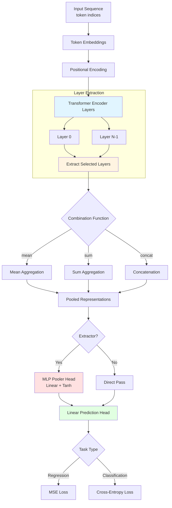

Nicheformer's fine-tuning architecture adapts the pre-trained transformer backbone for supervised downstream tasks through a flexible modular design. This architecture enables efficient transfer learning across various spatial transcriptomics applications while preserving the rich biological representations learned during pretraining. The system provides two implementations—`NicheformerFineTune` (recommended) and `FineTuningModel` (alternative)—both built on PyTorch Lightning for streamlined training workflows.

Sources: [src/nicheformer/models/_nicheformer_fine_tune.py](src/nicheformer/models/_nicheformer_fine_tune.py#L18-L92), [src/nicheformer/models/_fine_tune_model.py](src/nicheformer/models/_fine_tune_model.py#L15-L106)

## Architecture Overview

The fine-tuning architecture follows a modular design pattern where a frozen or partially-updated pre-trained backbone processes input sequences, extracting intermediate representations from specific transformer layers. These representations are combined using configurable aggregation functions and passed through task-specific prediction heads. The architecture supports multiple supervised tasks including regression for continuous niche composition values, classification for cell type labels, and density prediction for spatial analysis.

The key architectural components include: (1) the pre-trained Nicheformer backbone, (2) layer extraction mechanism that selects specific transformer encoder layers, (3) layer combination functions that aggregate multi-layer representations, (4) optional MLP extractor for additional transformation, and (5) task-specific linear prediction heads.

Sources: [src/nicheformer/models/_nicheformer_fine_tune.py](src/nicheformer/models/_nicheformer_fine_tune.py#L118-L174), [src/nicheformer/models/_fine_tune_model.py](src/nicheformer/models/_fine_tune_model.py#L107-L163)

## Core Components

### Pre-trained Backbone

The backbone is the pre-trained `Nicheformer` model that provides the foundational representations for fine-tuning. During initialization, the backbone's masking parameter (`masking_p`) is set to 0.0 since masked language modeling loss is no longer used during supervised fine-tuning. The backbone can be completely frozen or selectively updated based on the `freeze` parameter, enabling different transfer learning strategies. When `freeze=True`, all backbone parameters remain static, and only the task-specific prediction heads are trained. This approach is useful when the pre-trained representations are already well-suited for the downstream task or when working with limited training data.

Sources: [src/nicheformer/models/_nicheformer_fine_tune.py](src/nicheformer/models/_nicheformer_fine_tune.py#L62-L67), [src/nicheformer/models/_fine_tune_model.py](src/nicheformer/models/_fine_tune_model.py#L60-L64)

### Layer Extraction Mechanism

The fine-tuning architecture extracts hidden representations from specific transformer encoder layers rather than using only the final output. This is controlled by the `extract_layers` parameter, which accepts a list of layer indices. For example, `extract_layers=[11]` extracts features only from the final transformer layer (layer 11 in a 12-layer model), while `extract_layers=[6, 11]` combines representations from both middle and final layers. This flexibility allows practitioners to leverage different levels of abstraction—earlier layers capture more local patterns while later layers encode higher-level biological concepts.

> [!TIP]
> The layer extraction mechanism enables you to experiment with different abstraction levels for your specific task. Earlier layers may be better for fine-grained spatial patterns, while later layers often capture more semantic biological relationships.

Sources: [src/nicheformer/models/_nicheformer_fine_tune.py](src/nicheformer/models/_nicheformer_fine_tune.py#L130-L137), [src/nicheformer/models/_fine_tune_model.py](src/nicheformer/models/_fine_tune_model.py#L130-L138)

### Layer Combination Strategies

When multiple layers are extracted, their representations must be combined into a single feature vector. The `function_layers` parameter determines this aggregation strategy:

| Strategy | Description | Output Dimension | Use Case |
|----------|-------------|------------------|----------|
| `mean` | Element-wise average across layers | `dim_model` | Balanced integration of multi-scale features |
| `sum` | Element-wise sum across layers | `dim_model` | Emphasizes features present across multiple layers |
| `concat` | Concatenation along feature dimension | `dim_model × num_layers` | Preserves all layer-specific information |

The mean strategy is most commonly used as it provides smooth integration without drastically increasing dimensionality. Concatenation preserves the most information but increases computational cost and may require more training data to avoid overfitting.

Sources: [src/nicheformer/models/_nicheformer_fine_tune.py](src/nicheformer/models/_nicheformer_fine_tune.py#L139-L145), [src/nicheformer/models/_fine_tune_model.py](src/nicheformer/models/_fine_tune_model.py#L140-L147)

## Task-Specific Prediction Heads

The architecture supports five supervised tasks, each with a specialized prediction head and loss function:

### Niche Regression

Predicts continuous values representing niche composition or cell-type proportions in the local microenvironment. Uses a linear head mapping from `dim_model` to `dim_prediction` dimensions (typically the number of cell types, e.g., 33), with MSE loss. Optionally supports distribution regression (`regress_distribution=True`) where predictions are normalized via softmax to sum to 1, representing probability distributions over niche compositions.

Sources: [src/nicheformer/models/_nicheformer_fine_tune.py](src/nicheformer/models/_nicheformer_fine_tune.py#L93-L98), [src/nicheformer/models/_fine_tune_model.py](src/nicheformer/models/_fine_tune_model.py#L73-L76)

### Density Regression

Predicts a single scalar value representing cell density in the local microenvironment. Uses a linear head with one output dimension and MSE loss. This is useful for spatial analysis tasks where the number of surrounding cells is the target variable.

Sources: [src/nicheformer/models/_nicheformer_fine_tune.py](src/nicheformer/models/_nicheformer_fine_tune.py#L99-L101), [src/nicheformer/models/_fine_tune_model.py](src/nicheformer/models/_fine_tune_model.py#L77-L79)

### Niche Classification

Performs multi-class classification to predict discrete niche or region labels. Uses a linear head mapping to `n_classes` dimensions with cross-entropy loss. The output shape is `(batch_size, n_classes)`, and the model predicts class indices directly.

Sources: [src/nicheformer/models/_nicheformer_fine_tune.py](src/nicheformer/models/_nicheformer_fine_tune.py#L102-L104), [src/nicheformer/models/_fine_tune_model.py](src/nicheformer/models/_fine_tune_model.py#L80-L82)

### Binary Classification

Performs binary classification tasks, such as presence/absence of specific cell types or conditions. Uses a linear head with `dim_prediction` outputs and cross-entropy loss. Labels are automatically converted to binary (0 or 1) during training.

Sources: [src/nicheformer/models/_nicheformer_fine_tune.py](src/nicheformer/models/_nicheformer_fine_tune.py#L105-L107), [src/nicheformer/models/_fine_tune_model.py](src/nicheformer/models/_fine_tune_model.py#L83-L85)

### Multi-class Classification

Handles multi-label classification scenarios where each sample can belong to multiple classes simultaneously. Uses a linear head with `dim_prediction × n_classes` outputs, allowing predictions for multiple labels per sample.

Sources: [src/nicheformer/models/_nicheformer_fine_tune.py](src/nicheformer/models/_nicheformer_fine_tune.py#L108-L113), [src/nicheformer/models/_fine_tune_model.py](src/nicheformer/models/_fine_tune_model.py#L86-L88)

## Configuration Parameters

The fine-tuning architecture accepts numerous parameters that control its behavior:

| Parameter | Type | Default | Description |
|-----------|------|---------|-------------|
| `backbone` | `pl.LightningModule` | required | Pre-trained Nicheformer model |
| `supervised_task` | `str` | required | Task type: 'niche_regression', 'density_regression', 'niche_classification', etc. |
| `extract_layers` | `list[int]` | required | Indices of transformer layers to extract features from |
| `function_layers` | `str` | 'mean' | Method to combine extracted layers: 'mean', 'sum', 'concat' |
| `freeze` | `bool` | False | If True, freeze all backbone parameters |
| `reinit_layers` | `list[int]` \| `None` | None | Layers to reinitialize before training |
| `extractor` | `bool` | False | If True, add MLP pooler head before final linear layer |
| `lr` | `float` | 1e-4 | Learning rate |
| `warmup` | `int` | 10 | Number of warmup steps for LR scheduler |
| `max_epochs` | `int` | 50000 | Maximum training epochs |
| `dim_prediction` | `int` | 33 | Output dimension for regression tasks |
| `n_classes` | `int` | 60 | Number of classes for classification tasks |
| `regress_distribution` | `bool` | False | Normalize regression outputs to sum to 1 |
| `predict_density` | `bool` | False | Predict scalar cell density |
| `ignore_zeros` | `bool` | False | Ignore zero labels in classification |
| `without_context` | `bool` | True | Exclude context tokens from predictions |

Sources: [src/nicheformer/models/_nicheformer_fine_tune.py](src/nicheformer/models/_nicheformer_fine_tune.py#L19-L90), [src/nicheformer/config_files/_config_fine_tune.py](src/nicheformer/config_files/_config_fine_tune.py#L1-L21)

## Training Workflow

The training workflow follows a standard PyTorch Lightning pattern with task-specific loss computation and logging. During each training step, the model:

1. Receives a batch containing token indices, attention masks, and labels
2. Disables MLM masking by setting masking probability to 0.0
3. Processes the batch through the backbone to extract layer representations
4. Aggregates representations using the specified combination function
5. Applies optional MLP extractor and task-specific linear head
6. Computes task-specific loss (MSE for regression, Cross-entropy for classification)
7. Logs metrics to the training logger

The model implements `training_step`, `validation_step`, `test_step`, and `predict_step` methods following PyTorch Lightning conventions. The optimizer uses AdamW with the CosineWarmupScheduler, which gradually increases the learning rate during the warmup period then applies cosine annealing decay.

```mermaid
flowchart LR
    A[Batch Input<br/>tokens, attention_mask, label] --> B[Disable MLM Masking<br/>masking_p=0.0]
    B --> C[Forward Pass<br/>Backbone + Extraction]
    C --> D[Layer Combination<br/>mean/sum/concat]
    D --> E[Optional MLP Extractor<br/>if extractor=True]
    E --> F[Task-Specific Linear Head]
    F --> G{Task Type?}
    G -->|Regression| H[Compute MSE Loss]
    G -->|Classification| I[Compute Cross-Entropy Loss]
    H --> J[Backpropagation<br/>AdamW Optimizer]
    I --> J
    J --> K[Learning Rate Schedule<br/>Cosine Warmup]
    K --> L[Log Metrics]
    
    style C fill:#e1f5ff
    style F fill:#fff4e1
    style H fill:#ffe1e1
    style I fill:#ffe1e1
```

Sources: [src/nicheformer/models/_nicheformer_fine_tune.py](src/nicheformer/models/_nicheformer_fine_tune.py#L175-L218), [src/nicheformer/models/_nicheformer_fine_tune.py](src/nicheformer/models/_nicheformer_fine_tune.py#L391-L406)

## Context Token Handling

The architecture provides flexibility in handling auxiliary context tokens through the `without_context` parameter. Context tokens are special tokens added to the input sequence that encode metadata about the sample (e.g., modality, species, assay). When `without_context=True` (default), the model excludes the first 3 tokens (typically auxiliary tokens) from pooling and prediction, using only the biological sequence tokens. When `without_context=False`, all tokens including context tokens are included in the pooled representation.

This design choice allows the model to either leverage contextual metadata in predictions or focus purely on the biological sequence content depending on the task requirements.

Sources: [src/nicheformer/models/_nicheformer_fine_tune.py](src/nicheformer/models/_nicheformer_fine_tune.py#L161-L166), [src/nicheformer/models/_fine_tune_model.py](src/nicheformer/models/_fine_tune_model.py#L151-L156)

## Layer Reinitialization Strategy

The `reinit_layers` parameter enables selective reinitialization of transformer encoder layers before fine-tuning. When specified, the indicated layers have their weights reinitialized using the backbone's initialization function. This strategy is particularly useful when transferring to substantially different domains where some layers' pre-trained weights may be less relevant. For example, reinitializing the final few layers while keeping earlier layers frozen can help the model adapt to new downstream tasks while preserving lower-level feature extractors.

Sources: [src/nicheformer/models/_nicheformer_fine_tune.py](src/nicheformer/models/_nicheformer_fine_tune.py#L68-L72), [src/nicheformer/models/_fine_tune_model.py](src/nicheformer/models/_fine_tune_model.py#L66-L72)

## Next Steps

After understanding the fine-tuning architecture, you can explore specific task implementations:

- **[Classification Tasks with Fine-Tuning](19-classification-tasks-with-fine-tuning)**: Learn detailed strategies for classification tasks including multi-class and binary scenarios
- **[Regression Tasks and Density Prediction](20-regression-tasks-and-density-prediction)**: Dive deeper into regression tasks for niche composition and density prediction
- **[Layer Extraction and Reinitialization Strategies](21-layer-extraction-and-reinitialization-strategies)**: Understand best practices for selecting and configuring layer extraction strategies
- **[Transfer Learning Across Tissues and Technologies](22-transfer-learning-across-tissues-and-technologies)**: Learn how to effectively apply fine-tuning across different biological contexts

For practical implementation examples, refer to the [downstream fine-tuning notebook](../notebooks/experiments/downstream_fine_tune.ipynb) which demonstrates end-to-end workflows for various tasks.
