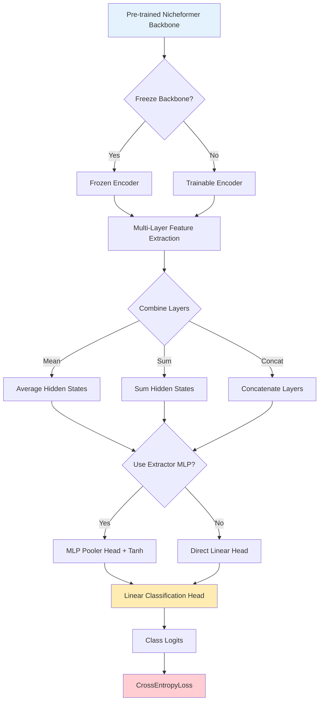

This guide explains how to fine-tune pre-trained Nicheformer models for classification tasks in spatial omics data. Fine-tuning adapts the foundation model's learned representations to predict discrete categorical labels such as cell types, tissue regions, or spatial niches.

## Classification Task Architecture

The fine-tuning architecture wraps a pre-trained Nicheformer backbone with a classification-specific prediction head. This design enables efficient transfer learning while preserving the powerful representations learned during pretraining across diverse spatial transcriptomics datasets.

Sources: [_nicheformer_fine_tune.py](src/nicheformer/models/_nicheformer_fine_tune.py#L18-L93)



The architecture consists of five key components that transform pre-trained representations into classification predictions:

**Backbone Encoder**: The pre-trained Nicheformer transformer processes input token sequences through multi-layer attention mechanisms. You can optionally freeze these parameters to preserve pre-trained knowledge, or unfreeze them for full fine-tuning. When `freeze=True`, the backbone weights remain unchanged, and only the classification head is trained—this is particularly effective when the downstream task is similar to the pretraining domain.

**Layer Extraction Strategy**: Rather than using only the final transformer output, Nicheformer extracts features from intermediate layers specified by `extract_layers` (e.g., `[8, 10, 11]` for the top three layers). This captures multi-scale representations that improve classification performance. The extracted representations are then combined using one of three strategies: `"mean"` averages across layers, `"sum"` adds them together, or `"concat"` concatenates them to create higher-dimensional features.

> [!TIP]
> The choice of `extract_layers` significantly impacts performance. Deeper layers capture more task-specific features, while shallower layers preserve generalizable patterns. For complex classification tasks, extracting from multiple layers (e.g., `[8, 10, 11]`) and using mean pooling typically outperforms single-layer extraction.

**Optional Extractor MLP**: When `extractor=True`, an additional MLP layer (linear transformation + Tanh activation) is applied before the final classification head. This extractor follows the HuggingFace BERT-style pooler architecture and provides a learned transformation of the aggregated representations, which can improve performance on challenging classification tasks by adding non-linear capacity.

**Classification Head**: A linear layer maps the aggregated representations to class logits. For `niche_classification`, this produces `n_classes` logits—one per class. For `niche_binary_classification`, it produces `dim_prediction` logits (one per cell type), and for `niche_multiclass_classification`, it produces `dim_prediction * n_classes` logits for multi-label scenarios.

**Pooling Strategy**: The final token representations are pooled to create a fixed-size vector for each sample. The `"mean"` strategy averages all token representations (excluding auxiliary context tokens when `without_context=True`). The `"cls"` strategy uses a dedicated CLS token prepended to the sequence, similar to BERT. For spatial omics data, mean pooling is typically more effective as it captures the full context of the cellular neighborhood.

Sources: [_nicheformer_fine_tune.py](src/nicheformer/models/_nicheformer_fine_tune.py#L93-L117), [_fine_tune_model.py](src/nicheformer/models/_fine_tune_model.py#L93-L140)

## Supported Classification Tasks

Nicheformer provides three distinct classification task types, each optimized for different downstream prediction scenarios in spatial omics analysis.

| Task Type | Prediction Shape | Loss Function | Use Case |
|-----------|------------------|---------------|----------|
| `niche_classification` | `(batch, n_classes)` | CrossEntropyLoss | Multi-class single-label classification (e.g., tissue region, spatial niche) |
| `niche_binary_classification` | `(batch, dim_prediction)` | CrossEntropyLoss | Binary classification per cell type (e.g., presence/absence) |
| `niche_multiclass_classification` | `(batch, n_classes, dim_prediction)` | CrossEntropyLoss | Multi-label classification (e.g., multiple marker expressions) |

**Niche Classification**: The most common task for spatial omics, this performs standard multi-class classification where each sample belongs to exactly one class. For example, classifying cells into spatial niche types or tissue regions. The model outputs `n_classes` logits, and the class with the highest score is selected as the prediction. This is ideal for categorical variables with mutually exclusive categories.

Sources: [_nicheformer_fine_tune.py](src/nicheformer/models/_nicheformer_fine_tune.py#L106-L108)

**Niche Binary Classification**: This performs binary classification for each of `dim_prediction` categories (typically cell types). For each category, the model predicts whether it is present (1) or absent (0). This is useful for tasks like predicting which cell types are present in a cellular neighborhood, where multiple cell types can co-occur. Labels are automatically converted to binary format: `label = (label != 0).int()`.

Sources: [_nicheformer_fine_tune.py](src/nicheformer/models/_nicheformer_fine_tune.py#L109-L111), [_fine_tune_model.py](src/nicheformer/models/_fine_tune_model.py#L180-L182)

**Niche Multi-class Classification**: This extends binary classification to multiple classes per category, enabling multi-label prediction scenarios. The output dimension is `dim_prediction * n_classes`, which is then reshaped to `(batch, n_classes, dim_prediction)` for loss computation. This allows predicting, for example, different expression levels or states for multiple cell types simultaneously.

Sources: [_nicheformer_fine_tune.py](src/nicheformer/models/_nicheformer_fine_tune.py#L112-L115), [_fine_tune_model.py](src/nicheformer/models/_fine_tune_model.py#L133-L136)

## Configuration and Hyperparameters

Fine-tuning requires careful configuration of model architecture and training hyperparameters. The configuration system supports both Python dictionaries and YAML files, making it easy to experiment with different settings.

```python
config = {
    # Model paths and data
    'checkpoint_path': 'path/to/pretrained/model.ckpt',
    'data_path': 'path/to/data.h5ad',
    'technology_mean_path': 'path/to/technology_mean.npy',
    'output_path': 'path/to/predictions.h5ad',
    
    # Task specification
    'supervised_task': 'niche_classification',  # Task type
    'label': 'region',  # Column name to predict
    'organ': 'brain',  # Tissue type for logging
    
    # Model architecture
    'freeze': False,  # Freeze backbone weights
    'reinit_layers': None,  # Layers to reinitialize
    'extract_layers': [11],  # Which transformer layers to use
    'function_layers': 'mean',  # How to combine layers
    'extractor': False,  # Use MLP extractor
    'pool': 'mean',  # Pooling strategy
    'without_context': True,  # Exclude auxiliary tokens
    
    # Output dimensions
    'n_classes': 17,  # Number of classes for classification
    'dim_prediction': 1,  # Output dimension (task-dependent)
    
    # Training hyperparameters
    'batch_size': 32,
    'lr': 1e-4,
    'warmup': 10,
    'max_epochs': 100,
    'gradient_clip_val': 1.0,
    'accumulate_grad_batches': 10,
    'precision': 32,
    
    # Data loading
    'max_seq_len': 1500,
    'aux_tokens': 30,
    'chunk_size': 1000,
    'num_workers': 4,
}
```

Sources: [_config_fine_tune.py](src/nicheformer/config_files/_config_fine_tune.py#L1-L21), [downstream_fine_tune.ipynb](notebooks/experiments/downstream_fine_tune.ipynb#L38-L74)

### Key Configuration Parameters

The most critical parameters for successful fine-tuning are those controlling model architecture and training dynamics:

**Freeze Strategy**: Setting `freeze=True` is recommended when working with small datasets or when the downstream task closely matches the pretraining domain. This prevents catastrophic forgetting of the pre-trained representations and reduces the risk of overfitting. For larger datasets or significantly different tasks, setting `freeze=False` and using a lower learning rate (e.g., `1e-5`) allows the model to adapt more thoroughly to the new task.

Sources: [_nicheformer_fine_tune.py](src/nicheformer/models/_nicheformer_fine_tune.py#L31-L32), [_fine_tune_model.py](src/nicheformer/models/_fine_tune_model.py#L47-L48)

**Layer Extraction**: The `extract_layers` parameter determines which transformer layers contribute to the final prediction. Common strategies include:
- `[11]` for using only the final layer (most task-specific features)
- `[8, 10, 11]` for multi-scale feature combination
- `[0, 5, 10, 11]` for capturing representations at all depth levels

The `function_layers` parameter controls how these extracted layers are combined, with `"mean"` being the most robust choice for most classification tasks.

Sources: [_nicheformer_fine_tune.py](src/nicheformer/models/_nicheformer_fine_tune.py#L127-L143), [_fine_tune_model.py](src/nicheformer/models/_fine_tune_model.py#L107-L122)

**Learning Rate and Warmup**: Fine-tuning typically requires lower learning rates than pretraining. A common configuration is `lr=1e-4` with `warmup=10` steps, allowing the model to gradually increase the learning rate before decaying it following a cosine schedule. The warmup period helps stabilize training early in the fine-tuning process. Use the `LearningRateMonitor` callback to track learning rate changes throughout training.

Sources: [_fine_tune.py](src/nicheformer/_fine_tune.py#L37-L56), [_nicheformer_fine_tune.py](src/nicheformer/models/_nicheformer_fine_tune.py#L391-L398)

> [!TIP]
> For classification tasks with class imbalance, consider using `ignore_zeros=True` to exclude zero-valued labels from loss computation. This prevents the model from being biased toward the majority class and can significantly improve performance on minority classes. The implementation automatically replaces zeros with `-100`, which PyTorch's CrossEntropyLoss ignores.

Sources: [_nicheformer_fine_tune.py](src/nicheformer/models/_nicheformer_fine_tune.py#L35), [_fine_tune_model.py](src/nicheformer/models/_fine_tune_model.py#L195-L197)

## Training Workflow

The fine-tuning workflow follows a structured process from data loading through model training and prediction. This workflow is implemented in both script form (`_fine_tune.py`) and as an interactive notebook (`downstream_fine_tune.ipynb`).


**Step 1: Model Loading**: Load the pre-trained Nicheformer model from a checkpoint path. The model architecture and hyperparameters are automatically restored, providing a solid foundation for fine-tuning.

```python
from nicheformer.models import Nicheformer, NicheformerFineTune

model = Nicheformer.load_from_checkpoint(
    checkpoint_path=config['checkpoint_path'],
    strict=False
)
```

Sources: [_fine_tune.py](src/nicheformer/_fine_tune.py#L13-L14), [downstream_fine_tune.ipynb](notebooks/experiments/downstream_fine_tune.ipynb#L165-L168)

**Step 2: Fine-Tuning Model Initialization**: Wrap the pre-trained backbone with the classification-specific components:

```python
fine_tune_model = NicheformerFineTune(
    backbone=model,
    supervised_task=config['supervised_task'],
    extract_layers=config['extract_layers'],
    function_layers=config['function_layers'],
    lr=config['lr'],
    warmup=config['warmup'],
    max_epochs=config['max_epochs'],
    dim_prediction=config['dim_prediction'],
    n_classes=config['n_classes'],
    freeze=config['freeze'],
    reinit_layers=config['reinit_layers'],
    extractor=config['extractor'],
    pool=config['pool'],
    organ=config['organ'],
    label=config['label'],
    without_context=True
)
```

Sources: [_nicheformer_fine_tune.py](src/nicheformer/models/_nicheformer_fine_tune.py#L19-L63), [downstream_fine_tune.ipynb](notebooks/experiments/downstream_fine_tune.ipynb#L170-L188)

**Step 3: Trainer Configuration**: Set up the PyTorch Lightning trainer with appropriate callbacks and settings:

```python
import pytorch_lightning as pl
from pytorch_lightning.callbacks import ModelCheckpoint, LearningRateMonitor

trainer = pl.Trainer(
    max_epochs=config['max_epochs'],
    accelerator='gpu',
    devices=1,
    precision=config.get('precision', 32),
    gradient_clip_val=config.get('gradient_clip_val', 1.0),
    accumulate_grad_batches=config.get('accumulate_grad_batches', 10),
    callbacks=[
        ModelCheckpoint(dirpath=config['output_dir'], every_n_train_steps=5000, save_top_k=-1),
        LearningRateMonitor(logging_interval='step')
    ]
)
```

Sources: [_fine_tune.py](src/nicheformer/_fine_tune.py#L37-L56), [downstream_fine_tune.ipynb](notebooks/experiments/downstream_fine_tune.ipynb#L190-L198)

**Step 4: Training**: Execute the training loop:

```python
trainer.fit(
    model=fine_tune_model,
    train_dataloaders=train_loader,
    val_dataloaders=val_loader
)
```

During training, the model logs both classification loss and accuracy metrics. The `training_step` method computes CrossEntropyLoss for classification tasks, with accuracy calculated as the proportion of correct predictions.

Sources: [_nicheformer_fine_tune.py](src/nicheformer/models/_nicheformer_fine_tune.py#L175-L212), [_fine_tune_model.py](src/nicheformer/models/_fine_tune_model.py#L164-L213)

**Step 5: Prediction and Evaluation**: Generate predictions on the test set and store them in the AnnData object:

```python
# Test evaluation
test_results = trainer.test(fine_tune_model, dataloaders=test_loader)

# Get predictions
predictions = trainer.predict(fine_tune_model, dataloaders=test_loader)
class_logits = torch.cat([p[0] for p in predictions]).cpu().numpy()
class_probs = torch.cat([p[1] for p in predictions]).cpu().numpy()

# Store in AnnData
adata.obs.loc[test_mask, f"{prediction_key}_class"] = class_logits.argmax(axis=1)
adata.obs.loc[test_mask, f"{prediction_key}_class_probs"] = class_probs
adata.write_h5ad(config['output_path'])
```

Sources: [_nicheformer_fine_tune.py](src/nicheformer/models/_nicheformer_fine_tune.py#L305-L321), [downstream_fine_tune.ipynb](notebooks/experiments/downstream_fine_tune.ipynb#L227-L246)

## Advanced Features

**Layer Reinitialization**: When `reinit_layers` is specified, the selected transformer layers are reinitialized with random weights using a normal distribution (mean=0.0, std=0.02). This can be beneficial when the pre-trained features are not well-suited for the downstream task, allowing the model to learn task-specific representations at intermediate layers while preserving the general knowledge in the remaining layers.

Sources: [_nicheformer_fine_tune.py](src/nicheformer/models/_nicheformer_fine_tune.py#L33-L37), [_fine_tune_model.py](src/nicheformer/models/_fine_tune_model.py#L50-L54)

**Context Token Handling**: Spatial omics data often includes auxiliary context tokens (modality, assay, specie) that are prepended to the actual gene expression tokens. Setting `without_context=True` excludes these auxiliary tokens from pooling by slicing `transformer_output[:, 3:, :]`, ensuring that predictions are based solely on the biological signal rather than technical metadata. This is particularly important for classification tasks where the biological content is the primary focus.

Sources: [_nicheformer_fine_tune.py](src/nicheformer/models/_nicheformer_fine_tune.py#L157-L160), [_fine_tune_model.py](src/nicheformer/models/_fine_tune_model.py#L138-L144)

**Distributed Training**: The fine-tuning script supports distributed data parallel (DDP) training for handling large datasets. The DDP strategy is automatically adjusted based on whether the backbone is frozen (`"ddp"` for frozen, `"ddp_find_unused_parameters_true"` for unfrozen) to optimize memory usage and computational efficiency.

Sources: [_fine_tune.py](src/nicheformer/_fine_tune.py#L50-L52)

## Common Use Cases

**Tissue Region Classification**: Classify cells into anatomical regions or tissue compartments (e.g., cortical layers in brain, zones in liver). This uses `niche_classification` with `n_classes` equal to the number of regions. The model learns to associate spatial and molecular patterns with region-specific identities.

**Spatial Niche Identification**: Identify discrete spatial niches based on cellular neighborhood composition. Each niche represents a distinct microenvironment characterized by specific cell type distributions. This is ideal for understanding tissue organization and cellular interaction patterns.

**Cell Type Presence Prediction**: Use `niche_binary_classification` to predict which cell types are present in each cellular neighborhood. This provides a binary profile of cell type co-occurrence patterns, useful for understanding tissue heterogeneity.

**Multi-Label Marker Expression**: Apply `niche_multiclass_classification` to predict expression levels or states of multiple markers simultaneously. This captures complex biological states that cannot be represented by single categorical labels.

Sources: [_fine_tune_model.py](src/nicheformer/models/_fine_tune_model.py#L62-L82), [_config_fine_tune.py](src/nicheformer/config_files/_config_fine_tune.py#L1-L21)

## Troubleshooting and Best Practices

**Poor Classification Performance**: If accuracy is low, consider: (1) Reducing `lr` to `1e-5` or lower, (2) Unfreezing more layers with `freeze=False`, (3) Extracting features from multiple layers with `extract_layers=[8, 10, 11]`, (4) Enabling the extractor MLP with `extractor=True`, (5) Increasing training epochs or adjusting warmup duration.

**Overfitting**: Signs of overfitting include large gaps between training and validation accuracy. Mitigate by: (1) Freezing the backbone with `freeze=True`, (2) Using stronger regularization (increase gradient clipping, add dropout), (3) Reducing model capacity (fewer extract_layers), (4) Increasing batch size for more stable gradients.

**Class Imbalance**: When classes are highly imbalanced, use `ignore_zeros=True` to exclude the majority class from loss computation, or implement weighted sampling in the DataLoader to balance class representation during training.

Sources: [_nicheformer_fine_tune.py](src/nicheformer/models/_nicheformer_fine_tune.py#L194-L196), [_fine_tune_model.py](src/nicheformer/models/_fine_tune_model.py#L195-L197)

## Next Steps

After mastering classification tasks, explore related topics:
- **[Regression Tasks and Density Prediction](20-regression-tasks-and-density-prediction)** for continuous value prediction tasks
- **[Fine-Tuning Model Architecture](18-fine-tuning-model-architecture)** for deeper architectural insights
- **[Transfer Learning Across Tissues and Technologies](22-transfer-learning-across-tissues-and-technologies)** for cross-domain adaptation strategies
- **[Layer Extraction and Reinitialization Strategies](21-layer-extraction-and-reinitialization-strategies)** for advanced layer manipulation techniques
