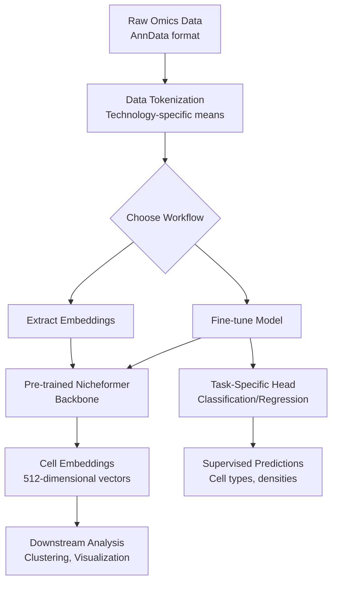
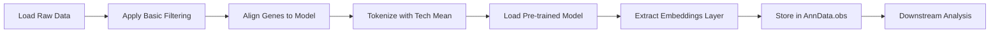

Nicheformer is a foundation model for single-cell and spatial omics data that enables powerful analysis across multiple technologies and tissue types. This guide will help you get up and running quickly with pre-trained models, allowing you to extract cell embeddings and fine-tune the model for your specific downstream tasks. Nicheformer leverages a transformer architecture trained on large-scale spatial and dissociated transcriptomics data, making it particularly effective for niche composition analysis and transfer learning across different omics modalities.

## Project Overview

Nicheformer provides two primary workflows: extracting embeddings from pre-trained models for downstream analysis, and fine-tuning the model for specific supervised tasks. The framework is built on PyTorch Lightning and supports distributed training with Merlin DataModule for efficient data loading at scale.




The project structure follows a modular design separating models, data processing, and experiment configurations:


Sources: [README.md](README.md#L1-L15), [__init__.py](src/nicheformer/__init__.py#L5-L8)

## Installation

Nicheformer requires Python 3.9 or newer. We strongly recommend creating a fresh conda environment to avoid dependency conflicts:

```bash
# Create a new environment
mamba create -n nicheformer_env python=3.9
mamba activate nicheformer_env

# Clone and install development version
git clone https://github.com/theislab/nicheformer.git
cd nicheformer
pip install -e .
```

The installation includes core dependencies for deep learning (PyTorch, PyTorch Lightning), data handling (AnnData, NumPy), distributed training (Merlin, Dask), and visualization (Squidpy). For GPU acceleration, consider installing CUDA dependencies with `pip install -e ".[cuda]"`.

Sources: [README.md](README.md#L16-L33), [pyproject.toml](pyproject.toml#L1-L52)

## Downloading Pre-trained Models

Pre-trained model weights and technology-specific mean files are available from Mendeley Data. Download these files into the `data/` subdirectory in the repository:

- **Pre-trained model**: `nicheformer.ckpt` - The foundation model pre-trained on the SpatialCorpus-110M dataset
- **Technology means**: Mean vectors for normalizing data from different platforms (CosMX, MERFISH, Xenium, ISS, dissociated scRNA-seq)
- **Example data**: Sample AnnData files demonstrating proper data formatting

```bash
# After downloading from Mendeley Data, organize as:
data/
├── nicheformer.ckpt
├── model_means/
│   ├── cosmx_mean_script.npy
│   ├── merfish_mean_script.npy
│   ├── xenium_mean_script.npy
│   └── dissociated_mean_script.npy
└── model.h5ad
```

These assets are essential for both embedding extraction and fine-tuning workflows. The technology mean files ensure proper normalization across different platforms using the tokenization pipeline.

Sources: [README.md](README.md#L40-L44), [data/README.md](data/README.md#L1-L5)

## Quick Workflows

Nicheformer supports two main entry points depending on your analysis needs:

| Workflow | Purpose | Output | Complexity |
|----------|---------|--------|------------|
| **Extract Embeddings** | Get fixed representations for downstream analysis | Cell embeddings (512-dim vectors) in AnnData | Beginner |
| **Fine-tune Model** | Adapt model to specific supervised tasks | Task-specific predictions (classification/regression) | Intermediate |

### Getting Cell Embeddings

Extracting embeddings is the quickest way to leverage Nicheformer for exploratory analysis. This workflow uses the pre-trained model as a feature extractor without modifying its weights:

```python
import anndata as ad
from nicheformer.models import Nicheformer
from nicheformer.data import NicheformerDataset
import torch

# Load your data
adata = ad.read_h5ad('path/to/your/data.h5ad')
technology_mean = np.load('path/to/technology_mean.npy')

# Create dataset
dataset = NicheformerDataset(
    adata=adata,
    technology_mean=technology_mean,
    max_seq_len=1500,
    aux_tokens=30
)

# Load pre-trained model
model = Nicheformer.load_from_checkpoint('data/nicheformer.ckpt')
model.eval()

# Extract embeddings
dataloader = torch.utils.data.DataLoader(dataset, batch_size=32)
embeddings = []
for batch in dataloader:
    with torch.no_grad():
        output = model.get_embeddings(batch, layer=-1)
        embeddings.append(output.cpu().numpy())

# Store in AnnData
adata.obsm['nicheformer_embeddings'] = np.concatenate(embeddings, axis=0)
```

The resulting embeddings can be used for clustering, visualization (UMAP/t-SNE), or as input to downstream machine learning models. The `get_embeddings` method accepts a `layer` parameter to extract features from different transformer depths (-1 for the last layer).

Sources: [get_embeddings.ipynb](notebooks/experiments/get_embeddings.ipynb#L1-L80), [_embeddings.py](src/nicheformer/_embeddings.py#L8-L100), [Nicheformer.get_embeddings](src/nicheformer/models/_nicheformer.py#L272-L274)

### Fine-tuning for Downstream Tasks

For supervised tasks like cell type classification or niche density prediction, fine-tuning adapts the pre-trained backbone to your specific problem:

```python
from pytorch_lightning import Trainer
from nicheformer.models import Nicheformer, NicheformerFineTune

# Load pre-trained backbone
backbone = Nicheformer.load_from_checkpoint('data/nicheformer.ckpt')

# Create fine-tuning model
fine_tune_model = NicheformerFineTune(
    backbone=backbone,
    supervised_task='niche_regression',
    extract_layers=[11],  # Use last layer features
    function_layers='mean',
    lr=1e-4,
    warmup=10,
    max_epochs=100,
    dim_prediction=33,  # Output dimension for niche composition
    freeze=False  # Allow backbone adaptation
)

# Configure trainer
trainer = Trainer(
    max_epochs=100,
    accelerator='gpu',
    devices=1,
    precision='bf16-mixed'
)

# Train (assuming you have train/val splits)
trainer.fit(fine_tune_model, train_dataloader, val_dataloader)
```

Fine-tuning supports multiple task types through the `supervised_task` parameter:
- `niche_regression`: Predict continuous niche composition values
- `density_regression`: Predict cell density
- `niche_classification`: Classify cells into categories
- Custom configurations via `dim_prediction` and `n_classes`

Sources: [downstream_fine_tune.ipynb](notebooks/experiments/downstream_fine_tune.ipynb#L1-L120), [_fine_tune.py](src/nicheformer/_fine_tune.py#L8-L75), [NicheformerFineTune](src/nicheformer/models/_nicheformer_fine_tune.py#L15-L80)

## Data Preparation Requirements

Before using Nicheformer, your data must be properly formatted and tokenized. The framework expects AnnData objects with specific structure:

### Essential AnnData Structure

```
adata:
├── X: Gene expression matrix (cells × genes), sparse or dense
├── obs: Cell metadata
│   └── nicheformer_split: 'train', 'val', or 'test' partition
└── var: Gene metadata (must match gene set used during pre-training)
```

> [!TIP]
> Ensure your gene expression matrix uses the same gene ordering as the pre-trained model. The gene mapping is stored in `data/model.h5ad` and should be used to align your data before tokenization.

### Tokenization Process

Gene expression values are converted to integer tokens using technology-specific mean values:

```python
from nicheformer.data.dataset import tokenize_data

# Normalize and tokenize
tokens = tokenize_data(
    x=adata.X.toarray() if hasattr(adata.X, 'toarray') else adata.X,
    median_counts_per_gene=technology_mean,
    max_seq_len=1500  # Context window size
)
```

The tokenization process:
1. Applies size-factor normalization to scale counts to 10,000
2. Discretizes expression values into integer tokens
3. Truncates or pads sequences to `max_seq_len`
4. Reserves auxiliary tokens for special purposes (CLS, MASK, etc.)

Sources: [dataset.py](src/nicheformer/data/dataset.py#L12-L50), [tokenization example](notebooks/tokenization/xenium_human_lung.ipynb#L1-L80)

## Configuration System

Nicheformer uses YAML-style configuration dictionaries to manage experiment parameters. Key configuration files are located in `src/nicheformer/config_files/`:

### Embedding Configuration

```python
sweep_config = {
    'checkpoint_path': "data/nicheformer.ckpt",
    'fine_tuned_checkpoint_path': "data/nicheformer_ft.ckpt",
    'organ': "everything"  # Data partition to process
}
```

### Fine-tuning Configuration

```python
sweep_config = {
    'checkpoint_path': "data/nicheformer.ckpt",
    'freeze': False,  # Backbone adaptation strategy
    'extract_layers': [11],  # Feature extraction layers
    'lr': 1e-4,
    'warmup': 1,
    'max_epochs': 50000,
    'batch_size': 12,
    'supervised_task': 'niche_classification',
    'n_classes': 17,
    'organ': 'brain'
}
```

> [!TIP]
> The `organ` parameter determines which data partition to load. For custom datasets, you'll need to add corresponding logic in the configuration system to point to your data paths.

Sources: [_config_embeddings.py](src/nicheformer/config_files/_config_embeddings.py#L1-L6), [_config_fine_tune.py](src/nicheformer/config_files/_config_fine_tune.py#L1-L21)

## Common Usage Patterns

### End-to-End Embedding Extraction Workflow



### Multi-Task Fine-tuning Setup

When working with multiple downstream tasks, Nicheformer supports layer extraction and reinitialization strategies:

| Strategy | Description | Use Case |
|----------|-------------|----------|
| `freeze=True` | Lock all backbone weights | Small datasets, prevent overfitting |
| `extract_layers=[11]` | Use only last layer | Simple tasks, avoid overfitting |
| `extract_layers=[8,9,10,11]` | Combine multiple layers | Complex tasks, richer features |
| `reinit_layers=[11]` | Reinitialize top layers | Domain adaptation |

Sources: [FineTuningModel](src/nicheformer/models/_fine_tune_model.py#L15-L40), [_fine_tune.py](src/nicheformer/_fine_tune.py#L15-L75)

## Troubleshooting Common Issues

### Out-of-Memory Errors

If you encounter CUDA OOM errors during embedding extraction:
- Reduce `batch_size` (try 16 or 8 instead of 32)
- Decrease `max_seq_len` (context window size)
- Use smaller `chunk_size` for data processing
- Enable `precision='bf16-mixed'` for reduced memory footprint

### Slow Data Loading

For large datasets, ensure you're using the distributed data pipeline:
- Verify Merlin DataModule is properly configured
- Increase `num_workers` for parallel loading
- Use `.parquet` files for optimized I/O
- Consider pre-tokenizing data to disk

### Poor Performance on Fine-tuning

If fine-tuning performance is suboptimal:
- Start with `freeze=True` and only unfreeze after initial training
- Use smaller learning rates (1e-5 to 1e-4) for fine-tuning
- Check that your `technology_mean` matches your platform
- Verify gene alignment with the pre-trained model
- Consider increasing `warmup` steps for stable training

Sources: [get_embeddings.ipynb](notebooks/experiments/get_embeddings.ipynb#L1-L100), [MerlinDataModule](src/nicheformer/data/datamodules.py#L118-L132)

## Next Steps

Now that you understand the basics of Nicheformer, you're ready to dive deeper into the framework:

- For detailed installation instructions and environment setup, visit **[Installation and Setup](3-installation-and-setup)**
- Learn about the complete data download process in **[Downloading Pre-trained Models and Data](4-downloading-pre-trained-models-and-data)**
- Understand how Nicheformer represents data in **[Understanding Nicheformer Data Schema](5-understanding-nicheformer-data-schema)**
- Master the tokenization pipeline in **[Tokenizing Gene Expression Data](6-tokenizing-gene-expression-data)**
- Explore the transformer architecture in **[Nicheformer Transformer Architecture](10-nicheformer-transformer-architecture)**

For hands-on examples, check out the tokenization notebooks in the `notebooks/tokenization/` directory, which demonstrate how to prepare data from various technologies (CosMX, MERFISH, Xenium) for use with Nicheformer.
