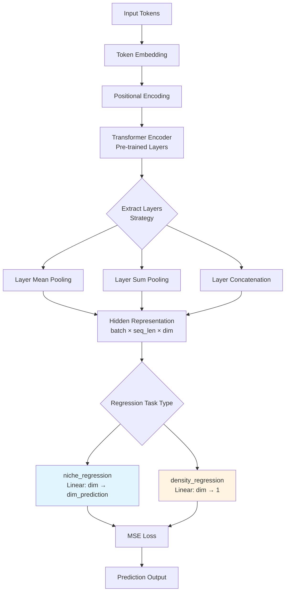

Regression tasks in Nicheformer enable the model to predict continuous numerical values from spatial transcriptomics data, with two primary applications: predicting niche composition distributions and predicting local cell density. These tasks leverage the pre-trained transformer backbone through supervised fine-tuning, adapting the learned representations for regression objectives rather than classification or masked token prediction.

## Regression Task Architecture

The regression framework in Nicheformer extends the pre-trained transformer with task-specific linear heads that map learned embeddings to continuous outputs. The architecture distinguishes between two regression modalities: niche composition regression predicts per-cell-type values, while density regression predicts a single scalar representing the number of surrounding cells.

Sources: [_fine_tune_model.py](/src/nicheformer/models/_fine_tune_model.py#L15-L110)



The regression head is instantiated based on the `supervised_task` parameter during model initialization. For niche regression tasks, the linear head maps the backbone's hidden dimensionality to a per-cell-type prediction vector, while density regression uses a single-output linear head for scalar predictions. The model supports optional distribution regression through softmax normalization before computing MSE loss.

Sources: [_fine_tune_model.py](/src/nicheformer/models/_fine_tune_model.py#L62-L94)

### Task Types and Head Configuration

| Task Type | Linear Head Shape | Output Dimension | Loss Function | Use Case |
|-----------|------------------|------------------|---------------|----------|
| `niche_regression` | `(dim_model, dim_prediction)` | `batch × dim_prediction` | MSELoss | Predict per-cell-type abundance values |
| `density_regression` | `(dim_model, 1)` | `batch × 1` | MSELoss | Predict local cell count around target cell |

The `dim_prediction` parameter determines the output dimensionality for niche regression, typically set to the number of cell types or niche categories being predicted. For density regression, this parameter is irrelevant as the output is always a scalar.

Sources: [_fine_tune_model.py](/src/nicheformer/models/_fine_tune_model.py#L28-L31), [_config_fine_tune.py](/src/nicheformer/config_files/_config_fine_tune.py#L13-L15)

## Fine-Tuning Pipeline for Regression Tasks

The regression fine-tuning workflow follows a structured pipeline that prepares data, configures the model, and trains with regression-specific loss computation. The training loop adapts the pre-trained backbone through supervised learning while optionally freezing layers or reinitializing specific transformer layers.

Sources: [downstream_fine_tune.py](/src/nicheformer/experiments/downstream_fine_tune.py#L17-L175)

```mermaid
flowchart LR
    A[Load AnnData] --> B[Load Technology Mean]
    B --> C[Create NicheformerDataset<br/>train/val/test splits]
    C --> D[Initialize DataLoaders]
    D --> E[Load Pre-trained Nicheformer]
    E --> F[Wrap in FineTuningModel<br/>Set supervised_task='regression']
    F --> G[Configure Trainer<br/>Gradient accumulation, checkpointing]
    G --> H[Train with MSE Loss]
    H --> I[Evaluate on Test Set]
    I --> J[Store Predictions in AnnData]
    
    style F fill:#ffe1f5
    style H fill:#e1ffe1
```



The dataset class handles metadata extraction including regression targets through the `metadata_fields` configuration. Targets are automatically converted to tensors and returned alongside the tokenized gene expression data during batch generation.

Sources: [dataset.py](/src/nicheformer/data/dataset.py#L139-L171)

### Configuration Parameters

Key configuration parameters control the regression fine-tuning behavior:

| Parameter | Type | Default | Description |
|-----------|------|---------|-------------|
| `supervised_task` | str | `'regression'` | Task type: `'niche_regression'` or `'density_regression'` |
| `regress_distribution` | bool | `False` | Apply softmax normalization to predictions |
| `predict_density` | bool | `False` | Sum label dimensions for scalar density prediction |
| `dim_prediction` | int | `1` | Output dimensionality for niche regression |
| `freeze` | bool | `False` | Freeze pre-trained backbone weights |
| `extract_layers` | List[int] | - | Which transformer layers to extract features from |
| `function_layers` | str | `'mean'` | How to combine extracted layers: `'mean'`, `'sum'`, `'concat'` |
| `extractor` | bool | `False` | Use pooler MLP head before linear prediction |

Sources: [_fine_tune_model.py](/src/nicheformer/models/_fine_tune_model.py#L17-L39), [_config_fine_tune.py](/src/nicheformer/config_files/_config_fine_tune.py#L1-L21)

## Loss Computation and Training Dynamics

The regression training step computes Mean Squared Error between predictions and target labels, with special handling for density prediction tasks. When `predict_density=True`, the target labels are summed across dimensions to produce a scalar representing the total count of neighboring cells.

Sources: [_fine_tune_model.py](/src/nicheformer/models/_fine_tune_model.py#L164-L203)

During the forward pass, the backbone generates hidden representations which are pooled using mean aggregation (excluding context tokens if `without_context=True`). The pooled representation passes through the regression linear head to generate predictions. For distribution regression, predictions undergo softmax normalization to ensure they sum to one across output dimensions.

The training loss is logged as `fine_tuning_regression_train` for monitoring convergence, while validation uses the corresponding `fine_tuning_regression_validation` metric.

Sources: [_fine_tune_model.py](/src/nicheformer/models/_fine_tune_model.py#L107-L158), [_fine_tune_model.py](/src/nicheformer/models/_fine_tune_model.py#L216-L246)

### Density Prediction Mode

Density prediction extends the regression framework to predict local cellular microenvironment density. This mode is activated by setting `predict_density=True` in the model configuration, which triggers automatic label transformation:

```python
# Density prediction label transformation
if self.hparams.predict_density:
    label = batch['label'].sum(1)  # Sum across cell type dimensions
    label = label.view(-1, 1)      # Reshape to scalar prediction target
```

The density regression head maps the pooled representation to a single output value, trained to minimize MSE against the true neighbor count. This enables the model to learn spatial density patterns from gene expression context.

Sources: [_fine_tune_model.py](/src/nicheformer/models/_fine_tune_model.py#L183-L186), [_fine_tune_model.py](/src/nicheformer/models/_fine_tune_model.py#L89-L91)

## Prediction Extraction and Storage

After training, predictions are generated on the test set and stored back into the AnnData object for downstream analysis. The fine-tuning script handles both regression and classification task prediction extraction, with regression tasks returning the continuous predictions directly.

Sources: [downstream_fine_tune.py](/src/nicheformer/experiments/downstream_fine_tune.py#L145-L175)

Predictions are stored in `adata.obs` under a key formatted as `predictions_{label}`, where `{label}` is the target column name from the configuration. Test metrics computed during evaluation are stored in `adata.uns` with corresponding metric names for reference.

Sources: [downstream_fine_tune.py](/src/nicheformer/experiments/downstream_fine_tune.py#L156-L170)

> [!TIP]
> When using distribution regression with `regress_distribution=True`, ensure your target labels are properly normalized or comparable across samples, as the softmax normalization applied during prediction assumes comparable scales across output dimensions.

> [!TIP]
> For density prediction tasks, verify that your label dimensions represent additive quantities (such as neighbor counts) before enabling `predict_density=True`, as the summation operation assumes meaningful additive semantics across the label dimensions.

## Practical Implementation Example

The following configuration demonstrates setting up a niche regression task to predict per-cell-type niche composition values:

```python
sweep_config = {
    'checkpoint_path': "/path/to/pretrained/nicheformer.ckpt",
    'supervised_task': 'niche_regression',  # Regression task
    'regress_distribution': False,          # No softmax normalization
    'predict_density': False,               # Predict full vector, not scalar
    'dim_prediction': 33,                    # Predict 33 cell type values
    'freeze': False,                         # Allow backbone fine-tuning
    'extract_layers': [6, 7, 8],            # Extract last 3 layers
    'function_layers': 'mean',              # Average layer representations
    'extractor': False,                      # No pooler MLP
    'lr': 1e-4,
    'warmup': 100,
    'max_epochs': 50000,
    'batch_size': 12,
    'label': 'X_niche_0',                   # Target column in adata.obs
    'data_path': '/path/to/data.h5ad',
    'technology_mean_path': '/path/to/mean.npy',
}
```

For density prediction, modify the configuration as:

```python
{
    'supervised_task': 'density_regression',
    'predict_density': True,                # Sum labels to scalar
    'dim_prediction': 1,                     # Single output (required but ignored)
    # ... other parameters same as above
}
```

Sources: [_config_fine_tune.py](/src/nicheformer/config_files/_config_fine_tune.py#L1-L21), [downstream_fine_tune.py](/src/nicheformer/experiments/downstream_fine_tune.py#L80-L102)

## Next Steps

- Explore **[Classification Tasks with Fine-Tuning](19-classification-tasks-with-fine-tuning)** for understanding categorical prediction alternatives
- Review **[Fine-Tuning Model Architecture](18-fine-tuning-model-architecture)** for deeper architectural details
- Study **[Transfer Learning Across Tissues and Technologies](22-transfer-learning-across-tissues-and-technologies)** for cross-domain regression strategies
- Configure experiments using **[Configuration Files and Parameters](26-configuration-files-and-parameters)** for systematic hyperparameter exploration