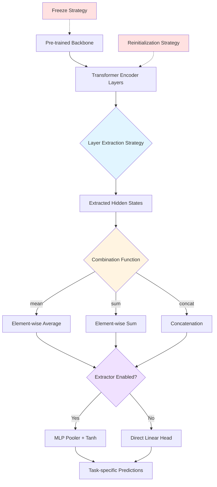
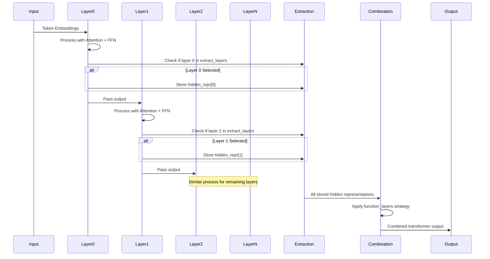

Fine-tuning pre-trained foundation models for specialized downstream tasks requires strategic decisions about which layers to leverage and how to adapt them. Nicheformer provides flexible mechanisms for extracting features from intermediate transformer layers and selectively reinitializing specific layers to balance pre-trained knowledge with task-specific adaptation. These strategies enable precise control over the transfer learning process, allowing you to optimize performance for diverse spatial transcriptomics and single-cell analysis tasks.

## Architectural Overview

The layer extraction and reinitialization framework operates within the fine-tuning pipeline, sitting between the frozen or partially trainable pre-trained backbone and the task-specific prediction head. When you initialize a fine-tuning model, you configure which transformer layers contribute to the final representation and whether any layers should be reset to their initial weight distributions.

The architecture supports three complementary strategies: layer extraction for feature aggregation, selective reinitialization for adaptation control, and optional MLP extraction heads for further representation refinement. These strategies can be combined in various configurations depending on your task requirements, data availability, and desired balance between pre-trained knowledge retention and task-specific learning.



This modular design allows you to experiment with different combinations without modifying the underlying model architecture. For example, you might extract features from early layers for low-level gene expression patterns while reinitializing later layers to capture task-specific high-level representations. The framework supports these explorations through simple configuration parameters without requiring code modifications.

Sources: [src/nicheformer/models/_fine_tune_model.py](src/nicheformer/models/_fine_tune_model.py#L17-L106), [src/nicheformer/models/_nicheformer_fine_tune.py](src/nicheformer/models/_nicheformer_fine_tune.py#L19-L92)

## Layer Extraction Mechanisms

Layer extraction enables you to aggregate features from specific transformer layers rather than relying solely on the final layer output. This approach recognizes that different layers in deep transformers capture different levels of abstraction—earlier layers preserve more localized gene expression patterns, while deeper layers capture more complex cell-cell interaction representations. By extracting from multiple layers, you can create richer representations that combine multiple scales of biological information.

The extraction process occurs during the forward pass through the encoder layers. As each layer processes the input embeddings, the framework checks whether that layer index is in your specified `extract_layers` list. If so, the layer's output is stored for later aggregation. This creates a collection of hidden states spanning potentially different depths of the network.



The implementation iterates through each encoder layer sequentially, applying the standard transformer operations of multi-head self-attention and feed-forward networks. At each step, it checks if the current layer index is in the extraction list. If the layer is selected, the output tensors are collected into a list of hidden representations. This design is efficient because it avoids redundant computation—extraction occurs during the normal forward pass rather than requiring additional inference passes.

Sources: [src/nicheformer/models/_fine_tune_model.py](src/nicheformer/models/_fine_tune_model.py#L107-L163), [src/nicheformer/models/_nicheformer_fine_tune.py](src/nicheformer/models/_nicheformer_fine_tune.py#L118-L174)

### Layer Combination Functions

Once hidden representations are extracted from the specified layers, they must be combined into a single representation that can be fed to the prediction head. Nicheformer supports three combination strategies through the `function_layers` parameter, each with different trade-offs in representational capacity and computational efficiency.

The **mean** strategy computes the element-wise average across all extracted layers, producing a representation of the same dimensionality as individual layer outputs. This approach is often effective when you want to smooth out layer-specific idiosyncrasies and create a stable representation that captures consensus features across network depths. The implementation stacks all extracted tensors along a new dimension and applies `torch.mean()` across that dimension.

The **sum** strategy performs element-wise addition across layers, which can amplify features that are consistently present across multiple layers while attenuating layer-specific noise. This is mathematically equivalent to mean without normalization, which can be advantageous when you want to preserve magnitude information about feature strength across layers.

The **concat** strategy concatenates the layer outputs along the feature dimension, resulting in a representation with dimensionality equal to the original dimension multiplied by the number of extracted layers. This preserves all information from each layer but significantly increases the parameter count in subsequent layers and may require more data to avoid overfitting.

Sources: [src/nicheformer/models/_fine_tune_model.py](src/nicheformer/models/_fine_tune_model.py#L131-L141), [src/nicheformer/models/_nicheformer_fine_tune.py](src/nicheformer/models/_nicheformer_fine_tune.py#L145-L152)

| Strategy | Output Dimension | Parameter Impact | Use Case |
|----------|------------------|------------------|----------|
| mean | dim_model | No change | General-purpose feature aggregation, smoothing layer-specific variations |
| sum | dim_model | No change | Amplifying consistent features, preserving feature magnitude |
| concat | dim_model × num_layers | Increases downstream parameters | Maximum information retention, data-rich scenarios |

### Configuration Examples

Configuring layer extraction requires specifying which layers to extract and how to combine them. The `extract_layers` parameter accepts a list of integer indices, where negative values count from the end (similar to Python indexing). For example, `extract_layers=[-1]` extracts only the final layer, while `extract_layers=[0, -1]` extracts both the first and last layers.

In the configuration file, you specify these parameters alongside other fine-tuning settings. The `function_layers` parameter must be one of "mean", "sum", or "concat". The default configuration often uses `extract_layers=[-1]` with `function_layers="mean"`, which effectively replicates standard fine-tuning behavior using only the final layer output.

Sources: [src/nicheformer/config_files/_config_fine_tune.py](src/nicheformer/config_files/_config_fine_tune.py#L1-L21), [src/nicheformer/experiments/downstream_fine_tune.py](src/nicheformer/experiments/downstream_fine_tune.py#L17-L100)

## Layer Reinitialization Strategies

Layer reinitialization provides a mechanism for selectively resetting specific transformer layers to their initial weight distributions during fine-tuning. This strategy is particularly valuable when certain layers in the pre-trained model have learned features that are irrelevant or detrimental to your downstream task. By reinitializing these layers, you give the model the opportunity to learn task-specific representations from scratch while preserving beneficial knowledge in other layers.

The reinitialization process occurs during model initialization, before training begins. When the `reinit_layers` parameter is specified, the framework iterates through the encoder layers and applies weight initialization to each one. Unlike layer extraction, which accepts a list of specific layer indices, the current implementation reinitializes all layers when `reinit_layers` is truthy. This behavior provides a coarse-grained control mechanism—either reinitialize all layers or none.

Sources: [src/nicheformer/models/_fine_tune_model.py](src/nicheformer/models/_fine_tune_model.py#L46-L51), [src/nicheformer/models/_nicheformer_fine_tune.py](src/nicheformer/models/_nicheformer_fine_tune.py#L55-L60)

### Initialization Schemes

The weight initialization scheme differs between the fine-tuning model implementations and the base Nicheformer model. The fine-tuning model in `_fine_tune_model.py` uses a normal distribution initialization with mean 0.0 and standard deviation 0.02 for all weight parameters. This follows common transformer initialization practices and provides a suitable starting point for fine-tuning.

The base Nicheformer model, which is called during reinitialization, uses Xavier normal initialization for Linear layers and zero initialization for biases. Xavier initialization scales the weights based on the input and output dimensions, helping maintain stable gradient flow during the early stages of training. This scheme is generally more sophisticated than simple normal initialization and is better suited for deep architectures.

```python
# Fine-tuning model initialization (simplified)
for name, param in self.named_parameters():
    if 'weight' in name:
        init.normal_(param, mean=0.0, std=0.02)

# Base Nicheformer model initialization
for m in self.modules():
    if isinstance(m, nn.Linear):
        init.xavier_normal_(m.weight)
        if m.bias is not None:
            init.zeros_(m.bias)
```

This difference in initialization schemes means that when you reinitialize layers during fine-tuning, the weights will follow the base model's Xavier initialization scheme rather than the simpler normal distribution. This is appropriate because you're reinitializing transformer layers that were originally trained with Xavier initialization.

Sources: [src/nicheformer/models/_fine_tune_model.py](src/nicheformer/models/_fine_tune_model.py#L334-L339), [src/nicheformer/models/_nicheformer.py](src/nicheformer/models/_nicheformer.py#L264-L271)

### When to Use Reinitialization

Reinitialization is most effective when you have sufficient task-specific data to train the reinitialized layers effectively. If your downstream task dataset is small, reinitializing many layers may lead to overfitting or poor convergence because the model doesn't have enough examples to learn meaningful representations from scratch. Conversely, if you have a large dataset that differs significantly from the pre-training data distribution, reinitializing later layers can help the model adapt more effectively.

A common pattern is to reinitialize only the top few layers of the transformer while keeping earlier layers frozen. Early layers typically learn more general features (such as gene expression patterns and basic cell-type signatures) that transfer well across tasks, while later layers capture more specialized relationships that may be task-specific. However, the current implementation's all-or-nothing approach means you need to implement custom modifications for selective layer reinitialization.

Sources: [src/nicheformer/models/_fine_tune_model.py](src/nicheformer/models/_fine_tune_model.py#L46-L51)

## MLP Extractor Head

The extractor head provides an optional MLP (multi-layer perceptron) that can be inserted between the combined transformer output and the task-specific linear prediction head. When enabled via the `extractor=True` parameter, this head applies a linear transformation followed by a Tanh activation function, mirroring the design pattern used in HuggingFace's BERT-style models.

The extractor head serves multiple purposes. First, it provides an additional non-linear transformation that can learn to project the combined layer representations into a space better suited for the downstream task. Second, it can help stabilize training by providing a bottleneck that reduces the dimensionality of features before the final prediction layer. Third, the Tanh activation bounds the output range, which can help with gradient stability during the early stages of fine-tuning.

The implementation adds a `pooler_head` linear layer that transforms from `dim_model` to `dim_model` dimensions, followed by a `activation` layer that applies Tanh. When extracting predictions, if the extractor is enabled, the combined transformer output first passes through this pooler head before reaching the task-specific linear layer.

Sources: [src/nicheformer/models/_fine_tune_model.py](src/nicheformer/models/_fine_tune_model.py#L89-L95), [src/nicheformer/models/_nicheformer_fine_tune.py](src/nicheformer/models/_nicheformer_fine_tune.py#L73-L78)

> [!TIP]
> The extractor head is particularly useful when you're extracting from multiple layers using the "concat" strategy, as it provides a mechanism to compress the high-dimensional concatenated representation back to the original dimensionality before the final prediction layer.

## Freezing Strategies

While layer extraction and reinitialization provide fine-grained control over specific layers, the `freeze` parameter offers a binary decision point for the entire backbone. When `freeze=True`, all parameters in the pre-trained backbone are frozen, meaning they won't be updated during fine-tuning. In this scenario, only the task-specific prediction head (and optionally the extractor head) are trainable.

Freezing the backbone is appropriate when your pre-trained model has already learned highly relevant features for your downstream task, or when you have very limited training data and want to avoid catastrophic forgetting of pre-trained knowledge. It also significantly reduces memory usage during training because frozen parameters don't require gradient computation or storage.

However, freezing also limits the model's ability to adapt to your specific task. For many spatial transcriptomics applications, some level of backbone adaptation is beneficial because the spatial context and cell-type composition of your dataset may differ from the pre-training data. In these cases, setting `freeze=False` allows the entire network to adapt while you can still use reinitialization to control which layers adapt more dramatically.

Sources: [src/nicheformer/models/_fine_tune_model.py](src/nicheformer/models/_fine_tune_model.py#L43-L44), [src/nicheformer/models/_nicheformer_fine_tune.py](src/nicheformer/models/_nicheformer_fine_tune.py#L51-L52)

## Integration with Fine-Tuning Pipeline

The layer extraction and reinitialization strategies integrate seamlessly with the broader fine-tuning workflow. When you call `fine_tune_predictions()`, the function loads the pre-trained model checkpoint, wraps it in a fine-tuning model with your specified configuration, and proceeds with training using PyTorch Lightning.

The configuration dictionary passed to `fine_tune_predictions()` contains all the parameters for controlling layer behavior, including `extract_layers`, `function_layers`, `reinit_layers`, `freeze`, and `extractor`. These parameters are passed directly to the `NicheformerFineTune` constructor, which applies the strategies during initialization.

During training, the forward pass automatically applies your configured layer extraction strategy, and the optimizer respects your freezing settings. The reinitialization occurs once during model setup, ensuring that reinitialized layers start from the specified weight distribution before any training steps.

Sources: [src/nicheformer/experiments/downstream_fine_tune.py](src/nicheformer/experiments/downstream_fine_tune.py#L17-L100)

## Practical Configuration Patterns

Different downstream tasks benefit from different layer strategy configurations. For **niche composition prediction** tasks where the goal is to predict the relative abundances of cell types in a neighborhood, extracting from later layers that capture complex interactions often works well. A configuration like `extract_layers=[-2, -1]` with `function_layers="mean"` provides a balance of high-level features without excessive dimensionality.

For **cell type classification** tasks, earlier layers may contain more discriminative gene expression signatures. In this case, `extract_layers=[0, -1]` with `function_layers="concat"` can combine low-level expression patterns with high-level contextual information. However, be aware that concatenation increases the representation dimensionality and may require adjustment of the linear head's input dimension.

For **density regression** tasks where you predict scalar values like cell density, simpler configurations often suffice. Using only the final layer with `extract_layers=[-1]` and `function_layers="mean"` provides a stable baseline. Adding the extractor head with `extractor=True` can help when you need additional non-linear transformation capacity.

| Task Type | Recommended extract_layers | Recommended function_layers | Recommended extractor |
|-----------|---------------------------|----------------------------|----------------------|
| Niche Regression | [-2, -1] | mean | False |
| Density Regression | [-1] | mean | True (for complex patterns) |
| Cell Type Classification | [0, -1] | concat | False |
| Spatial Pattern Recognition | [-3, -2, -1] | sum | False |

Sources: [src/nicheformer/config_files/_config_fine_tune.py](src/nicheformer/config_files/_config_fine_tune.py#L1-L21)

> [!TIP]
> When experimenting with layer strategies, start with the default configuration (extract_layers=[-1], function_layers="mean") and systematically vary one parameter at a time. This approach helps you understand which changes actually improve performance versus those that simply add complexity without benefit.

## Troubleshooting and Common Issues

When working with layer extraction strategies, you may encounter dimension mismatch errors if the combination function changes the output dimensionality but subsequent layers expect the original dimension. This most commonly occurs with the "concat" strategy, which multiplies the dimension by the number of extracted layers. If you use concatenation, ensure that any downstream layers can accommodate the increased dimensionality.

Reinitialization issues typically manifest as slow convergence or poor final performance. If reinitializing all layers leads to significantly worse performance than fine-tuning with frozen layers, this suggests that the pre-trained representations were highly relevant to your task and reinitialization discarded valuable knowledge. In this case, try selective reinitialization (which may require custom implementation) or disable reinitialization entirely.

Memory issues can arise when extracting from many layers with the "concat" strategy or when using large batch sizes with the extractor head enabled. If you encounter out-of-memory errors, try reducing the number of extracted layers, switching to "mean" or "sum" combination strategies, or reducing the batch size in the configuration.

## Next Steps

After configuring your layer extraction and reinitialization strategies, you'll want to understand how the resulting representations are used for specific tasks. The [Classification Tasks with Fine-Tuning](19-classification-tasks-with-fine-tuning) page details how layer outputs feed into classification heads for cell type and niche type prediction tasks. If your focus is on continuous outcomes, the [Regression Tasks and Density Prediction](20-regression-tasks-and-density-prediction) page explains the regression pipeline.

For understanding the broader context of transferring knowledge across different tissues and technologies, the [Transfer Learning Across Tissues and Technologies](22-transfer-learning-across-tissues-and-technologies) page provides strategies for adapting models when your downstream data differs significantly from the pre-training distribution. If you're interested in analyzing the representations themselves rather than making predictions, the [Layer-wise Embedding Analysis](25-layer-wise-embedding-analysis) page offers techniques for interpreting what different layers have learned.