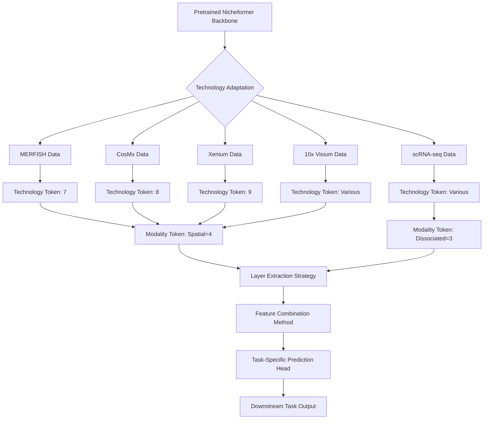

Transfer learning enables Nicheformer's foundation model to adapt its learned representations from pretraining data to diverse downstream tasks across different tissues, organs, and spatial omics technologies. This capability leverages the model's extensive pretraining on the SpatialCorpus-110M dataset, which encompasses multiple species, technologies, and tissue types, to achieve strong performance on new domains with limited fine-tuning data.

## Cross-Technology Transfer Architecture

Nicheformer's transfer learning architecture is built around a modular design that separates the pretrained backbone from task-specific prediction heads, enabling flexible adaptation to new spatial technologies while preserving learned biological representations. The system supports multiple spatial platforms through technology-specific tokenization and auxiliary metadata tokens that provide context about the experimental conditions.



The architecture enables seamless transfer between technologies through several key mechanisms. Technology-specific tokens encode platform information at the input layer, allowing the model to adjust its internal representations based on the experimental platform. The backbone processes these technology-aware token sequences through its transformer encoder, with the option to extract features from multiple layers. These features are then combined using configurable strategies and fed through task-specific prediction heads tailored to the downstream objective.

## Tissue and Organ Adaptation

Transfer learning across tissues leverages Nicheformer's ability to learn universal biological representations during pretraining, capturing fundamental cellular and niche patterns that generalize across organs. The fine-tuning pipeline demonstrates this capability across multiple tissue types, each requiring specific data paths and label configurations optimized for the biological context.

The system supports several tissue types with specialized configurations:

| Tissue Type | Technology | Data Path Pattern | Example Labels |
|------------|-------------|-------------------|----------------|
| Mouse Brain | MERFISH | `merfish_brain/` | `X_niche_1`, `region`, `author_cell_type` |
| Human Liver | CosMx | `cosmx_healthy_liver/` or `cosmx_liver/` | `X_niche_0-4`, `niche`, `assay`, `specie` |
| Human Lung | CosMx | `cosmx_lung/` | `X_niche_0-4`, `niche`, `assay`, `specie` |
| Mouse Multi-organ | Mixed | `dissociated_spatial_mouse_tokens_predictions/` | Variable by organ |

Each tissue configuration defines specific label keys that map to the biological questions of interest. For example, brain tissue focuses on regional classification and niche composition, while liver tissue includes multiple niche density dimensions (`X_niche_0` through `X_niche_4`) that capture zonation patterns. The label configuration is passed to the fine-tuning model through the `label` parameter, determining which column from the preprocessed dataset serves as the prediction target.

## Fine-Tuning Implementation Strategies

The fine-tuning process provides multiple strategies for adapting the pretrained model to new domains, balancing computational efficiency with predictive performance. These strategies are implemented through the `FineTuningModel` class, which wraps the pretrained backbone and adds task-specific components.

### Backbone Adaptation Modes

The backbone adaptation strategy is controlled through the `freeze` and `reinit_layers` parameters, enabling different trade-offs between preserving pretrained knowledge and adapting to new data:

- **Frozen Backbone** (`freeze=True`): The entire pretrained encoder remains unchanged, with only the prediction head trained. This is computationally efficient and ideal when the pretrained representations generalize well to the new task. The backbone is frozen using `self.backbone.freeze()` which disables gradient updates through all encoder parameters.

- **Full Fine-Tuning** (`freeze=False`): All model parameters, including the pretrained encoder, are updated during training. This allows the model to adapt its internal representations to the specific characteristics of the new tissue or technology but requires more data and computational resources.

- **Layer Reinitialization** (`reinit_layers=[list]`): Specified layers of the encoder are reinitialized with Xavier/Glorot initialization (`init.normal_(param, mean=0.0, std=0.02)`), allowing certain transformer layers to learn features from scratch while retaining pretrained knowledge in other layers. This provides a middle ground between full freezing and full fine-tuning.

### Feature Extraction and Combination

The system provides flexibility in which transformer layers provide features for the downstream task through the `extract_layers` parameter. This enables leveraging different levels of abstraction from the pretrained network:

```python
# Extract from specific layers (e.g., last layer only)
extract_layers = [11]

# Extract from multiple layers (e.g., middle and last layers)
extract_layers = [8, 11]

# Extract from early layers for low-level features
extract_layers = [2, 4, 6]
```

The extracted layer outputs are combined using the `function_layers` parameter, supporting three aggregation strategies:

| Strategy | Description | Use Case |
|----------|-------------|----------|
| `mean` | Average across extracted layers | General-purpose, balances information from all layers |
| `sum` | Element-wise summation across layers | Emphasizes common patterns across layers |
| `concat` | Concatenate along feature dimension | Preserve all information, increase model capacity |

The combination happens in the forward pass, where hidden representations from selected layers are stacked and aggregated:

```python
if self.hparams.function_layers == "mean":
    combined_tensor = torch.stack(hidden_repr, dim=-1)
    transformer_output = torch.mean(combined_tensor, dim=-1)  # bs x seq_len x dim
elif self.hparams.function_layers == "sum":
    combined_tensor = torch.stack(hidden_repr, dim=-1)
    transformer_output = torch.sum(combined_tensor, dim=-1)
elif self.hparams.function_layers == "concat":
    transformer_output = torch.cat(hidden_repr, dim=2)
```

### Prediction Head Design

The prediction head transforms the aggregated features into task-specific outputs, with different architectures for regression and classification tasks:

- **Regression Tasks** (`niche_regression`, `density_regression`): A linear layer projects features to the output dimension, predicting continuous values. For niche regression, this predicts niche composition per cell type (`dim_prediction` outputs). For density regression, this predicts a single scalar representing cell density.

- **Classification Tasks** (`niche_classification`, `niche_binary_classification`, `niche_multiclass_classification`): A linear layer produces logits for each class, with dimensionality matching the number of categories. The loss function is CrossEntropyLoss, with special handling for binary classification where labels are converted to binary values.

An optional `extractor` component adds a pooling MLP before the linear head, mimicking BERT-style pooling with a Tanh activation:

```python
if extractor:
    self.pooler_head = nn.Linear(self.backbone.hparams.dim_model, self.backbone.hparams.dim_model)
    self.activation = nn.Tanh()
    # In forward:
    cls_prediction = self.pooler_head(transformer_output[:, 3:, :].mean(1))
    cls_prediction = self.activation(cls_prediction)
```

### Pooling Strategies

The model supports two pooling strategies for aggregating token-level representations into a single prediction:

- **Mean Pooling** (`pool='mean'`): Averages representations across all tokens (excluding auxiliary context tokens when `without_context=True`). This is the default approach and works well for most tasks.

- **CLS Token Pooling** (`pool='cls'`): Adds a special [CLS] token (token ID 2) at the beginning of each sequence, which is trained to aggregate information from all tokens through self-attention. This mimics BERT's approach but requires the model to be trained with CLS tokens from the beginning.

The context exclusion (`without_context=True`) removes auxiliary metadata tokens from the pooling operation, focusing predictions on the actual gene expression tokens:

```python
if self.hparams.without_context:
    cls_prediction = self.linear_head(transformer_output[:, 3:, :].mean(1))
else:
    cls_prediction = self.linear_head(transformer_output.mean(1))
```

Sources: [src/nicheformer/models/_fine_tune_model.py](/src/nicheformer/models/_fine_tune_model.py#L107-L163)

## Multi-Modal Transfer Learning

Nicheformer's architecture enables transfer learning across modalities—specifically between spatial transcriptomics and dissociated single-cell RNA sequencing. This is achieved through modality tokens that inform the model about the experimental context, allowing it to adjust its representations accordingly.

### Modality-Specific Tokenization

During data preprocessing, modality information is encoded as an integer token:

- `modality=3`: Dissociated single-cell data
- `modality=4`: Spatial transcriptomics data

This token is prepended to each sequence during tokenization, allowing the model to condition its representations on the experimental modality. The `on_after_batch_transfer` method in the fine-tuning model handles adding this token to the input:

```python
if self.backbone.hparams.modality:
    x = batch[data_key]
    modality = batch['modality']
    x = torch.cat((modality.reshape(-1, 1), x), dim=1)  # add modality token
    batch[data_key] = x
```

### Cross-Modality Adaptation Patterns

The pretrained model learns representations that capture biological principles shared across modalities while modality-specific features adjust for technical differences. During transfer to a new modality, the model can leverage this knowledge in several ways:

1. **Spatial to Dissociated**: Models pretrained on spatial data can be adapted to single-cell data, leveraging learned cell-cell interaction patterns while adjusting for the absence of spatial coordinates.

2. **Dissociated to Spatial**: Single-cell pretrained models can be adapted to spatial contexts, where the modality token helps the model recognize that spatial neighborhood information is available.

3. **Multi-Modal Fine-Tuning**: When fine-tuning data includes both modalities, the model learns shared representations that generalize across experimental contexts.

The effectiveness of cross-modality transfer depends on the biological similarity of the tasks and the diversity of the pretraining data. Nicheformer's pretraining on the SpatialCorpus-110M dataset, which includes both dissociated and spatial data from multiple technologies, provides a strong foundation for cross-modal transfer.

Sources: [notebooks/tokenization/cosmx_human_liver.ipynb](/notebooks/tokenization/cosmx_human_liver.ipynb#L68-L71)

## Species Transfer Learning

Transfer learning across species leverages Nicheformer's understanding of conserved biological mechanisms while accommodating species-specific differences. The system uses species tokens similar to modality tokens, encoding species information at the input level.

### Species-Specific Configuration

Species are mapped to integer tokens during preprocessing:

- `specie=5`: Human data
- `specie=6`: Mouse data

These tokens are added during tokenization and processed alongside gene expression tokens:

```python
specie_dict = {
    'human': 5,
    'Homo sapiens': 5,
    'Mus musculus': 6,
    'mouse': 6,
}
```

### Cross-Species Adaptation Strategies

The fine-tuning configuration includes species-specific parameters through the `organ` field, which can be set to values like `'brain'`, `'liver'`, `'lung'`, or `'entire_mouse'`. This parameter is primarily used for logging and tracking purposes but also influences data path resolution:

```python
if config['organ'] == 'healthy_liver':
    path_organ = '/lustre/groups/.../cosmx_healthy_liver'
    label_key = ['assay', 'specie', 'modality', 'niche', 'X', 'X_niche_0', ...]
elif config['organ'] == 'lung':
    path_organ = '/lustre/groups/.../cosmx_lung'
    label_key = ['assay', 'specie', 'modality', 'niche', 'X', 'X_niche_0', ...]
```

Cross-species transfer is particularly valuable when data is limited for a species but abundant for another. The pretrained model captures evolutionarily conserved gene regulatory patterns and cellular functions, allowing effective knowledge transfer between humans and mice for many biological tasks.

> [!TIP]
> When performing cross-species transfer, pay attention to gene mapping consistency. The tokenization process relies on a shared gene vocabulary across species, so ensure that your data preprocessing uses the same gene mapper as the pretraining data (stored in `data/model_means/model.h5ad`).

Sources: [src/nicheformer/_fine_tune.py](/src/nicheformer/_fine_tune.py#L44-L61)

## Training Configuration for Transfer Learning

Effective transfer learning requires careful configuration of training hyperparameters to balance adaptation speed with retention of pretrained knowledge. Nicheformer provides sensible defaults that can be adjusted based on dataset size and task complexity.

### Learning Rate and Warmup

The learning rate is typically set lower than pretraining to avoid catastrophic forgetting of pretrained representations. The default configuration uses `lr=1e-4` with a warmup period:

```python
sweep_config = {
    'lr': 1e-4,
    'warmup': 1,
    'max_epochs': 50000,
    ...
}
```

The optimizer uses AdamW with weight decay for regularization, and the learning rate follows a cosine warmup schedule that gradually increases during warmup then decays:

```python
optimizer = optim.AdamW(self.parameters(), lr=self.hparams.lr, weight_decay=0.001)
lr_scheduler = CosineWarmupScheduler(optimizer,
                                     warmup=self.hparams.warmup,
                                     max_epochs=self.hparams.max_epochs)
```

### Training Pipeline

The fine-tuning process follows a standard PyTorch Lightning pipeline:

1. **Model Loading**: The pretrained backbone is loaded from a checkpoint using `Nicheformer.load_from_checkpoint()`

2. **Fine-Tuning Model Creation**: The backbone is wrapped in `FineTuningModel` with task-specific configuration

3. **Data Loading**: A `MerlinDataModuleDistributed` loads the downstream task data, handling train/val/test splits

4. **Training**: The trainer iterates through epochs, computing losses and updating parameters (unless backbone is frozen)

5. **Prediction**: After training, predictions are generated on the test set and saved

The training configuration supports distributed data parallel training with appropriate strategies based on whether the backbone is frozen:

```python
strategy="ddp_find_unused_parameters_true" if config['freeze']==False else "ddp"
```

Sources: [src/nicheformer/_fine_tune.py](/src/nicheformer/_fine_tune.py#L41-L47)

## Practical Transfer Learning Workflow

A complete transfer learning workflow involves several steps from data preparation to model evaluation. The `downstream_fine_tune.ipynb` notebook provides a comprehensive template for this process.

### Step 1: Data Preparation

Prepare your data using the appropriate tokenization notebook for your technology (e.g., `cosmx_human_liver.ipynb` for CosMx data, `xenium_human_lung.ipynb` for Xenium data). This process:

- Loads the raw data in AnnData format
- Applies normalization (size factor normalization to 10,000 counts)
- Maps genes to the shared vocabulary using `model.h5ad`
- Adds technology, modality, and species tokens
- Tokenizes gene expression to integer sequences
- Saves preprocessed parquet files for efficient loading

### Step 2: Configuration Setup

Configure the fine-tuning parameters based on your task:

```python
config = {
    'checkpoint_path': 'path/to/pretrained_model.ckpt',
    'freeze': True,  # or False for full fine-tuning
    'extract_layers': [11],  # which layers to use
    'function_layers': 'mean',  # aggregation strategy
    'supervised_task': 'niche_regression',  # or classification
    'dim_prediction': 33,  # output dimension
    'lr': 1e-4,
    'warmup': 10,
    'max_epochs': 100,
    'batch_size': 32,
    'organ': 'brain',  # for logging
    'label': 'X_niche_1',  # target column
    ...
}
```

### Step 3: Model Initialization

Load the pretrained backbone and create the fine-tuning model:

```python
from nicheformer.models.nicheformer import Nicheformer
from nicheformer.models._nicheformer_fine_tune import NicheformerFineTune

model = Nicheformer.load_from_checkpoint(checkpoint_path=config['checkpoint_path'], strict=False)

fine_tune_model = NicheformerFineTune(
    backbone=model,
    supervised_task=config['supervised_task'],
    extract_layers=config['extract_layers'],
    function_layers=config['function_layers'],
    freeze=config['freeze'],
    lr=config['lr'],
    warmup=config['warmup'],
    max_epochs=config['max_epochs'],
    dim_prediction=config['dim_prediction'],
    organ=config['organ'],
    label=config['label'],
)
```

### Step 4: Training and Evaluation

Train the model using PyTorch Lightning trainer:

```python
trainer = pl.Trainer(
    max_epochs=config['max_epochs'],
    accelerator='gpu' if torch.cuda.is_available() else 'cpu',
    devices=1,
    precision=config.get('precision', 32),
    gradient_clip_val=1.0,
    accumulate_grad_batches=10,
)

trainer.fit(fine_tune_model, train_dataloaders=train_loader, val_dataloaders=val_loader)
```

### Step 5: Prediction and Analysis

Generate predictions on test data and save results:

```python
predictions = trainer.predict(fine_tune_model, dataloaders=test_loader)

# Store predictions in AnnData
prediction_key = f"predictions_{config['label']}"
adata.obs.loc[test_mask, prediction_key] = predictions

adata.write_h5ad(config['output_path'])
```

Sources: [notebooks/experiments/downstream_fine_tune.ipynb](/notebooks/experiments/downstream_fine_tune.ipynb#L27-L82)

## Transfer Learning Best Practices

Achieving optimal performance with transfer learning requires understanding several key principles and avoiding common pitfalls.

### When to Freeze the Backbone

**Freeze the backbone** when:
- Downstream data is limited (few hundred samples or less)
- The pretrained representations already perform well on validation data
- You want fast training and minimal computational resources
- The new task is similar to pretraining objectives (e.g., predicting cellular properties)

**Don't freeze the backbone** when:
- You have abundant downstream data (thousands of samples)
- The new domain differs significantly from pretraining data (different technology, tissue, or species)
- You need to adapt to domain-specific patterns not captured during pretraining
- Performance with a frozen backbone is insufficient

### Layer Selection Strategy

The choice of `extract_layers` depends on the task complexity:

- **Early layers** (0-4): Capture low-level features, useful for predicting technical artifacts or basic expression patterns
- **Middle layers** (5-8): Capture intermediate biological concepts, good for cell type classification
- **Late layers** (9-11): Capture high-level abstract representations, ideal for complex tasks like niche composition prediction

Multi-layer extraction (e.g., `[8, 11]`) often outperforms single-layer extraction by combining information at different abstraction levels.

### Feature Aggregation Selection

Choose the aggregation strategy based on your needs:

- **Mean**: Best default choice, stable and works well across tasks
- **Sum**: Emphasizes features present across multiple layers, useful when patterns are consistent
- **Concat**: Preserves all information but increases parameter count, use when data is abundant

> [!TIP]
> Start with a frozen backbone and mean aggregation on layer [11]. If performance is insufficient, progressively unfreeze layers and experiment with multi-layer extraction before considering full fine-tuning.

### Monitoring Transfer Learning Success

Track these metrics during fine-tuning to assess transfer learning effectiveness:

1. **Convergence Speed**: Fast convergence often indicates good transfer from pretrained knowledge
2. **Final Performance**: Compare against training from scratch—transfer should outperform random initialization
3. **Overfitting**: Monitor train/validation gap; large gaps suggest overfitting to limited downstream data
4. **Gradient Magnitudes**: Small gradients in frozen layers indicate the backbone is truly frozen

## Evaluation Metrics for Transfer Learning

Different downstream tasks require appropriate evaluation metrics to assess transfer learning performance.

### Regression Task Metrics

For niche regression and density prediction tasks, use:

- **R² Score**: Measures proportion of variance explained, higher is better
- **Mean Squared Error (MSE)**: Average squared difference between predictions and targets
- **Mean Absolute Error (MAE)**: Average absolute difference, less sensitive to outliers
- **Pearson Correlation**: Measures linear relationship between predictions and targets

The model computes MSE loss during training:

```python
if self.task == 'regression':
    loss = self.cls_loss(cls_prediction, label)
    self.log('fine_tuning_regression_train', loss, sync_dist=True, prog_bar=True)
```

### Classification Task Metrics

For niche classification and related tasks, use:

- **Accuracy**: Proportion of correct predictions
- **F1 Score**: Harmonic mean of precision and recall, better for imbalanced classes
- **Confusion Matrix**: Detailed breakdown of predictions by class
- **AUROC**: Area under ROC curve for binary classification

The model tracks accuracy during training:

```python
if self.task == 'classification':
    accuracy_pred = torch.argmax(cls_prediction, dim=1)
    acc = (accuracy_pred == label).float().mean()
    self.log('accuracy_train', acc, sync_dist=True)
```

Sources: [src/nicheformer/models/_fine_tune_model.py](/src/nicheformer/models/_fine_tune_model.py#L164-L217)

## Limitations and Considerations

While transfer learning significantly improves performance on downstream tasks, several limitations should be considered.

### Domain Shift Challenges

Significant domain shift between pretraining and downstream data can reduce transfer learning effectiveness:

- **Technology Differences**: New platforms with different sensitivity or gene panels may not benefit fully from pretrained representations
- **Tissue Differences**: Rare tissue types not represented in pretraining may require more extensive fine-tuning
- **Species Differences**: While mammals share many biological principles, distant species may have limited transfer

### Data Requirements

Transfer learning reduces but doesn't eliminate the need for downstream task data:

- **Minimal Data**: Frozen backbone may work with as few as 100-500 samples
- **Adequate Data**: 1,000-5,000 samples typically needed for reasonable fine-tuning performance
- **Abundant Data**: 10,000+ samples can support full fine-tuning from scratch

### Computational Considerations

Different transfer learning strategies have different computational requirements:

| Strategy | GPU Memory | Training Time | Suitable for |
|----------|------------|---------------|---------------|
| Frozen Backbone | Low | Fast (minutes-hours) | Small datasets, quick iteration |
| Partial Fine-Tune | Medium | Medium | Most practical use cases |
| Full Fine-Tune | High | Slow (hours-days) | Large datasets, complex tasks |

## Troubleshooting Transfer Learning

Common issues and their solutions in transfer learning scenarios.

### Problem: Poor Performance with Frozen Backbone

**Possible Causes**:
- Downstream task differs significantly from pretraining
- Domain shift too large for frozen representations
- Insufficient feature extraction layers

**Solutions**:
- Try unfreezing the backbone (`freeze=False`)
- Extract from multiple layers (`extract_layers=[8, 11]`)
- Use concatenation aggregation to preserve more information
- Consider reinitializing specific layers that need to adapt

### Problem: Overfitting During Fine-Tuning

**Possible Causes**:
- Downstream dataset too small for number of trainable parameters
- Learning rate too high
- Training too long

**Solutions**:
- Freeze the backbone and only train the prediction head
- Reduce learning rate (try 1e-5 or lower)
- Increase weight decay (try 0.01 instead of 0.001)
- Use early stopping based on validation loss
- Apply stronger regularization

### Problem: Training Instability

**Possible Causes**:
- Learning rate too high for unfrozen backbone
- Gradient explosion in deep layers
- Batch size too small

**Solutions**:
- Enable gradient clipping (`gradient_clip_val=1.0`)
- Reduce learning rate
- Increase batch size if memory allows
- Increase warmup period to allow gradual learning rate increase
- Ensure proper data normalization

Sources: [src/nicheformer/config_files/_config_fine_tune.py](/src/nicheformer/config_files/_config_fine_tune.py#L1-L21)

## Next Steps

For implementing transfer learning with Nicheformer, refer to these complementary resources:

- **[Classification Tasks with Fine-Tuning](19-classification-tasks-with-fine-tuning)**: Detailed guide for setting up classification tasks with proper loss functions and evaluation metrics
- **[Regression Tasks and Density Prediction](20-regression-tasks-and-density-prediction)**: Specific considerations for regression tasks, including niche composition and cell density prediction
- **[Layer Extraction and Reinitialization Strategies](21-layer-extraction-and-reinitialization-strategies)**: Deep dive into selecting and configuring transformer layers for optimal feature extraction
- **[Downloading Pre-trained Models and Data](4-downloading-pre-trained-models-and-data)**: Instructions for accessing pretrained Nicheformer models required for transfer learning

The transfer learning capabilities demonstrated in Nicheformer showcase the power of foundation models for spatial omics, enabling researchers to apply knowledge learned from large-scale datasets to focused biological questions across diverse tissues, technologies, and experimental contexts.