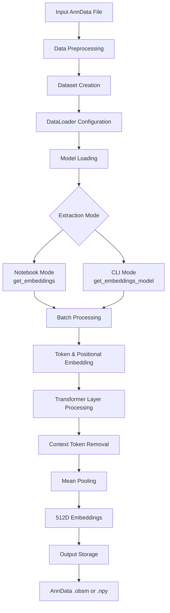

This guide explains how to extract meaningful cell embeddings from pre-trained Nicheformer models, enabling downstream analysis tasks like clustering, visualization, and supervised learning. The extracted embeddings represent compressed representations of gene expression data contextualized within tissue microenvironments.

## Overview of Embedding Extraction

Nicheformer provides two primary approaches for extracting embeddings: a programmatic command-line interface for batch processing and an interactive notebook-based workflow for flexible experimentation. Both methods leverage the same underlying model architecture but serve different use cases. The command-line approach excels at processing entire datasets efficiently, while the notebook workflow offers greater customization for exploratory analysis.

The embedding extraction process involves loading a pre-trained Nicheformer model, processing gene expression data through the model's transformer layers, and aggregating the learned representations. These 512-dimensional embeddings capture biological signals encoded during pretraining across millions of cells, representing cellular states in a continuous, information-rich space.


## Architecture of Embedding Extraction

The embedding extraction pipeline consists of several distinct stages that transform raw gene expression data into compressed representations:



The architecture distinguishes between two model types for extraction: the base `Nicheformer` model for direct embedding extraction, and the `FineTuningModel` wrapper that enables extraction from fine-tuned checkpoints with additional prediction heads. The base model provides layer-wise access to transformer representations, while the fine-tuned model integrates extracted layers into task-specific workflows.

> [!TIP]
> The embedding extraction method removes the first three context tokens (modality, species, and assay tokens) before mean pooling by default, ensuring embeddings focus purely on gene expression patterns rather than metadata cues. Set `without_context=False` to retain this information if metadata-influenced embeddings are desired for your analysis.

## Command-Line Extraction Workflow

The command-line approach using `get_embeddings.py` is designed for processing entire datasets efficiently with minimal code. This method is ideal for production workflows or when processing multiple organs/tissues systematically.

**Configuration Setup**: The extraction parameters are defined in `src/nicheformer/config_files/_config_embeddings.py`. The configuration requires specifying checkpoint paths and the target organ:

Sources: [src/nicheformer/config_files/_config_embeddings.py](src/nicheformer/config_files/_config_embeddings.py#L1-L6)

```python
sweep_config = {
    'checkpoint_path': "/path/to/pretrained/nicheformer.ckpt",
    'fine_tuned_checkpoint_path': "/path/to/fine_tuned/nicheformer_ft.ckpt",
    'organ': "everything"  # or 'brain', 'liver', 'lung', etc.
}
```

**Supported Organs**: The configuration supports multiple tissue types with corresponding data paths and label keys:

| Organ | Data Path Pattern | Label Keys Include |
|-------|------------------|-------------------|
| everything | `/data/nicheformer_tokens` | X, specie, assay, modality, idx |
| brain | `/data/nicheformer_downstream/merfish_brain` | cell_type, region, niche, X, X_niche_* |
| liver | `/data/nicheformer_downstream/cosmx_liver` | cell_type, region, niche, X, X_niche_* |
| lung | `/data/nicheformer_downstream/cosmx_lung` | cell_type, region, niche, X, X_niche_* |
| dissociated_brain | `/data/nicheformer_organ/dissociated_brain` | cell_type, X, idx |

Sources: [src/nicheformer/_embeddings.py](src/nicheformer/_embeddings.py#L19-L68)

**Execution**: Run the extraction using the main entry point:

```bash
cd src/nicheformer
python get_embeddings.py
```

**Output**: The extraction generates two files in the `embeddings/` directory:

- `embeddings.npy`: NumPy array containing 512-dimensional embeddings for all cells
- `metadata_embeddings.csv`: DataFrame with cell metadata (cell_type, region, niche, assay, specie, modality, index)

Sources: [src/nicheformer/_embeddings.py](src/nicheformer/_embeddings.py#L120-L143)

The CLI approach uses `MerlinDataModuleDistributed` for efficient data loading, supporting distributed processing across multiple GPUs for large-scale datasets. The trainer is configured with `max_steps=0` since the model is already loaded from checkpoint and no training occurs.

## Interactive Notebook Extraction

The notebook-based workflow in `notebooks/experiments/get_embeddings.ipynb` provides greater flexibility and is recommended for exploratory analysis or custom preprocessing needs. This approach enables interactive experimentation with embedding parameters and direct integration with AnnData objects.

**Configuration Parameters**: The notebook allows fine-grained control over extraction behavior:

Sources: [notebooks/experiments/get_embeddings.ipynb](notebooks/experiments/get_embeddings.ipynb#L21-L37)

| Parameter | Description | Default |
|-----------|-------------|---------|
| `data_path` | Path to input AnnData file | Required |
| `technology_mean_path` | Path to technology mean vectors for normalization | Required |
| `checkpoint_path` | Pre-trained model checkpoint path | Required |
| `output_path` | Output AnnData file path | `data_with_embeddings.h5ad` |
| `batch_size` | Number of cells per batch | 32 |
| `max_seq_len` | Maximum sequence length | 1500 |
| `aux_tokens` | Number of auxiliary tokens | 30 |
| `chunk_size` | Processing chunk size for memory management | 1000 |
| `precision` | Numerical precision (16, 32, or 'bf16-mixed') | 32 |
| `embedding_layer` | Which transformer layer to extract (-1 for last) | -1 |
| `embedding_name` | Suffix for embedding key in adata.obsm | `embeddings` |

**Data Preparation**: Before extraction, the input AnnData object must be properly formatted with metadata tokens:

Sources: [notebooks/experiments/get_embeddings.ipynb](notebooks/experiments/get_embeddings.ipynb#L63-L93)

```python
# Required metadata columns with token IDs
adata.obs['modality'] = 4  # spatial: 4, dissociated: 3
adata.obs['specie'] = 5    # human: 5, mouse: 6
adata.obs['assay'] = 8     # cosmx: 8, merfish: 7, 10x: 10-15

# Ensure split column exists
adata.obs['nicheformer_split'] = 'train'
```

The metadata token IDs correspond to learned embeddings for different experimental conditions, enabling the model to contextualize gene expression patterns across technologies and species.

**Extraction Process**: The notebook workflow creates a `NicheformerDataset` and processes batches through the model:

Sources: [notebooks/experiments/get_embeddings.ipynb](notebooks/experiments/get_embeddings.ipynb#L177-L201)

```python
# Create dataset
dataset = NicheformerDataset(
    adata=adata,
    technology_mean=technology_mean,
    split='train',
    max_seq_len=1500,
    aux_tokens=config.get('aux_tokens', 30),
    chunk_size=config.get('chunk_size', 1000),
    metadata_fields={'obs': ['modality', 'specie', 'assay']}
)

# Extract embeddings
embeddings = []
with torch.no_grad():
    for batch in tqdm(dataloader):
        batch = {k: v.to(device) if isinstance(v, torch.Tensor) else v
                for k, v in batch.items()}
        emb = model.get_embeddings(
            batch=batch,
            layer=config.get('embedding_layer', -1)
        )
        embeddings.append(emb.cpu().numpy())

embeddings = np.concatenate(embeddings, axis=0)
```

> [!TIP]
> For very large datasets, use the `chunk_size` parameter to process cells in manageable batches and prevent out-of-memory errors. The `chunk_size=1000` default works well for most systems, but adjust based on available GPU memory.

**Output Storage**: The notebook directly stores embeddings in the AnnData object for seamless integration with scanpy workflows:

Sources: [notebooks/experiments/get_embeddings.ipynb](notebooks/experiments/get_embeddings.ipynb#L215-L220)

```python
# Store embeddings in AnnData
embedding_key = f"X_niche_{config.get('embedding_name', 'embeddings')}"
adata.obsm[embedding_key] = embeddings
adata.write_h5ad(config['output_path'])
```

## Internal Embedding Extraction Methods

### Base Model Method: `get_embeddings()`

The `Nicheformer` class provides the `get_embeddings()` method that implements the core extraction logic. This method processes input batches through the transformer layers and returns aggregated representations.

Sources: [src/nicheformer/models/_nicheformer.py](src/nicheformer/models/_nicheformer.py#L272-L308)

**Process Flow**:

1. **Batch Processing**: Applies `on_after_batch_transfer()` for device placement and formatting
2. **Masking**: Applies 0% masking during inference to preserve all gene information
3. **Embedding Generation**: Computes token embeddings from masked indices
4. **Positional Encoding**: Adds learnable or fixed positional encodings to token embeddings
5. **Layer-wise Processing**: Passes embeddings through transformer layers up to the specified layer
6. **Context Removal**: Optionally removes the first three context tokens (modality, species, assay)
7. **Mean Pooling**: Aggregates sequence-level embeddings to a single 512-dimensional vector per cell

**Layer Selection**: The `layer` parameter controls which transformer layer representation to extract. Use `-1` for the final layer, or specify an integer from `0` to `nlayers-1` for intermediate layers. Early layers capture more local patterns, while later layers encode higher-level biological concepts.

Sources: [src/nicheformer/models/_nicheformer.py](src/nicheformer/models/_nicheformer.py#L289-L292)

### Fine-Tuned Model Method: `getting_prediction()`

When working with fine-tuned models, the `FineTuningModel` wrapper provides the `getting_prediction()` method that extracts representations from the backbone model after fine-tuning. This method is automatically called by the CLI extraction workflow.

Sources: [src/nicheformer/models/_fine_tune_model.py](src/nicheformer/models/_fine_tune_model.py#L261-L280)

The fine-tuned model supports flexible layer extraction strategies through the `extract_layers` and `function_layers` hyperparameters:

| `function_layers` | Operation | Resulting Dimension |
|-------------------|-----------|---------------------|
| `"mean"` | Average across extracted layers | 512 |
| `"sum"` | Sum across extracted layers | 512 |
| `"concat"` | Concatenate layers | 512 × number of extracted layers |

Sources: [src/nicheformer/models/_fine_tune_model.py](src/nicheformer/models/_fine_tune_model.py#L131-L143)

For example, extracting layers `[8, 10, 12]` with `function_layers="concat"` yields 1536-dimensional embeddings (512 × 3). This multi-layer approach can capture both specific and generalizable features across different abstraction levels.

## Advanced Configuration Options

### Distributed Processing

The CLI workflow supports distributed data loading using PyTorch Lightning's DDP strategy. Configure the trainer with multiple GPUs for accelerated processing:

Sources: [src/nicheformer/_embeddings.py](src/nicheformer/_embeddings.py#L16-L22)

```python
trainer = pl.Trainer(
    accelerator='gpu',
    max_steps=0,
    devices=4,  # Use 4 GPUs
    strategy="ddp_find_unused_parameters_true",
    precision='bf16-mixed',
)
```

### Precision Options

Three precision modes are available to balance speed and numerical accuracy:

| Precision | Memory Usage | Speed | Recommended Use |
|-----------|--------------|-------|-----------------|
| 32-bit | High | Baseline | Small datasets, maximum accuracy |
| 16-bit | Medium | 1.5-2× faster | Medium datasets, good speed-accuracy tradeoff |
| bfloat16 | Low | 2× faster | Large datasets, modern GPUs (Ampere+) |

### Memory Optimization

For very large datasets exceeding GPU memory, adjust these parameters:

- **Batch Size**: Reduce from default 24-32 to 8-16
- **Chunk Size**: Reduce from 1000 to 500-750
- **Precision**: Use bfloat16 or 16-bit mixed precision
- **Gradient Checkpointing**: Enable in model configuration if available

## Troubleshooting Guide

| Issue | Cause | Solution |
|-------|-------|----------|
| CUDA out of memory | Batch size too large for GPU memory | Reduce `batch_size` to 16-24 or use precision='16-mixed' |
| Mismatched embedding dimensions | Incorrect checkpoint loading | Ensure checkpoint matches expected architecture (dim_model=512) |
| Missing metadata tokens | AnnData columns not populated | Add `modality`, `specie`, `assay` columns with correct token IDs |
| Empty embeddings | Data preprocessing issues | Verify `technology_mean` path matches data normalization used in pretraining |
| Slow extraction | Small batch size with many workers | Increase `batch_size` and reduce `num_workers` to avoid CPU bottlenecks |

## Next Steps

After extracting cell embeddings, you can proceed to several downstream analyses:

- **[Using Embeddings for Downstream Analysis](24-using-embeddings-for-downstream-analysis)**: Learn how to apply embeddings to clustering, visualization, and supervised learning tasks
- **[Layer-wise Embedding Analysis](25-layer-wise-embedding-analysis)**: Understand how to compare and analyze embeddings extracted from different transformer layers
- **[Classification Tasks with Fine-Tuning](19-classification-tasks-with-fine-tuning)**: Explore supervised approaches that build on extracted embeddings for cell type annotation

For understanding the model architecture that generates these embeddings, refer to **[Nicheformer Transformer Architecture](10-nicheformer-transformer-architecture)**. If you need to prepare new data for embedding extraction, consult **[Tokenizing Gene Expression Data](6-tokenizing-gene-expression-data)**.