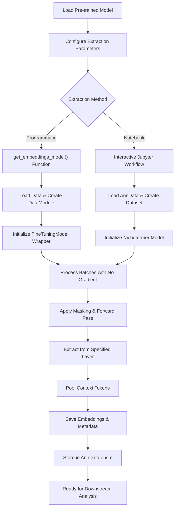
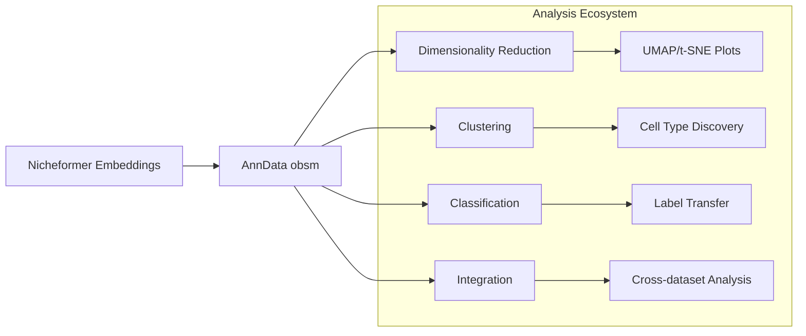

This guide explains how to extract cell embeddings from pre-trained Nicheformer models and apply them to downstream biological analysis tasks such as clustering, visualization, and integration with existing single-cell analysis pipelines. The extracted embeddings capture rich cellular representations that encode both gene expression patterns and spatial context information, enabling advanced analysis across different tissues, technologies, and experimental conditions.

## Understanding the Embedding Extraction Pipeline

Nicheformer provides two primary approaches for extracting embeddings: a programmatic interface through the core library and a user-friendly notebook-based workflow. Both methods leverage the same underlying architecture but offer different levels of control and convenience. The embedding extraction process operates on pre-trained models that have learned to capture complex cellular relationships during large-scale pretraining across multiple modalities and tissues.

The pipeline begins by loading a pre-trained model checkpoint, which can be either the base pre-trained model or a fine-tuned version specialized for specific organs or tasks. The model processes input data through its transformer architecture, extracting representations from specified layers. By default, the system extracts 512-dimensional embeddings from the final transformer layer, though earlier layers can be accessed for different representational characteristics. The extraction process preserves all relevant metadata including assay type, species, modality, cell type annotations, and spatial regions.

Sources: [src/nicheformer/_embeddings.py](src/nicheformer/_embeddings.py#L10-L143), [src/nicheformer/models/_nicheformer.py](src/nicheformer/models/_nicheformer.py#L272-L306)

> [!TIP]
> The embedding dimension of 512 is fixed across all Nicheformer models, ensuring compatibility with downstream tools regardless of the specific checkpoint used or the data being processed.

## Programmatic Embedding Extraction

The programmatic approach uses the `get_embeddings_model()` function from the embeddings module, which provides a streamlined interface for batch processing large datasets. This method is particularly suitable for production workflows, automated pipelines, or when processing multiple organs systematically. The function accepts a configuration dictionary specifying the model checkpoint paths, the target organ, and other processing parameters.

When using the programmatic interface, you configure parameters through a sweep configuration dictionary that specifies both the base pre-trained model and optionally a fine-tuned checkpoint. The system supports multiple predefined organ configurations including brain, liver, lung, dissociated tissues, and composite datasets. Each organ configuration includes specific path mappings and label keys that determine which metadata columns to preserve during extraction. The function automatically handles distributed data loading, batch processing, and device management, making it suitable for large-scale datasets.

Sources: [src/nicheformer/_embeddings.py](src/nicheformer/_embeddings.py#L10-L143), [src/nicheformer/get_embeddings.py](src/nicheformer/get_embeddings.py#L1-L18), [src/nicheformer/config_files/_config_embeddings.py](src/nicheformer/config_files/_config_embeddings.py#L1-L6)

The extraction process outputs two main artifacts: a NumPy array containing the embeddings and a CSV file with preserved metadata. The embeddings are stored with shape (n_cells, 512) where each row represents a single cell. The metadata file contains assay information, species labels, modality types, cell type annotations, region identifiers, niche classifications, and original indices, enabling downstream analyses to maintain full traceability back to the source data.

## Notebook-Based Interactive Extraction

For exploratory analysis and interactive workflows, the Jupyter notebook approach provides greater flexibility and visibility into the extraction process. This method uses the `NicheformerDataset` and `Nicheformer` model classes directly, allowing you to inspect intermediate results, adjust parameters iteratively, and integrate the extraction seamlessly with your existing analysis notebooks. The notebook workflow is ideal when you want to understand how your specific data preprocessing affects the resulting embeddings.

The notebook workflow begins by loading your data in AnnData format, which is the standard format for single-cell analysis in Python ecosystems. You must ensure your AnnData object contains the required metadata columns: `modality`, `specie`, and `assay`. These metadata fields map to the token IDs that Nicheformer uses during model inference. The system provides reference dictionaries for common metadata values, but you can add new mappings as needed for your specific datasets. After loading the data, you concatenate it with a reference model AnnData object to ensure consistent variable ordering and preprocessing.

Sources: [notebooks/experiments/get_embeddings.ipynb](notebooks/experiments/get_embeddings.ipynb#L55-L172), [notebooks/experiments/get_embeddings.ipynb](notebooks/experiments/get_embeddings.ipynb#L199-L216)

The configuration dictionary for the notebook workflow includes parameters for controlling the extraction behavior: `embedding_layer` specifies which transformer layer to extract from (-1 for the last layer), `batch_size` determines the number of cells processed simultaneously, `chunk_size` helps manage memory for large datasets, and `precision` controls numerical precision (16, 32, or 64-bit). The `embedding_name` parameter determines the suffix used when storing embeddings in the AnnData object, allowing you to store multiple embedding sets with different extraction parameters.

## Layer-Wise Embedding Extraction

Nicheformer provides access to embeddings from any transformer layer, enabling analysis of how representations evolve through the network depth. The `get_embeddings()` method accepts a `layer` parameter that specifies which layer to extract, with -1 representing the final layer. Lower layers typically capture more local features and gene-level patterns, while higher layers integrate more context and capture higher-level biological concepts. This flexibility allows you to experiment with different layers for your specific downstream task.

The extraction process processes the input through all transformer layers up to and including the specified layer. When extracting from intermediate layers, the embeddings may capture different aspects of the data. For example, early layers might be more sensitive to technical variations or strong expression patterns, while later layers might better represent biological cell states or spatial relationships. The system also provides control over whether to include context tokens (metadata) in the pooling process through the `with_context` parameter. By default, context tokens are excluded from the final embedding, focusing the representation on the gene expression content.

Sources: [src/nicheformer/models/_nicheformer.py](src/nicheformer/models/_nicheformer.py#L272-L306)

*Table: Embedding Layer Characteristics*

| **Layer** | **Representational Focus** | **Recommended Use Cases** |
|-----------|---------------------------|--------------------------|
| Early (0-3) | Local gene patterns, technical factors | Quality control, batch effect detection |
| Middle (4-7) | Gene pathway activation, cellular processes | Pathway analysis, functional annotation |
| Late (8-11) | Cell type identity, state transitions | Cell type classification, trajectory analysis |
| Final (12) | Integrated representations, niche context | Clustering, visualization, transfer learning |

> [!TIP]
> When extracting embeddings for clustering or visualization tasks, start with the final layer as it typically provides the most robust representations. If clustering performance is suboptimal, experiment with earlier layers as they may preserve more variation relevant to your specific biological question.

## Integration with Single-Cell Analysis Ecosystem

Once extracted, Nicheformer embeddings integrate seamlessly with the standard single-cell analysis ecosystem based on AnnData and scanpy. The embeddings are stored in the `adata.obsm` dictionary using a key that reflects the extraction parameters. For example, with the default configuration, embeddings are stored under the key `X_niche_embeddings`. This storage convention follows established patterns in the single-cell field, making the embeddings immediately usable with existing visualization and analysis tools.

The preserved metadata columns enable sophisticated analyses that combine the rich semantic information captured by Nicheformer with experimental annotations. For spatial transcriptomics data, you can visualize embeddings colored by tissue region, identified cell types, or manually annotated niches. For dissociated single-cell data, you can examine how embeddings separate by known cell types or identify novel subpopulations. The embeddings can be used directly as input to dimensionality reduction techniques like UMAP or t-SNE, or as features for clustering algorithms such as Leiden or Louvain.

Sources: [notebooks/experiments/get_embeddings.ipynb](notebooks/experiments/get_embeddings.ipynb#L319-L327)

The embeddings capture rich biological signals that often outperform traditional dimensionality reduction techniques like PCA, particularly when integrating across different technologies or tissues. Because the model was pre-trained on diverse datasets spanning multiple assays, species, and organs, the embeddings provide a unified representation space where cells from different sources can be meaningfully compared. This makes Nicheformer embeddings particularly powerful for cross-dataset integration, label transfer, and identifying conserved cell states across experimental conditions.

## Configuration and Parameter Reference

The embedding extraction process is controlled through a comprehensive configuration system that adapts to different use cases and data characteristics. The core configuration parameters define the data paths, model checkpoints, and processing behavior. The `checkpoint_path` parameter specifies the location of the pre-trained model checkpoint, while `fine_tuned_checkpoint_path` optionally provides a fine-tuned model for specialized tasks. The `organ` parameter selects predefined configurations for specific tissues or data types, though custom paths can be specified using the `path_organ` parameter.

Processing parameters control the computational aspects of extraction. The `batch_size` parameter determines how many cells are processed simultaneously, with larger values providing better GPU utilization but requiring more memory. The `chunk_size` parameter is particularly important for large datasets, as it controls how data is split to avoid memory overflow. The `precision` parameter offers a trade-off between numerical accuracy and memory usage, with 32-bit precision being the default recommendation for most applications. The `num_workers` parameter controls parallel data loading, with appropriate values depending on your system's CPU cores.

Sources: [src/nicheformer/_embeddings.py](src/nicheformer/_embeddings.py#L26-L83), [notebooks/experiments/get_embeddings.ipynb](notebooks/experiments/get_embeddings.ipynb#L55-L71)

*Table: Configuration Parameters*

| **Parameter** | **Type** | **Default** | **Description** |
|---------------|----------|-------------|-----------------|
| `checkpoint_path` | string | Required | Path to pre-trained model checkpoint |
| `fine_tuned_checkpoint_path` | string | Optional | Path to fine-tuned model checkpoint |
| `embedding_layer` | int | -1 | Transformer layer to extract (-1 for final) |
| `embedding_name` | string | 'embeddings' | Suffix for storage key in AnnData |
| `batch_size` | int | 24-32 | Number of cells per batch |
| `max_seq_len` | int | 1500 | Maximum sequence length |
| `chunk_size` | int | 1000 | Chunk size for memory management |
| `precision` | int | 32 | Numerical precision (16/32/64) |
| `without_context` | bool | True | Exclude metadata tokens from pooling |

The `label_key` configuration parameter specifies which metadata columns to preserve during extraction. Different organs and data types have different available metadata fields, so the label keys are configured per-organ. Common metadata includes assay type, species, modality, cell type annotations, region identifiers, and niche classifications. The system automatically detects which columns are present in your data and preserves them accordingly, ensuring that you don't lose critical information during the embedding extraction process.

## Advanced Usage Patterns

Beyond basic extraction, Nicheformer embeddings support several advanced usage patterns that can enhance your downstream analyses. One powerful pattern is comparative analysis across multiple embedding configurations. By extracting embeddings from different layers, with or without context tokens, or from different fine-tuned models, you can examine how different representational choices affect your analysis results. This comparative approach can help identify the most robust representations for your specific biological question.

Another advanced pattern is ensemble analysis, where you combine embeddings from multiple models or extraction parameters. Because different fine-tuned models may specialize in different aspects of cell biology, combining their representations can provide a more comprehensive view. Simple averaging or concatenation of embeddings from different sources can create enriched representations that capture complementary signals. This approach is particularly useful when no single model performs optimally across all cell types or conditions in your dataset.

Sources: [src/nicheformer/models/_fine_tune_model.py](src/nicheformer/models/_fine_tune_model.py#L107-L162)

For time-series or longitudinal studies, embeddings extracted at multiple time points can be used to track cellular state transitions. The unified representation space provided by Nicheformer ensures that embeddings are comparable across time points, even when the underlying gene expression profiles change dramatically. This enables trajectory inference, pseudotime analysis, and identification of transitional cell states that might be missed when analyzing each time point independently.

The embeddings can also serve as features for supervised machine learning tasks such as cell type classification or disease state prediction. Because the embeddings already capture complex biological patterns, they often serve as excellent input features for traditional machine learning algorithms like random forests, support vector machines, or neural networks. This approach can be particularly effective when you have limited labeled data, as the pre-trained embeddings provide a strong inductive bias based on the diverse data used during pretraining.

## Next Steps

After extracting embeddings, you can proceed to several complementary analyses. For understanding how different layers capture different aspects of cellular biology, see [Layer-wise Embedding Analysis](25-layer-wise-embedding-analysis). If you want to modify the model architecture for specific downstream tasks, refer to [Fine-Tuning Model Architecture](18-fine-tuning-model-architecture). For understanding the underlying model architecture that generates these embeddings, consult [Nicheformer Transformer Architecture](10-nicheformer-transformer-architecture).

The extracted embeddings are now ready for integration with your existing single-cell analysis pipelines, enabling powerful biological discoveries across tissues, technologies, and experimental conditions.