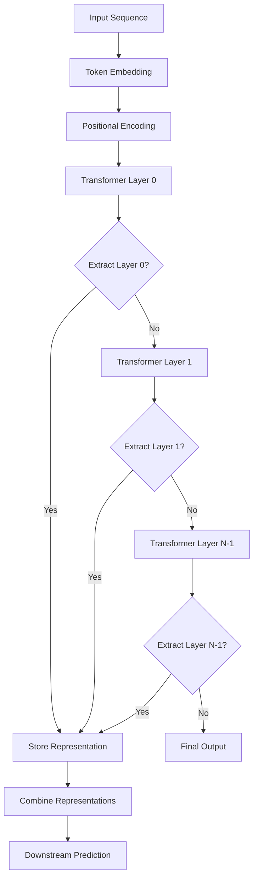

Layer-wise embedding analysis provides a powerful framework for understanding how different transformer layers in Nicheformer encode biological information. This analysis enables precise control over which representations are used for downstream tasks, allowing researchers to explore the hierarchy of learned features from gene expression patterns to higher-order biological concepts.

## Layer Extraction Architecture

The layer extraction mechanism operates at the core of Nicheformer's fine-tuning architecture, enabling selective harvesting of hidden representations from specific transformer layers. During the forward pass, the model iterates through each transformer layer and captures embeddings from layers specified in the `extract_layers` configuration parameter.

Sources: [src/nicheformer/models/_fine_tune_model.py](src/nicheformer/models/_fine_tune_model.py#L121-L126)



The extraction process identifies and collects intermediate representations that may capture different levels of biological abstraction. Early layers typically retain fine-grained gene expression patterns, while deeper layers encode higher-order relationships such as niche composition, tissue organization, and multimodal context integration.

Sources: [src/nicheformer/models/_fine_tune_model.py](src/nicheformer/models/_fine_tune_model.py#L121-L126)

## Layer Combination Strategies

Nicheformer provides three distinct strategies for combining multiple layer representations, each offering different trade-offs between dimensionality and information preservation. The `function_layers` parameter determines the mathematical operation applied to the collected layer embeddings.

Sources: [src/nicheformer/models/_fine_tune_model.py](src/nicheformer/models/_fine_tune_model.py#L127-L135)

| Strategy | Operation | Output Dimensionality | Characteristics |
|----------|-----------|----------------------|-----------------|
| `mean` | Average across layers | `dim_model` | Preserves spatial features, smooths variations |
| `sum` | Element-wise sum | `dim_model` | Amplifies consistent patterns across layers |
| `concat` | Concatenate tensors | `dim_model × n_extracted` | Maximizes information, increases dimensionality |

### Mean Aggregation

The mean strategy computes the average of all extracted layer representations, producing a compact embedding of dimension `dim_model` (typically 512). This approach smooths out layer-specific noise while preserving features that are consistent across the extracted depth.

Sources: [src/nicheformer/models/_fine_tune_model.py](src/nicheformer/models/_fine_tune_model.py#L127-L129)

### Summation Aggregation

The sum strategy element-wise adds all extracted representations, reinforcing features that appear consistently across layers while attenuating those that are layer-specific. This can emphasize stable biological signals that emerge throughout the transformer depth.

Sources: [src/nicheformer/models/_fine_tune_model.py](src/nicheformer/models/_fine_tune_model.py#L130-L132)

### Concatenation Aggregation

Concatenation preserves all layer information by appending representations along the feature dimension. For example, extracting layers [4, 8, 11] from a 512-dimensional model produces a 1536-dimensional representation. This maximizes information retention but may require additional dimensionality reduction for downstream tasks.

Sources: [src/nicheformer/models/_fine_tune_model.py](src/nicheformer/models/_fine_tune_model.py#L134-L135)

## Configuration and Implementation

Layer extraction configuration occurs during model initialization through the `FineTuningModel` constructor parameters:

Sources: [src/nicheformer/models/_fine_tune_model.py](src/nicheformer/models/_fine_tune_model.py#L21-L47)

```python
model = FineTuningModel.load_from_checkpoint(
    checkpoint_path=config['fine_tuned_checkpoint_path'],
    backbone=Nicheformer.load_from_checkpoint(checkpoint_path=config['checkpoint_path']),
    extract_layers=[4, 8, 11],  # Extract from layers 4, 8, and 11
    function_layers="mean",      # Combine using mean aggregation
    extractor=True,              # Apply pooler MLP
    without_context=True,        # Exclude context tokens
    predict=True                 # Enable embedding extraction mode
)
```

The `extract_layers` parameter accepts a list of integers specifying zero-indexed layer indices. These layers must exist within the backbone model's architecture (typically ranging from 0 to 11 for a 12-layer transformer).

Sources: [src/nicheformer/models/_fine_tune_model.py](src/nicheformer/models/_fine_tune_model.py#L17-L17)

## Context Token Management

Embedding extraction offers flexibility in handling auxiliary tokens through the `without_context` parameter. When enabled (default `True`), the model excludes the first three tokens (CLS, specie, assay, and modality tokens) from the final pooled representation, focusing exclusively on gene expression tokens.

Sources: [src/nicheformer/models/_fine_tune_model.py](src/nicheformer/models/_fine_tune_model.py#L142-L155)

> [!TIP]
> The context tokens (positions 0-2) encode metadata but can dilute cell-specific biological signals when included in embeddings. Use `without_context=True` for pure cell-level representations, or set to `False` if metadata-informed embeddings are needed for your downstream analysis task.

## Pooling Strategies

After layer extraction and combination, the model applies pooling operations to convert sequence-level representations into single cell embeddings. Two primary pooling mechanisms are available:

Sources: [src/nicheformer/models/_fine_tune_model.py](src/nicheformer/models/_fine_tune_model.py#L142-L156)

### Mean Pooling

Mean pooling computes the average across all gene tokens in the sequence, producing a representation that captures the overall expression profile of the cell's neighborhood.

Sources: [src/nicheformer/models/_fine_tune_model.py](src/nicheformer/models/_fine_tune_model.py#L153-L155)

### Pooler MLP

When `extractor=True`, a two-layer MLP projects the pooled representation through a learned transformation:
1. Linear layer: `dim_model → dim_model`
2. Tanh activation
3. Linear projection to prediction dimension

This enables task-specific adaptation of the extracted embeddings for fine-tuning objectives.

Sources: [src/nicheformer/models/_fine_tune_model.py](src/nicheformer/models/_fine_tune_model.py#L95-L97), [src/nicheformer/models/_fine_tune_model.py](src/nicheformer/models/_fine_tune_model.py#L140-L156)

## Reinitialization Strategies

The `reinit_layers` parameter enables selective reinitialization of transformer layers, which can adapt the backbone to new domains or tissues while preserving beneficial knowledge from pretraining. Layers specified in this list are reinitialized using Kaiming normal initialization (std=0.02), while others retain their pretrained weights.

Sources: [src/nicheformer/models/_fine_tune_model.py](src/nicheformer/models/_fine_tune_model.py#L68-L71)

> [!TIP]
> For transfer learning across different modalities (e.g., dissociated to spatial data), consider reinitializing the top 3-4 layers while keeping earlier layers frozen. This allows adaptation to new domain-specific patterns while preserving fundamental gene expression representations learned during pretraining.

## Embedding Extraction Pipeline

The complete embedding extraction workflow integrates layer-wise analysis with distributed data loading for large-scale datasets:

Sources: [src/nicheformer/_embeddings.py](src/nicheformer/_embeddings.py#L10-L143)

```mermaid
flowchart LR
    A[Load Pre-trained Checkpoint] --> B[Configure Extract Layers]
    B --> C[Initialize FineTuningModel]
    C --> D[Setup Merlin DataModule]
    D --> E[Iterate Validation Batches]
    E --> F[Forward Pass with Layer Extraction]
    F --> G[Apply Pooling Strategy]
    G --> H[Collect Metadata]
    H --> I[Save Embeddings]
    I --> J[Save Metadata CSV]
```



The pipeline leverages PyTorch Lightning's distributed training infrastructure for efficient processing, handling batches with mixed-precision training (BF16) and automatic device placement.

Sources: [src/nicheformer/_embeddings.py](src/nicheformer/_embeddings.py#L19-L87)

## Practical Application

### Extracting Multi-layer Embeddings

To extract embeddings combining representations from multiple transformer layers:

```python
# Configuration for multi-layer extraction
config = {
    'checkpoint_path': 'path/to/nicheformer.ckpt',
    'fine_tuned_checkpoint_path': 'path/to/nicheformer_ft.ckpt',
    'organ': 'brain'
}

# Model loads and extracts layers [4, 8, 11] using mean aggregation
from nicheformer._embeddings import get_embeddings_model
get_embeddings_model(config=config)
```

Sources: [src/nicheformer/config_files/_config_embeddings.py](src/nicheformer/config_files/_config_embeddings.py#L1-L6)

### Custom Fine-tuning Configuration

When fine-tuning for specific downstream tasks, the layer extraction parameters can be tuned:

```python
sweep_config = {
    'extract_layers': [11],           # Use only final layer
    'function_layers': 'mean',         # Mean aggregation (single layer)
    'extractor': False,               # No MLP projection
    'freeze': True,                   # Freeze backbone weights
    'supervised_task': 'niche_regression',
    'dim_prediction': 33,
}
```

Sources: [src/nicheformer/config_files/_config_fine_tune.py](src/nicheformer/config_files/_config_fine_tune.py#L1-L21)

## Biological Interpretation of Layer Depths

Different layers in the transformer architecture capture distinct levels of biological abstraction:

| Layer Depth | Biological Abstraction | Typical Use Cases |
|-------------|----------------------|-------------------|
| Early (0-4) | Gene expression patterns, individual token relationships | Expression profile reconstruction, token-level predictions |
| Middle (5-8) | Gene-gene interactions, pathway-level representations | Cell type classification, pathway activity inference |
| Late (9-11) | Tissue organization, niche composition, multimodal integration | Spatial location prediction, niche regression, density prediction |

By selectively extracting from specific depth ranges, researchers can tailor embeddings to the biological questions under investigation.

Sources: [src/nicheformer/models/_fine_tune_model.py](src/nicheformer/models/_fine_tune_model.py#L121-L126)

## Output and Metadata Storage

Extracted embeddings are stored as NumPy arrays with shape `(n_cells, embedding_dim)`, accompanied by comprehensive metadata capturing experimental context:

Sources: [src/nicheformer/_embeddings.py](src/nicheformer/_embeddings.py#L138-L141)

- **Embeddings file**: `embeddings.npy` - Dense representation matrix
- **Metadata file**: `metadata_embeddings.csv` - Contains columns for region, niche, cell_type, assay, species, modality, and cell index

This structured output enables direct integration with downstream analysis pipelines including dimensionality reduction, clustering, and visualization workflows.

Sources: [src/nicheformer/_embeddings.py](src/nicheformer/_embeddings.py#L124-L139)

## Advanced Configuration Patterns

### Progressive Layer Extraction

For analyzing how biological signals emerge across depth, extract embeddings from individual layers separately:

```python
# Extract from layer 4 only
config_layer4 = {'extract_layers': [4], 'function_layers': 'mean'}

# Extract from layer 8 only
config_layer8 = {'extract_layers': [8], 'function_layers': 'mean'}

# Extract from layer 11 only
config_layer11 = {'extract_layers': [11], 'function_layers': 'mean'}
```

Comparing these embeddings quantifies feature evolution through the network depth.

Sources: [src/nicheformer/models/_fine_tune_model.py](src/nicheformer/models/_fine_tune_model.py#L127-L135)

### Concatenated Multi-scale Analysis

Combine multiple scales using concatenation for maximum information retention:

```python
config_concat = {
    'extract_layers': [2, 5, 8, 11],    # Four representative layers
    'function_layers': 'concat',       # Preserve all information
    'extractor': True                  # Apply learned projection
}
```

This produces high-dimensional embeddings (2048-dim for 512 base model) that can be subsequently reduced using UMAP, PCA, or learned projections.

Sources: [src/nicheformer/models/_fine_tune_model.py](src/nicheformer/models/_fine_tune_model.py#L134-L135)

## Next Steps

For practical implementation of layer-wise embedding extraction, refer to [Extracting Cell Embeddings from Pre-trained Models](23-extracting-cell-embeddings-from-pre-trained-models) which provides step-by-step workflows for extracting and analyzing embeddings at scale. To understand how these embeddings integrate with fine-tuning workflows, consult [Layer Extraction and Reinitialization Strategies](21-layer-extraction-and-reinitialization-strategies). For understanding the transformer architecture that generates these layer representations, see [Nicheformer Transformer Architecture](10-nicheformer-transformer-architecture).