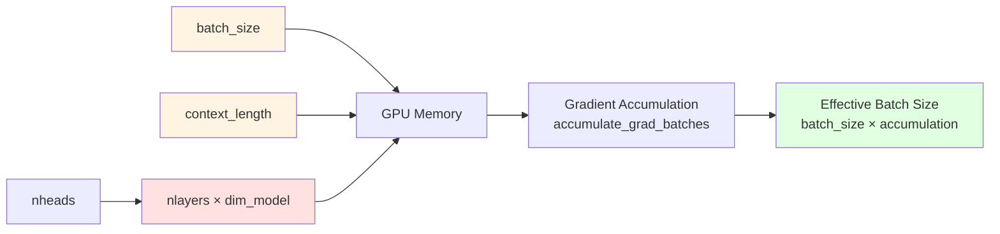

Configuration management in Nicheformer provides a centralized and modular approach to parameter control across pretraining, fine-tuning, and embedding extraction workflows. The configuration system uses Python dictionaries for core settings while supporting YAML files for experiment-specific customizations, enabling flexibility for different computational resources and biological tasks.

## Configuration Architecture Overview

Nicheformer employs a three-tiered configuration architecture that separates concerns between pretraining, fine-tuning, and embedding extraction. Each tier has dedicated configuration files in `src/nicheformer/config_files/`, with experiment scripts accepting additional YAML-based configurations through command-line arguments. This design allows for parameter inheritance and selective overriding based on experimental needs.

```mermaid
flowchart TB
    A[Config System Entry Point] --> B[Pretraining Config<br/>_config_train.py]
    A --> C[Fine-Tuning Config<br/>_config_fine_tune.py]
    A --> D[Embedding Config<br/>_config_embeddings.py]
    
    B --> E[Model Architecture<br/>dim_model, nheads, nlayers]
    B --> F[Training Hyperparameters<br/>lr, warmup, batch_size]
    B --> G[Data Configuration<br/>context_length, n_tokens]
    B --> H[Feature Flags<br/>specie, assay, modality]
    
    C --> I[Backbone Settings<br/>checkpoint_path, freeze]
    C --> J[Task Configuration<br/>supervised_task, n_classes]
    C --> K[Layer Strategies<br/>reinit_layers, extract_layers]
    
    D --> L[Model Paths<br/>checkpoint_path, fine_tuned_checkpoint_path]
    D --> M[Organ Selection<br/>organ]
    
    E & F & G & H --> N[Nicheformer Model<br/>models/_nicheformer.py]
    I & J & K --> O[FineTuningModel<br/>models/_fine_tune_model.py]
    L & M --> P[Embedding Extraction<br/>_embeddings.py]
    
    N --> Q[trainer.fit()]
    O --> Q
    P --> R[model.get_embeddings()]
    
    style A fill:#e1f5ff
    style B fill:#fff4e1
    style C fill:#ffe1f5
    style D fill:#e1ffe1
```

This architecture ensures that parameters flow cleanly from configuration files through model initialization to training pipelines, with clear separation of concerns between different computational stages.

Sources: [_config_train.py](src/nicheformer/config_files/_config_train.py#L1-L25), [_config_fine_tune.py](src/nicheformer/config_files/_config_fine_tune.py#L1-L20), [_config_embeddings.py](src/nicheformer/config_files/_config_embeddings.py#L1-L5)

## Pretraining Configuration

The pretraining configuration defined in `_config_train.py` controls the foundational model architecture and training dynamics. This configuration is used when training Nicheformer from scratch on large-scale spatial and dissociated transcriptomics data, as described in [Pretraining Nicheformer on Large-Scale Data](15-pretraining-nicheformer-on-large-scale-data).

### Core Model Architecture Parameters

| Parameter | Default | Description | Usage Context |
|-----------|---------|-------------|---------------|
| `dim_model` | 512 | Dimension of the transformer model embeddings and hidden states | Determines model capacity and memory requirements |
| `nheads` | 16 | Number of attention heads in each transformer layer | Affects parallel processing and attention granularity |
| `dim_feedforward` | 1024 | Dimension of the feed-forward network in transformer layers | Typically 2× dim_model for balanced capacity |
| `nlayers` | 12 | Number of transformer encoder layers | Controls model depth and representational power |
| `dropout` | 0.0 | Dropout probability for regularization | Higher values prevent overfitting on small datasets |

These architectural parameters directly initialize the Nicheformer Lightning module through its constructor [models/_nicheformer.py#L16-L36](src/nicheformer/models/_nicheformer.py#L16-L36), where they configure the transformer's internal structure via `_init_transformer()` [models/_nicheformer.py#L84-L86](src/nicheformer/models/_nicheformer.py#L84-L86).

### Training Dynamics and Data Configuration

| Parameter | Default | Description | Impact on Training |
|-----------|---------|-------------|-------------------|
| `lr` | 7e-4 | Learning rate for AdamW optimizer | Higher values accelerate learning but risk instability |
| `warmup` | 100000 | Number of warmup steps for learning rate scheduler | Enables stable training initialization [models/_nicheformer.py#L329-L344](src/nicheformer/models/_nicheformer.py#L329-L344) |
| `max_epochs` | 30661140 | Maximum training epochs/iterations | Set high for continuous training with checkpointing |
| `batch_size` | 6 | Batch size per GPU | Affects memory usage and gradient estimation |
| `masking_p` | 0.15 | Probability of token masking for MLM pretraining | Controls difficulty of self-supervised task |
| `context_length` | 1500 | Maximum sequence length for input tokens | Must align with tokenization preprocessing |

The learning rate schedule combines warmup with cosine annealing via the `CosineWarmupScheduler` class, which progressively reduces the learning rate after the warmup phase following a cosine curve [models/_nicheformer.py#L342-L344](src/nicheformer/models/_nicheformer.py#L342-L344).

### Token and Embedding Configuration

| Parameter | Default | Description | Notes |
|-----------|---------|-------------|-------|
| `n_tokens` | 20340 | Size of the vocabulary token set | Includes genes and special tokens |
| `batch_first` | True | Whether batch dimension comes first in tensors | PyTorch transformer convention |
| `learnable_pe` | True | Use learnable positional encodings instead of sinusoidal | Provides flexibility for spatial context |
| `autoregressive` | False | Enable autoregressive generation mode | Set False for bidirectional attention |

The embedding system combines token embeddings with positional encodings through `_init_embeddings()` [models/_nicheformer.py#L101-L103](src/nicheformer/models/_nicheformer.py#L101-L103), with learnable positional encodings allowing the model to adapt position representations to spatial transcriptomics data patterns.

### Metadata and Feature Flags

| Parameter | Default | Description | Effect on Data Processing |
|-----------|---------|-------------|---------------------------|
| `specie` | True | Include species metadata in model input | Enables cross-species transfer learning |
| `assay` | True | Include assay technology metadata | Captures platform-specific effects |
| `modality` | True | Include spatial/dissociated modality metadata | Distinguishes data types |
| `organ` | "everything" | Target organ or "everything" for multi-organ training | Controls data path selection [_train.py#L62-L65](src/nicheformer/_train.py#L62-L65) |

These feature flags control which metadata columns are included in the data module's column selection, enabling the model to learn from auxiliary information about samples, tissues, and experimental conditions.

Sources: [_config_train.py](src/nicheformer/config_files/_config_train.py#L1-L25), [_train.py](src/nicheformer/_train.py#L8-L32), [models/_nicheformer.py](src/nicheformer/models/_nicheformer.py#L16-L36)

## Fine-Tuning Configuration

Fine-tuning configuration in `_config_fine_tune.py` adapts the pre-trained model to specific downstream tasks such as niche classification, regression, or density prediction. This configuration wraps the pre-trained backbone in a `FineTuningModel` that adds task-specific prediction heads.

### Backbone Loading and Freezing

| Parameter | Default | Description | When to Modify |
|-----------|---------|-------------|----------------|
| `checkpoint_path` | Path to pretrained model | Path to pre-trained Nicheformer checkpoint | Update for different pretrained models |
| `freeze` | False | Freeze backbone parameters during fine-tuning | Set True for linear probing or small datasets |
| `pretrained_path` | None | Load from checkpoint and continue training | For resuming pretraining or continued pretraining |

The freezing strategy is critical for transfer learning: freezing the backbone while training only the prediction head is effective when limited data is available, while unfreezing allows adaptation of internal representations to the target task. The training strategy adapts automatically based on the freeze flag [_fine_tune.py#L60](src/nicheformer/_fine_tune.py#L60).

> [!TIP]
> When fine-tuning on small datasets (<10K cells), start with `freeze=True` to establish baseline performance, then gradually unfreeze layers using `reinit_layers` to find the optimal capacity for your task.

### Layer Manipulation Strategies

| Parameter | Default | Description | Typical Values |
|-----------|---------|-------------|---------------|
| `reinit_layers` | None | Layer indices to reinitialize before fine-tuning | `[0, 1]` for shallow layers, `[]` for none |
| `extract_layers` | [] | Layers to extract features from for prediction | `[6, 7, 8, 9, 10, 11]` for multi-scale features |
| `function_layers` | "last" | How to combine extracted layers | "mean", "max", or "last" |

Layer manipulation strategies enable fine-grained control over feature extraction. Reinitializing layers ([models/_fine_tune_model.py#L52-L61](src/nicheformer/models/_fine_tune_model.py#L52-L61)) can help when the pre-trained representations are poorly suited for the downstream task, while extracting from intermediate layers provides multi-scale feature representations useful for complex biological tasks.

### Task Configuration Parameters

| Parameter | Default | Description | Task Compatibility |
|-----------|---------|-------------|-------------------|
| `supervised_task` | "niche_classification" | Type of supervised learning task | "niche_classification", "density_regression", "distribution_regression" |
| `n_classes` | 17 | Number of output classes for classification | Must match target label cardinality |
| `dim_prediction` | 1 | Output dimension for regression tasks | 1 for scalar, >1 for multi-variate |
| `predict_density` | False | Whether to predict cell density | Enables spatial density modeling |
| `regress_distribution` | False | Predict distribution parameters | Useful for uncertainty estimation |
| `ignore_zeros` | False | Ignore zero values in regression | Helpful for sparse expression data |

The supervised task parameter determines which loss function and prediction head architecture are used [models/_fine_tune_model.py#L107-L162](src/nicheformer/models/_fine_tune_model.py#L107-L162). For niche classification, a softmax cross-entropy head is used; for regression tasks, mean squared error or distribution-based losses are applied depending on `regress_distribution` and `predict_density` settings.

### Training Configuration for Fine-Tuning

| Parameter | Default | Description | Fine-Tuning Best Practices |
|-----------|---------|-------------|--------------------------|
| `lr` | 1e-4 | Learning rate (typically lower than pretraining) | 10× lower than pretraining is common |
| `warmup` | 1 | Warmup steps for fine-tuning | Often minimal for transfer learning |
| `max_epochs` | 50000 | Maximum training epochs | Use early stopping based on validation |
| `batch_size` | 12 | Batch size for fine-tuning | Often larger than pretraining due to smaller context |
| `pool` | "mean" | Pooling strategy for sequence aggregation | "mean" for embeddings, "cls" for classification |

The pooling strategy affects how sequence-level representations are obtained. Mean pooling averages all token embeddings, while CLS pooling uses a dedicated classification token. For niche-related tasks where all cells contribute equally, mean pooling is typically preferred [_fine_tune.py#L10](src/nicheformer/_fine_tune.py#L10).

Sources: [_config_fine_tune.py](src/nicheformer/config_files/_config_fine_tune.py#L1-L20), [_fine_tune.py](src/nicheformer/_fine_tune.py#L12-L40), [models/_fine_tune_model.py](src/nicheformer/models/_fine_tune_model.py#L17-L39)

## Embedding Extraction Configuration

The embedding configuration in `_config_embeddings.py` is minimal, focusing only on model paths and target organs. This simplicity reflects the inference-only nature of embedding extraction, where training parameters are unnecessary.

### Core Embedding Parameters

| Parameter | Default | Description | Usage Notes |
|-----------|---------|-------------|-------------|
| `checkpoint_path` | Path to pretrained checkpoint | Path to base pre-trained Nicheformer model | Required for backbone initialization |
| `fine_tuned_checkpoint_path` | Path to fine-tuned checkpoint | Path to fine-tuned model for task-specific embeddings | Use None for base model embeddings |
| `organ` | "everything" | Target organ for embedding extraction | Selects appropriate data path and metadata |

Embedding extraction loads both the backbone and fine-tuned models if available, enabling extraction of representations from either the base pre-trained model or task-adapted versions [_embeddings.py#L17](src/nicheformer/_embeddings.py#L17). This flexibility supports both general purpose embeddings for clustering and task-specific embeddings for downstream analysis as described in [Using Embeddings for Downstream Analysis](24-using-embeddings-for-downstream-analysis).

### Organ-Specific Data Paths

The configuration system automatically maps organ names to data paths containing preprocessed tokenized data:

| Organ Value | Data Path | Typical Use Case |
|-------------|-----------|------------------|
| `brain` | `merfish_brain` | Mouse brain spatial transcriptomics |
| `liver` | `cosmx_liver` | Human liver CosMx spatial data |
| `lung` | `cosmx_lung` | Human lung CosMx spatial data |
| `dissociated_mouse_brain` | `dissociated_mouse_brain` | Dissociated mouse brain scRNA-seq |
| `everything` | `nicheformer_tokens` | Multi-tissue, multi-technology corpus |

This organ-based path resolution enables seamless switching between datasets without modifying code, supporting the multi-modal and multi-organ experiment management described in [Managing Multi-modal and Multi-organ Experiments](28-managing-multi-modal-and-multi-organ-experiments).

Sources: [_config_embeddings.py](src/nicheformer/config_files/_config_embeddings.py#L1-L5), [_embeddings.py](src/nicheformer/_embeddings.py#L10-L74)

## YAML-Based Experiment Configuration

For experiment-specific workflows, the configuration system supports YAML files loaded through command-line arguments in the `experiments/` directory scripts. This approach enables version-controlled, reproducible experiment configurations separate from core parameter definitions.

### YAML Configuration Structure

Experiment scripts accept a `--config` argument pointing to a YAML file containing all necessary parameters:

```bash
python -m nicheformer.experiments.downstream_fine_tune --config experiments/configs/liver_fine_tune.yaml
```

The YAML configuration includes parameters from the Python config files plus additional experiment-specific settings:

| YAML Parameter | Default | Description | Example |
|----------------|---------|-------------|---------|
| `data_path` | Required | Path to input AnnData file | `data/liver_processed.h5ad` |
| `technology_mean_path` | Required | Path to technology mean array | `data/means/cosmx_mean.npy` |
| `output_dir` | Required | Directory for outputs and checkpoints | `outputs/liver_experiment/` |
| `output_path` | Required | Path for output AnnData file | `outputs/liver_experiment/results.h5ad` |
| `max_seq_len` | 4096 | Maximum sequence length for dataset | `4096` or `8192` for larger datasets |
| `aux_tokens` | 30 | Number of auxiliary tokens for metadata | `30` (specie, assay, modality) |
| `chunk_size` | 1000 | Chunk size for data loading | `1000` for memory efficiency |
| `num_workers` | 4 | Number of dataloader workers | `4` or higher for fast I/O |
| `embedding_layer` | -1 | Layer to extract embeddings from | `-1` for last layer, `6` for middle |
| `embedding_name` | "embeddings" | Name for embedding key in AnnData | `"nicheformer"` or `"spatial"` |
| `precision` | 32 | Numerical precision for training | `16` for mixed precision, `32` for full |
| `gradient_clip_val` | 1.0 | Gradient clipping threshold | `1.0` for stability |
| `accumulate_grad_batches` | 10 | Gradient accumulation batches | `10` for effective batch scaling |

### Loading Configuration from YAML

The experiment scripts load YAML configurations using Python's standard YAML library:

```python
import yaml
from nicheformer.experiments.downstream_fine_tune import fine_tune_predictions

with open(args.config) as f:
    config = yaml.safe_load(f)

fine_tune_predictions(config=config)
```

This pattern, shown in [experiments/downstream_fine_tune.py#L182-L185](src/nicheformer/experiments/downstream_fine_tune.py#L182-L185), enables easy configuration management and experiment reproducibility. The config dictionary is passed directly to the experiment function, which uses `.get()` methods to provide sensible defaults for optional parameters.

> [!TIP]
> Store experiment-specific configurations in a version-controlled `experiments/configs/` directory alongside your notebooks. This practice enables reproducibility and easy sharing of experimental setups across collaborators.

Sources: [experiments/downstream_fine_tune.py](src/nicheformer/experiments/downstream_fine_tune.py#L176-L185), [experiments/get_embeddings.py](src/nicheformer/experiments/get_embeddings.py#L88-L96), [experiments/pretraining_fine_tune.py](src/nicheformer/experiments/pretraining_fine_tune.py#L123-L132)

## Parameter Interactions and Dependencies

Configuration parameters do not exist in isolation; they interact in meaningful ways that affect model performance, memory usage, and training stability. Understanding these dependencies is crucial for effective configuration.

### Memory and Computation Dependencies



The effective batch size, which determines gradient stability, is the product of `batch_size` and `accumulate_grad_batches` [_train.py#L55](src/nicheformer/_train.py#L55). When increasing context length or model size, reduce batch size and increase gradient accumulation to maintain the same effective batch size while staying within GPU memory limits.

### Learning Rate and Warmup Dependencies

The learning rate and warmup parameters work together through the `CosineWarmupScheduler`:

1. **Warmup Phase (0 to warmup steps)**: Learning rate increases linearly from 0 to target lr
2. **Cosine Decay Phase (warmup to max_epochs)**: Learning rate follows cosine curve from target to near-zero

For fine-tuning, use a smaller warmup (e.g., 1-10 steps) since the model is already partially trained, whereas pretraining requires larger warmup (e.g., 100K steps) for stable initialization.

### Data Path and Metadata Dependencies

The `organ` parameter determines data path resolution and metadata columns:

| Organ | Data Path | Required Metadata |
|-------|-----------|-------------------|
| `everything` | Multi-tissue corpus | `specie`, `assay`, `modality` must all be True |
| Single organ | Organ-specific path | Organ-specific metadata columns selected |

When `organ == "everything"`, the system automatically includes all metadata flags and selects the appropriate data path with multiple columns [_train.py#L62-L65](src/nicheformer/_train.py#L62-L65).

Sources: [models/_nicheformer.py#L329-L344](src/nicheformer/models/_nicheformer.py#L329-L344), [_train.py](src/nicheformer/_train.py#L43-L55)

## Practical Configuration Examples

### Example 1: Pretraining on Single Tissue

For focused pretraining on a specific tissue rather than the multi-organ corpus:

```python
from config_files._config_train import sweep_config

# Modify for tissue-specific pretraining
config = sweep_config.copy()
config['organ'] = 'brain'  # Single tissue instead of 'everything'
config['batch_size'] = 12  # Can increase with smaller context
config['max_epochs'] = 100000  # Fewer steps for single tissue
config['specie'] = False  # May not need species metadata for single-species
```

This configuration trains exclusively on brain data, potentially enabling better specialization for brain-specific spatial patterns, as detailed in [Transfer Learning Across Tissues and Technologies](22-transfer-learning-across-tissues-and-technologies).

### Example 2: Fine-Tuning for Cell Type Classification

Fine-tuning for a classification task with frozen backbone:

```python
from config_files._config_fine_tune import sweep_config

config = sweep_config.copy()
config['supervised_task'] = 'cell_type_classification'
config['n_classes'] = 42  # Number of cell types in dataset
config['freeze'] = True  # Linear probing baseline
config['lr'] = 5e-5  # Lower learning rate for frozen backbone
config['warmup'] = 100  # Short warmup
config['max_epochs'] = 500  # With early stopping
config['label'] = 'cell_type'  # Target column in data
```

This configuration implements linear probing, where only the classification head is trained, providing a strong baseline for cell type prediction tasks as described in [Classification Tasks with Fine-Tuning](19-classification-tasks-with-fine-tuning).

### Example 3: Extracting Multi-Scale Embeddings

Extracting embeddings from multiple layers for comprehensive analysis:

```python
from config_files._config_embeddings import sweep_config

config = sweep_config.copy()
config['organ'] = 'liver'
config['fine_tuned_checkpoint_path'] = '/path/to/liver_fine_tuned.ckpt'
```

Then in the embedding extraction code, specify multiple layers:

```python
for layer in [4, 7, 11]:  # Early, middle, and late layers
    config['embedding_layer'] = layer
    config['embedding_name'] = f'layer_{layer}'
    get_embeddings_model(config=config)
```

This multi-scale approach enables analysis of feature representations at different depths of the network, useful for the layer-wise analysis discussed in [Layer-wise Embedding Analysis](25-layer-wise-embedding-analysis).

### Example 4: YAML Configuration for Reproducible Experiment

A complete YAML configuration file for liver tissue density regression:

```yaml
# liver_density_regression.yaml
data_path: "/data/liver_processed.h5ad"
technology_mean_path: "/data/means/cosmx_mean.npy"
output_dir: "/outputs/liver_density_experiment"
output_path: "/outputs/liver_density_experiment/results.h5ad"

# Model configuration
checkpoint_path: "/pretrained_models/nicheformer.ckpt"
supervised_task: "density_regression"
predict_density: true
dim_prediction: 5  # Multi-scale density
freeze: false
reinit_layers: [0, 1]
pool: "mean"

# Training configuration
batch_size: 16
lr: 5e-5
warmup: 100
max_epochs: 1000
num_workers: 8
precision: 16
gradient_clip_val: 1.0
accumulate_grad_batches: 5

# Data configuration
max_seq_len: 4096
aux_tokens: 30
chunk_size: 1000

# Experiment metadata
organ: "liver"
label: "X_niche_0"
```

This configuration, loadable via `python -m nicheformer.experiments.downstream_fine_tune --config liver_density_regression.yaml`, encapsulates all experiment parameters in a single version-controlled file, supporting reproducible research workflows.

Sources: [experiments/downstream_fine_tune.py](src/nicheformer/experiments/downstream_fine_tune.py#L17-L109), [experiments/get_embeddings.py](src/nicheformer/experiments/get_embeddings.py#L14-L86)

## Common Configuration Pitfalls

### Incorrect Vocabulary Size

Setting `n_tokens` to a value that doesn't match your tokenized data will cause index-out-of-bounds errors during training. Ensure this value matches the maximum token ID in your preprocessed data, typically one more than the highest gene token ID.

### Misaligned Context Length

The `context_length` parameter must match or exceed the maximum sequence length in your tokenized data. If sequences are truncated during tokenization but the config expects longer sequences, padding will dominate inputs and reduce effective model capacity. Verify alignment between tokenization scripts and configuration.

### Warmup Steps Exceeding Training Steps

Setting `warmup` larger than `max_epochs` results in learning rates that never decay, potentially causing training instability. Ensure `warmup` is at most 10-20% of total training steps for pretraining, or minimal for fine-tuning.

### Frozen Backbone with High Learning Rate

When `freeze=True`, the learning rate applies only to the prediction head. Using the pretraining learning rate (e.g., 7e-4) with a frozen backbone will cause rapid divergence. Reduce by 10-100× for frozen fine-tuning scenarios.
