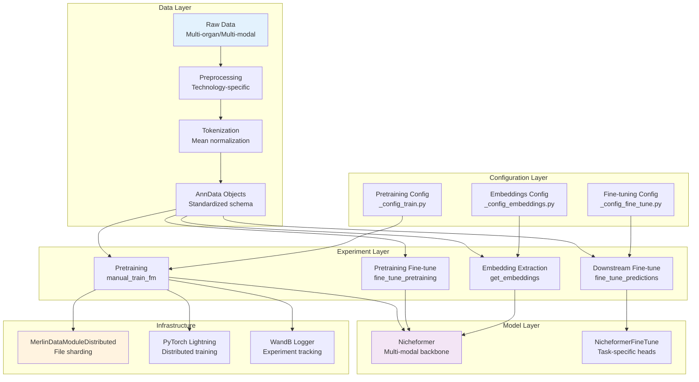

Nicheformer's architecture is specifically designed to handle multi-modal (dissociated single-cell and spatial transcriptomics) and multi-organ experiments through a sophisticated token embedding system and distributed training infrastructure. This page covers the architectural patterns, configuration strategies, and workflow management for conducting experiments across diverse biological systems and technology platforms.

## Multi-modal Token Architecture

Nicheformer incorporates metadata directly into the embedding space through specialized tokens that represent biological and technical covariates. The model architecture supports three primary dimensions of variation: modality, species, and assay type. These metadata tokens are prepended to the gene expression sequence during training, allowing the transformer to learn context-aware representations that generalize across experimental conditions.

The token system is implemented through configuration flags in the model constructor: `specie`, `assay`, and `modality` [src/nicheformer/models/_nicheformer.py#L42-L47]. When enabled, these parameters control the injection of special tokens into the input sequence. The embedding layer is initialized with `n_tokens+5` positions to accommodate auxiliary tokens including mask (0), padding (1), and CLS (2) tokens, plus additional slots for metadata [src/nicheformer/models/_nicheformer.py#L68-L73].

The metadata token assignments follow a standardized mapping defined in the tokenization notebooks:
- **Modality tokens**: `dissociated` → 3, `spatial` → 4
- **Species tokens**: `human/Homo sapiens` → 5, `mouse/Mus musculus` → 6
- **Assay tokens**: merfish (7), cosmx (8), visium (9), various 10x versions (10-16), CITE-seq (17), Smart-seq v4 (18) [notebooks/experiments/get_embeddings.ipynb#L75-L92]

Sources: [src/nicheformer/models/_nicheformer.py](src/nicheformer/models/_nicheformer.py#L42-L73), [notebooks/experiments/get_embeddings.ipynb](notebooks/experiments/get_embeddings.ipynb#L75-L92)

## Configuration File Organization

Nicheformer employs a hierarchical configuration system that separates concerns across different experiment types. Configuration files are organized under `src/nicheformer/config_files/` with dedicated files for training, fine-tuning, and embedding extraction workflows.

### Pretraining Configuration

The pretraining configuration (`_config_train.py`) defines parameters for large-scale model training across diverse datasets:

```python
sweep_config = {
    'organ': "everything",  # Train on all organs
    'specie': True,         # Enable species tokens
    'assay': True,          # Enable assay tokens
    'modality': True,       # Enable modality tokens
    'n_tokens': 20340,       # Total gene vocabulary
    'context_length': 1500, # Maximum sequence length
    # ... additional training parameters
}
```

The `organ` parameter is particularly important: when set to `"everything"`, the training pipeline uses a multi-organ dataset path and specifies multiple metadata columns for the data module [src/nicheformer/config_files/_config_train.py#L19-L26].

Sources: [src/nicheformer/config_files/_config_train.py](src/nicheformer/config_files/_config_train.py#L19-L26)

### Fine-tuning Configuration

Downstream task configuration (`_config_fine_tune.py`) focuses on organ-specific tasks:

```python
sweep_config = {
    'checkpoint_path': "/path/to/nicheformer.ckpt",
    'freeze': False,
    'reinit_layers': None,
    'supervised_task': 'niche_classification',
    'organ': 'brain',  # Single-organ fine-tuning
    'label': 'region',
    'n_classes': 17,
}
```

This configuration enables transfer learning from the general pre-trained model to specific downstream tasks, with options for layer freezing and reinitialization [src/nicheformer/config_files/_config_fine_tune.py#L1-L21].

Sources: [src/nicheformer/config_files/_config_fine_tune.py](src/nicheformer/config_files/_config_fine_tune.py#L1-L21)

## Distributed Data Loading Strategy

Nicheformer leverages Merlin's distributed data loading infrastructure to handle multi-modal datasets efficiently across multiple GPUs. The `MerlinDataModuleDistributed` class implements a sophisticated file distribution strategy that shards data across available compute devices.

The data module supports two primary loading modes controlled by the `splits` parameter:
- **Single-organ mode**: Loads data from cellxgene census tokenized paths with `cell_type` as the key column
- **Multi-organ mode**: Loads from the comprehensive Nicheformer tokenized dataset with multiple metadata columns `[X, specie, assay, modality]` [src/nicheformer/_train.py#L56-L64]

The distributed file allocation uses modulus-based assignment:
```python
files = [file for file in os.listdir(base_path) 
         if ((int(file.split('.')[0].split('-')[1]) % world_size) == device)]
```

This ensures each GPU processes a distinct subset of data files, enabling scalable training on millions of cells [src/nicheformer/data/datamodules.py#L64-L67].

Sources: [src/nicheformer/_train.py](src/nicheformer/_train.py#L56-L64), [src/nicheformer/data/datamodules.py](src/nicheformer/data/datamodules.py#L64-L67)

## Experiment Types and Workflows

Nicheformer provides three distinct experiment entry points, each optimized for different stages of the machine learning pipeline:

### Pretraining Workflow

The pretraining workflow (`manual_train_fm`) initializes a Nicheformer model from scratch or resumes from a checkpoint, training on masked token prediction objectives. The workflow uses PyTorch Lightning with distributed data parallel strategy (`ddp_find_unused_parameters_true`) and integrates with Weights & Biases for experiment tracking [src/nicheformer/_train.py#L11-L81].

Key configuration parameters:
- **Learning rate**: 7e-4 with warmup over 100,000 steps
- **Batch size**: 6 with gradient accumulation (10 steps)
- **Precision**: bf16-mixed for memory efficiency
- **Checkpoint frequency**: Every 1,500 training steps

Sources: [src/nicheformer/_train.py](src/nicheformer/_train.py#L11-L81)

### Fine-tuning Workflow

The fine-tuning workflow (`fine_tune_predictions`) adapts pre-trained models to specific downstream tasks. Two variants exist:
1. **Pretraining fine-tune**: Continues masked token prediction on new data while preserving learned representations
2. **Downstream fine-tune**: Adds task-specific prediction heads (classification or regression) on top of the frozen or fine-tuned backbone [src/nicheformer/experiments/downstream_fine_tune.py#L12-L186]

The downstream fine-tuning workflow creates a `NicheformerFineTune` wrapper that manages:
- Feature extraction from specified transformer layers
- Prediction head architecture (mean pooling, concatenation)
- Freezing and reinitialization strategies
- Task-specific loss functions (classification vs regression)

Sources: [src/nicheformer/experiments/downstream_fine_tune.py](src/nicheformer/experiments/downstream_fine_tune.py#L12-L186), [src/nicheformer/experiments/pretraining_fine_tune.py](src/nicheformer/experiments/pretraining_fine_tune.py#L12-L133)

### Embedding Extraction Workflow

The embedding extraction workflow (`get_embeddings`) produces cell-level representations from pre-trained or fine-tuned models. This workflow bypasses training loops and uses the model's `get_embeddings` method to extract features from specified layers (default: last layer, -1) [src/nicheformer/experiments/get_embeddings.py#L12-L97].

Embeddings are stored in the AnnData object's `obsm` attribute with keys formatted as `X_niche_{embedding_name}`, enabling seamless integration with downstream single-cell analysis pipelines.

Sources: [src/nicheformer/experiments/get_embeddings.py](src/nicheformer/experiments/get_embeddings.py#L12-L97)

## Multi-Organ Data Integration

Nicheformer's data schema standardizes metadata across diverse datasets through ontology-based annotations defined in `src/nicheformer/data/constants.py`. This enables consistent integration of data from multiple sources and technology platforms.

### Ontology Standards

The constants module defines ontology terms for key biological dimensions:
- **Assay ontology**: EFO terms for 10x technologies (EFO:0030003, EFO:0009899, etc.), MERFISH (EFO:0008992), and spatial technologies (EFO:0030029) [src/nicheformer/data/constants.py#L4-L18]
- **Species ontology**: NCBITaxon identifiers for mouse (NCBITaxon:10090) and human (NCBITaxon:9606) [src/nicheformer/data/constants.py#L38-L43]
- **Tissue ontology**: UBERON identifiers for organs including brain (UBERON:0000955), liver (UBERON:0002107), lung (UBERON:0002048), and others [src/nicheformer/data/constants.py#L51-L64]

### Data Schema Constants

The AnnData object schema uses standardized keys for storing metadata:
- **Obs columns**: `assay_ontology_term_id`, `tissue_ontology_term_id`, `organism_ontology_term_id`, `cell_type_ontology_term_id` [src/nicheformer/data/constants.py#L75-L86]
- **Obsm matrices**: `spatial` coordinates, `X_niche` niche composition matrices [src/nicheformer/data/constants.py#L108-L114]
- **Split column**: `nicheformer_split` for train/val/test partitioning

Sources: [src/nicheformer/data/constants.py](src/nicheformer/data/constants.py#L4-L114)

## Technology-Specific Tokenization

Nicheformer provides tokenization notebooks for different spatial transcriptomics technologies, each handling the specific preprocessing requirements of the platform:

| Technology | Notebook | Mean File | Modality |
|------------|----------|-----------|----------|
| CosMx Human Liver | `cosmx_human_liver.ipynb` | `cosmx_mean_script.npy` | Spatial |
| CosMx Human Lung | `cosmx_human_lung.ipynb` | `cosmx_mean_script.npy` | Spatial |
| MERFISH Mouse Brain | `merfish_mouse_brain.ipynb` | `merfish_mean_script.npy` | Spatial |
| Xenium Human Colon | `xenium_human_colon.ipynb` | `xenium_mean_script.npy` | Spatial |
| Xenium Human Lung | `xenium_human_lung.ipynb` | `xenium_mean_script.npy` | Spatial |
| scRNAseq Mouse Brain | `scRNAseq_mouse_brain_haviv.ipynb` | `dissociated_mean_script.npy` | Dissociated |

Each notebook follows a consistent workflow: raw data download, preprocessing into AnnData format, and tokenization using technology-specific mean values for normalization [notebooks/tokenization/](notebooks/tokenization/).

Sources: [notebooks/tokenization/](notebooks/tokenization/), [data/model_means/](data/model_means/)

## Complete Experiment Architecture



This architecture enables scalable training on millions of cells across diverse biological systems while maintaining experiment reproducibility through standardized configurations and metadata schemas.

Sources: [src/nicheformer/_train.py](src/nicheformer/_train.py#L11-L81), [src/nicheformer/data/datamodules.py](src/nicheformer/data/datamodules.py#L111-L186)

## Practical Experiment Management

### Running Multi-organ Pretraining

To train a model on all organs with multi-modal support:

1. Configure `_config_train.py` with `organ: "everything"`, enable metadata tokens (`specie: True`, `assay: True`, `modality: True`)
2. Ensure the multi-organ dataset path contains parquet files with standardized schema
3. Launch training with: `python src/nicheformer/train.py`
4. Monitor via WandB project named `FM-everything` [src/nicheformer/_train.py#L40-L42]

### Organ-specific Fine-tuning

To fine-tune for a specific organ (e.g., brain region classification):

1. Create a YAML config specifying the pre-trained checkpoint path and organ-specific data
2. Set appropriate task type (`supervised_task: 'niche_classification'` or `'niche_regression'`)
3. Run: `python -m nicheformer.experiments.downstream_fine_tune --config path/to/config.yaml`
4. Predictions are automatically stored in `adata.obs` with appropriate keys [src/nicheformer/experiments/downstream_fine_tune.py#L172-L182]

### Cross-technology Embedding Extraction

To extract embeddings from a new spatial technology (e.g., Xenium):

1. Tokenize the data using the appropriate notebook in `notebooks/tokenization/`
2. Configure `data_path` to point to the preprocessed AnnData file
3. Use the technology-specific mean file for normalization
4. Run the embedding extraction and store results in `adata.obsm['X_niche_embeddings']` [src/nicheformer/experiments/get_embeddings.py#L78-L88]

> [!TIP]
> When working with new technologies not covered by existing mean files, compute the technology mean from a representative dataset and save it as a `.npy` file following the naming convention `{technology}_mean_script.npy`. This ensures consistent normalization across all modalities.

## Next Steps

For comprehensive understanding of the experiment management workflow:
- Continue to [Configuration Files and Parameters](26-configuration-files-and-parameters) for detailed parameter documentation
- Review [Experiment Tracking with Weights & Biases](27-experiment-tracking-with-weights-and-biases) for monitoring strategies
- Refer to [Transfer Learning Across Tissues and Technologies](22-transfer-learning-across-tissues-and-technologies) for advanced fine-tuning patterns

For practical implementation guidance:
- Explore [Fine-Tuning Model Architecture](18-fine-tuning-model-architecture) for prediction head design
- Study [Extracting Cell Embeddings from Pre-trained Models](23-extracting-cell-embeddings-from-pre-trained-models) for detailed embedding workflows