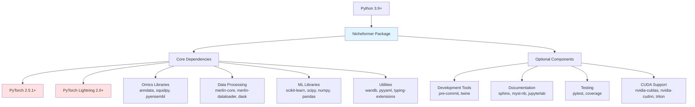
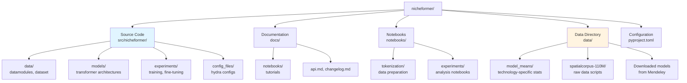

This guide walks you through installing Nicheformer, a foundation model for single-cell and spatial omics analysis. We'll cover environment setup, dependency management, and data preparation to get you ready for training, fine-tuning, or extracting embeddings from pre-trained models.

## System Requirements

Before beginning the installation, ensure your system meets the following requirements:

| Requirement | Minimum Version | Recommended Version |
|-------------|-----------------|---------------------|
| Python | 3.9 | 3.9 or 3.10 |
| CUDA (optional) | 12.1 | 12.1+ |
| RAM | 16 GB | 32 GB or higher |
| GPU | 8 GB VRAM | 16 GB+ VRAM for training |
| Disk Space | 10 GB | 50 GB+ for data and models |

Nicheformer requires **Python 3.9 or newer** to function properly. The project is licensed under the BSD 3-Clause License, which allows for both academic and commercial use with proper attribution.
Sources: [pyproject.toml](pyproject.toml#L1-L15), [LICENSE](LICENSE#L1-L30)

## Installation Architecture

Understanding the installation architecture helps you navigate dependencies effectively. The following diagram illustrates the relationship between Nicheformer components and their dependencies:




## Quick Installation

The recommended approach uses **Mambaforge** (a lightweight conda distribution) to create an isolated environment, preventing conflicts with existing Python packages. This approach ensures reproducibility and simplifies dependency management.

### Step 1: Create and Activate Conda Environment

First, create a dedicated conda environment with Python 3.9:

```bash
mamba create -n nicheformer_env python=3.9 -y
```

Activate your newly created environment:

```bash
mamba activate nicheformer_env
```

This isolates Nicheformer's dependencies from your system Python and other projects, which is especially important given the specific version requirements for packages like numpy (1.26.4) and pandas (1.5.3).
Sources: [README.md](README.md#L29-L35), [pyproject.toml](pyproject.toml#L14-L32)

### Step 2: Clone and Install Nicheformer

Clone the repository and install it in development mode, which allows you to modify the source code if needed:

```bash
git clone https://github.com/theislab/nicheformer.git
cd nicheformer
pip install -e .
```

The `-e` flag enables **editable mode**, linking the installed package directly to the source code directory. This is ideal for development or when you want to track the latest changes from the repository.
Sources: [README.md](README.md#L36-L41), [pyproject.toml](pyproject.toml#L1-L10)

> [!TIP]
> **Critical Tip**: Always verify your Python version before installation (`python --version`). Using Python 3.11 or higher may cause compatibility issues with some dependencies, particularly pyensembl and older versions of scientific computing libraries.

## Installation Options

Depending on your use case, you may want to install additional optional dependencies. The following table summarizes available installation options:

| Installation Command | Purpose | Use Case |
|---------------------|---------|----------|
| `pip install -e .` | Core package only | Standard users extracting embeddings |
| `pip install -e ".[dev]"` | Development tools | Contributors modifying source code |
| `pip install -e ".[test]"` | Testing framework | Running test suite |
| `pip install -e ".[doc]"` | Documentation tools | Building documentation locally |
| `pip install -e ".[cuda]"` | CUDA acceleration | GPU-accelerated training |
| `pip install -e ".[dev,test,doc]"` | All extras | Full development environment |

### Developer Installation

For contributors planning to modify the codebase or run tests, install all development dependencies:

```bash
pip install -e ".[dev,test,doc]"
pre-commit install
```

The `pre-commit install` command sets up automated code formatting and linting checks that run before each commit, ensuring code consistency across the project.
Sources: [docs/contributing.md](docs/contributing.md#L14-L20), [pyproject.toml](pyproject.toml#L34-L52)

### CUDA Installation

For GPU-accelerated training (recommended for pretraining and large-scale fine-tuning), install CUDA-specific dependencies:

```bash
pip install -e ".[cuda]"
```

This includes NVIDIA cuBLAS, cuDNN, CUDA runtime, and Triton, which are essential for leveraging PyTorch's CUDA capabilities. Note that you must have compatible NVIDIA GPU drivers installed on your system.
Sources: [pyproject.toml](pyproject.toml#L54-L59)

## Verification

After installation, verify that Nicheformer is correctly installed and accessible:

```bash
python -c "import nicheformer; print(f'Nicheformer version: {nicheformer.__version__}')"
```

You should see output similar to:

```
Nicheformer version: 0.0.1
```

For a more comprehensive test, try importing the main modules:

```python
import nicheformer
import nicheformer.data
import nicheformer.models

print("✓ Core modules imported successfully")
print(f"✓ Available data modules: {dir(nicheformer.data)}")
```

Sources: [src/nicheformer/__init__.py](src/nicheformer/__init__.py#L1-L8)

## Project Structure After Installation

After successful installation, your workspace will have the following structure:




This structure separates source code, documentation, notebooks, and data, making it easy to navigate and maintain different aspects of the project. The `src/nicheformer/` directory contains the actual Python package that gets installed, while `notebooks/` provides practical examples for data preprocessing, model training, and analysis.
Sources: [README.md](README.md#L1-L65), [notebooks/README.md](notebooks/README.md#L1-L5)

## Data Preparation

Nicheformer requires both pre-trained model weights and dataset-specific preprocessing statistics. These must be downloaded and placed in the correct directory structure.

### Download Pre-trained Models

Pre-trained Nicheformer weights are available from [Mendeley Data](https://data.mendeley.com/preview/87gm9hrgm8?a=d95a6dde-e054-4245-a7eb-0522d6ea7dff). Download the model files and place them in the `data/` directory:

```bash
# After downloading from Mendeley Data
# Place files in: nicheformer/data/
ls data/
# Should show: model.h5ad and other model files
```

The pre-trained weights include model parameters from both pretraining and fine-tuning experiments, as well as linear probing results that you can use for downstream analysis.
Sources: [README.md](README.md#L47-L51), [data/README.md](data/README.md#L1-L5)

### Model Means and Technology-Specific Statistics

Technology-specific mean vectors are required for proper data normalization. These are located in `data/model_means/`:

```
data/model_means/
├── cosmx_mean_script.npy
├── dissociated_mean_script.npy
├── iss_mean_script.npy
├── merfish_mean_script.npy
├── model.h5ad
└── xenium_mean_script.npy
```

Each `.npy` file contains mean expression values for a specific spatial omics technology (CosMx, Xenium, MERFISH, ISS, or dissociated single-cell data). These are used during tokenization to normalize gene expression values appropriately.
Sources: [data/README.md](data/README.md#L1-L5), [notebooks/README.md](notebooks/README.md#L1-L5)

### SpatialCorpus-110M Data Scripts

For researchers working with the SpatialCorpus-110M dataset, exemplary loading scripts are provided in `data/spatialcorpus-110M/`:

```
data/spatialcorpus-110M/
├── dissociated/      # Loading scripts for dissociated single-cell data
└── spatial/          # Loading scripts for spatial omics data
```

These scripts demonstrate how to load and preprocess datasets used in the Nicheformer paper. You can customize them for your own data by modifying the appropriate loading functions. The scripts expect data to be organized with `raw/` and `preprocessed/` subdirectories, with the default storing location configurable in `nicheformer.data.constants`.
Sources: [data/spatialcorpus-110M/README.md](data/spatialcorpus-110M/README.md#L1-L9), [src/nicheformer/data/constants.py](src/nicheformer/data/constants.py#L1-L10)

## Troubleshooting Common Installation Issues

| Issue | Symptoms | Solution |
|-------|----------|----------|
| Python version conflict | Installation fails with version requirement errors | Ensure you're using Python 3.9-3.10. Check with `python --version` and recreate environment if needed |
| CUDA incompatibility | GPU training fails with CUDA errors | Verify GPU driver compatibility with CUDA 12.1+. Run `nvidia-smi` to check installed driver version |
| Memory errors during installation | Pip runs out of memory during dependency resolution | Increase virtual memory or use `pip install --no-cache-dir -e .` to skip caching |
| Import errors | `ModuleNotFoundError` when importing nicheformer | Verify installation with `pip show nicheformer` and ensure you're in the correct conda environment |
| PyTorch version mismatch | CUDA not available despite GPU installation | Reinstall PyTorch with correct CUDA version: `pip install torch --index-url https://download.pytorch.org/whl/cu121` |

> [!TIP]
> **Critical Tip**: If you encounter version conflicts with dependencies like numpy or pandas, try installing in a fresh environment. The strict version requirements (numpy==1.26.4, pandas==1.5.3) ensure reproducibility but may conflict with other packages in shared environments.

## Next Steps

Once installation and setup are complete, you're ready to proceed with:

1. **[Downloading Pre-trained Models and Data](4-downloading-pre-trained-models-and-data)** - Learn how to access and organize the complete model weights and datasets needed for your analysis
2. **[Understanding Nicheformer Data Schema](5-understanding-nicheformer-data-schema)** - Explore the data format and structure required by Nicheformer for optimal performance
3. **[Extracting Cell Embeddings from Pre-trained Models](23-extracting-cell-embeddings-from-pre-trained-models)** - Jump directly into using pre-trained models to generate embeddings for your data

For researchers interested in training their own models or fine-tuning on custom datasets, the following paths are recommended:

- **[Tokenizing Gene Expression Data](6-tokenizing-gene-expression-data)** - Learn how to prepare your single-cell or spatial omics data for Nicheformer
- **[Fine-Tuning Model Architecture](18-fine-tuning-model-architecture)** - Understand how to adapt pre-trained models to your specific research questions

The example notebooks in [notebooks/tokenization/](notebooks/tokenization/) provide step-by-step tutorials for preparing data from various technologies including CosMx, Xenium, MERFISH, and scRNA-seq datasets.
Sources: [notebooks/README.md](notebooks/README.md#L1-L5), [docs/index.md](docs/index.md#L1-L16)