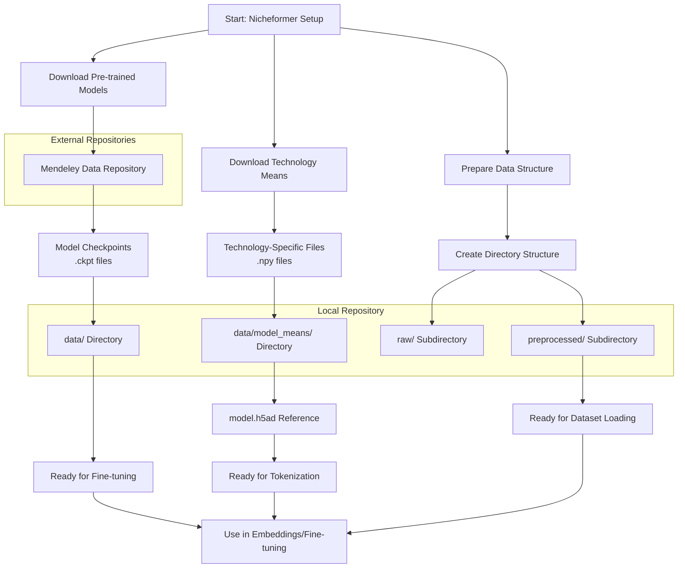
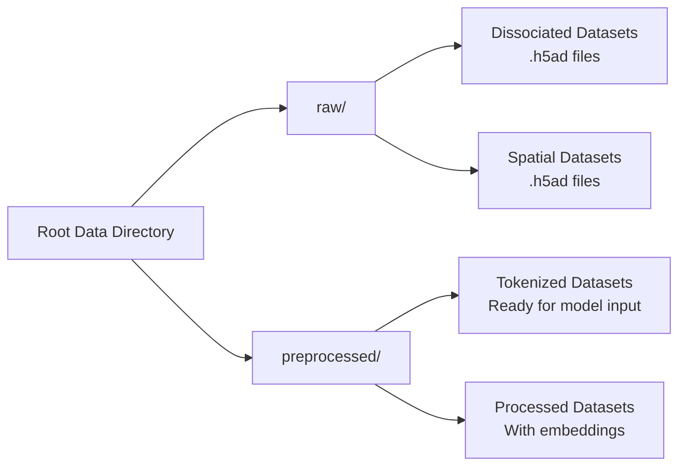

This guide explains how to access and download pre-trained Nicheformer models and required data files for your spatial and single-cell omics analysis. Nicheformer provides model weights and auxiliary data through centralized repositories, along with exemplary loading scripts for processing your own datasets.

## Architecture Overview

The data access workflow for Nicheformer follows a modular architecture where pre-trained models, technology-specific parameters, and data loading utilities are integrated. The following diagram illustrates the complete data acquisition and preparation pipeline:



## Pre-trained Model Access

Nicheformer pre-training weights are distributed through Mendeley Data, a scientific data repository. These weights represent the foundation model trained on the SpatialCorpus-110M dataset and can be used for transfer learning, embedding extraction, or fine-tuning on downstream tasks. The complete model parameters including pretraining, fine-tuning, and linear probing results are available at [Mendeley Data](https://data.mendeley.com/preview/87gm9hrgm8?a=d95a6dde-e054-4245-a7eb-0522d6ea7dff).

Download the model checkpoint files from Mendeley Data and place them in a convenient location within your project structure. The checkpoint files have a `.ckpt` extension and follow PyTorch Lightning's format. For example usage, you would specify the path like:
```python
checkpoint_path = '/path/to/nicheformer/pretrained_models/your_checkpoint.ckpt'
```
Sources: [README.md](/README.md#L31-L36), [data/README.md](/data/README.md#L1-L5)

## Technology-Specific Mean Files

Nicheformer requires technology-specific mean vectors for normalization during data preprocessing. These mean files are computed across large datasets for each spatial transcriptomics technology and are essential for proper tokenization. The repository includes several technology mean files in the `data/model_means/` directory:

| Technology | Mean File | Description |
|------------|-----------|-------------|
| CosMx | cosmx_mean_script.npy | CosMx spatial transcriptomics platform |
| Dissociated | dissociated_mean_script.npy | Dissociated single-cell RNA-seq data |
| ISS | iss_mean_script.npy | In situ sequencing technology |
| MERFISH | merfish_mean_script.npy | Multiplexed error-robust fluorescence in situ hybridization |
| Xenium | xenium_mean_script.npy | 10x Genomics Xenium platform |

Additionally, the `model.h5ad` file in the same directory serves as a reference AnnData object containing gene information and model specifications used during pretraining. This file is particularly important when loading your own datasets to ensure gene alignment with the pre-trained model. Download or copy these files to your local `data/model_means/` directory to enable proper data processing.

Sources: [data/model_means](/data/model_means), [notebooks/README.md](/notebooks/README.md#L1-L5)

## Dataset Structure Requirements

Before downloading or preparing your datasets, establish the proper directory structure as required by Nicheformer's data loading pipeline. The data organization follows a standardized pattern with `raw` and `preprocessed` subdirectories:



The `raw/` subdirectory should contain your original AnnData files (.h5ad format) for both dissociated single-cell data and spatial omics data. The `preprocessed/` subdirectory is where tokenized datasets and data with extracted embeddings are stored. You can configure the default storage location by modifying the `DefaultPaths` class in `src/nicheformer/data/constants.py` to match your local filesystem structure.

Sources: [data/spatialcorpus-110M/README.md](/data/spatialcorpus-110M/README.md#L3-L9), [src/nicheformer/data/constants.py](/src/nicheformer/data/constants.py#L88-L93)

## Downloading GEO Datasets

For datasets available through the Gene Expression Omnibus (GEO), Nicheformer provides automated download utilities. The `src/nicheformer/data/download.py` module includes functions to download and extract tar archives from GEO with progress tracking. You can download datasets by their GEO accession number using the command-line interface:

```bash
python -m nicheformer.data.download --geo-id GSEXXXXXX --save-path /your/data/raw/directory
```

The download script supports:
- Streaming downloads with progress indicators
- Automatic extraction of tar/zip archives
- Optional file format filtering to extract specific file types only
- Error handling for network issues and corrupted downloads

For programmatic access, you can also use the `download_tar` function directly:
```python
from nicheformer.data.download import download_tar

url = "https://www.ncbi.nlm.nih.gov/geo/download/?acc=GSEXXXXXX&format=file"
save_path = "/path/to/your/data/raw/GSEXXXXXX.tar.gz"
download_tar(url, save_path, file_format="h5ad")
```

> [!TIP]
> When using the file_format parameter, you can pass a list to extract multiple formats (e.g., `file_format=['h5ad', 'csv']`) or a single string for one specific format. This is useful when GEO archives contain multiple file types but you only need specific ones.

Sources: [src/nicheformer/data/download.py](/src/nicheformer/data/download.py#L1-L89)

## Exemplary Loading Scripts

The repository provides tokenization notebooks that demonstrate how to process various spatial transcriptomics technologies. These notebooks serve as templates for preparing your own data and are located in the `notebooks/tokenization/` directory:

- `cosmx_human_liver.ipynb` - CosMx human liver dataset
- `cosmx_human_lung.ipynb` - CosMx human lung dataset
- `merfish_mouse_brain.ipynb` - MERFISH mouse brain dataset
- `xenium_human_colon.ipynb` - Xenium human colon dataset
- `xenium_human_lung.ipynb` - Xenium human lung dataset

These notebooks show the complete pipeline from raw data loading through tokenization, including how to apply the technology-specific mean files for normalization. Before using these scripts, ensure you have placed the required model weights and technology mean vectors in the `data/model_means/` directory.

Sources: [notebooks/README.md](/notebooks/README.md#L1-L5), [notebooks/experiments/get_embeddings.ipynb](/notebooks/experiments/get_embeddings.ipynb#L1-L100)

## Complete Setup Example

Here's a complete example showing how to configure paths for embedding extraction using downloaded resources:

```python
import os
from nicheformer.models import Nicheformer
from nicheformer.data import NicheformerDataset

# Configuration with downloaded resources
config = {
    # Path to your preprocessed dataset (in preprocessed/ subdirectory)
    'data_path': '/path/to/data/preprocessed/your_dataset.h5ad',
    
    # Technology mean file from model_means/ directory
    'technology_mean_path': '/path/to/data/model_means/cosmx_mean_script.npy',
    
    # Downloaded model checkpoint from Mendeley Data
    'checkpoint_path': '/path/to/pretrained_models/your_model.ckpt',
    
    # Output configuration
    'output_path': 'data_with_embeddings.h5ad',
    'batch_size': 32,
    'max_seq_len': 1500,
    'aux_tokens': 30,
    'embedding_layer': -1,  # Last layer embeddings
}
```

> [!TIP]
> The model.h5ad file in model_means/ contains the reference gene expression matrix used during pretraining. When loading your own datasets, ensure that your data uses the same gene identifiers or perform appropriate gene alignment to match the pre-trained model's gene space.

## Troubleshooting Guide

| Issue | Possible Cause | Solution |
|-------|---------------|----------|
| File not found errors | Incorrect paths in configuration | Verify paths point to the `data/` subdirectory as specified in README |
| Missing technology mean | Mean file not downloaded | Download the appropriate `.npy` file from the repository or Mendeley Data |
| OOM during loading | Large dataset, insufficient memory | Use the `chunk_size` parameter to process data in batches |
| Gene mismatch | Dataset uses different gene identifiers | Align your genes with `model.h5ad` using gene symbols or Ensembl IDs |
| Download failures | Network issues or corrupted archive | Re-download using the GEO script with error handling enabled |

## Next Steps

After downloading the pre-trained models and data, you can proceed with:

- [Tokenizing Gene Expression Data](6-tokenizing-gene-expression-data) - Learn how to transform your datasets using the downloaded technology means
- [Extracting Cell Embeddings from Pre-trained Models](23-extracting-cell-embeddings-from-pre-trained-models) - Use the downloaded checkpoint to generate embeddings for your data
- [Fine-Tuning Model Architecture](18-fine-tuning-model-architecture) - Adapt the pre-trained model to your specific downstream tasks

The complete architecture for data processing, from raw datasets through to model inference, builds upon these foundational resources. Ensure all components are properly configured before proceeding to downstream analysis.