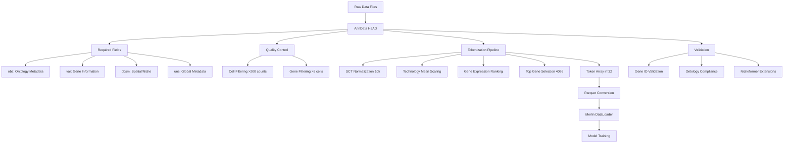

This page provides a comprehensive overview of the Nicheformer data schema, which extends the Cellxgene schema to support both single-cell and spatial omics data for foundation model pretraining. The schema is designed to capture rich biological metadata while enabling efficient tokenization and distributed training workflows.

## Core AnnData Schema Structure

Nicheformer builds on the AnnData format with standardized fields for cell-level observations (obs), gene-level variables (var), spatial coordinates (obsm), and unstructured metadata (uns). The schema enforces ontology-based metadata to ensure biological interoperability across datasets.

### Observation Fields (adata.obs)

The observation layer contains cell-level metadata divided into three categories: required ontologies, biological annotations, and Nicheformer-specific fields. All ontology fields must use controlled vocabulary from standard repositories.

**Required Ontology Fields:**

| Field Name | Description | Example Value |
|------------|-------------|---------------|
| `assay_ontology_term_id` | Experimental assay type | `EFO:0030004` (10x 5') |
| `sex_ontology_term_id` | Biological sex | `PATO:0000383` (female) |
| `organism_ontology_term_id` | Species identifier | `NCBITaxon:9606` (human) |
| `tissue_ontology_term_id` | Tissue origin | `UBERON:0002048` (lung) |
| `suspension_type` | Sample suspension type | `cell`, `nucleus`, or `na` (spatial) |

**Biological Annotation Fields:**

| Field Name | Description | Example Value |
|------------|-------------|---------------|
| `cell_type_ontology_term_id` | Cell type classification | `CL:0000066` (epithelial cell) |
| `development_stage_ontology_term_id` | Developmental stage | `HsapDv:0000087` (human adult stage) |
| `disease_ontology_term_id` | Disease state | `MONDO:0002006` (cancer) |
| `self_reported_ethnicity_ontology_term_id` | Ethnicity metadata | `HANCESTRO:0012` (European) |

**Nicheformer-Specific Fields:**

| Field Name | Description | Data Type |
|------------|-------------|-----------|
| `condition_id` | Experimental condition identifier | string |
| `tissue_type` | Tissue origin category | `tissue` or `organoid` |
| `author_cell_type` | Original cell type annotation | string |
| `library_key` | Spatial library identifier | string |
| `niche` | Niche composition identifier | string |
| `region` | Anatomical region | string |
| `dataset` | Source dataset name | string |
| `sample_id` | Sample identifier | string |
| `donor_id` | Donor identifier | string |
| `x`, `y` | Spatial coordinates | float |

Sources: [constants.py](src/nicheformer/data/constants.py#L78-L123), [validate.py](src/nicheformer/data/validate.py#L187-L210)

### Variable Fields (adata.var)

Gene-level metadata supports filtering and cross-dataset alignment:

| Field Name | Description | Data Type |
|------------|-------------|-----------|
| `feature_is_filtered` | Gene filtering flag | boolean |
| `gene_name` | Gene symbol (required) | string |
| `feature_reference` | Genome reference | string |
| `feature_biotype` | Gene biotype | string |

All variables must be indexed by Ensembl Gene IDs (e.g., `ENSG00000139618`) to enable cross-species compatibility.

Sources: [constants.py](src/nicheformer/data/constants.py#L120-L123)

### Multi-dimensional Observation Fields (adata.obsm)

Spatial omics data requires specialized storage structures:

| Field Name | Description | Data Type | Dimensions |
|------------|-------------|-----------|------------|
| `spatial` | Spatial coordinates | float64 array | n_cells × 2 |
| `X_niche` | Niche composition matrix | sparse matrix | n_cells × n_cell_types |
| `X_niche_0` to `X_niche_4` | Multi-radius niche compositions | sparse matrix | n_cells × n_cell_types |

The niche composition matrices capture the cellular neighborhood context by aggregating cell type distributions around each cell within defined radii, enabling the model to learn spatial relationships.

Sources: [constants.py](src/nicheformer/data/constants.py#L113-L117), [niche_compositions.py](src/nicheformer/data/tools/niche_compositions.py#L1-L51)

### Unstructured Metadata (adata.uns)

Global dataset metadata:

| Field Name | Description | Example |
|------------|-------------|---------|
| `title` | Dataset title | descriptive string |
| `niche` | Niche calculation parameters | dict with radius, node_degree |
| `schema_version` | Schema version identifier | string |
| `nicheformer_version` | Nicheformer version | `"0.0.1"` |

Sources: [constants.py](src/nicheformer/data/constants.py#L106-L112), [validate.py](src/nicheformer/data/validate.py#L212-L215)

## Data Processing Pipeline

### Tokenization Strategy

Nicheformer converts normalized gene expression data into fixed-length token sequences through a multi-step process:

1. **Quality Control Filtering**: Remove cells with <200 counts and genes expressed in <5 cells
2. **SCT Normalization**: Scale each cell to 10,000 counts
3. **Technology Scaling**: Divide by technology-specific mean expression
4. **Gene Ranking**: Sort genes by expression (descending)
5. **Token Selection**: Select top expressed genes up to max_seq_len (default: 4096)
6. **Token Offset**: Add auxiliary token offset (default: 30) for padding

```python
# Tokenization process in code
def tokenize_data(x: np.array, median_counts_per_gene: np.array, max_seq_len: int = None):
    x = np.nan_to_num(x)  # Handle missing values
    x = sf_normalize(x)  # Scale to 10,000 counts
    median_counts_per_gene += median_counts_per_gene == 0  # Avoid division by zero
    out = x / median_counts_per_gene.reshape((1, -1))  # Technology normalization
    scores_final = _sub_tokenize_data(out, 4096, 30)  # Gene selection
    return scores_final.astype('i4')
```

The resulting token array has shape (n_cells, max_seq_len) with dtype int32, where each value represents a gene index plus the auxiliary token offset.

Sources: [dataset.py](src/nicheformer/data/dataset.py#L12-L50), [xenium_human_lung.ipynb](notebooks/tokenization/xenium_human_lung.ipynb#L120-L149)

### Spatial Niche Composition

Spatial datasets include neighborhood context through composition matrices. The `niche_compositions()` function computes cellular neighborhoods using radius-based spatial graphs:

```python
def niche_compositions(adata: AnnData, radii: list[float]) -> AnnData:
    # Calculate spatial neighborhoods
    connectivities, _ = spatial_neighbors(
        adata, spatial_key='spatial', library_key='library_key',
        coord_type='generic', radius=radius
    )
    # Aggregate cell type distributions
    one_hot_ct = get_dummies(adata.obs['author_cell_type'], dtype=int, sparse=True)
    niche = connectivities @ csr_matrix(one_hot_ct)
    # Store as obsm
    adata.obsm[f"X_niche_{n}"] = niche
```

This creates sparse matrices where each row represents a cell and columns represent cell types, with values indicating the proportion of that cell type within the defined radius.

Sources: [niche_compositions.py](src/nicheformer/data/tools/niche_compositions.py#L1-L51)

## Distributed Data Format (Parquet)

For distributed training, Nicheformer converts H5AD files to Parquet format optimized for the Merlin data loading framework. The PARQUET_SCHEMA defines 30 columns:

### Expression and Niche Data:
- `X`: int32 array - Tokenized gene expression sequence
- `X_niche_0` to `X_niche_4`: int32 arrays - Niche composition tokens
- `density_0` to `density_4`: float32 arrays - Cell density metrics

### Categorical Metadata (all int64):
- `niche`, `author_cell_type`, `region`, `cell_type`, `development_stage`, `disease`, `tissue`, `tissue_general`
- `assay`, `specie`, `modality`, `organism`, `dataset_id`, `donor_id`, `tech_sample`, `idx`

### Quality Flags:
- `is_primary_data`: boolean - Primary dataset indicator
- `measured_genes`: int32 - Number of genes detected per cell

Sources: [datamodules.py](src/nicheformer/data/datamodules.py#L15-L42)

## Schema Validation

The validation framework extends cellxgene schema compliance with Nicheformer-specific requirements:

### Validation Checks:

1. **Gene Validation**: All genes must be valid Ensembl IDs for the specified organism (mouse or human)
2. **Ontology Validation**: Required ontology fields must use supported vocabulary terms
3. **Nicheformer Validation**: Additional checks for `condition_id` and `tissue_type` presence
4. **Label Appending**: Converts ontology IDs to human-readable labels

```python
def validate(adata: AnnData, organism: Literal["mouse", "human"] = "mouse", 
             ignore_labels: bool = False, verbose: bool = False):
    # Check genes
    gene_checker = GeneChecker(SupportedOrganisms.HOMO_SAPIENS)
    valid_genes = [g for g in adata.var_names if gene_checker.is_valid_id(g)]
    
    # Validate schema
    validator = CurrentFormat(ignore_labels=ignore_labels)
    validator.validate_adata(adata)
    validator.validate_nicheformer(adata)
    
    # Append labels
    writer = AnnDataLabelAppender(validator)
    adata = writer.write_labels()
    
    return adata, validator.is_valid, validator.errors
```

Sources: [validate.py](src/nicheformer/data/validate.py#L24-L70)

## Supported Assay Technologies

Nicheformer supports multiple single-cell and spatial omics platforms through standardized ontology identifiers:

| Technology | Ontology ID | Category |
|------------|-------------|----------|
| 10x Genomics 3' v2 | EFO:0009899 | Dissociated |
| 10x Genomics 3' v3 | EFO:0009922 | Dissociated |
| 10x Genomics 5' v1 | EFO:0011025 | Dissociated |
| 10x Genomics 5' v2 | EFO:0009900 | Dissociated |
| Smart-seq2 | EFO:0008931 | Dissociated |
| MERFISH | EFO:0008992 | Spatial |
| CosMx | EFO:0030029 | Spatial |
| Xenium | (assigned separately) | Spatial |

Each technology requires a technology-specific mean expression vector for proper normalization, calculated across representative datasets.

Sources: [constants.py](src/nicheformer/data/constants.py#L4-L20)

## Dataset Class Implementation

The `NicheformerDataset` class wraps AnnData objects with chunked processing for memory efficiency:

```python
class NicheformerDataset(Dataset):
    def __init__(self, adata, technology_mean, split='train', 
                 max_seq_len=4096, aux_tokens=30, chunk_size=1000,
                 metadata_fields=None):
        # Filter by split
        self.adata = adata[adata.obs.nicheformer_split == split].copy()
        # Process in chunks
        self._process_chunks()
        # Prepare metadata
        self._prepare_metadata()
    
    def _process_chunk(self, start_idx, end_idx):
        # Convert sparse to dense
        x = chunk_adata.X.toarray() if issparse(chunk_adata.X) else chunk_adata.X
        # Normalize and tokenize
        x = sf_normalize(x) / self.technology_mean
        tokens = _sub_tokenize_data(x, self.max_seq_len, self.aux_tokens)
        return tokens
```

This architecture enables loading datasets with millions of cells by processing in configurable chunk sizes with explicit GPU memory management.

Sources: [dataset.py](src/nicheformer/data/dataset.py#L60-L171)

## Complete Data Schema Architecture



Sources: [dataset.py](src/nicheformer/data/dataset.py#L1-L171), [datamodules.py](src/nicheformer/data/datamodules.py#L1-L186), [validate.py](src/nicheformer/data/validate.py#L1-L259)

## Data Access and Preparation

Preparing data for Nicheformer involves three main stages:

### 1. Data Acquisition
Download datasets from GEO using the download utilities or use provided exemplary loading scripts. Access pre-processed datasets from the SpatialCorpus-110M repository in both dissociated and spatial formats.

### 2. Schema Validation
Run validation to ensure compliance with ontology requirements and Nicheformer-specific fields:
```python
from nicheformer.data import validate
adata, is_valid, errors = validate(adata, organism="human", verbose=True)
```

### 3. Tokenization and Export
Apply the tokenization pipeline with appropriate technology means:
```python
from nicheformer.data import NicheformerDataset
dataset = NicheformerDataset(
    adata, technology_mean=xenium_mean, 
    split='train', max_seq_len=4096
)
```

Sources: [download.py](src/nicheformer/data/download.py#L1-L89), [basic_filtering.py](src/nicheformer/data/tools/basic_filtering.py#L1-L40)

> [!TIP]
> Always use technology-specific mean vectors for normalization to ensure cross-platform comparability. The mean vectors account for systematic biases between different omics platforms and are essential for accurate tokenization across heterogeneous datasets.

> [!TIP]
> For spatial datasets, always include the `library_key` field in spatial neighbor calculations. This prevents incorrect neighbor assignments across tissue sections or experimental batches, ensuring niche composition matrices accurately reflect biological neighborhoods.

## Next Steps

To deepen your understanding of data handling in Nicheformer:

- **[Tokenizing Gene Expression Data](6-tokenizing-gene-expression-data)** - Detailed walkthrough of the complete tokenization pipeline
- **[Data Loading with Merlin DataModules](7-data-loading-with-merlin-datamodules)** - Advanced distributed data loading strategies
- **[Niche Composition Analysis](8-niche-composition-analysis)** - Deep dive into spatial neighborhood computation methods
