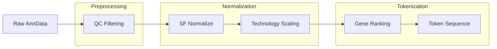
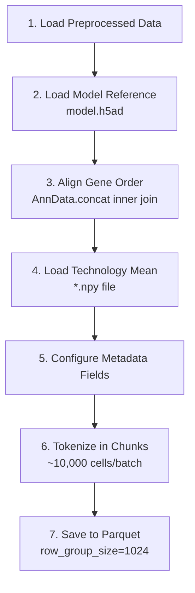

Gene expression tokenization transforms continuous gene count matrices into discrete token sequences suitable for transformer architectures. This process preserves biological signal while standardizing representation across diverse technologies and modalities, enabling cross-dataset learning in Nicheformer.

## Tokenization Architecture Overview

The tokenization pipeline converts raw gene expression data through a three-stage transformation: size factor normalization, technology-specific scaling, and ranked gene selection. The output consists of integer token sequences where each token represents a gene identifier, ordered by expression level within each cell.

This architecture ensures that cells from different single-cell and spatial technologies share a common token space while maintaining technology-specific signal through median normalization factors. The chunked processing design enables memory-efficient handling of datasets with hundreds of thousands of cells.

Sources: [dataset.py](/src/nicheformer/data/dataset.py#L1-L58), [xenium_human_lung.ipynb](/notebooks/tokenization/xenium_human_lung.ipynb#L120-L174)

## Core Tokenization Components

### Normalization Functions

The foundation of tokenization lies in two sequential normalization operations. First, size factor normalization (SF normalization) scales each cell to a total count of 10,000, accounting for sequencing depth variation across cells. This approach, standard in single-cell analysis, uses the formula:

$$X_{normalized} = X \times \frac{10,000}{\sum X}$$

The implementation handles both sparse and dense matrices efficiently, with safeguards against zero division by ensuring non-zero counts.

Sources: [dataset.py](/src/nicheformer/data/dataset.py#L12-L26), [xenium_human_lung.ipynb](/notebooks/tokenization/xenium_human_lung.ipynb#L130-L143)

### Technology-Specific Scaling

Following SF normalization, technology-specific median counts adjust for systematic differences between platforms (10x Genomics, MERFISH, Xenium, etc.). The pipeline divides normalized expression by pre-computed median counts per gene:

$$X_{scaled} = \frac{X_{normalized}}{\text{median\_counts\_per\_gene}}$$

This step preserves relative expression patterns while aligning distributions across technologies. Median arrays are stored as `.npy` files in the data directory and loaded during tokenization setup.

Sources: [dataset.py](/src/nicheformer/data/dataset.py#L48-L57), [xenium_human_lung.ipynb](/notebooks/tokenization/xenium_human_lung.ipynb#L210-L237)

### Gene Ranking and Token Selection

The core tokenization logic uses Numba-accelerated computation for efficient gene ranking. For each cell, the algorithm:
1. Identifies non-zero gene indices
2. Sorts genes by descending expression values
3. Selects top `max_seq_len` genes (default: 4096)
4. Offsets indices by `aux_tokens` (default: 30) to reserve space for special tokens
5. Returns zero-padded integer arrays for cells with fewer expressed genes

The `aux_tokens` parameter reserves initial vocabulary indices for system tokens (CLS, SEP, MASK, padding), preventing collision with gene identifiers. With 20,310 genes in the model vocabulary and 30 auxiliary tokens, the final token space spans 1-20,340.

Sources: [dataset.py](/src/nicheformer/data/dataset.py#L29-L45), [dataset.py](/src/nicheformer/data/dataset.py#L63-L75)

## NicheformerDataset Implementation

### Initialization and Configuration

The `NicheformerDataset` class encapsulates the entire tokenization workflow with configurable parameters:

| Parameter | Default | Purpose |
|-----------|---------|---------|
| `adata` | required | AnnData object with pre-split `nicheformer_split` column |
| `technology_mean` | required | Technology-specific median counts array |
| `split` | 'train' | Data partition ('train', 'test', 'val') |
| `max_seq_len` | 4096 | Maximum tokens per cell |
| `aux_tokens` | 30 | Reserved token offset |
| `chunk_size` | 1000 | Cells processed per chunk |
| `metadata_fields` | {'obs': [], 'obsm': []} | Additional metadata to extract |

The constructor filters cells by split, stores configuration, and immediately triggers chunked processing to generate tokenized representations in memory.

Sources: [dataset.py](/src/nicheformer/data/dataset.py#L60-L96)

### Chunked Processing Strategy

Memory efficiency is achieved through processing cells in configurable chunks. The `_process_chunks` method orchestrates:
1. Dividing data into chunks of `chunk_size` cells
2. Sequential processing with progress tracking
3. GPU memory clearing and garbage collection between chunks
4. Concatenation of results into final token array

This design enables tokenization of datasets exceeding available RAM, as demonstrated by the 827,048-cell Xenium lung dataset.

Sources: [dataset.py](/src/nicheformer/data/dataset.py#L98-L114), [dataset.py](/src/nicheformer/data/dataset.py#L116-L137)

### Metadata Handling

The dataset extracts and stores metadata fields alongside tokens, supporting both `obs` (cell-level) and `obsm` (matrix-level) annotations. Sparse matrices in `obsm` are processed in chunks with automatic conversion to dense format, maintaining memory efficiency while preserving spatial coordinates or other multi-dimensional features.

Sources: [dataset.py](/src/nicheformer/data/dataset.py#L139-L157)

> [!TIP]
> The chunked processing pattern in NicheformerDataset provides a template for memory-intensive operations on large single-cell datasets. Adjust `chunk_size` based on available RAM and sparse matrix density to balance throughput and memory usage.

## Practical Tokenization Workflow

### Step-by-Step Pipeline

The complete tokenization process for a new dataset involves seven key steps:

This workflow ensures compatibility with pre-trained models by enforcing consistent gene ordering and token vocabulary. The Xenium lung notebook demonstrates production-ready implementation with 827,048 cells processed in 83 batches.

Sources: [xenium_human_lung.ipynb](/notebooks/tokenization/xenium_human_lung.ipynb#L482-L547), [xenium_human_lung.ipynb](/notebooks/tokenization/xenium_human_lung.ipynb#L856-L872)

### Data Preparation Requirements

Before tokenization, data must meet several requirements:
- **Gene Alignment**: Concatenate with `model.h5ad` using `join='inner'` to ensure identical gene ordering
- **Split Assignment**: Cells labeled with `nicheformer_split` column ('train', 'test', 'val')
- **Metadata Encoding**: Categorical fields converted to integer IDs (assay=9, modality=4, specie=5)
- **Quality Control**: Apply filtering (min_counts=200, min_cells=5) via `qc_filter` function

The tokenization script includes dictionaries for mapping assay types, species, and modalities to their integer IDs, maintaining consistency with model training data.

Sources: [xenium_human_lung.ipynb](/notebooks/tokenization/xenium_human_lung.ipynb#L65-L92), [basic_filtering.py](/src/nicheformer/data/tools/basic_filtering.py#L6-L40), [constants.py](/src/nicheformer/data/constants.py#L4-L123)

### Batch Processing Implementation

Large-scale tokenization divides data into manageable batches (default: 10,000 cells). Each batch:
1. Extracts expression matrix and metadata subset
2. Applies tokenization pipeline
3. Shuffles rows to mix spatial/dissociated data
4. Converts to PyArrow Table with optimized row groups
5. Writes to Parquet with compression

This approach balances I/O efficiency with memory constraints, enabling parallel processing of multiple batches on compute clusters.

Sources: [xenium_human_lung.ipynb](/notebooks/tokenization/xenium_human_lung.ipynb#L776-L872)

## Token Structure and Interpretation

The final token output follows a structured format:

| Token Position | Meaning | Example Values |
|----------------|---------|----------------|
| 1-30 | Reserved for system tokens (CLS, SEP, MASK, PAD) | N/A |
| 31+ | Gene identifiers ranked by expression | 6520, 15202, 10870, ... |

For cells with fewer than 4,096 expressed genes, remaining positions are zero-padded. The ranking preserves relative importance of highly expressed genes while creating variable-length sequences compatible with transformer architectures. Auxiliary tokens enable downstream tasks like masked prediction and sequence separation.

Sources: [dataset.py](/src/nicheformer/data/dataset.py#L34-L41), [xenium_human_lung.ipynb](/notebooks/tokenization/xenium_human_lung.ipynb#L915-L936)

## Technology-Specific Considerations

### Technology Mean Arrays

Each technology platform requires a pre-computed median count array derived from training data. These arrays:
- Capture systematic expression biases per platform
- Enable cross-technology normalization
- Are loaded from `data/model_means/` directory
- Require zero-handling (replace zeros with 1 to avoid division errors)

Available arrays include: `cosmx_mean_script.npy`, `dissociated_mean_script.npy`, `iss_mean_script.npy`, `merfish_mean_script.npy`, and `xenium_mean_script.npy`.

Sources: [xenium_human_lung.ipynb](/notebooks/tokenization/xenium_human_lung.ipynb#L211-L237), [dataset.py](/src/nicheformer/data/dataset.py#L52-L53)

### Spatial vs. Dissociated Data

Spatial transcriptomics datasets require additional preprocessing:
- **Spatial coordinates**: Extract `x` and `y` from obs to `obsm['spatial']`
- **Spatial neighbors**: Compute with `squidpy.gr.spatial_neighbors` (radius=25)
- **Niche composition**: Calculate using dedicated tools in `niche_compositions.py`

The tokenization pipeline handles both modalities identically after preprocessing, with modality information encoded in metadata (spatial=4, dissociated=3).

Sources: [xenium_human_lung.ipynb](/notebooks/tokenization/xenium_human_lung.ipynb#L362-L365), [constants.py](/src/nicheformer/data/constants.py#L65-L70), [niche_compositions.py](/src/nicheformer/data/tools/niche_compositions.py)

## Best Practices and Optimization

### Memory Management

Tokenization of large datasets requires careful memory management:
- Use `chunk_size` parameter to tune memory usage
- Clear GPU cache between chunks with `torch.cuda.empty_cache()`
- Force garbage collection after each chunk
- Prefer sparse matrix operations until dense conversion is necessary

The default `chunk_size=1000` provides a balanced starting point, but adjust based on system RAM and dataset size.

Sources: [dataset.py](/src/nicheformer/data/dataset.py#L98-L114)

### Performance Optimization

Key optimization strategies include:
- **Numba JIT**: `_sub_tokenize_data` is compiled for efficient gene ranking
- **Batch processing**: Process 10,000 cells per batch for optimal I/O
- **PyArrow format**: Use columnar storage with `row_group_size=1024`
- **Sparse matrices**: Maintain sparsity until tokenization requires dense conversion

The Xenium lung dataset processes 827,048 cells in 3 minutes 47 seconds using this optimized pipeline.

Sources: [dataset.py](/src/nicheformer/data/dataset.py#L29-L45), [xenium_human_lung.ipynb](/notebooks/tokenization/xenium_human_lung.ipynb#L856-L872)

> [!TIP]
> When tokenizing new technologies, compute the median counts array from a representative subset of training data first. This ensures accurate cross-platform normalization and improves downstream task performance.

## Troubleshooting Common Issues

| Issue | Symptoms | Solution |
|-------|----------|----------|
| Gene mismatch | Error during concatenation | Verify gene names match model.h5ad exactly; use `join='inner'` |
| Memory overflow | Process killed during tokenization | Reduce `chunk_size`; clear unused variables between chunks |
| Zero division warnings | NaN values in tokenized output | Ensure `median_counts_per_gene` has no zeros; replace with 1 |
| Sparse matrix errors | `ValueError: Setting sparse array` | Convert sparse matrices to dense before assignment to obsm |

Always inspect tokenized output shape and dtype to ensure int32 arrays with correct dimensions (n_cells × 4096).

Sources: [dataset.py](/src/nicheformer/data/dataset.py#L52-L53), [xenium_human_lung.ipynb](/notebooks/tokenization/xenium_human_lung.ipynb#L493-L498)

## Integration with Data Loading

Tokenized data feeds directly into Merlin DataModules for efficient distributed training. The Parquet output format with optimized row groups enables:
- Streaming reads during training
- Column pruning for selective metadata access
- Distributed data loading across GPUs

Metadata fields extracted during tokenization (assay, specie, modality, idx) are passed through to the model as auxiliary inputs, supporting conditional generation and technology-aware representations.
