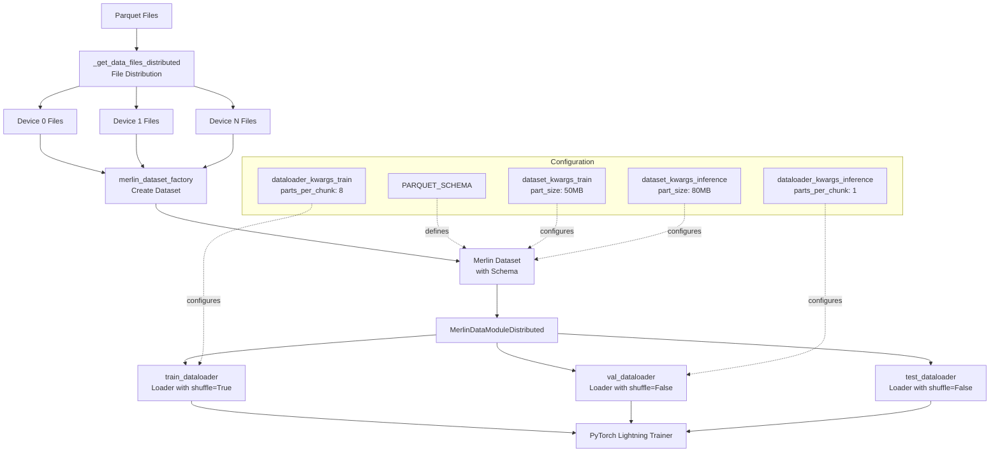
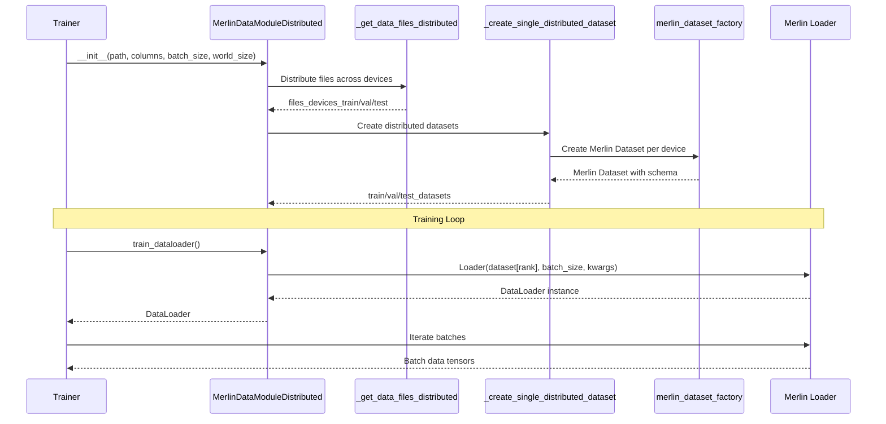

Nicheformer leverages **NVIDIA Merlin's high-performance data loading infrastructure** to handle large-scale spatial transcriptomics datasets efficiently. The Merlin DataModule provides a distributed, PyTorch Lightning-integrated solution for loading tokenized gene expression data stored in Parquet format, enabling scalable training across multiple GPUs with minimal memory overhead. This architecture is specifically designed to handle the complex data requirements of spatial transcriptomics, including gene expression tokens, niche composition features, density predictions, and rich metadata annotations.

## Architecture Overview

The Merlin DataModule architecture consists of several interconnected components that work together to provide efficient data loading for distributed training:



The architecture implements a **device-aware file distribution strategy** where Parquet files are allocated across multiple GPUs based on hash partitioning. Each device loads only its assigned files, ensuring balanced data distribution and minimizing inter-device communication overhead. The system uses Merlin's optimized Parquet engine with custom schema definitions to efficiently read compressed spatial transcriptomics data.

Sources: [datamodules.py](src/nicheformer/data/datamodules.py#L90-L112)

## Parquet Schema Definition

Nicheformer uses a comprehensive Parquet schema that captures all necessary information for spatial transcriptomics analysis:

**Core Expression Features:**
- `X`: Tokenized gene expression values (int32, list type, max 2048 genes)
- `X_niche_0` through `X_niche_4`: Niche composition features for 5 neighborhood levels (int32)
- `density_0` through `density_4`: Cell density predictions at 5 spatial scales (float32)

**Spatial and Cell Metadata:**
- `niche`: Assigned niche cluster identifier (int64)
- `author_cell_type`: Original cell type annotation from dataset authors (int64)
- `region`: Spatial region identifier (int64)
- `soma_joinid`: Unique cell identifier (int64)
- `is_primary_data`: Boolean flag indicating primary dataset source

**Dataset and Experimental Metadata:**
- `dataset_id`: Source dataset identifier (int64)
- `donor_id`: Donor/sample identifier (int64)
- `assay`: Experimental technology type (int64)
- `cell_type`: Standardized cell type ontology (int64)
- `development_stage`: Developmental stage annotation (int64)
- `disease`: Disease state annotation (int64)
- `tissue`: Tissue type identifier (int64)
- `tissue_general`: General tissue category (int64)
- `tech_sample`: Technology-specific sample identifier (int64)
- `specie`: Species identifier (int64)
- `modality`: Data modality (spatial/dissociated) (int64)
- `organism`: Organism ontology identifier (int64)
- `measured_genes`: Number of genes measured per cell (int32)
- `idx`: Row index (int64)

Sources: [datamodules.py](src/nicheformer/data/datamodules.py#L15-L46)

## MerlinDataModuleDistributed Class

The `MerlinDataModuleDistributed` class is a PyTorch Lightning `LightningDataModule` that orchestrates distributed data loading. It automatically handles file distribution, dataset creation, and dataloader configuration for training, validation, and testing phases.

**Initialization Parameters:**

| Parameter | Type | Default | Description |
|-----------|------|---------|-------------|
| `path` | str | Required | Base path containing train/test/val directories with Parquet files |
| `columns` | List[str] | Required | List of column names to load from Parquet files |
| `batch_size` | int | Required | Batch size for all dataloaders |
| `world_size` | int | Required | Number of devices/GPUs for distributed training |
| `sub_sample_frac` | float | 1.0 | Fraction of files to use (enables sub-sampling) |
| `splits` | bool | True | Whether to use separate train/test/val splits |
| `dataloader_kwargs_train` | Dict | None | Override default training dataloader parameters |
| `dataloader_kwargs_inference` | Dict | None | Override default inference dataloader parameters |
| `dataset_kwargs_train` | Dict | None | Override default training dataset parameters |
| `dataset_kwargs_inference` | Dict | None | Override default inference dataset parameters |

Sources: [datamodules.py](src/nicheformer/data/datamodules.py#L118-L134)

## Data Loading Pipeline

The data loading process follows a systematic pipeline from file discovery to batch generation:



**File Distribution Strategy:**

The `_get_data_files_distributed` function implements a modulus-based file allocation strategy:

1. Scans all Parquet files in the specified split directory
2. Extracts numeric IDs from filenames (format: `prefix-ID.parquet`)
3. Assigns files to devices using `ID % world_size == device_rank`
4. Supports sub-sampling by taking only the top fraction of sorted files
5. Returns a list where each index contains files for a specific device

This ensures **even distribution** of data across devices while maintaining **deterministic assignment** based on file IDs, which is crucial for reproducibility and efficient caching.

Sources: [datamodules.py](src/nicheformer/data/datamodules.py#L90-L104)

## Default Configuration

The DataModule applies sensible defaults optimized for training and inference scenarios:

**Dataloader Defaults:**

| Configuration | Training | Inference |
|---------------|----------|-----------|
| `parts_per_chunk` | 8 | 1 |
| `shuffle` | True | False |
| `drop_last` | Not set | Not set |

Higher `parts_per_chunk` during training improves **GPU utilization** by providing more data per chunk, while inference uses smaller chunks for **memory efficiency** when processing single batches.

**Dataset Defaults:**

| Configuration | Training | Inference |
|---------------|----------|-----------|
| `part_size` | '50MB' | '80MB' |

Smaller part sizes during training reduce **memory pressure** during random access, while larger part sizes during inference improve **sequential read performance**.

Sources: [datamodules.py](src/nicheformer/data/datamodules.py#L67-L87)

## Usage Examples

### Pretraining Configuration

For large-scale pretraining across all tissues and technologies:

```python
from data.datamodules import MerlinDataModuleDistributed

module = MerlinDataModuleDistributed(
    path='/path/to/nicheformer_tokens',
    columns=['X', 'specie', 'assay', 'modality'],
    batch_size=6,
    world_size=8,  # 8 GPUs
    splits=True
)
```

This configuration loads gene expression tokens (`X`) along with metadata columns needed for masked language modeling pretraining across the entire dataset.

Sources: [_train.py](src/nicheformer/_train.py#L59-L65)

### Fine-Tuning Configuration

For tissue-specific fine-tuning tasks:

```python
module = MerlinDataModuleDistributed(
    path='/path/to/cosmx_healthy_liver',
    columns=[
        'assay', 'specie', 'modality', 'niche',
        'X', 'X_niche_0', 'X_niche_1', 'X_niche_2',
        'X_niche_3', 'X_niche_4'
    ],
    batch_size=12,
    world_size=4,
    splits=True
)
```

This configuration includes niche composition features (`X_niche_0-4`) for supervised tasks like density prediction or niche classification.

Sources: [_fine_tune.py](src/nicheformer/_fine_tune.py#L66-L73)

### Custom Configuration

You can override default parameters for specific use cases:

```python
module = MerlinDataModuleDistributed(
    path='/path/to/data',
    columns=['X', 'cell_type'],
    batch_size=32,
    world_size=2,
    sub_sample_frac=0.5,  # Use 50% of data
    dataloader_kwargs_train={
        'parts_per_chunk': 16,  # More aggressive loading
        'shuffle': True
    },
    dataset_kwargs_train={
        'part_size': '100MB'  # Larger chunks for faster access
    }
)
```

> [!TIP]
> When working with limited GPU memory, reduce `parts_per_chunk` and `batch_size` to decrease peak memory usage, but be aware this may reduce throughput due to less efficient GPU utilization.

Sources: [datamodules.py](src/nicheformer/data/datamodules.py#L118-L134)

## Integration with PyTorch Lightning

The DataModule integrates seamlessly with PyTorch Lightning's training workflow:

```python
from pytorch_lightning import Trainer
from models._nicheformer import Nicheformer

# Initialize model and datamodule
model = Nicheformer(dim_model=512, nheads=16, ...)
datamodule = MerlinDataModuleDistributed(
    path='/path/to/data',
    columns=['X', 'specie', 'assay', 'modality'],
    batch_size=6,
    world_size=8
)

# Configure distributed training
trainer = Trainer(
    accelerator='gpu',
    devices=-1,  # Use all available GPUs
    strategy="ddp_find_unused_parameters_true",
    precision='bf16-mixed',
    gradient_clip_val=1,
    accumulate_grad_batches=10
)

# Train
trainer.fit(model, datamodule=datamodule)
```

The DataModule automatically provides the appropriate dataloaders for each phase:
- `train_dataloader()`: Returns shuffled loader for training
- `val_dataloader()`: Returns non-shuffled loader for validation
- `test_dataloader()`: Returns non-shuffled loader for testing
- `predict_dataloader()`: Returns loader for inference/prediction

Each dataloader uses `get_rank()` to select only the dataset assigned to the current device, ensuring **proper distributed execution**.

Sources: [datamodules.py](src/nicheformer/data/datamodules.py#L175-L186) | [_train.py](src/nicheformer/_train.py#L8-L81)

## Performance Considerations

> [!TIP]
> For optimal performance, ensure Parquet files are properly partitioned with file IDs that distribute evenly across `world_size`. This prevents load imbalance where some devices process more data than others.

The Merlin DataModule achieves high performance through several optimizations:

1. **Column Pruning**: Only requested columns are loaded from Parquet files, reducing I/O overhead
2. **Schema Optimization**: Pre-defined schema prevents type inference overhead during loading
3. **Chunked Loading**: `parts_per_chunk` controls how many rows are loaded per operation, balancing memory and throughput
4. **Device-Specific Files**: Each device reads only its assigned files, eliminating duplicate I/O
5. **Memory-Mapped Access**: Merlin uses memory mapping for efficient random access to compressed data

When tuning performance:
- Increase `parts_per_chunk` for better GPU utilization if memory allows
- Decrease `part_size` if encountering OOM errors during training
- Use `sub_sample_frac` for rapid prototyping without full dataset loading
- Ensure file system has sufficient I/O bandwidth for concurrent reads from multiple devices

Sources: [datamodules.py](src/nicheformer/data/datamodules.py#L49-L61)

## Data Organization Structure

The DataModule expects a specific directory structure:

```
data_base_path/
├── train/
│   ├── prefix-0.parquet
│   ├── prefix-1.parquet
│   ├── prefix-2.parquet
│   └── ...
├── test/  (or val/ depending on splits parameter)
│   ├── prefix-0.parquet
│   ├── prefix-1.parquet
│   └── ...
```

File naming convention follows the pattern `prefix-ID.parquet` where `ID` is a numeric value used for distribution. The system sorts files by ID in descending order before sub-sampling, ensuring **deterministic behavior** across runs.

Sources: [datamodules.py](src/nicheformer/data/datamodules.py#L90-L104)

## Advanced Features

### Schema Definition

The `merlin_dataset_factory` creates datasets with a carefully crafted schema:

```python
Schema([
    ColumnSchema(
        'X', dtype=int32,
        is_list=True, is_ragged=False,
        properties={'value_count': {'max': 2048}}
    )
] + [ColumnSchema(col, dtype=PARQUET_SCHEMA[col]) for col in columns])
```

The `X` column is treated as a list (ragged tensor in TensorFlow terminology) with a maximum length of 2048 genes per cell. This schema definition enables Merlin to optimize memory layout for the variable-length gene expression vectors.

Sources: [datamodules.py](src/nicheformer/data/datamodules.py#L49-L61)

### Rank-Based Dataset Selection

The dataloader methods use `torch.distributed.get_rank()` to select the appropriate dataset:

```python
def train_dataloader(self):
    return Loader(
        self.train_datasets[get_rank()],
        batch_size=self.batch_size,
        **self.dataloader_kwargs_train
    )
```

This ensures each GPU process loads only its assigned data, enabling **true distributed data parallelism** without redundancy.

Sources: [datamodules.py](src/nicheformer/data/datamodules.py#L175-L186)

## Relationship to Other Data Components

The Merlin DataModule operates at a different abstraction level than the `NicheformerDataset` class. While `NicheformerDataset` handles tokenization and preprocessing of AnnData objects for smaller-scale experiments, the Merlin DataModule is designed for **large-scale distributed training** on pre-tokenized data stored in Parquet format.

**Key Differences:**

| Aspect | NicheformerDataset | MerlinDataModuleDistributed |
|--------|-------------------|----------------------------|
| Data Source | AnnData objects in memory | Parquet files on disk |
| Scale | Millions of cells | Hundreds of millions of cells |
| Processing | On-the-fly tokenization | Pre-tokenized data |
| Distribution | Single device | Multi-device distributed |
| Use Case | Development, small datasets | Production pretraining |

For data preparation and tokenization workflows, refer to [Tokenizing Gene Expression Data](6-tokenizing-gene-expression-data). For understanding the data schema and features, see [Understanding Nicheformer Data Schema](5-understanding-nicheformer-data-schema).

Sources: [dataset.py](src/nicheformer/data/dataset.py#L60-L171) | [datamodules.py](src/nicheformer/data/datamodules.py#L118-L186)

## Next Steps

After understanding the Merlin DataModule architecture:

1. **Explore distributed training strategies**: Learn how to scale training across multiple GPUs and nodes in [Distributed Data Loading Strategies](9-distributed-data-loading-strategies)

2. **Understand the data schema**: Dive deeper into the meaning and organization of spatial transcriptomics features in [Understanding Nicheformer Data Schema](5-understanding-nicheformer-data-schema)

3. **Configure training workflows**: See how to integrate the DataModule with complete training pipelines in [Configuring Training Workflows](17-configuring-training-workflows)

4. **Learn about pretraining**: Understand how the DataModule supports large-scale pretraining in [Pretraining Nicheformer on Large-Scale Data](15-pretraining-nicheformer-on-large-scale-data)