Niche composition analysis is a fundamental spatial transcriptomics technique in Nicheformer that quantifies the cellular neighborhood surrounding each cell. By capturing the relative abundance of different cell types within a specified spatial radius, this approach enables the model to learn **cell-cell interaction patterns** and **microenvironmental context** that influence cellular behavior. This analysis is particularly crucial for spatial technologies like MERFISH, CosMx, and Xenium, where spatial coordinates are preserved during data acquisition.

Sources: [niche_compositions.py](src/nicheformer/data/tools/niche_compositions.py#L9-L51), [constants.py](src/nicheformer/data/constants.py#L97-L117)

## Core Concept and Purpose

The niche composition function operates on the principle that a cell's identity and function are heavily influenced by its surrounding microenvironment. In spatial transcriptomics data, this microenvironment is characterized by the types and proportions of neighboring cells within a specified distance. The implementation uses **spatial neighbor graphs** to identify neighbors, then aggregates cell type information to create a **composition vector** for each cell.

The calculation follows a systematic process: first, it creates a one-hot encoding of cell types from the AnnData object's observation metadata; second, it constructs a spatial connectivity matrix using Squidpy's spatial neighbors function; finally, it computes the niche composition by multiplying the connectivity matrix with the one-hot cell type matrix. The result is stored in `adata.obsm['X_niche_n']` where n indicates the radius index, while configuration metadata is preserved in `adata.uns['niche']`.

Sources: [niche_compositions.py](src/nicheformer/data/tools/niche_compositions.py#L29-L50), [constants.py](src/nicheformer/data/constants.py#L113-L117)

## Implementation Architecture

The niche composition analysis integrates seamlessly with Nicheformer's data pipeline through a modular architecture that supports multi-radius analysis and distributed computing. The function accepts an AnnData object containing spatial coordinates, cell type annotations, and library identifiers, along with a list of radii defining the neighborhood sizes for analysis. For each radius, the system independently computes spatial neighborhoods and generates corresponding composition vectors, enabling analysis across multiple spatial scales simultaneously.

```mermaid
flowchart TD
    A[Input AnnData] --> B[Extract Cell Types<br/>adata.obs.author_cell_type]
    A --> C[Extract Spatial Coords<br/>adata.obsm.spatial]
    A --> D[Extract Library Key<br/>adata.obs.library_key]
    
    B --> E[Create One-Hot Encoding]
    E --> F[For Each Radius]
    
    F --> G[Compute Spatial Neighbors<br/>squidpy.gr.spatial_neighbors]
    G --> H[Get Connectivities Matrix]
    H --> I[Multiply: Connectivities @ One-Hot]
    I --> J[Store: adata.obsm.X_niche_n]
    
    J --> K[Calculate Statistics<br/>node_degree, etc.]
    K --> L[Store Metadata<br/>adata.uns.niche]
    
    L --> M[Output AnnData<br/>with niche compositions]
    
    style A fill:#e3f2fd
    style E fill:#bbdefb
    style G fill:#90caf9
    style I fill:#64b5f6
    style M fill:#e3f2fd
```



The implementation leverages Squidpy's spatial neighbor functionality with `coord_type='generic'`, making it compatible with diverse spatial technologies. The function respects library boundaries through the `library_key` parameter, ensuring that cells from different tissue sections or experimental batches are not incorrectly treated as neighbors. This is particularly important for datasets with multiple acquisition fields or slide regions.

Sources: [niche_compositions.py](src/nicheformer/data/tools/niche_compositions.py#L9-L27), [constants.py](src/nicheformer/data/constants.py#L98-L99)

## Data Structure and Storage

Niche composition data is stored in the AnnData object's `obsm` (observation metadata multi-dimensional) attribute, following a consistent naming convention that accommodates multiple radii. Each radius configuration produces a separate matrix stored as `adata.obsm['X_niche_{n}']`, where n is the index of the radius in the input list. These matrices have dimensions of n_cells × n_cell_types, where each row represents a cell and each column represents a cell type proportion.

The metadata structure captured in `adata.uns['niche']` provides comprehensive configuration tracking:

| Field | Description | Example |
|-------|-------------|---------|
| `columns` | Ordered list of cell type names | `['Astro-Epen', 'CB GABA', 'CB Glut', ...]` |
| `niche_{n}` | Nested dict for each radius index | - |
| `radius` | Spatial radius used for neighborhood | `50.0` |
| `coord_type` | Coordinate system type | `'generic'` |
| `node_degree` | Mean number of neighbors per cell | `25.7` |
| `library_key` | Key used to separate libraries | `'library_key'` |

This metadata structure enables reproducibility and facilitates downstream analysis by preserving all parameters used during niche calculation. The constant definitions in `ObsmConstants.NICHE` and `UnsConstants.NICHE` provide centralized reference for these storage locations.

Sources: [constants.py](src/nicheformer/data/constants.py#L106-L118), [niche_compositions.py](src/nicheformer/data/tools/niche_compositions.py#L30-L50)

## Integration with Dataset Pipeline

The niche composition data integrates into Nicheformer's training pipeline through the `NicheformerDataset` class's flexible metadata handling system. When initializing a dataset, users can specify which obsm fields (including niche composition matrices) should be included in the training data using the `metadata_fields` parameter. This enables the model to learn from both intrinsic gene expression patterns and extrinsic spatial context during training.

The dataset implementation handles niche composition data with **chunk-based processing** for memory efficiency, particularly important for large spatial datasets. The `_prepare_metadata()` method systematically processes obsm fields, converting sparse matrices to dense format chunk-by-chunk if necessary. This approach ensures that models can be trained on datasets with millions of spatially resolved cells without exhausting memory resources.

```python
# Example of including niche composition in dataset
metadata_fields = {
    'obs': ['author_cell_type', 'region'],
    'obsm': ['X_niche_0', 'X_niche_1', 'X_niche_2']  # Multiple radii
}
```

During training, each batch receives both the tokenized gene expression data and the corresponding niche composition vectors, allowing the transformer architecture to incorporate spatial context into its learned representations. The model can leverage this information to predict cell behavior, identify cell-cell interaction patterns, or reconstruct tissue organization.

Sources: [dataset.py](src/nicheformer/data/dataset.py#L63-L96), [dataset.py](src/nicheformer/data/dataset.py#L139-L171)

## Practical Applications and Use Cases

Niche composition analysis serves multiple purposes in the Nicheformer workflow, from data exploration to model training. In the exploratory phase, researchers visualize niche composition distributions across different radii to understand the spatial organization of tissues and identify characteristic neighborhood patterns. The tokenization notebooks demonstrate this through histograms of niche sums and spatial visualizations colored by cell type composition.

For model training, niche composition vectors serve as **auxiliary inputs** that enhance the model's ability to capture spatial dependencies. This is particularly valuable for downstream tasks such as cell type classification, spatial domain identification, and cell-cell interaction prediction. The multi-radius approach allows the model to learn patterns at different biological scales—from immediate neighboring cells to broader tissue-level organizations.

The function also supports **comparative analysis** across different spatial technologies and tissue types. By using the same computational framework for MERFISH, CosMx, Xenium, and other technologies, researchers can directly compare niche characteristics across platforms, facilitating cross-technology validation and discovery.

Sources: [dataset.py](src/nicheformer/data/dataset.py#L63-L80), [merfish_mouse_brain.ipynb](notebooks/tokenization/merfish_mouse_brain.ipynb#L17-L100)

## Configuration Parameters and Best Practices

Effective niche composition analysis requires careful consideration of several configuration parameters:

> [!TIP]
> When selecting radii for niche composition, consider the spatial resolution of your technology and the biological scale of interest. Typical values range from 50-200 μm for immediate neighborhoods to 500-1000 μm for broader tissue context. Start with 3-4 logarithmically spaced radii to capture multi-scale patterns.

| Parameter | Description | Typical Values | Impact |
|-----------|-------------|----------------|--------|
| `radii` | List of neighborhood radii | `[50, 100, 200, 400]` | Determines spatial scale of analysis |
| `library_key` | Field separating tissue sections | `'library_key'` | Prevents cross-library neighbor connections |
| `coord_type` | Spatial coordinate system | `'generic'` | Must match coordinate format |

Best practices include: (1) always validate that `library_key` is correctly set for datasets with multiple acquisition regions, (2) explore radius sensitivity by examining niche composition distributions before committing to specific values, and (3) ensure cell type annotations are consistent and comprehensive, as missing cell types will be excluded from the one-hot encoding.

The implementation efficiently handles large datasets through sparse matrix operations, but users should monitor memory usage when processing very large spatial datasets with many cell types or multiple radii simultaneously.

Sources: [niche_compositions.py](src/nicheformer/data/tools/niche_compositions.py#L9-L27), [constants.py](src/nicheformer/data/constants.py#L78-L104)

## Next Steps

After computing niche composition data, the natural progression is to integrate these features into your model training or analysis workflow. For **data preparation**, explore [Data Loading with Merlin DataModules](7-data-loading-with-merlin-datamodules) to understand how niche composition vectors are efficiently loaded during distributed training. For **model architecture**, consult [Nicheformer Transformer Architecture](10-nicheformer-transformer-architecture) to see how spatial context features are incorporated into the model's input structure. If you're working with downstream tasks, the [Fine-Tuning Model Architecture](18-fine-tuning-model-architecture) documentation explains how to leverage niche composition for specific biological predictions.