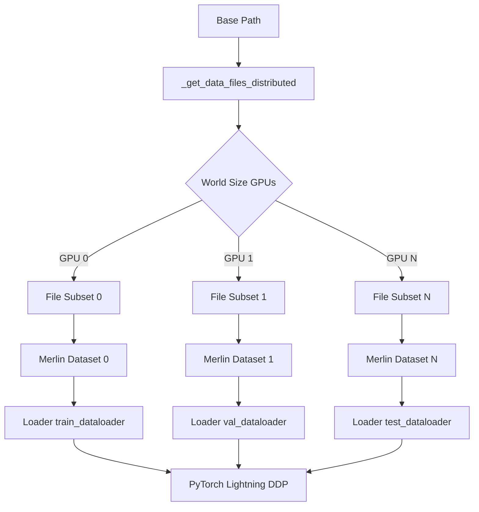

Nicheformer employs sophisticated distributed data loading strategies to efficiently handle large-scale spatial transcriptomics datasets across multiple GPUs. This architecture leverages NVIDIA Merlin's high-performance data loading framework integrated with PyTorch Lightning's distributed training capabilities, enabling seamless scaling from single-device to multi-GPU training scenarios. The design prioritizes data locality, memory efficiency, and minimal I/O contention through intelligent file sharding and rank-based data distribution.

Sources: [datamodules.py](src/nicheformer/data/datamodules.py#L1-L186), [_train.py](src/nicheformer/_train.py#L1-L81)

## Architecture Overview

The distributed data loading architecture centers around the `MerlinDataModuleDistributed` class, which extends PyTorch Lightning's `LightningDataModule` to provide a clean interface for managing distributed datasets. This class orchestrates three key components: file distribution logic, Merlin Dataset creation, and Loader instantiation. The system operates on a **rank-based data partitioning model** where each GPU (identified by its distributed rank) is assigned a disjoint subset of parquet files, ensuring no data overlap while maintaining balanced workload distribution.

Sources: [datamodules.py](src/nicheformer/data/datamodules.py#L118-L186)

The data flow follows a clear progression from raw parquet files distributed across devices to Merlin Datasets configured with appropriate memory management settings, then to PyTorch Loaders that feed data into the distributed training pipeline. Each rank accesses only its assigned file subset through `get_rank()` from `torch.distributed`, eliminating the need for cross-device communication during data loading.

Sources: [datamodules.py](src/nicheformer/data/datamodules.py#L90-L186)

## File Distribution Mechanism

The core of the distributed strategy lies in `_get_data_files_distributed`, which implements a modulo-based file assignment algorithm. For a given split directory (train, val, or test), the function identifies all parquet files and distributes them across available GPUs using the formula `file_id % world_size == device_rank`. This deterministic approach ensures reproducible data splits and eliminates the need for complex synchronization or sampling protocols.

Sources: [datamodules.py](src/nicheformer/data/datamodules.py#L90-L100)

The algorithm applies several optimizations: files are sorted numerically to maintain consistent ordering, results are reversed to prioritize newer or more important data, and subsampling can be applied through the `sub_sample_frac` parameter to reduce dataset size for experimentation or debugging. Each device receives a file list that is guaranteed to be disjoint from all other devices, preventing duplicate data loading and maximizing GPU memory utilization.

Sources: [datamodules.py](src/nicheformer/data/datamodules.py#L90-L100)

> [!TIP]
> The modulo-based distribution strategy ensures zero overlap between devices but may create imbalance if the number of files isn't evenly divisible by world size. For optimal performance, ensure your dataset contains a multiple of your target GPU count, or accept minor imbalance that's typically negligible for large datasets.

## Merlin Dataset Integration

Nicheformer leverages NVIDIA Merlin's optimized `merlin.io.Dataset` class to handle large-scale parquet data efficiently. The `merlin_dataset_factory` function constructs datasets with explicit schema definitions, critical for type safety and performance optimization. The schema defines all available columns including tokenized gene expression (`X`), niche context features (`X_niche_0` through `X_niche_4`), density predictions (`density_0` through `density_4`), and various metadata fields like cell type, tissue, and assay information.

Sources: [datamodules.py](src/nicheformer/data/datamodules.py#L15-L48)

The primary tokenized expression column receives special configuration: it's marked as a list type with a maximum value count of 2048, reflecting the context length used during pretraining. This schema-driven approach enables Merlin to optimize memory layout and access patterns, particularly important for the ragged tensors representing variable-length gene expression profiles. The factory function also applies memory management settings through `set_default_kwargs_dataset`, which defaults to 50MB part sizes during training and 80MB during inference to balance I/O throughput against memory pressure.

Sources: [datamodules.py](src/nicheformer/data/datamodules.py#L49-L64)

## Dataloader Configuration Strategy

Dataloaders are configured differently for training and inference phases to optimize for their respective workloads. The `set_default_kwargs_dataloader` function establishes sensible defaults: training dataloaders use 8 parts per chunk with shuffling enabled, while inference dataloaders use 1 part per chunk with deterministic ordering. This distinction reflects the different priorities—training needs maximized throughput and randomness for generalization, while inference requires reproducible results and minimal memory overhead.

Sources: [datamodules.py](src/nicheformer/data/datamodules.py#L67-L76)

The actual Merlin Loader creation happens in the dataloader methods (`train_dataloader`, `val_dataloader`, etc.), where each rank accesses its corresponding dataset through the `get_rank()` function. This rank-based access pattern is the critical piece that ties together the distributed file assignment and the actual data consumption, ensuring each GPU trains on a unique data shard while maintaining the illusion of a unified global dataset from the model's perspective.

Sources: [datamodules.py](src/nicheformer/data/datamodules.py#L175-L185)

## Configuration Parameters

The `MerlinDataModuleDistributed` class exposes several key parameters for customization across different training scenarios:

| Parameter | Type | Default | Description |
|-----------|------|---------|-------------|
| `path` | str | Required | Base directory containing train/test splits with parquet files |
| `columns` | List[str] | Required | Columns to load from parquet files, must match PARQUET_SCHEMA |
| `batch_size` | int | Required | Batch size per GPU, affects memory usage and throughput |
| `world_size` | int | Required | Total number of GPUs across all nodes |
| `sub_sample_frac` | float | 1.0 | Fraction of files to use per device (0.0-1.0) for experimentation |
| `splits` | bool | True | Whether to use separate train/test directories |
| `dataloader_kwargs_train/inference` | Dict | None | Custom settings for Merlin Loaders |
| `dataset_kwargs_train/inference` | Dict | None | Custom settings for Merlin Datasets |

Sources: [datamodules.py](src/nicheformer/data/datamodules.py#L120-L151)

The column selection mechanism is particularly important for different training phases—pretraining typically uses minimal columns (`X`, plus species/assay/modality metadata), while downstream tasks may require niche context features (`X_niche_*`) or density predictions (`density_*`). This selective loading reduces memory footprint and I/O overhead by only reading required columns from disk.

Sources: [_train.py](src/nicheformer/_train.py#L69-L74), [_fine_tune.py](src/nicheformer/_fine_tune.py#L52-L66)

## Integration with PyTorch Lightning DDP

The distributed data loading system integrates seamlessly with PyTorch Lightning's Distributed Data Parallel (DDP) strategy. In training scripts like `_train.py`, the Trainer is configured with `strategy="ddp_find_unused_parameters_true"`, which enables the DDP backend while handling parameter visibility for complex models that may not use all parameters in every forward pass. The trainer's `world_size` property is passed directly to the datamodule, ensuring automatic coordination between the distributed process group and data loading.

Sources: [_train.py](src/nicheformer/_train.py#L49-L51), [_train.py](src/nicheformer/_train.py#L71-L76)

The `prepare_data_per_node=True` setting in the datamodule indicates that data preparation (file scanning, dataset creation) happens on each node independently, which is appropriate given that files are already distributed across devices. Combined with the rank-based access pattern, this creates a scalable architecture where each GPU operates independently without cross-device synchronization during data loading—critical for maintaining high throughput as the cluster scales.

Sources: [datamodules.py](src/nicheformer/data/datamodules.py#L156-L157)

> [!TIP]
> When debugging distributed training issues, verify that your parquet files are correctly named with numeric identifiers that support the modulo distribution strategy. Files should follow patterns like `prefix-0.parquet`, `prefix-1.parquet`, etc., where the numeric portion is extracted and used for distribution.

## Performance Considerations and Best Practices

Effective distributed data loading requires attention to several performance-critical aspects. The part size configuration directly impacts I/O patterns—smaller parts (default 50MB for training) provide better load balancing but increase file handle overhead, while larger parts reduce overhead but may cause uneven work distribution. The parts per chunk setting (default 8 for training) controls how many parts are loaded simultaneously, affecting both throughput and memory consumption.

Sources: [datamodules.py](src/nicheformer/data/datamodules.py#L67-L76), [datamodules.py](src/nicheformer/data/datamodules.py#L81-L88)

For multi-node training, ensure that the file system infrastructure can handle concurrent I/O from all nodes without contention. Network-attached storage with sufficient bandwidth is essential, and local caching strategies may be beneficial for frequently accessed datasets. The gradient accumulation setting in the Trainer (`accumulate_grad_batches=10` in default configs) can be adjusted to balance between larger effective batch sizes and memory constraints without affecting the underlying data loading efficiency.

Sources: [_train.py](src/nicheformer/_train.py#L54-L56), [_fine_tune.py](src/nicheformer/_fine_tune.py#L47-L50)

The system supports both mixed-precision training (`precision='bf16-mixed'`) and gradient clipping, which work independently of the data loading strategy but should be considered holistically when optimizing end-to-end throughput. These settings affect compute efficiency rather than I/O, but represent important considerations for overall training performance at scale.

Sources: [_train.py](src/nicheformer/_train.py#L54-L56)

## Next Steps

Now that you understand distributed data loading strategies, explore how this integrates with the broader training pipeline. Continue with [Distributed Training with PyTorch Lightning](16-distributed-training-with-pytorch-lightning) to learn about the complete distributed training setup, or review [Data Loading with Merlin DataModules](7-data-loading-with-merlin-datamodules) for more details on the Merlin-specific components. For practical implementation examples, examine the configuration options in [Model Configuration and Hyperparameters](14-model-configuration-and-hyperparameters).