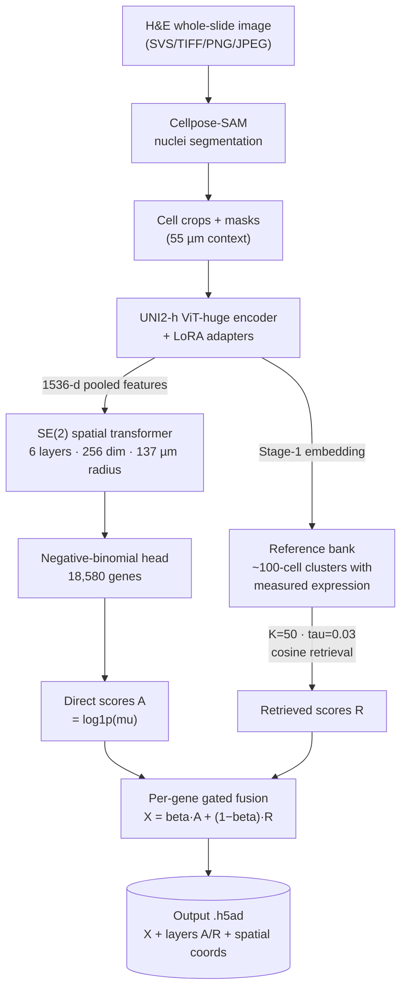

This page introduces **Morph2Mol**, a foundation model that predicts single-cell spatial gene expression directly from H&E histology images. Here you will learn what problem the project solves, the core ideas behind its design, how the repository is organized, and where to go next in the documentation. This page stays at the conceptual level — hands-on commands and deep internals live in later pages.

## What Morph2Mol Does

Morph2Mol answers a concrete question in computational pathology: given a stained tissue image, what genes is each individual cell expressing? The system takes a whole-slide H&E image, finds every cell nucleus, extracts a small image crop around each cell, and produces a per-cell expression score across 18,580 model genes — without requiring any measured expression on the target slide ([README.md](/README.md#L1-L3), [README.md](/README.md#L44-L53)). The project is distributed as an installable Python package `morph2mol` (version 0.3.0, Python ≥ 3.10) built on PyTorch 2.6+, together with ready-to-run `predict/` and `train/` driver scripts ([pyproject.toml](/pyproject.toml#L6-L16), [requirements.txt](/requirements.txt#L1-L12)).

The central insight of the design is **retrieval-augmented prediction**. A pure image-to-expression model produces a *direct* score, but the system also keeps a *reference bank* of cells whose expression was actually measured (from platforms like Xenium or CosMx). At inference time, each target cell's image embedding retrieves the 50 most visually similar reference cell clusters, and their measured expression is blended with the direct prediction ([README.md](/README.md#L109), [predict/predict.py](/predict/predict.py#L177-L188)). This means spatial expression predictions are grounded in real measured data whenever a similar tissue has been profiled before.

## Key Capabilities at a Glance

| Capability | What it means | Where it lives |
| --- | --- | --- |
| Automatic nuclei segmentation | Cellpose-SAM finds nuclei in the whole slide, handling slide-size images via overlapping windows | `predict/segment.py` |
| Direct expression prediction | Image → gene scores for 18,580 genes via a 25M-parameter model (`Morph2Mol-25M-scGPT`) | `predict/model.py`, `morph2mol/head.py` |
| Reference retrieval | Cosine search over a bank of ~100-cell clusters with measured expression | `morph2mol/retrieval.py` |
| Per-gene gated fusion | `X = beta*A + (1-beta)*R`, with weights fitted per organ and gene | `morph2mol/gate.py` |
| Streaming output | Results written incrementally to `.h5ad` so memory stays bounded | `predict/predict.py` |
| Release integrity | SHA-256 checksums verify checkpoints, gene space, bank, and fusion weights all match | `morph2mol/release.py` |
| Tissue-aware weights | Fusion weights for 15 organs in `narrow`/`wide` panel groups (20 organ/panel groups total) | `morph2mol/tissue.py`, `weights/` |

Sources: [README.md](/README.md#L68-L88), [predict/predict.py](/predict/predict.py#L117-L122), [predict/segment.py](/predict/segment.py#L1-L28), [weights/README.md](/weights/README.md#L29-L31)

## How It Works: The Big Picture

The diagram below shows the full inference flow. Two branches run in parallel — the **direct branch** (a neural network predicting expression from images) and the **retrieval branch** (nearest-neighbor lookup into measured expression) — and their outputs are fused per gene. Before reading it, note the three model components you will meet repeatedly: the *frozen UNI2-h image encoder with trainable LoRA adapters*, the *SE(2) spatial decoder that attends over cell neighborhoods within 137 µm*, and the *negative-binomial expression head with scGPT-initialized gene embeddings*.



The **direct branch** works as follows: each 55 µm cell crop is encoded by UNI2-h (a ViT-huge vision transformer, frozen), with small low-rank LoRA matrices injected into the attention layers of the last encoder blocks to adapt it to histology ([morph2mol/encoder.py](/morph2mol/encoder.py#L9-L21), [morph2mol/encoder.py](/morph2mol/encoder.py#L29-L40)). Cell-level features come from mask-weighted pooling over the encoder's patch tokens, so segmentation boundaries decide which image evidence belongs to which cell ([predict/segment.py](/predict/segment.py#L25-L27)). A six-layer spatial transformer then lets each target cell attend to up to 128 target + 64 context neighbors within 137 µm, using pairwise distances in microns through a learned Gaussian kernel ([morph2mol/se2.py](/morph2mol/se2.py#L7-L13), [README.md](/README.md#L57)). Finally, the negative-binomial head converts cell embeddings into per-gene mean rates `mu`, conditioned on absolute and relative cell area, and predictions are returned in `log1p(mu)` scale ([morph2mol/head.py](/morph2mol/head.py#L24-L40), [predict/model.py](/predict/model.py#L64-L68)).

The **retrieval branch** treats prediction as a lookup problem. The reference bank stores, for each ~100-cell cluster of previously measured cells, a 1536-dim image-embedding key (from Stage 1 training) plus the cluster's measured expression for the genes it covers ([morph2mol/retrieval.py](/morph2mol/retrieval.py#L120-L149)). Each target cell retrieves its 50 nearest clusters by exact fp16 cosine similarity, and cluster scores are combined with exponential weights at temperature 0.03 ([morph2mol/retrieval.py](/morph2mol/retrieval.py#L170-L200)). A per-gene **gate** then blends the two branches: `beta` weights were fitted offline on reference slides (never on the target), and genes without retrieval coverage fall back to the direct prediction ([morph2mol/gate.py](/morph2mol/gate.py#L83-L105), [README.md](/README.md#L109)).

Both branches are trained in two stages on paired H&E images and measured spatial expression. **Stage 1** aligns image features with scGPT RNA cell embeddings using a symmetric contrastive loss (temperature 0.07) — this is what makes image and expression spaces comparable for retrieval. **Stage 2** trains the spatial decoder and expression head with a negative-binomial objective, reusing the Stage 1 LoRA weights as initialization ([docs/training.md](/docs/training.md#L58-L97)). The reference bank and fusion weights are then built from the training corpus in separate steps ([docs/training.md](/docs/training.md#L99-L150)).

Sources: [morph2mol/encoder.py](/morph2mol/encoder.py#L9-L40), [morph2mol/se2.py](/morph2mol/se2.py#L7-L22), [morph2mol/head.py](/morph2mol/head.py#L24-L40), [morph2mol/retrieval.py](/morph2mol/retrieval.py#L120-L149), [morph2mol/gate.py](/morph2mol/gate.py#L83-L105), [predict/model.py](/predict/model.py#L13-L68), [docs/training.md](/docs/training.md#L58-L150)

## Repository Layout

The repository separates the **importable library** (`morph2mol/`) from the **command-line drivers** that call it (`predict/` for inference, `train/` for training). Tests and documentation sit at the top level, and the `weights/` directory ships gene symbol lists used to define the model's gene space.

```text
Morph2Mol/
├── morph2mol/          # Core library: model components, retrieval, gating, release
│   ├── encoder.py      #   UNI2-h builder + LoRA injection
│   ├── se2.py          #   SE(2) spatial transformer decoder
│   ├── head.py         #   Negative-binomial expression head
│   ├── retrieval.py    #   ReferenceBank: cluster retrieval engine
│   ├── gate.py         #   Per-gene fusion weight fitting + application
│   ├── release.py      #   Portable release loading + integrity checks
│   ├── scgpt_backend/  #   Vendored scGPT RNA embedding backend
│   └── training/       #   Stage 1 / Stage 2 training logic
├── predict/            # Inference CLI: segmentation, I/O, context, streaming output
├── train/              # Training drivers: prepare → phase1 → phase2 → bank → beta
├── configs/            # Example release configuration
├── docs/               # Training guide + input/output format specs
├── tests/              # Gene-table and prediction-compatibility tests
├── weights/            # Model gene symbol lists (genes.tsv, xenium_genes.tsv)
├── voice/              # Backward-compatible namespace alias
└── pyproject.toml      # Package metadata (morph2mol v0.3.0)
```

A useful detail for readers tracing older code or checkpoints: the package once shipped under a different name, and compatibility is preserved explicitly — the inference model class exposes `Voice25M = Morph2Mol` as an alias, and both `morph2mol-release-v1` and `voice25m-release-v1` schemas are accepted by the release loader ([predict/model.py](/predict/model.py#L71-L72), [morph2mol/release.py](/morph2mol/release.py#L11-L12)). The `morph2mol` package itself is importable without the driver scripts: everything from encoder construction to gated fusion is a library function you can call directly ([pyproject.toml](/pyproject.toml#L16-L19)).

## Verification and Reproducibility

Every prediction run is anchored to an auditable *release directory* containing `release.json`, the two stage checkpoints, the gene space, fusion weights, and the reference bank ([weights/README.md](/weights/README.md#L5-L27)). When a release is loaded, the system recomputes SHA-256 hashes of the stage checkpoints and gene space, cross-checks the bank's cache fingerprint against the gate metadata, and refuses to run if checkpoints, genes, bank, and fusion weights disagree ([morph2mol/release.py](/morph2mol/release.py#L21-L45)). These identities are also recorded in the output file's metadata (`stage1_sha256`, `stage2_sha256`, `gene_space_sha256`, `bank_fingerprint`), so any result can be traced back to the exact artifacts that produced it ([predict/predict.py](/predict/predict.py#L117-L122), [predict/predict.py](/predict/predict.py#L189-L197)).

Tissue handling follows the same "no silent assumptions" philosophy: organ names are user-supplied annotations in a `sample,tissue` CSV, matched case-insensitively, and related donor/block samples are transitively excluded from reference banks when fitting fusion weights — preventing a sample from "predicting itself" ([morph2mol/tissue.py](/morph2mol/tissue.py#L22-L56), [README.md](/README.md#L78)).

## What to Read Next

For a beginner-friendly progression through this catalog:

1. **[Quick Start](2-quick-start)** — install, download the model, and run your first prediction end to end.
2. **[Inference CLI Reference](3-inference-cli-reference)** — every `predict/predict.py` flag explained, from `--tissue` to memory controls.
3. **[Reading Prediction Outputs](4-reading-prediction-outputs)** — how to interpret the `.h5ad` fields (`X`, layers `A`/`R`, `var['beta']`, embeddings).
4. **[Architecture Overview](5-architecture-overview)** — the full component map before diving into individual modules.
5. Then follow the Deep Dive order: model components ([Image Encoder and LoRA Adapters](6-image-encoder-and-lora-adapters), [SE(2) Distance Attention Decoder](7-se-2-distance-attention-decoder), [Negative-Binomial Expression Head](8-negative-binomial-expression-head), [scGPT RNA Embedding Backend](9-scgpt-rna-embedding-backend)), retrieval-augmented prediction ([Reference Bank Construction](10-reference-bank-construction), [Cluster Retrieval Mechanics](11-cluster-retrieval-mechanics), [Gated Fusion Weights](12-gated-fusion-weights)), and finally training and inference engineering.

> [!TIP]
> The single most important sentence in this codebase's README for interpreting results: combined scores `X = beta*A + (1-beta)*R` describe *variation across cells within each gene* — they are not molecule counts ([README.md](/README.md#L109)).

> [!TIP]
> Segmentation quality directly bounds prediction quality: the per-cell feature is a mask-weighted average over encoder patches, so the boundary decides which image evidence is attributed to each cell. If you have your own cell boundaries (e.g., paired with a spatial assay), pass them via `--cells` instead of relying on automatic segmentation ([predict/segment.py](/predict/segment.py#L25-L27), [README.md](/README.md#L70)).
