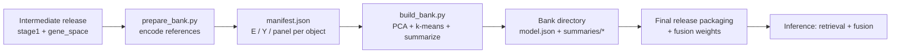
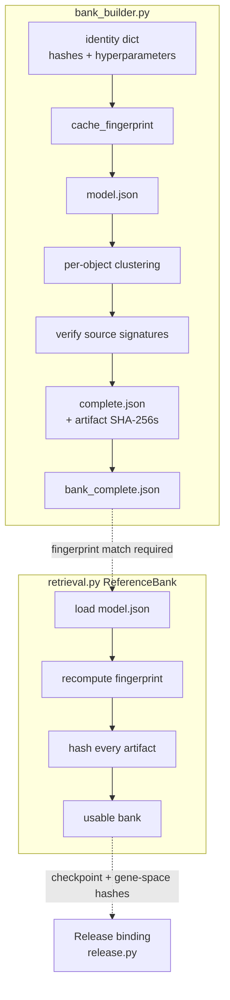

The reference bank is Morph2Mol's retrieval substrate: a compact, fingerprinted store of clustered (image-feature, measured-expression) summaries derived from training reference slides. At inference, direct model predictions are fused with expression retrieved from this bank, so its construction determines both the quality and the reproducibility of every prediction. This page explains how the bank is built — from encoding reference slides to writing verified on-disk artifacts — and why each step is structured the way it is. Retrieval-time behavior is covered in [Cluster Retrieval Mechanics](11-cluster-retrieval-mechanics), and how the resulting weights are fitted is covered in [Gated Fusion Weights](12-gated-fusion-weights).

The system's purpose frames everything below: predict spatial gene expression from H&E images using "an image encoder, a spatial decoder, and a reference bank of cells with measured expression" [README.md](/README.md#L1-L3). The bank ships with the downloadable model, alongside checkpoints, fusion weights, and gene information [README.md](/README.md#L14-L20).

Sources: [README.md](/README.md#L1-L3), [README.md](/README.md#L14-L20)

## Where the Bank Sits in the Architecture

Bank construction is a post-training, pre-inference step. It consumes an intermediate release (containing the Stage-1 alignment checkpoint and gene space but not yet the bank or gate) and produces a directory of per-reference cluster summaries that a final release packages by reference. The two modules involved have a clean producer/consumer split:

- **`train/prepare_bank.py`** — encodes each reference slide through the full prediction pipeline and materializes per-cell features and expression as plain NumPy arrays plus a manifest.
- **`morph2mol/bank_builder.py`** (exposed as `predict/build_bank.py`) — clusters those features per slide and writes the summarization artifacts with integrity metadata.

The training guide documents this exact command sequence: export an intermediate release, run `prepare_bank.py`, then run `build_bank.py` against its manifest [docs/training.md](/docs/training.md#L104-L115).



Sources: [docs/training.md](/docs/training.md#L104-L115), [predict/build_bank.py](/predict/build_bank.py#L1-L8), [train/prepare_bank.py](/train/prepare_bank.py#L1-L2), [morph2mol/bank_builder.py](/morph2mol/bank_builder.py#L1)

## Stage 1: Preparing Reference Inputs with `prepare_bank.py`

`prepare_bank.py` takes a release, a prepared dataset, and a list of reference sample IDs, and emits one working directory per reference containing the bank builder's raw inputs. Its first act is a data-contract guard: the reference list must be a subset of the corpus's training split (`set(refs) <= set(contract['training_set'])`), preventing held-out slides from leaking into the retrieval pool [train/prepare_bank.py](/train/prepare_bank.py#L29-L30). This guard connects directly to the split discipline described in [Training Data Contracts](13-training-data-contracts); here we focus only on what construction itself produces.

The release is opened with `retrieval=False` because bank/gate artifacts do not exist yet — only the Stage-1 checkpoint and gene space are needed [train/prepare_bank.py](/train/prepare_bank.py#L26-L28). The gene space is loaded into a symbol→global-index lookup that anchors every later panel mapping [train/prepare_bank.py](/train/prepare_bank.py#L27-L28).

Sources: [train/prepare_bank.py](/train/prepare_bank.py#L26-L30), [docs/training.md](/docs/training.md#L104-L112)

### Mapping the slide's measured panel into the global gene space

Each reference slide measures its own subset of genes, recorded in its `genes.tsv`. The preparer intersects those symbols with the release gene space, keeping column order, rejecting slides with no overlap or duplicate measured symbols, and writing the matched symbols to `genes.txt` [train/prepare_bank.py](/train/prepare_bank.py#L34-L39). This per-slide "panel" is central to the whole design: the bank stores expression only for genes the slide actually measured, and retrieval later forms *coverage groups* by intersecting query panels with bank panels — mechanics detailed in [Cluster Retrieval Mechanics](11-cluster-retrieval-mechanics).

Sources: [train/prepare_bank.py](/train/prepare_bank.py#L34-L39)

### Encoding reference slides through the full prediction pipeline

To obtain image features, the preparer invokes the complete prediction pipeline on the reference slide itself — segmentation, crop extraction, encoding — via `predict_reference([... '--save-embeddings' ...], reference=True)`, cached as `direct.h5ad` [train/prepare_bank.py](/train/prepare_bank.py#L40-L45). Two validations protect the cache: the H5AD must be marked `complete`, and its recorded `stage1_sha256` must equal the current release's Stage-1 hash, otherwise stale predictions are rejected [train/prepare_bank.py](/train/prepare_bank.py#L52-L53). The Stage-1 Phase-1 features are then exported as `E.npy` — the `[N, 1536]` retrieval embedding matrix, with cell IDs retained to align expression rows later [train/prepare_bank.py](/train/prepare_bank.py#L54-L55).

Sources: [train/prepare_bank.py](/train/prepare_bank.py#L40-L55)

### Standardizing measured expression

Expression handling follows an explicit recipe, stated in a code comment as: *"population z-score log1p counts, sd floor 1e-3, fp16 before cluster means"* [train/prepare_bank.py](/train/prepare_bank.py#L57). Concretely, the sparse `expression.npz` is restricted to the predicted cell rows and matched gene columns, log1p-transformed, z-scored per gene with a variance floor of `1e-3` guarding near-constant genes, and written as a float16 memmap `Y.npy` in 4096-row chunks [train/prepare_bank.py](/train/prepare_bank.py#L56-L65). The per-slide panel is saved as global gene indices in `panel.npy` [train/prepare_bank.py](/train/prepare_bank.py#L66).

Sources: [train/prepare_bank.py](/train/prepare_bank.py#L56-L66)

### Provenance metadata and the manifest

Each working directory ends with a `feature_meta.json` declaring the Stage-1 checkpoint hash, the feature protocol ID (`masked_cell_features`), dimensionality 1536, and `output_field: 'phase1'` [train/prepare_bank.py](/train/prepare_bank.py#L67-L68). Finally the top-level `manifest.json` records the checkpoint path, gene-space path, both protocol IDs, and one object entry per reference (`split: 'train'`, `n_cells`, and `E`/`Y`/`panel` paths) [train/prepare_bank.py](/train/prepare_bank.py#L69-L73).

| Output | Content | Purpose downstream |
| --- | --- | --- |
| `E.npy` | `[N, 1536]` raw Phase-1 image features | PCA + k-means clustering keys |
| `Y.npy` | `[N, len(panel)]` float16 z-scored log1p expression | Cluster mean expression values |
| `panel.npy` | Global gene indices of the measured panel | Coverage-group formation at retrieval |
| `feature_meta.json` | Checkpoint hash + protocol IDs + dim + field | Feature provenance validation |
| `manifest.json` | Object list, protocol IDs, artifact paths | Builder's sole input contract |

Sources: [train/prepare_bank.py](/train/prepare_bank.py#L67-L73), [morph2mol/bank_io.py](/morph2mol/bank_io.py#L10-L14)

## Stage 2: Clustering and Summarization with `bank_builder.py`

`predict/build_bank.py` is an eight-line shim that imports and runs `bank_builder.main` [predict/build_bank.py](/predict/build_bank.py#L1-L8). The builder accepts `--manifest`, `--output`, `--device`, `--backend` (`auto`/`faiss`/`torch`), and `--expected-objects` [morph2mol/bank_builder.py](/morph2mol/bank_builder.py#L222-L230). Before any computation, it disables TF32 matmuls to keep float arithmetic bit-stable across runs [morph2mol/bank_builder.py](/morph2mol/bank_builder.py#L76-L81), and validates the manifest: object count must match expectation, stay within 1–256 (a bound tied to uint8 source IDs), and contain no duplicates [morph2mol/bank_builder.py](/morph2mol/bank_builder.py#L85-L87).

### The identity dict and cache fingerprint

Reproducibility is engineered through an **identity dictionary** captured before any clustering: schema, checkpoint and gene-space SHA-256s, both protocol IDs, the manifest hash, and every fixed hyperparameter — `target_size=100`, `PCA_dimensions=64`, `max_PCA_rows=100000`, `kmeans_iterations=10`, `per_object_seed='object_index'`, `retrieval_K=50`, `tau=0.03`, backend, torch version, and device [morph2mol/bank_builder.py](/morph2mol/bank_builder.py#L93-L101). The Faiss version is pinned into the identity when that backend is used [morph2mol/bank_builder.py](/morph2mol/bank_builder.py#L102-L105). Per-object **source signatures** (path, size, mtime of `E`/`Y`/`panel`, plus the feature-meta SHA) are folded in after re-validating each object's split and feature metadata [morph2mol/bank_builder.py](/morph2mol/bank_builder.py#L106-L112). The SHA-256 of this canonicalized dict becomes the **`cache_fingerprint`** [morph2mol/bank_builder.py](/morph2mol/bank_builder.py#L113).

> [!TIP]
> The fingerprint is the bank's reproducibility contract: any change to inputs, hyperparameters, library versions, or protocol IDs changes the hash, which invalidates every cached summary and forces a rebuild into a fresh directory. Conversely, an unchanged fingerprint lets an interrupted build resume — completed objects are detected and reused verbatim.

Sources: [morph2mol/bank_builder.py](/morph2mol/bank_builder.py#L93-L113), [morph2mol/bank_io.py](/morph2mol/bank_io.py#L30-L31)

### Write exclusivity and idempotent restarts

The output directory is guarded by a kernel-level `flock` on `.build.lock`, which releases automatically even for killed processes — the code notes this avoids stale PID locks entirely [morph2mol/bank_io.py](/morph2mol/bank_io.py#L42-L55). Under the lock, if `model.json` already exists, its content must exactly equal the freshly computed model (identity + fingerprint) or the build refuses with *"Bank input/configuration changed; choose a new output directory"*; otherwise the model is written once and becomes the directory's identity record [morph2mol/bank_builder.py](/morph2mol/bank_builder.py#L115-L122).

Sources: [morph2mol/bank_builder.py](/morph2mol/bank_builder.py#L115-L122), [morph2mol/bank_io.py](/morph2mol/bank_io.py#L42-L55)

### Deterministic PCA projection

Per object, features are validated first: `E` must be `[N, 1536]`, `Y` must be `[N, len(panel)]`, the panel must be unique and in-range, at least 64 cells must exist (the PCA-64 minimum), and the row count must match the manifest's declared `n_cells` [morph2mol/bank_builder.py](/morph2mol/bank_builder.py#L132-L141). PCA then proceeds deterministically: a random subsample of `min(N, 100000)` rows is drawn with a generator seeded by the object index, standardized via `original_keys` (L2-normalized Phase-1 features), and reduced to 64 components with `torch.pca_lowrank`; the mean, components, and sampled row indices are all persisted (`PCA_mean.npy`, `PCA_components.npy`, `PCA_training_rows.npy`) so the projection is fully reconstructible [morph2mol/bank_builder.py](/morph2mol/bank_builder.py#L142-L150). All N cells are then projected to the 64-D space in 32768-row chunks [morph2mol/bank_builder.py](/morph2mol/bank_builder.py#L152-L155).

Sources: [morph2morph/bank_builder.py](/morph2mol/bank_builder.py#L142-L155), [docs/training.md](/docs/training.md#L117)

### k-means with exact full-population assignment

Cluster count targets ~100 cells per community: `nclusters = max(1, n // 100)`, initialized by a seeded `randperm` over projected cells [morph2mol/bank_builder.py](/morph2mol/bank_builder.py#L156-L158). Ten Lloyd iterations follow, with two interchangeable assignment backends:

| Property | `torch` backend | `faiss` backend |
| --- | --- | --- |
| Assignment | Chunked exhaustive float32 L2, no ANN, no subsampling [morph2mol/bank_builder.py](/morph2mol/bank_builder.py#L30-L45) | `GpuIndexFlatL2` in float32 (`useFloat16=False`), searched in 8192-row blocks [morph2mol/bank_builder.py](/morph2mol/bank_builder.py#L167-L176) |
| Tie-breaking | First centre wins exact ties [morph2mol/bank_builder.py](/morph2mol/bank_builder.py#L43) | Faiss internal ordering |
| GPU resources | None needed | 256 MiB temp memory, null-stream sharing with Torch for safe tensor interop [morph2mol/bank_builder.py](/morph2mol/bank_builder.py#L160-L165) |
| Selection | Default with `--backend auto` fallback [morph2mol/bank_builder.py](/morph2mol/bank_builder.py#L15-L27) | Requires CUDA + GPU Faiss; explicit `faiss` selection fails hard otherwise [morph2mol/bank_builder.py](/morph2mol/bank_builder.py#L24-L26) |

Centroids update only over non-empty clusters each iteration [morph2mol/bank_builder.py](/morph2mol/bank_builder.py#L179-L185). Notably, the code keeps the *tenth* assignment rather than performing an eleventh search after the final centroid update — an explicit, documented choice [morph2mol/bank_builder.py](/morph2mol/bank_builder.py#L187). Labels are then canonicalized with `unique(..., return_inverse=True)`, which simultaneously compacts away empty clusters [morph2mol/bank_builder.py](/morph2mol/bank_builder.py#L188-L189). The training guide confirms these parameters: PCA-64 on up to 100,000 cells per slide, 10 iterations, `max(1, floor(N/100))` initial clusters, empty clusters removed, ≥64 cells required, and either backend selectable [docs/training.md](/docs/training.md#L117).

Sources: [morph2mol/bank_builder.py](/morph2mol/bank_builder.py#L156-L189), [docs/training.md](/docs/training.md#L117)

### Cluster summarization: keys, values, counts

The `summarize` routine aggregates everything into three artifacts via chunked `index_add_` accumulation [morph2mol/bank_builder.py](/morph2mol/bank_builder.py#L48-L62):

- **`keys`** — each cell's Phase-1 feature is L2-normalized to float16 (`original_keys` enforces finite `[N,1536]` input [morph2mol/retrieval.py](/morph2mol/retrieval.py#L64-L68)), averaged within its cluster, and re-normalized. The result is a float16 `[C, 1536]` matrix of cluster centroids on the unit hypersphere [morph2mol/bank_builder.py](/morph2mol/bank_builder.py#L55-L59).
- **`values`** — cluster-mean standardized expression across the panel genes, float32, computed from the float16 `Y` upcast per chunk [morph2mol/bank_builder.py](/morph2mol/bank_builder.py#L56-L60).
- **`counts`** — cluster cell counts as int64 [morph2mol/bank_builder.py](/morph2mol/bank_builder.py#L50-L62).

Non-finite guards fire on both input chunks and final summaries [morph2mol/bank_builder.py](/morph2mol/bank_builder.py#L57-L61). All five artifacts plus the three PCA files are saved per object [morph2mol/bank_builder.py](/morph2mol/bank_builder.py#L191-L196), and a conservation check asserts no cells were lost (`counts.sum() == n`) [morph2mol/bank_builder.py](/morph2mol/bank_builder.py#L197).

> [!TIP]
> Cluster keys are not raw feature centroids — they are normalize → average → re-normalize compositions. Because mean-of-unit-vectors then renormalization stays on the unit sphere, retrieval can later use exact float16 cosine similarity against these keys with zero approximation loss, which is why the bank records `retrieval_K=50` and `tau=0.03` as part of its identity rather than leaving them to inference code.

Sources: [morph2mol/bank_builder.py](/morph2mol/bank_builder.py#L48-L62), [morph2mol/retrieval.py](/morph2mol/retrieval.py#L64-L68), [docs/training.md](/docs/training.md#L119)

## On-Disk Layout of a Constructed Bank

A completed bank is a plain directory of NumPy artifacts plus two JSON records. Everything the consumer needs is declared in `bank_io.py`: the schema string `morph2mol-reference-bank`, both protocol IDs, and the eight-member `ARTIFACTS` tuple [morph2mol/bank_io.py](/morph2mol/bank_io.py#L10-L14).

```text
bank/
├── model.json                  # identity dict + cache_fingerprint
├── bank_complete.json          # totals: n_objects, n_cells, n_communities
├── .build.lock                 # kernel flock for write exclusivity
└── summaries/
    ├── object_00/
    │   ├── keys.npy            # [C,1536]  float16  unit-sphere cluster centroids
    │   ├── values.npy          # [C, panel] float32 cluster-mean expression
    │   ├── panel.npy           # global gene indices of measured panel
    │   ├── counts.npy          # [C] int64 cells per cluster
    │   ├── labels.npy          # [N] int32 per-cell cluster assignment
    │   ├── PCA_mean.npy        # projection mean
    │   ├── PCA_components.npy  # 64 components
    │   ├── PCA_training_rows.npy  # sampled rows used to fit PCA
    │   └── complete.json       # metadata + per-artifact SHA-256
    └── object_01/ ...
```

After the per-object loop, `bank_complete.json` records the fingerprint alongside aggregate totals — object count, total cells, and total communities [morph2mol/bank_builder.py](/morph2mol/bank_builder.py#L217-L219). This marker is what later turns a partially built directory into an unusable one: loaders demand it before accepting anything [morph2mol/retrieval.py](/morph2mol/retrieval.py#L89-L90).

Sources: [morph2mol/bank_io.py](/morph2mol/bank_io.py#L10-L14), [morph2mol/bank_builder.py](/morph2mol/bank_builder.py#L191-L219)

## The Integrity and Reproducibility Chain

Every artifact is protected by a layered verification system that spans construction, caching, and consumption:

1. **Per-object completion records.** After saving, the builder re-hashes each input signature and compares against the pre-build snapshot, failing with *"Input changed during build"* if any file mutated mid-run [morph2mol/bank_builder.py](/morph2mol/bank_builder.py#L198-L200). It then writes `complete.json` containing object metadata and the SHA-256 of every artifact [morph2mol/bank_builder.py](/morph2mol/bank_builder.py#L201-L209).
2. **Resume validation.** On re-run, a completed object is accepted only if its `complete.json` matches the current fingerprint, object name, and all stored artifact hashes [morph2mol/bank_builder.py](/morph2mol/bank_builder.py#L65-L72).
3. **Feature provenance.** `validate_feature` cross-checks the checkpoint hash and protocol ID, requires dimensionality 1536, and demands `output_field == 'phase1'` — explicitly rejecting Stage-2 embeddings being smuggled in as retrieval keys [morph2mol/bank_io.py](/morph2mol/bank_io.py#L58-L65).
4. **Consumer-side verification.** `ReferenceBank.__init__` re-verifies the schema, recomputes the fingerprint from the model JSON, checks `target_size == 100` and the completion marker, requires `retrieval_K == 50` and `tau == TAU`, validates per-object metadata and artifact hashes (optionally skippable via `verify_hashes=False`), and enforces the 1–256 object bound [morph2mol/retrieval.py](/morph2mol/retrieval.py#L77-L112).
5. **Release binding.** A final release cross-checks the bank's `checkpoint_sha256` against the packaged Stage-1 hash and `gene_space_sha256` against the gene space, so a bank can never be silently paired with mismatched checkpoints or genes [morph2mol/release.py](/morph2mol/release.py#L27-L41).

| Check | Enforced at | Failure mode |
| --- | --- | --- |
| Manifest objects are training-split samples | `prepare_bank.py` | `ValueError` [train/prepare_bank.py](/train/prepare_bank.py#L29-L30) |
| Cached predictions match release Stage-1 hash | `prepare_bank.py` | Rejected cache [train/prepare_bank.py](/train/prepare_bank.py#L52-L53) |
| E/Y/panel shapes, panel range, ≥64 cells | `bank_builder.build` | `ValueError` [morph2mol/bank_builder.py](/morph2mol/bank_builder.py#L132-L141) |
| Inputs unchanged during build | Per-object finalize | Build abort [morph2mol/bank_builder.py](/morph2mol/bank_builder.py#L198-L200) |
| Artifact SHA-256 vs `complete.json` | Resume + load | Corrupt-artifact error [morph2mol/bank_builder.py](/morph2mol/bank_builder.py#L65-L72), [morph2mol/retrieval.py](/morph2mol/retrieval.py#L104-L107) |
| Bank ↔ release checkpoint/gene hashes | `Release` construction | Mismatch error [morph2mol/release.py](/morph2mol/release.py#L27-L41) |



Sources: [morph2mol/bank_builder.py](/morph2mol/bank_builder.py#L65-L72), [morph2mol/bank_builder.py](/morph2mol/bank_builder.py#L198-L219), [morph2mol/bank_io.py](/morph2mol/bank_io.py#L58-L65), [morph2mol/retrieval.py](/morph2mol/retrieval.py#L77-L112), [morph2mol/release.py](/morph2mol/release.py#L27-L41)

## How the Bank Is Consumed (Handoff)

At load time, `ReferenceBank` streams each object's `keys.npy` to the device as float16 tensors, validates `values.npy` shape/dtype against its panel, and copies the whole expression pool into one preallocated device tensor to bound memory — no second full pool during concatenation [morph2mol/retrieval.py](/morph2mol/retrieval.py#L120-L146). The `exclude` parameter drops specific objects at load (used when fitting fusion weights must exclude a query's own reference), and the uint8 source IDs it assigns are the reason for the 256-object ceiling [morph2mol/retrieval.py](/morph2mol/retrieval.py#L97-L112). What happens next — 50-neighbor selection per coverage group, tie-shared exponential weights at temperature 0.03, and fusion into direct predictions — is the domain of [Cluster Retrieval Mechanics](11-cluster-retrieval-mechanics) and [Gated Fusion Weights](12-gated-fusion-weights). Packaging the finished bank into a distributable release is covered by [Model Export and Release Packaging](17-model-export-and-release-packaging).

Sources: [morph2mol/retrieval.py](/morph2mol/retrieval.py#L97-L146), [docs/training.md](/docs/training.md#L119-L120)

## Key Takeaways

Bank construction in Morph2Mol is deliberately **conservative and self-verifying**: exhaustive (non-approximate) PCA and k-means on full populations, deterministic per-object seeding, population-level expression standardization with explicit floors, and hash-chained artifacts from creation through consumption. The `cache_fingerprint` turns the entire pipeline into a pure function of its declared inputs — identical inputs always yield an identical, resumable bank; any drift yields an immediately detectable mismatch rather than silent corruption. This is the foundation that makes retrieval-augmented prediction trustworthy: when you call [Cluster Retrieval Mechanics](11-cluster-retrieval-mechanics), you are querying summaries whose provenance can be re-verified in milliseconds from `complete.json` alone.
