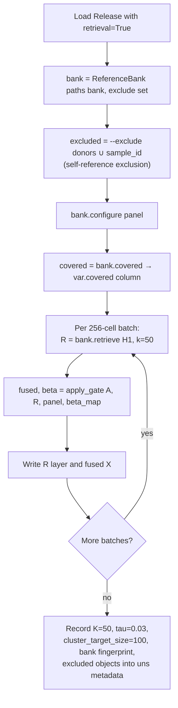

This page explains how Morph2Mol converts direct morphological predictions into retrieval-augmented ones. The engine lives in a single class — `ReferenceBank` — which indexes reference slides as *clusters* of ~100 cells, matches each target cell against cluster keys with exact fp16 cosine search, resolves cross-bank coverage groups, distributes tie weight fractionally at the k-th neighbor boundary, and aggregates standardized expression values from a flat GPU pool. The design goals are verifiable exactness (no ANN approximations), deterministic tie handling, and a strict NaN-based coverage contract consumed downstream by the gated fusion stage.

## Why Retrieval Indexes Clusters, Not Cells

The reference bank does not store per-cell entries. During bank construction, cells within each reference slide are k-means clustered into communities of `target_size=100` cells, and each community is summarized into two artifacts: a **cluster key** (the re-normalized mean of member cells' normalized Phase-1 features, cast to fp16) and a **cluster value** (the mean standardized log1p expression across the bank panel) [bank_builder.py](morph2mol/bank_builder.py#L48-L62). At inference time the relationship is deliberately asymmetric: the *query* is a single cell's raw Phase-1 feature vector, while the *index* consists of cluster keys. A target cell thus borrows expression from its 50 most morphologically similar reference communities.

This asymmetry is a noise-robustness trade-off rather than a pure compression choice:

| Dimension | Cluster-level index (chosen) | Cell-level index |
|---|---|---|
| Unit of retrieval | ~100-cell k-means community | Individual annotated cell |
| Key stability | Mean over members damps segmentation/registration noise | Sensitive to single-cell artifacts |
| Expression semantics | Smoothed population z-score per panel gene | Noisy per-cell measurements |
| Storage | #communities × #panel genes | #cells × #panel genes |
| Top-50 granularity | 50 communities ≈ up to ~5,000 cells of evidence | 50 individual cells |

Note that these *feature-space clusters* are unrelated to the *spatial target/context blocks* (≤128 cells) used for inference batching — the latter belong to [Spatial Context Blocking](19-spatial-context-blocking) and are configured independently at `TARGET_CELLS = 128` [recipe.py](morph2mol/recipe.py#L5), [predict/spatial_context.py](predict/spatial_context.py#L15-L26).

The bank itself carries the invariant `require(self.model['target_size'] == 100)` — a release built with any other community size is rejected outright [retrieval.py](morph2mol/retrieval.py#L87).

```mermaid
graph LR
    subgraph Reference Bank (per object/slide)
        K1[Cluster keys<br/>fp16 1536-d, normalized] 
        V1[Cluster values<br/>z-scored log1p, bank panel]
        P1[Object panel<br/>gene id subset]
    end
    Q[Target cell<br/>raw Phase-1 1536-d] -->|L2-normalize, fp16| QN
    QN -->|exact cosine per object| K1
    K1 --> TB[Per-bank top-50]
    P1 --> CG{Coverage groups<br/>banks sharing a gene}
    TB --> CG
    CG --> TW[Tie-aware weights<br/>tau = 0.03]
    TW --> AGG[Weighted gather<br/>from flat value pool]
    V1 --> AGG
    AGG --> R[R matrix<br/>NaN = no coverage]
    R --> G[apply_gate fusion]
```

Sources: [bank_builder.py](morph2mol/bank_builder.py#L48-L62), [retrieval.py](morph2mol/retrieval.py#L87), [recipe.py](morph2mol/recipe.py#L5)

## Bank Invariants Checked Before Any Query

`ReferenceBank.__init__` treats the bank directory as untrusted input. Before a single similarity score is computed, it verifies a chain of invariants that bind the bank to the exact model, gene space, and build configuration [retrieval.py](morph2mol/retrieval.py#L77-L112):

| Check | Assertion | Failure meaning |
|---|---|---|
| Schema | `morph2mol-reference-bank` (or legacy alias) | Directory is not a bank |
| Fingerprint | SHA-256 of `model.json` identity equals `cache_fingerprint` [bank_io.py](morph2mol/bank_io.py#L30-L31) | Metadata edited after build |
| Cluster size | `target_size == 100` | Bank built with different clustering |
| Completion marker | `bank_complete.json` count matches `expected_objects` and fingerprint [retrieval.py](morph2mol/retrieval.py#L89-L94) | Interrupted build |
| Retrieval contract | `retrieval_K == 50` and `tau == 0.03` | Bank/Search hyperparameters drift |
| Per-object metadata | `complete.json` object id and fingerprint | Stale or swapped object cache |
| Artifact integrity | All `ARTIFACTS` present; SHA-256 match when `verify_hashes=True` [retrieval.py](morph2mol/retrieval.py#L104-L107) | Corrupt or missing `.npy` |
| Panel sanity | Unique gene ids within `[0, n_genes)` [retrieval.py](morph2mol/retrieval.py#L108-L109) | Malformed panel |
| Object count | 1–256 objects | Hard limit from uint8 source ids [retrieval.py](morph2mol/retrieval.py#L111) |

Loading is equally deliberate about memory. Every object's `values.npy` is opened as a read-only memmap, and a **single preallocated GPU pool** of float32 receives the flattened values exactly once — avoiding a second full expression pool during concatenation. Cluster keys are moved to device as fp16 `[N, 1536]`, and three index tensors are built: `row_start` (per-community address in the pool), `source` (uint8 object id per community), and `offsets` (global community id base per object) [retrieval.py](morph2mol/retrieval.py#L120-L149). The artifacts themselves follow the protocol declared in [bank_io.py](morph2mol/bank_io.py#L10-L14): features use `masked_cell_features`, values use `standardized_log_expression`.

Sources: [retrieval.py](morph2mol/retrieval.py#L77-L149), [bank_io.py](morph2mol/bank_io.py#L10-L31)

## Panel Adaptation: Coverage Groups and Column Maps

A target panel (e.g. `--genes xenium`) rarely matches any reference object's panel exactly, and different references may measure different gene subsets. `configure(panel)` precomputes the entire adaptation in one pass [retrieval.py](morph2mol/retrieval.py#L151-L168):

1. **Coverage groups** — `groups_for` partitions query panel positions by *which* banks contain each gene: the group key is the tuple of bank indices whose panel includes the gene [retrieval.py](morph2mol/retrieval.py#L70-L75). A gene present in objects 0 and 2 only forms its own group and will be retrieved against exactly those two indexes.
2. **Column map** — a `[n_banks, n_panel_genes]` int32 matrix mapping a (bank, global panel position) pair to that bank's local panel column, or `-1` when the bank does not measure the gene.
3. **Gene→group map and coverage mask** — `group_for_gene` assigns each panel position its group id (or `-1` for genes no reference measures), and `covered` is the boolean mask of supported genes.

The consequence is a precise definition of *retrieval coverage*: a gene is retrievable if and only if at least one excluded-filtered reference object measures it. Genes outside this set are never zero-filled — their output column stays NaN, and gene chunks during aggregation skip them entirely [retrieval.py](morph2mol/retrieval.py#L222-L228). This NaN is not an error state; it is the deliberate handshake signal that the fusion stage consumes (see the final section).

Sources: [retrieval.py](morph2mol/retrieval.py#L70-L75), [retrieval.py](morph2mol/retrieval.py#L151-L168)

## Exact Cosine Search at Temperature 0.03

`retrieve(H, k=50)` begins by validating the query tensor with `original_keys`: it must be finite raw Phase-1 features of shape `[N, 1536]`, which are L2-normalized and cast to fp16 on device [retrieval.py](morph2mol/retrieval.py#L64-L68). This is the *same* normalization used when bank cluster keys were built (cluster keys are normalized means of these normalized member features), so queries and keys occupy one identical metric space.

The search itself is exhaustive and documented as such — the source carries the comment *"Documented exact fp16 cosine, no PCA256/ANN candidate omissions"* [retrieval.py](morph2mol/retrieval.py#L180-L188). Two exactness measures back this claim:

- **TF32 is disabled** for both matmul and cuDNN (`torch.backends.*.allow_tf32 = False`) so reduced-precision kernels cannot silently perturb scores [retrieval.py](morph2mol/retrieval.py#L80-L81).
- **No index compression**: each object's keys are scored in full (`Q @ E.T`), queries processed in chunks of 256, and per-bank `topk(min(50, bank size))` retained with community ids offset into the global id space.

Neighbors are then resolved **per coverage group**, not per bank. For each group, the candidate lists of all member banks are concatenated; `effective_k = min(50, total candidates)` scores are selected, and the k-th score `theta` becomes a threshold [retrieval.py](morph2mol/retrieval.py#L189-L200).

> [!TIP]
> The softmax denominator is computed *only* over the selected top-k scores, yet the numerator assigns fractional mass to *every* tied neighbor — potentially more ties than fit in top-k. This works because `fractional = (effective_k - n_gt) / n_eq` conserves tie mass exactly: `n_eq × fractional = effective_k − n_gt`, which equals the number of ties inside the top-k. Deleting the fractional trick in favor of naive weighting would break the sum-to-one invariant whenever the k-th score is tied.

Weight computation then proceeds [retrieval.py](morph2mol/retrieval.py#L201-L213):

```python
theta = selected[:, -1:]                     # k-th score (the tie boundary)
mx    = selected[:, :1]                      # top-1 score (softmax stabilizer)
fractional = (effective_k - n_gt) / n_eq     # shared share per tied neighbor
denominator = exp((selected - mx)/TAU).sum() # over top-k only
mass = 1 if v > theta else fractional if v == theta else 0
w = exp((v - mx)/TAU) * mass / denominator
```

With `TAU = 0.03` [retrieval.py](morph2mol/retrieval.py#L14), the weighting is sharply peaked: a neighbor 0.1 cosine below the query maximum receives roughly `exp(-3.3) ≈ 3.6%` of the top-1's weight, so retrieved expression is dominated by the handful of morphologically nearest communities.

Determinism is protected by a **retry protocol**. The retained candidate window is `k + tie_padding` wide (default 64), but the number of scores ≥ `theta` is counted over the *full* group candidate set. If any query/group needs more room than the window provides, `retrieve` recursively re-invokes itself with `tie_padding = required - k` so every threshold tie participates, then truncates the stacked result to the global `required` width [retrieval.py](morph2mol/retrieval.py#L214-L221). A hard assertion verifies each weight row sums to 1 within `2e-5` before any aggregation happens.

Sources: [retrieval.py](morph2mol/retrieval.py#L64-L68), [retrieval.py](morph2mol/retrieval.py#L170-L221)

## Weighted Expression Aggregation from the Flat Pool

The final stage converts weight distributions into retrieved expression. Output is initialized to NaN for the whole `[N, G]` matrix, then filled gene-chunk-wise in blocks of 128 columns, skipping positions whose `group_for_gene` is `-1` [retrieval.py](morph2mol/retrieval.py#L222-L239).

For each supported gene chunk, the gather pipeline is:

1. **Select neighbor cells** — `cells[q0:q1, groups, :]` picks, per query and per gene group, the retained community ids (a query gene supported by two banks reads the union of both banks' top-50 lists).
2. **Resolve object and column** — `source[chosen]` yields each neighbor's object id; `colmap[source, position]` maps it to that object's local expression column.
3. **Address the pool** — `row_start[chosen] + col` computes flat addresses directly into the single preallocated value pool.
4. **Weighted sum** — `output = Σ (w × expression)` over the neighbor axis.

> [!TIP]
> Query chunks during the gather are sized by a budget formula — `qstep = clamp(16_000_000 / (positions × required), 1, 256)` — keeping each transient gather under ~64 MiB of float32. Because community ids, source ids, and pool addresses are all precomputed tensors, no Python-level loop over neighbors or objects exists on the hot path.

`retrieve` returns the float32 NumPy matrix plus a statistics dictionary that inference code embeds into output metadata [retrieval.py](morph2mol/retrieval.py#L240-L242):

| Field | Meaning |
|---|---|
| `max_retained_threshold_ties` | Widest tie set actually needed (drives the window width after retry) |
| `coverage_groups` | Number of distinct bank-subset groups for the query panel |
| `covered_genes` | Count of retrievable genes in the panel |

Sources: [retrieval.py](morph2mol/retrieval.py#L222-L242)

## Integration in the Inference Pipeline

The CLI orchestrates retrieval in a narrow, memory-conscious window of the prediction run. After the full direct-pass matrix `A` is written and the vision model is deleted (freeing VRAM), retrieval begins [predict/predict.py](predict/predict.py#L169-L188):



Three aspects deserve attention. First, **self-reference exclusion**: the query slide's own `sample_id` (or `--sample-id`) is merged with any explicit `--exclude` donors before bank construction, so a slide can never retrieve from communities containing its own cells — the guard against leakage when predicting a reference slide itself [predict/predict.py](predict/predict.py#L177-L182). Second, **query features are the raw Phase-1 embeddings** (`X_morph2mol_phase1`), encoded per target cell during the direct pass and persisted fp16 precisely so retrieval can replay them in batches of `--query-batch 256` [predict/predict.py](predict/predict.py#L137-L164). Third, the run records the complete retrieval contract — `K=50`, `tau=0.03`, `cluster_target_size=100`, the bank fingerprint, and the resolved exclusion list — into `.uns['morph2mol']`, together with scale declarations: `R_scale` is *"per-reference population z score of log1p(counts)"* and `X_scale` is *"per-gene scores, not counts"* [predict/predict.py](predict/predict.py#L189-L192).

A `--reference` calibration mode disables retrieval entirely (`Release(..., retrieval=not reference)`), writing only direct predictions as ground truth for fusion-weight fitting — that calibration workflow belongs to [Gated Fusion Weights](12-gated-fusion-weights) [predict/predict.py](predict/predict.py#L50-L51), [predict/predict.py](predict/predict.py#L109-L112).

Sources: [predict/predict.py](predict/predict.py#L137-L192)

## The NaN Contract: Where Retrieval Hands Off to Fusion

Retrieval's last responsibility is a clean interface with gating. `apply_gate` treats `R` as masked input: `covered = np.isfinite(R).all(0)` per gene, and any gene that arrives NaN — or whose transferred beta is non-finite — is forced to `beta = 1.0`, meaning the direct branch alone survives fusion [gate.py](morph2mol/gate.py#L96-L104). The code comments are explicit that letting a NaN propagate would silently blank the gene's entire column, which is why retrieval never zero-fills and the gate never trusts absent coverage.

Integrity also spans module boundaries at release load time. `Release` cross-checks that the bank's `checkpoint_sha256` and `gene_space_sha256` match the release's verified Stage-1 checkpoint and gene space, that the gate metadata carries the bank's `cache_fingerprint`, and that the gate's fitted `K`/`tau` equal the bank's `retrieval_K`/`tau` — a mismatch in any of these aborts before inference [release.py](morph2mol/release.py#L27-L45). In other words, a release cannot ship fusion weights fitted against a differently-configured retrieval contract. The artifact-side checksums (SHA-256 per `.npy`, enforced on every bank load) are covered operationally in [Release Integrity Verification](21-release-integrity-verification), and the full construction pipeline that produces these clusters is documented in [Reference Bank Construction](10-reference-bank-construction).

Sources: [gate.py](morph2mol/gate.py#L83-L104), [release.py](morph2mol/release.py#L27-L45)

## Where to Go Next

- [Reference Bank Construction](10-reference-bank-construction) — how communities, keys, values, and panels are built and fingerprinted upstream of this page's mechanics.
- [Gated Fusion Weights](12-gated-fusion-weights) — how the beta grid is fitted on calibration slides and how `apply_gate` consumes the NaN-coverage contract.
- [Spatial Context Blocking](19-spatial-context-blocking) — the *spatial* (not feature-space) blocking that batches cell crops during prediction.
- [Reading Prediction Outputs](4-reading-prediction-outputs) — where the `R` layer, `covered`/`beta` columns, and `.uns` retrieval metadata land in the `.h5ad` output.