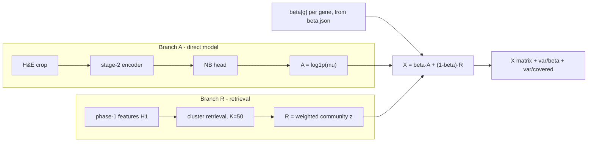
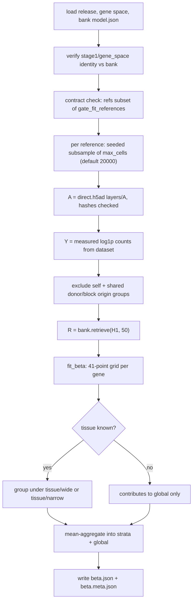
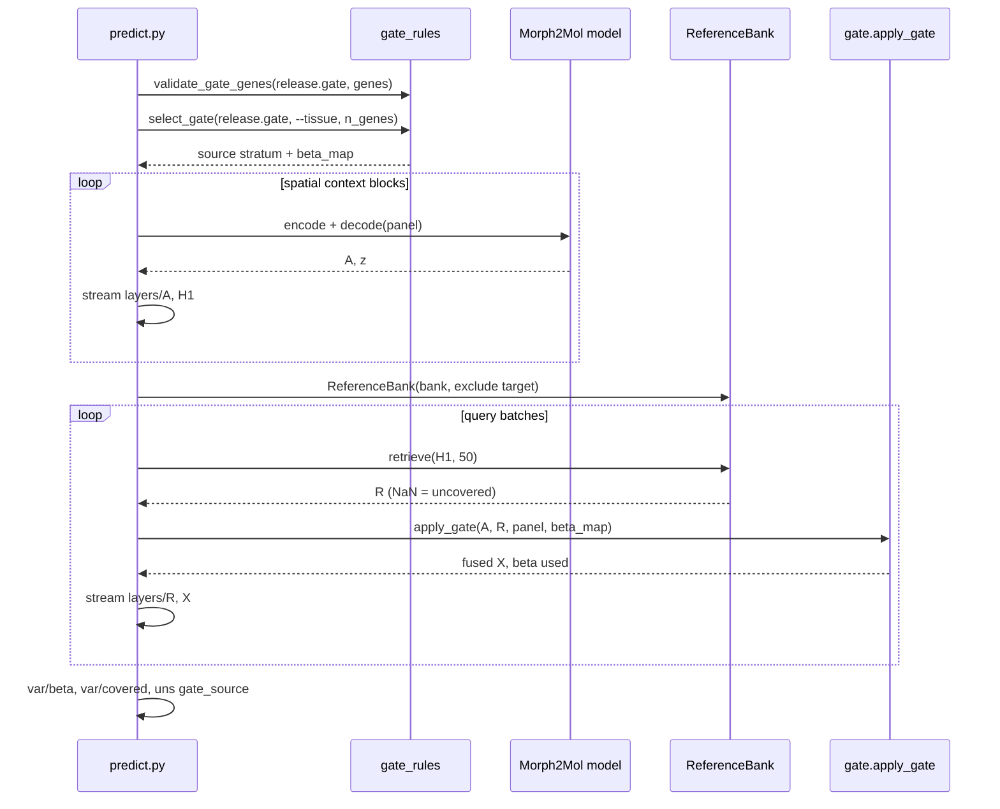

Morph2Mol never asks you to trust a single predictor. Every target cell receives two expression estimates per gene: a **direct branch** `A` produced by the trained negative-binomial head, and a **retrieved branch** `R` assembled from matched reference communities in the expression bank. The *gated fusion* layer decides, **per gene**, how much weight each branch contributes to the final `X` matrix. This page explains the fusion contract, how the gate weights are fitted on measured reference slides, how stratum-specific weights are selected at inference, and how the whole chain stays provably consistent across a release. Deep implementation detail of the retrieval call itself is covered in [Cluster Retrieval Mechanics](11-cluster-retrieval-mechanics); here `R` is treated as an input.

## The Two-Branch Fusion Contract

The fusion is a scalar convex blend, applied independently for every gene `g` and every cell:

```
X[:, g] = beta[g] · A[:, g] + (1 − beta[g]) · R[:, g]
```

The convention matters: **`beta = 1` means "direct model only"**, and `beta = 0` means "retrieval only". The two branches are not on the same scale and do not have the same coverage, which is precisely why a per-gene gate exists rather than a global mixing constant:

| Property | Branch `A` (direct) | Branch `R` (retrieved) |
|---|---|---|
| Producer | Stage-2 encoder + NB expression head | `ReferenceBank.retrieve` over community summaries |
| Scale | `log1p(mu)` | per-reference population z-score of `log1p(counts)` |
| Coverage | every panel gene, always finite | only genes present in at least one reference panel; `NaN` elsewhere |
| Failure mode | runtime error on nonfinite output | silent absence (encoded as `NaN`) |

Both scales are declared verbatim in the prediction metadata (`A_scale`, `R_scale`, `X_scale`), and the gate file itself carries a `branches` block documenting the same triple — the fusion never hides what it is combining.



Sources: [predict.py](predict/predict.py#L117-L122), [gate.py](morph2mol/gate.py#L83-L104), [fit_beta.py](train/fit_beta.py#L86-L89)

## Fitting Beta by Grid-Searched Correlation

The gate weight for each gene is fitted on **reference slides whose measured expression you are allowed to read**. The objective is deliberately simple: choose the `beta` in `[0, 1]` that maximizes the Pearson correlation between the blended prediction and the measured log1p counts, per gene. Because a correlation of a blend is smooth but **not concave** in `beta`, the implementation rejects a closed-form solution in favor of a fixed 41-point grid (`GRID = linspace(0, 1, 41)`), which is both robust and cheap at this size.

The fitting kernel in `_fit_gene_chunk` follows a precise recipe. All three arrays are column-centred first (`_centred`), the |Y| norm is precomputed once, and then each grid point evaluates `per_gene_pcc_blend`, a vectorized Pearson computation over all genes simultaneously. Two eligibility rules gate which genes are fitted at all (`_fit_eligible`): the retrieved column must be finite for every cell, and the measured labels must actually vary (constant genes carry no correlation signal). Genes that fail — most importantly genes with no retrieval coverage — are pinned to `beta = 1.0`, i.e., the direct branch stands alone.

> [!TIP]
> Ties on the correlation grid are broken toward the **larger** beta (`(p == best) &amp; (b > beta)` in the grid loop). When two blend ratios correlate identically with the measured labels, the system prefers the direct model — a quiet anti-retrieval bias that avoids handing genes to the retrieval branch without measurable benefit.

To bound temporary memory on whole-slide fits, `fit_beta` processes genes in chunks of 128, allocating only the output vectors up front and copying each chunk of `A`, `R`, `Y` before the centring pass. The returned pair is `(beta [G], pcc_at_beta [G])` — the achieved correlation is kept alongside the weight so downstream aggregation and diagnostics can inspect fit quality per gene.

| Design decision | Implementation | Rationale |
|---|---|---|
| 41-point grid, not calculus | `GRID` sweep in `_fit_gene_chunk` | correlation-of-blend objective is smooth but not concave in beta |
| Gene chunking at 128 | column slicing inside `fit_beta` | bounds peak temporary memory per slide |
| Eligibility filter | `_fit_eligible` | variance-free or never-covered genes cannot be fitted meaningfully |
| Coverage fallback | `beta[~covered] = 1.0` | genes without retrieval must not be dragged by zero-filled `R` |

Sources: [gate.py](morph2mol/gate.py#L5-L18), [gate.py](morph2mol/gate.py#L33-L63), [gate.py](morph2mol/gate.py#L66-L80)

## From Reference Slides to a Gate File

The `train/fit_beta.py` entry point orchestrates the fitting campaign and enforces the hygiene that makes the transferred weights trustworthy. Before any statistics are computed, it verifies that the bank's `checkpoint_sha256` and `gene_space_sha256` match the release, and that every requested fitting reference belongs to the **approved `gate_fit_references` split** of the training contract — gate fitting is a privilege of held-out, contract-approved slides, not an ad-hoc operation.

Each reference then goes through a leakage-controlled calibration loop:



Three details in this loop deserve attention. First, the labels `Y` are **measured log1p counts read from the dataset**, not the z-scored values the bank stores — the code comments this distinction explicitly, since silently fitting against bank `Y.npy` would optimize against the wrong scale. Second, retrieval during fitting is **leave-one-out**: `reference_exclusions` removes the sample itself *and transitively expands* any shared `donor_or_block_id` groups from the bank, so a slide is never scored against communities that include its own donor or block. Third, the direct predictions are validated to belong to the exact release checkpoints before use.

The per-reference fits are then aggregated by plain averaging of each gene's beta into a hierarchy: tissue-and-panel-width **strata** (keys like `lung/wide`) and a `global` pool. The resulting `beta.json` is a self-describing artifact whose schema the selection rules at inference time depend on:

| Key | Meaning |
|---|---|
| `version` | `"per_gene"` — gene-wise weights, not a scalar |
| `fallback` | `"same_tissue"` — stratum fallback policy |
| `tissue_casefold` | tissue names matched case-insensitively |
| `panel_cut` | gene-count threshold (1000) separating `wide` from `narrow` panels |
| `min_refs` | minimum number of references for a stratum to be eligible |
| `strata_order` | deterministic tie-break order over `tissue/width` keys |
| `strata` | `{tissue/width: {n_refs, beta}}` maps |
| `global` | `{n_refs, beta}` over all fitting references |
| `fit_signature.genes` | SHA-256 of the ordered gene list the betas were fitted against |
| `branches` | documentation of the `A`, `R`, and fusion scales |

Alongside `beta.json`, a `beta.meta.json` records the provenance needed later: the gate's own SHA-256, both checkpoint hashes, the gene-space hash, the bank `cache_fingerprint`, the retrieval settings (`K=50, tau=0.03`), the reference list with its exclusions, the calibration subsample size and seed, and the spatial-context prediction protocol.

Sources: [fit_beta.py](train/fit_beta.py#L28-L38), [fit_beta.py](train/fit_beta.py#L43-L79), [tissue.py](morph2mol/tissue.py#L43-L56), [fit_beta.py](train/fit_beta.py#L81-L99)

## Stratum Selection Rules at Inference

When a target slide arrives, the fusion weight vector is not recomputed — it is **selected** from the shipped hierarchy by `select_gate` in `gate_rules.py`. The selection dimension is a two-part key: the tissue (user-supplied via `--tissue`) and the panel width, derived automatically as `wide` when the requested gene count is at least `panel_cut` (1000) and `narrow` otherwise.

The algorithm in `select_gate_source` is a small state machine with strict validation. Only strata with `n_refs >= min_refs` are eligible. Stratum keys are parsed as `tissue/width`, and any key whose width component is not exactly `narrow` or `wide` is rejected outright. If `tissue_casefold` is set, both stratum names and the target tissue are passed through `tissue_key` (strip + casefold) before comparison, and **case-equivalent strata in the same file are treated as a refit-required error** rather than silently resolved. The target tissue itself may carry an explicit width override (`lung/wide`), which is validated and split before lookup. Resolution then proceeds by exact match on `tissue/width`, followed by the first same-tissue entry in `strata_order`, and finally the `global` pool — which is also the outcome for an unknown or omitted tissue, matching the CLI help ("omitted or unknown uses global weights").

One further guard runs before any of this: `validate_gate_genes` hashes the target's ordered gene list and compares it to `fit_signature.genes`. Because betas are stored against **integer global gene IDs**, applying them under a different gene head ordering would be a silent misalignment; the hash check turns that into a hard "refit the gate" error.

| Target request | Resolution outcome |
|---|---|
| `lung`, 4000 genes, `lung/wide` eligible | exact stratum `lung/wide` |
| `lung/wide`, 300 genes | explicit width override wins → `lung/wide` |
| `Lung`, casefold enabled | matches strata under casefolded tissue |
| `lung`, but `lung/narrow` only, width `narrow` | `lung/narrow` via `strata_order` |
| `brain`, no `brain` stratum | `global` |
| stratum with `n_refs < min_refs` | not eligible; falls through the chain |

Sources: [gate_rules.py](morph2mol/gate_rules.py#L7-L13), [gate_rules.py](morph2mol/gate_rules.py#L16-L43), [gate_rules.py](morph2mol/gate_rules.py#L46-L49), [tissue.py](morph2mol/tissue.py#L7-L8), [predict.py](predict/predict.py#L20-L20)

## Applying the Gate on a Target Slide

Fusion at inference is isolated in `apply_gate` with an explicit contract: **nothing here reads the target's labels**. The function receives the direct predictions `A`, the retrieved matrix `R` (with `NaN` marking uncovered genes), the panel of global gene IDs, and the selected `beta_by_gene` map. It assembles the per-gene beta vector by lookup with `default = 1.0`, then applies three defensive normalizations that jointly guarantee the blend degrades gracefully to the direct branch.

The ordering of these guards is load-bearing. Betas that are missing from the map, or arrive as `NaN`, become `1.0` — the inline comment explains why: a nonfinite beta let through would silently blank that gene's entire column. Next, beta values outside `[0, 1]` raise immediately, since a transferred file should never contain out-of-range weights. Finally, **wherever `R` is not fully finite, beta is forced to `1.0` before the `nan_to_num` sanitization**, so the zero-filled retrieval values can never contaminate the blend — for uncovered genes the fused output is exactly `A`.

> [!TIP]
> The `NaN` handling is an ordering constraint, not just validation: `R`'s blanks are converted to `0.0` *after* the covered-mask forces `beta = 1.0`. If the conversion ran first, an uncovered gene blended at `beta &lt; 1` would be dragged toward zero by the zero-filled retrieval values instead of cleanly falling back to the direct branch.

In `predict/predict.py`, fusion is the final phase of the streaming pipeline. The model pass runs first over spatial-context blocks, writing `layers/A` and the phase-1 features; the model and its GPU memory are then explicitly released before the retrieval bank is opened with the target itself and any `--exclude` objects removed. For each query batch, `bank.retrieve` produces `R`, `apply_gate` fuses it into `X`, and both are streamed to disk. The gate leaves an auditable trace in the output file:

| Output artifact | Content |
|---|---|
| `X` (top-level matrix) | fused predictions, declared as `beta*A+(1-beta)*R; per-gene scores, not counts` |
| `layers/A` | direct branch, kept for inspection |
| `layers/R` | raw retrieved branch, kept for inspection |
| `var['beta']` | the beta actually applied per output gene (all ones in `--reference` mode) |
| `var['covered']` | which genes had any retrieval coverage |
| `uns['morph2mol'].gate_source` | the resolved stratum key, e.g. `lung/wide` or `global` |



Sources: [gate.py](morph2mol/gate.py#L83-L104), [predict.py](predict/predict.py#L108-L112), [predict.py](predict/predict.py#L175-L193)

## Provenance and Integrity of a Shipped Gate

A gate file is only meaningful for one exact combination of checkpoints, gene space, and bank. The release loader turns that statement into mechanical verification: on construction with retrieval enabled, `Release` reads `beta.json` and `beta.meta.json` and cross-checks seven identities before any prediction is allowed. Any mismatch aborts with "Model checkpoints, genes, reference bank and fusion weights do not match" — including the subtle case where the gate was fitted under different retrieval settings (`K`, `tau`) than the shipped bank uses.

| Integrity check | Gate-side value | Compared against |
|---|---|---|
| gate file hash | `gate_meta['gate_sha256']` | SHA-256 of shipped `beta.json` |
| alignment checkpoint | `gate_meta['checkpoint_sha256']` | release `stage1` hash |
| expression checkpoint | `gate_meta['stage2_checkpoint_sha256']` | release `stage2` hash |
| gene space | `gate_meta['gene_space_sha256']` | release `gene_space` hash |
| bank identity | `gate_meta['cache_fingerprint']` | bank `cache_fingerprint` |
| retrieval settings | `gate_meta['K']`, `gate_meta['tau']` | bank `retrieval_K`, `tau` |
| gene head ordering | `fit_signature.genes` | SHA-256 of target gene list at predict time |

Packaging enforces the pairing at export time too: `export_release.py` refuses to ship a bank without a gate or vice versa ("Supply both --bank and --beta"), copies both `beta.json` and its `.meta.json` into the release, and registers the gate path in `release.json`. The result is a release in which fusion weights cannot drift away from the model, the bank, or the gene head — and a per-slide, per-gene audit trail in every prediction output.

Sources: [release.py](morph2mol/release.py#L27-L45), [export_release.py](train/export_release.py#L50-L55), [predict.py](predict/predict.py#L117-L122)

## Where to Go Next

The gate is the last hop of the retrieval-augmented path. To understand where `R` comes from — cluster keys, temperature-weighted community blending, and coverage semantics — read [Cluster Retrieval Mechanics](11-cluster-retrieval-mechanics), and see how those per-slide artifacts are produced in [Reference Bank Construction](10-reference-bank-construction). The `A` branch's training story, including the gene head the `fit_signature` protects, is covered in [Stage 2 Expression Training](15-stage-2-expression-training) and packaged end-to-end in [Model Export and Release Packaging](17-model-export-and-release-packaging). For how to interpret `var['beta']` and `var['covered']` in a real prediction file, see [Reading Prediction Outputs](4-reading-prediction-outputs).