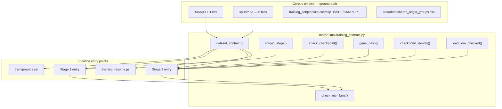
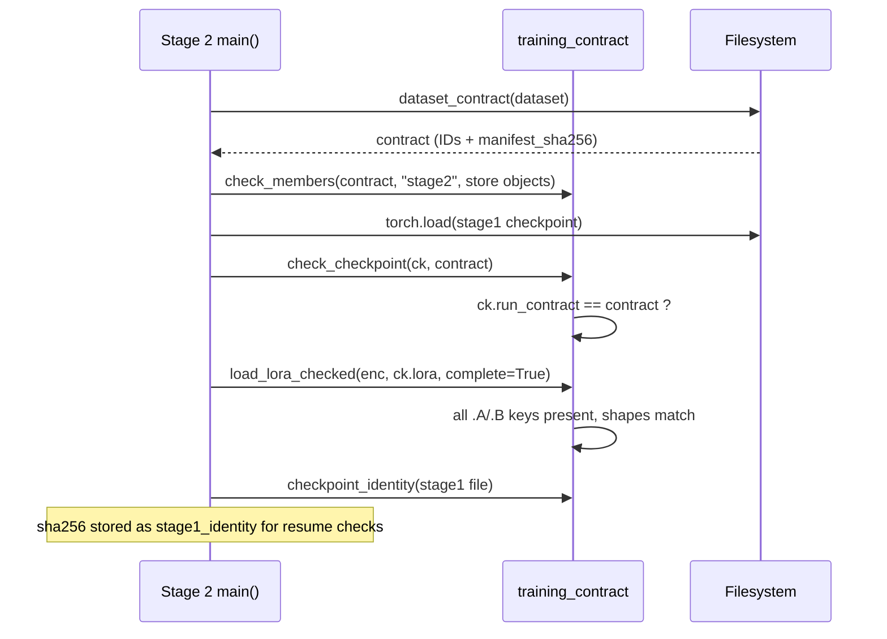

Training in Morph2Mol runs over expensive distributed jobs on large corpora, so the pipeline treats its input data as a formal contract rather than a loose convention. This page explains the *contract layer*: the corpus layout, the split topology, the per-slide and per-cell file guarantees, the gene-space rules, and the identity artifacts that bind checkpoints, caches, and resumes to exactly the data they were built from. The authoritative implementation is `morph2mol/training_contract.py`, a dependency-free module of pure validation functions that every training entry point imports before touching data. Training mechanics themselves — what the loss optimizes or how batches are scheduled — are covered in [Stage 1 Contrastive Alignment](14-stage-1-contrastive-alignment) and [Stage 2 Expression Training](15-stage-2-expression-training); this page stays strictly on the *data rules* those stages enforce.

## The Contract Kernel and Its Enforcement Layers

The design separates **contract definition** (what valid data looks like) from **contract enforcement** (where it is checked). The kernel module contains no PyTorch or training logic — only `Path`, `hashlib`, and `json` — which makes it importable from preparation scripts, both training stages, and the resume layer without coupling any of them. Each stage re-derives the contract from disk at startup rather than trusting a stored copy, and checkpoints that claim to be trained on a corpus embed the full contract dict verbatim for later comparison.



Sources: [training_contract.py](morph2mol/training_contract.py#L1-L78), [stage1.py](morph2mol/training/stage1.py#L136-L137), [stage2.py](morph2mol/training/stage2.py#L113-L114), [prepare.py](train/prepare.py#L18-L21)

## Corpus Layout and Split Topology

A valid corpus is a directory with a `MANIFEST.csv` at its root, one subdirectory per split (`training_set/{xenium,cosmx}/TISSUE/SAMPLE` and `cross_slide_test_set/...`), a `splits/` folder of six text files, and an optional `metadata/shared_origin_groups.csv` for donor/block grouping. Each split file holds one globally unique sample name per line; blank lines are skipped and `#` lines are treated as comments. Reading a split file that contains a duplicate name is an immediate error — identity is enforced at the text level before any set logic runs.

```text
corpus/
  MANIFEST.csv
  training_set/{xenium,cosmx}/TISSUE/SAMPLE/...
  cross_slide_test_set/{xenium,cosmx}/TISSUE/SAMPLE/...
  splits/
    training_set.txt
    inslide_test_set.txt
    cross_slide_test_set.txt
    stage2_global_training.txt
    retrieval_references.txt
    gate_fit_references.txt
  metadata/shared_origin_groups.csv
```

Sources: [docs/training.md](docs/training.md#L17-L30), [training_contract.py](morph2mol/training_contract.py#L7-L11)

The six split files are not independent lists — they are bound by a set algebra that `dataset_contract()` evaluates on every run. Four invariants must hold simultaneously, and a violation of any one aborts startup with a single `Invalid Stage1/Stage2/test split` error:

| Invariant | Set expression | Why it exists |
| --- | --- | --- |
| In-slide holdout nesting | `inslide_test_set ⊆ training_set` | Held-out cells live *inside* training slides, so their slides must appear in the training split |
| Cross-slide disjointness | `training_set ∩ cross_slide_test_set = ∅` | Cross-slide generalization requires fully unseen slides |
| Stage-2 derivation | `stage2_global_training = training_set − inslide_test_set` | Expression training excludes in-slide test cells; the set is *exact*, not approximate |
| Reference-set equality | `retrieval_references = gate_fit_references = stage2_global_training` | Both downstream reference sets must match Stage-2 training and exclude all test objects |

Beyond the ID lists, `dataset_contract()` hashes the raw bytes of `MANIFEST.csv` into `manifest_sha256`, and resolves the dataset root to an absolute path. The returned dict — six ID lists, the resolved root, and the manifest hash — becomes the canonical `contract` object threaded through every later check. Because Stage 1 writes this dict verbatim into checkpoints as `run_contract`, any later comparison of `run_contract` against a freshly derived contract transitively pins the sample sets *and* the manifest bytes.

> [!TIP]
> The four invariants are **interdependent equations**, not independent rules: adding one sample to `inslide_test_set.txt` silently reshapes `stage2_global_training`, `retrieval_references`, and `gate_fit_references` in the same run. Enforcement happens at training start, not at corpus preparation time — so validate your splits with `dataset_contract()` before committing to an expensive multi-day run.

Sources: [training_contract.py](morph2mol/training_contract.py#L14-L28), [docs/training.md](docs/training.md#L32-L34)

```mermaid
graph LR
    TR["training_set<br/>(image–RNA alignment)"] -- "superset" --> IT["inslide_test_set<br/>(held-out cells within training slides)"]
    TR -- "training − inslide" ==> S2["stage2_global_training<br/>(expression training)"]
    S2 == "exact equality" ==> RR["retrieval_references"]
    S2 == "exact equality" ==> GR["gate_fit_references"]
    CT["cross_slide_test_set"] -. "disjoint from training_set" .- TR
```

## Object Identity: Resolving a Sample Name

Sample names in split files are logical identifiers; the corpus resolves them to directories through `object_directory()` in `morph2mol/tissue.py`. Resolution globs the pattern `*/*/*/{sample}` under the corpus root — that is `{split_root}/{platform}/{tissue}/{sample}` — and rejects anything under a directory containing `rawdata`. Two uniqueness conditions must hold: the resolved absolute paths must collapse to exactly one, and the tissue-level parent directory name (compared case-insensitively) must be unique across all matches. When a sample physically exists under both `training_set/` and another split root, the `training_set/` copy is preferred.

> [!TIP]
> The `training_set` preference combined with the *cross-root* ambiguity check means sample names must be globally unique across the entire corpus — not just within one split file. A name reused under different platforms or tissue directories fails with `ambiguous corpus objects`, because path resolution cannot disambiguate which slide a split line refers to.

The same module defines two auxiliary contracts used downstream. `read_tissue_map()` validates the organ-annotation CSV: it must contain `sample` and `tissue` columns, samples must be non-empty and unique, and organ names must match `[a-z][a-z0-9_]*` after casefolding. `reference_exclusions()` reads `metadata/shared_origin_groups.csv` (rows of `field=donor_or_block_id`, semicolon-separated `samples`) and computes the *transitive closure* of excluded samples starting from a query reference — so if blocks A and B share a donor, fitting fusion weights for A also excludes B, and anything else grouped with B.

Sources: [tissue.py](morph2mol/tissue.py#L11-L19), [tissue.py](morph2mol/tissue.py#L22-L37), [tissue.py](morph2mol/tissue.py#L43-L56)

## The Prepared-Slide File Contract

Every sample directory in the corpus must follow the prepared-slide format. Three of these files are load-bearing for training: `dataset.json` pins geometry, `manifest.csv.gz` maps expression rows to crop paths, and `expression.npz` + `genes.tsv` define the count matrix and its gene order. `train/prepare.py` re-validates the geometry contract per object: `patch_size` must be exactly `224` (pixels) and `patch_size_um` exactly `55` (µm), fixing `um_per_px` at 55/224 throughout the pipeline.

| File | Required contract | Verified by |
| --- | --- | --- |
| `dataset.json` | `patch_size = 224`, `patch_size_um = 55`, plus `um_per_pixel_source` | `prepare.py`, Stage 2 `LiveStore` |
| `manifest.csv.gz` | CSV with `expr_row`, `patch_path` columns; paths relative to the slide directory | `cells_of()`, `load_slide_npz()` |
| `patch_cell_boundaries.npz` | `expr_rows` [N], `indptr` [N+1], `vertex_x_patch`/`vertex_y_patch`, `y_pixel`/`x_pixel`, scalar `output_size` | `cells_of()`, `load_slide_npz()` |
| `expression.npz` | SciPy CSR raw counts, rows matching expression-row space | `training_slides()`, `LiveStore` |
| `genes.tsv` | Tab-separated, header + gene symbols in first column | `prepare.py`, `LiveStore` |

Protein, control, and non-gene channels must be filtered out *before* corpus preparation — the contract layer trusts that what remains in `genes.tsv` are RNA gene symbols. The optional `cells.npz` fields documented for prediction inputs (centroids, polygons, optional `mpp`) are the upstream source format; training consumes only the prepared derivatives above.

Sources: [docs/formats.md](docs/formats.md#L17-L39), [prepare.py](train/prepare.py#L27-L33), [docs/training.md](docs/training.md#L32-L34)

## Cell-Level Input Guarantees

Two functions translate the per-slide files into training-ready cell records, and both guarantee the same three invariants: every expression row has exactly one crop path, every cell has a normalized 16×16 mask, and cell ordering follows boundary-row order. `load_slide_npz()` (Stage 1) and `cells_of()` (Stage 2) rasterize each polygon into a 224×224 binary image via `output_size`, then area-pool it into a 16×16 float mask by block averaging — which requires `output_size` to be divisible by 16. Polygons with fewer than three vertices rasterize to empty; rather than dropping the cell, the mask falls back to a single central token (`w[8,8] = 1.0`), then the whole mask is divided by its sum so it is always a probability distribution.

The crop-path lookup itself is a contract: `manifest.csv.gz` is deduplicated on `expr_row` and indexed, and any boundary row whose `expr_row` lacks a manifest entry would raise a `KeyError` at data-build time — the "every boundary row must have a crop" rule is enforced implicitly by construction. In Stage 2, `LiveStore` additionally converts `y_pixel`/`x_pixel` centroids to microns using the slide's own `um_per_pixel_source` from `dataset.json`, so spatial distances in the decoder are physically meaningful regardless of the scanner's native resolution.

Sources: [contrastive.py](morph2mol/training/contrastive.py#L50-L64), [cell_inputs.py](morph2mol/training/cell_inputs.py#L5-L26), [stage2.py](morph2mol/training/stage2.py#L40-L41)

## Gene Space: The Global Gene Contract

The gene axis has its own contract chain. `train/prepare.py` consumes a gene-embedding NPZ (ordered symbols `genes` + float32 `emb` [G, 512]) and validates it structurally: 2-D, 512 columns, one row per symbol, all symbols unique, all values finite. It then walks every object in `training_set ∪ cross_slide_test_set`, reads each slide's `genes.tsv` symbols, and emits three artifacts into `work/direct/`:

| Artifact | Contents | Downstream consumer |
| --- | --- | --- |
| `gene_space_all.npz` | `genes`, `gene_emb`, per-object `objects`/`platform`/`split` arrays, boolean `panel_mask` [objects × G], `um_per_px = 55/224` | Stage 2, release export |
| `gene_space_xen.npz` | Gene subset measured on Xenium **training** slides only | Xenium-constrained export |
| `gene_emb_scgpt.npz` | `genes` + `emb`, verbatim from the input table | Stage 2 expression head |

The Xenium subset rule is a one-way door: symbols accumulate only from training-split slides with `platform == 0`, so held-out slides never widen the exported gene space — matching the documented rule that the gene list is the sorted union of *training-split* genes and held-out slides contribute none. Within Stage 2, each `LiveStore` maps its slide's `genes.tsv` columns onto the global gene space via a first-occurrence-wins rule (duplicated symbols within a slide are silently collapsed to the first column), producing `head_idx` — the contract that targets written into the loss use a consistent global gene ordering.

Identity on this axis is a hash: `gene_hash()` computes the SHA-256 of the JSON-serialized ordered gene list, and `check_checkpoint()` rejects any Stage-2 initialization whose stored `gene_head_sha256` differs from the current run's genes — reordering or re-subsetting the gene space invalidates every existing checkpoint.

Sources: [prepare.py](train/prepare.py#L21-L43), [stage2.py](morph2mol/training/stage2.py#L52-L66), [training_contract.py](morph2mol/training_contract.py#L39-L40), [docs/training.md](docs/training.md#L47-L56)

## Runtime Enforcement at Training Entry

Both training stages run the same three-step verification sequence before building any tensors: derive the contract from disk, resolve the physical sample directories, and compare the resolved membership against the contract with exact set equality. `check_members()` distinguishes the two stages by key — Stage 1 checks against `training_set`, Stage 2 against `stage2_global_training` — and its error message enumerates the *missing* and *extra* samples, which makes split-file drift immediately diagnosable. Stage 1 resolves slides by walking `training_set/{xenium,cosmx}/*/*` on disk and requires a 512-dimensional scGPT embedding file per slide whose row count equals the slide's `expression.npz` row count; Stage 2 iterates the contract's own ID list through `object_directory()` and then re-checks membership as a guard against resolution drift.

| Stage | Check | Enforcement site | Failure signal |
| --- | --- | --- | --- |
| Stage 1 | Embedding file exists, 2-D, width 512 | `target_path()` | `Missing scGPT embeddings` / `expected 512-dimensional` |
| Stage 1 | Embedding rows == expression rows | `target_path()` | `not aligned with expression rows` |
| Stage 1 | Resolved slides == `training_set`, no duplicates | `check_members()` | missing/extra sample lists |
| Stage 1 | ≥ 1 full optimizer batch; positive budget | `stage1_steps()` | `No full optimizer batch` |
| Stage 1 | Supervised cells == dataset size, exactly once per epoch | epoch-end all-reduce | `did not cover every usable cell exactly once` |
| Stage 2 | Resolved stores == `stage2_global_training` | `check_members()` | missing/extra sample lists |
| Stage 2 | Stage-1 ckpt: completed 3 epochs, scGPT target | inline in `main()` | `Initialize ... with a completed ... Stage-1 checkpoint` |
| Stage 2 | `gene_space_all` genes == `gene_emb_scgpt` genes | array equality | `gene embeddings and output gene order differ` |

The Stage-1 usable-cell rule deserves note: during cache building, cells whose embedding rows have zero magnitude are dropped, and every downstream budget — `stage1_steps()`, the coverage check, `data_identity` — is computed against the *filtered* count. A silent embedding-quality problem therefore surfaces as a smaller-than-expected corpus rather than a NaN deep in training. The final Stage-1 safety net is exact per-epoch coverage: after each epoch, ranks all-reduce their supervised counts and the run aborts if the total is not exactly one pass over the usable dataset.

Sources: [stage1.py](morph2mol/training/stage1.py#L19-L41), [stage1.py](morph2mol/training/stage1.py#L44-L63), [stage1.py](morph2mol/training/stage1.py#L162-L163), [stage1.py](morph2mol/training/stage1.py#L206-L209), [stage2.py](morph2mol/training/stage2.py#L113-L137), [stage2.py](morph2mol/training/stage2.py#L154-L156), [training_contract.py](morph2mol/training_contract.py#L52-L58)

## Checkpoint Binding: The Identity Chain

Checkpoints are not just weights — they are notarized snapshots of the contract state under which they were produced. Stage 1's `saved_state()` embeds the full `run_contract`, an `init_hash` (a 16-hex digest over all trainable adapter and tower tensors at initialization), the DDP `world_size`, the `data_identity` dict, the coverage cursor, and per-rank RNG states. Stage 2 then chains three verifications against a Stage-1 checkpoint: `check_checkpoint()` compares the embedded `run_contract` with the freshly derived contract; `load_lora_checked(enc, ck['lora'], complete=True)` requires the LoRA key set to be *exactly* all parameters ending in `.A`/`.B` with matching shapes; and `checkpoint_identity()` hashes the Stage-1 file itself into `stage1_identity['sha256']`, which Stage 2 stores in its own checkpoints and later resume checks compare byte-for-byte.



The resume layer extends the same discipline to *recipe* reproducibility: `check_stage1_resume()` and `check_stage2_resume()` compare every key in fixed recipe lists (`STAGE1_RECIPE`, `STAGE2_RECIPE` — learning rates, LoRA geometry, epochs, seeds, coverage parameters) between the checkpoint's stored args and the current invocation, alongside contract equality, world-size equality, data identity, and cursor consistency. A resume is only accepted when the corpus, the data order, the initialization, and the hyperparameters are all provably unchanged.

| Identity artifact | Computed from | Bound by |
| --- | --- | --- |
| `manifest_sha256` | Raw bytes of `MANIFEST.csv` | Inside `run_contract`, compared in `check_checkpoint()` |
| `run_contract` | Six split sets + resolved root + manifest hash | Written into every Stage-1 checkpoint |
| `data_identity` | Cell count, object order, cache metadata hash | Stage-1 resume equality |
| `init_hash` | Initial adapter + tower tensor bytes | Stage-1 resume equality |
| `gene_head_sha256` | `gene_hash(ordered gene list)` | Stage-2 init and resume |
| `stage1_identity.sha256` | Bytes of the Stage-1 checkpoint file | Stage-2 run and resume |
| Cache `signature` | File stamps / array digests | Stale-cache rejection (see below) |

Sources: [stage1.py](morph2mol/training/stage1.py#L145-L176), [training_contract.py](morph2mol/training_contract.py#L43-L78), [stage2.py](morph2mol/training/stage2.py#L144-L164), [training_resume.py](morph2mol/training_resume.py#L99-L153)

## Consistency Signatures for Derived Arrays

Training never re-reads raw PNGs for repeated runs; instead it caches derived arrays (Stage-1 crop paths, masks, embedding targets; Stage-2 mask and target matrices) under signatures computed from the sources. `file_stamp()` captures a source file's resolved path, size, and nanosecond mtime; `array_stamp()` SHA-256s an index array's bytes; `cached_arrays()` publishes arrays atomically under a write lock and stores the signature in `metadata.json` *last*. A cache whose stored signature differs from the freshly computed one is rejected outright — the contract layer refuses to silently reuse arrays derived from changed inputs rather than rebuilding them. The full mechanics of resume cursors and cache sharing belong to [Resume, Caching, and Reproducibility](16-resume-caching-and-reproducibility); from the contract perspective, the important point is that every cached artifact carries a verifiable provenance signature, and Stage-1's `stage1_data_identity()` folds those cache signatures into the checkpoint's identity chain.

Sources: [training_cache.py](morph2mol/training_cache.py#L10-L49), [training_resume.py](morph2mol/training_resume.py#L85-L96), [stage1.py](morph2mol/training/stage1.py#L44-L63)

## Common Failure Modes

Because every check fails fast with an explicit message, most contract violations are diagnosable from the error text alone. The table below maps the most frequent operator mistakes to their enforcement sites:

| Symptom (error message) | Root cause | Fix |
| --- | --- | --- |
| `Duplicate samples: {path}` | A sample listed twice in a split file | De-duplicate the split file; duplicates are never merged |
| `Invalid Stage1/Stage2/test split` | One of the four set invariants broken | Re-derive `stage2_global_training` / reference lists from the other splits |
| `{key} must match Stage-2 training and exclude all test objects` | `retrieval_references` or `gate_fit_references` drifted from `stage2_global_training` | Regenerate both reference lists to equal the Stage-2 set |
| `{sample}: ambiguous corpus objects` | Sample name reused across platforms/tissues, or present in multiple split roots | Enforce globally unique sample names in the corpus |
| `Checkpoint training split differs from the current corpus` | Corpus or `MANIFEST.csv` changed since the checkpoint was written | Re-derive and confirm the split sets; retrain or restore the original corpus |
| `Checkpoint gene-head order differs from this run` | Gene space reordered or re-subsetted after the checkpoint | Regenerate `gene_emb_scgpt.npz`/gene table in the original order |
| `Stale training cache: {root}` | Source files changed under an existing cache directory | Point at a fresh cache directory; never edit sources in place mid-run |
| `Stage-1 data order/cache identity changed` | Object order or cached-array content differs on resume | Resume with identical corpus state and cache contents |

Sources: [training_contract.py](morph2mol/training_contract.py#L7-L65), [tissue.py](morph2mol/tissue.py#L11-L19), [training_cache.py](morph2mol/training_cache.py#L20-L37), [training_resume.py](morph2mol/training_resume.py#L106-L128)

## Where to Go Next

The contract layer is the entry gate to the rest of the training pipeline. To see what happens after these checks pass — the symmetric contrastive alignment itself — continue to [Stage 1 Contrastive Alignment](14-stage-1-contrastive-alignment); for the spatial decoder and negative-binomial training that consumes the Stage-2 set, see [Stage 2 Expression Training](15-stage-2-expression-training). The signature mechanics summarized above are expanded in [Resume, Caching, and Reproducibility](16-resume-caching-and-reproducibility), and the downstream consumers of the reference split files are covered in [Reference Bank Construction](10-reference-bank-construction) and [Model Export and Release Packaging](17-model-export-and-release-packaging).