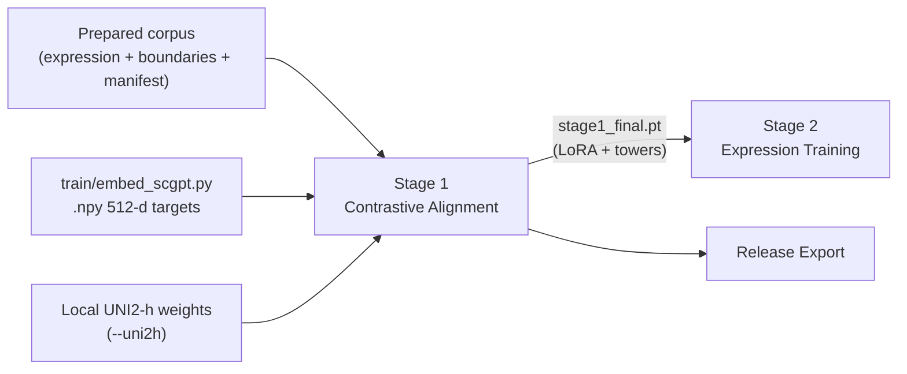
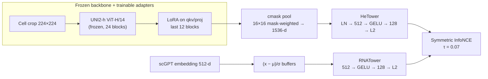
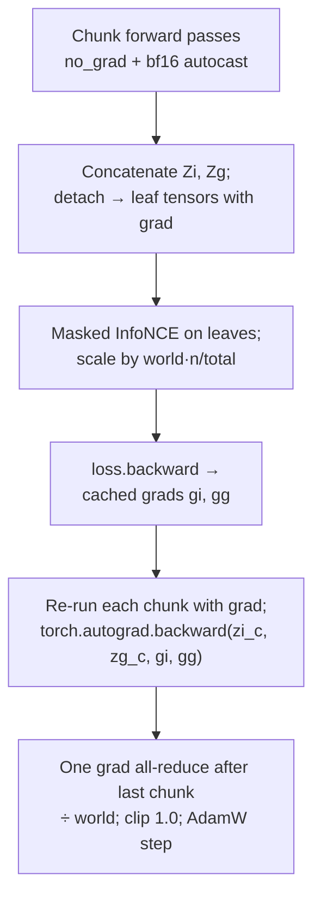

Stage 1 is the first trainable phase of the Morph2Mol-25M pipeline: it teaches a frozen UNI2-h vision encoder — augmented with low-rank LoRA adapters — to place each cell's morphology in the same 128-dimensional space as that cell's precomputed scGPT RNA embedding. The stage runs a fixed three-epoch recipe with a symmetric InfoNCE objective at temperature 0.07, produces `checkpoints/alignment/stage1_final.pt`, and hands its adapted encoder weights to Stage 2 expression training. This page explains the data construction, the objective, the gradient-caching optimization strategy, the exactly-once coverage guarantee, and the resume machinery that make the stage reproducible. It assumes familiarity with the corpus layout described in [Training Data Contracts](13-training-data-contracts) and with the two towers' backends: the [Image Encoder and LoRA Adapters](6-image-encoder-and-lora-adapters) and the [scGPT RNA Embedding Backend](9-scgpt-rna-embedding-backend).

Sources: [stage1.py](morph2mol/training/stage1.py#L1), [recipe.py](morph2mol/recipe.py#L11-L19), [docs/training.md](docs/training.md#L58-L76)

## Position in the Training Pipeline

Stage 1 consumes two inputs produced by earlier steps. The first is the prepared corpus — `training_set/{xenium,cosmx}/...` directories with `expression.npz`, `patch_cell_boundaries.npz`, and `manifest.csv.gz` per sample, validated against split files. The second is the per-sample scGPT embedding file: `train/embed_scgpt.py` runs the frozen whole-human scGPT model over every cell in `expression.npz` row order and writes `<sample>.npy` — 512-dimensional, L2-normalized, float16 cell features. Stage 1 never sees raw expression; it aligns morphology to these targets. Its output checkpoint is later consumed by Stage 2 (via `--stage1`) and by release export, as covered in [Stage 2 Expression Training](15-stage-2-expression-training) and [Model Export and Release Packaging](17-model-export-and-release-packaging).



Sources: [docs/training.md](docs/training.md#L36-L84), [embed_scgpt.py](train/embed_scgpt.py#L85-L90), [stage1.py](morph2mol/training/stage1.py#L214-L219)

## The Alignment Architecture

The stage trains three movable parts against a frozen backbone. The **image pathway** loads UNI2-h (ViT-H/14, 24 blocks, 1536-dim features, register tokens, SwiGLU MLP) strictly from a local state dict, freezes all parameters, then injects LoRA into the `qkv` and `proj` projections of the last 12 blocks with rank 16, alpha 32, and dropout 0.05. Features from the 256 patch tokens are reshaped into a 16×16 grid and pooled with the cell's mask weights (the "cmask pool") into a single 1536-dim vector, so the representation describes exactly the cell polygon rather than the whole crop. The **image tower** (`HeTower`) then maps this through LayerNorm → Linear(1536→512) → GELU → Linear(512→128) followed by L2 normalization. The **RNA tower** (`RNATower`) standardizes the 512-dim scGPT embedding with fixed running buffers (μ, σ) and applies the mirrored MLP Linear(512→512) → GELU → Linear(512→128) → L2 normalize. Both towers project into a shared 128-dim unit sphere where contrastive similarity is computed.



| Component | Parameterization | Trainable | Role |
| --- | --- | --- | --- |
| UNI2-h backbone | ViT-H/14, 1536-d, 24 blocks | No | Visual feature extraction |
| LoRA adapters | 12 blocks, r=16, α=32, dropout 0.05 | Yes (lr 1.5e-4) | Task-adapt attention layers |
| HeTower | LN(1536) → 512 → GELU → 128 → L2 | Yes (lr 1e-3) | Image projection head |
| RNATower | (x−μ)/σ → 512 → GELU → 128 → L2 | Yes (lr 1e-3) | RNA projection head |

Sources: [encoder.py](morph2mol/encoder.py#L9-L40), [contrastive.py](morph2mol/training/contrastive.py#L14-L22), [stage1.py](morph2mol/training/stage1.py#L139-L144), [recipe.py](morph2mol/recipe.py#L11-L19)

## Building the Training Tensors

Before any GPU work, the stage assembles three logically concatenated arrays — crop paths, 16×16 mask weights, and RNA targets — one entry per usable cell. Validation precedes construction: `dataset_contract` reads the split files and enforces the invariants (in-slide test ⊆ training, training ∩ cross-slide = ∅, stage-2 set = training − in-slide test), then `training_slides` scans `training_set/{xenium,cosmx}` in sorted order, requires a matching `<sample>.npy` embedding file with 512 columns whose row count equals the `expression.npz` row count, and asserts the discovered sample set is exactly the approved `training_set` split via `check_members`. The contract — including a SHA-256 of `MANIFEST.csv` — is stored in every checkpoint written by the run.

Per-sample caching follows in `build_data`. For each slide, `load_slide_npz` reads `patch_cell_boundaries.rasterizes each cell polygon into a 16×16 float32 weight map by area-pooling the rasterized polygon over each 14-pixel token (any cell with fewer than 3 vertices or a vanishing mask falls back to its central token), while `manifest.csv.gz` supplies each expression row's crop path. Embedding rows are gathered by expression row index, cast to float16, and **cells whose target vector is all-zero are dropped** — a cell with an empty scGPT embedding cannot supervise contrastive learning. The three arrays are written under `work_dir/cache/stage1/<sample>` through `cached_arrays`, which takes an exclusive file lock, keys the cache on a signature of source-file stamps (resolved path, size, mtime) plus fixed seed/schema constants, publishes `metadata.json` last, and later memory-maps the completed arrays. `JoinedArrays` then presents all slides as one read-only logical concatenation so statistics and indexing span the corpus without materializing it.

Sources: [training_contract.py](morph2morph/training_contract.py#L14-L36), [stage1.py](morph2mol/training/stage1.py#L19-L63), [contrastive.py](morph2mol/training/contrastive.py#L50-L64), [training_cache.py](morph2mol/training_cache.py#L10-L73)

> [!TIP]
> The cache signature uses file *stamps* (path + size + mtime), not content hashes — regenerating an embedding `.npy` in place invalidates the cache correctly, but editing a file while preserving mtime would not. When in doubt, delete `work_dir/cache/stage1` rather than trusting a stale cache; `cached_arrays` deliberately refuses mismatched signatures instead of silently rebuilding.

## The Objective: Symmetric InfoNCE at τ = 0.07

The loss is the CLIP-style symmetric cross-entropy. Similarity logits are `zi @ zg.T / TEMP` with `TEMP = 0.07`, labels are the identity permutation, and the loss averages the image-to-RNA and RNA-to-image directions: `0.5 * (CE(logits, lab) + CE(logits.t(), lab))`. With an effective batch of 2,048 cells per rank, each cell discriminates itself against 2,047 in-batch negatives — this is why the stage aggregates to such a large batch before stepping.

Normalization of the RNA targets happens once, before training: `rna_stats` streams the concatenated float16 embedding array in 200,000-row chunks, accumulating sums and sums-of-squares in float64 to produce per-dimension μ and σ (with variance floored at zero and σ clamped by 1e-6). These become non-trainable buffers inside `RNATower`, so a resumed run reconstructs identical normalization from data alone. On the image side, `he_embed` chains normalization by ImageNet MEAN/STD, the LoRA-adapted encoder, mask-weighted pooling, and the `HeTower` — the single function invoked identically in training and (later, for bank construction) inference, which keeps the two feature spaces consistent.

Sources: [contrastive.py](morph2mol/training/contrastive.py#L11-L48), [stage1.py](morph2mol/training/stage1.py#L142-L144)

## Augmentation and Batching

Every `__getitem__` passes through two wrappers. `CLIPDS` loads the crop PNG, converts to RGB, resizes bilinearly to 224×224, and returns the CHW uint8 image, its float32 mask, and the float32 RNA target. `D4Wrap` then samples a uniform orientation from the eight-element dihedral group — one of four right-angle rotations, optionally combined with a horizontal flip — and applies the *same* transform to the crop and its mask, so mask pooling stays geometrically consistent with the image. Determinism is anchored by a fixed seed: `torch.manual_seed(1)` at startup and a dedicated `torch.Generator(manual_seed(1))` feeding the DataLoader, which is what later makes mid-epoch resume bit-reproducible.

The sampler is a custom `ResumeTailSampler` extending `DistributedSampler`. Because the global cell count rarely divides evenly by `world_size`, distributed sharding pads some ranks; the sampler emits `(index, valid)` pairs where `valid = slot*num_replicas + rank < len(dataset)`, and `TailDataset` appends that flag to each sample. Supervision — the loss mask, the seen-cell counters, and the epoch-end assertion — operates strictly on `valid` rows, so padding slots are never trained on and **every usable cell contributes exactly once per epoch**. At each epoch boundary the ranks all-reduce their per-rank `seen` counts and the run raises `ValueError` unless the sum equals `len(dataset)` exactly; a hard coverage check, not a heuristic.

Sources: [contrastive.py](morph2mol/training/contrastive.py#L24-L33), [stage1.py](morph2mol/training/stage1.py#L66-L82), [clip_coverage.py](morph2mol/clip_coverage.py#L6-L31), [stage1.py](morph2mol/training/stage1.py#L178-L211)

## Gradient-Cached Optimization at Effective Batch 2,048

The central engineering constraint: the InfoNCE matrix needs all 2,048 embeddings in memory to form logits, but backpropagating through 2,048 concurrent UNI2-h forward passes would not fit. `gradcache_step_ddp` solves this with the classic gradient-cache decomposition, executed once per accumulation window (the DataLoader yields `accumulation = 2048 // chunk` micro-batches, chunk defaulting to 256):



Three details deserve attention. First, DDP ranks can hold different numbers of *valid* cells (the tail problem), so a rank with few supervised cells would otherwise dominate the gradient; the loss is rescaled by `world * n / total` (with `total` all-reduced) so the step direction equals the gradient of the global masked mean regardless of rank imbalance. A rank with zero valid cells computes a zero-grad placeholder `(zi.sum()+zg.sum())*0` to stay gradient-flow-connected. Second, parameter-gradient synchronization is deliberately deferred: **one all-reduce after the final chunk** rather than per-chunk DDP hooks, cutting communication volume by the accumulation factor. Third, optimization uses AdamW with two parameter groups — LoRA adapters at lr 1.5e-4 and both towers at lr 1e-3, shared weight decay 0.01 — with linear warmup over the first 150 steps (`min(1, (step+1)/150)` applied to each group's stored `base_lr`), and global gradient-norm clipping at 1.0 before every step.

Sources: [stage1.py](morph2mol/training/stage1.py#L85-L117), [stage1.py](morph2mol/training/stage1.py#L152-L161), [stage1.py](morph2mol/training/stage1.py#L193-L197)

> [!TIP]
> The recompute phase re-runs each chunk *with* autocast and casts outputs to `.float()` before `torch.autograd.backward`, so cached gradients computed against float32 leaf copies are injected into bf16-computed graphs through the float cast boundary. If you adapt this pattern, keep that explicit cast — backward through mismatched dtypes silently produces wrong scales otherwise.

## Fixed Recipe and Step Budget

Stage settings live in `recipe.py` and are **immutable at runtime**: `stage1_settings` raises `TypeError` if any caller attempts to override a recipe key, accepting only runtime arguments (paths, workers, chunk, checkpoint frequency, resume). The total optimizer step count is computed from data shape, not configured: `stage1_steps(cells, epochs=3, world, chunk, accumulation)` sets `per_epoch = ceil(cells / (world·chunk·accumulation))` and returns `3 × per_epoch`, guaranteeing the loop trains at least one full optimizer batch per epoch and terminates after exactly three epochs regardless of corpus size. The recipe key set is also mirrored into `STAGE1_RECIPE` for resume validation, so a checkpoint can never be continued under silently changed hyperparameters.

| Recipe key | Value | Meaning |
| --- | --- | --- |
| `epochs` | 3 | Fixed three-epoch schedule |
| `loss` / `target` | `infonce` / `scgpt` | Symmetric InfoNCE against scGPT embeddings |
| `eff_batch` | 2048 | Cells per optimizer step per rank |
| `lr_lora` / `lr_tower` | 1.5e-4 / 1e-3 | AdamW learning rates |
| `wd` / `warmup` | 0.01 / 150 | Weight decay, warmup steps |
| `nblocks`, `r`, `alpha`, `dropout` | 12, 16, 32, 0.05 | LoRA placement and shape |
| `d4_aug` / `retain_tail` / `no_validation` | True / True / True | Dihedral augmentation, tail retention, no val split |
| `seed` | 1 | Global RNG seed |

Sources: [recipe.py](morph2mol/recipe.py#L11-L19), [training_contract.py](morph2mol/training_contract.py#L52-L58), [training_resume.py](morph2morph/training_resume.py#L15-L18), [docs/training.md](docs/training.md#L66-L76)

## Checkpoints, Resume, and Reproducibility

Every `save_every` steps (default 500) and at the final step, rank 0 writes `checkpoints/alignment/stage1_step{N}.pt` — and at completion `stage1_final.pt` — through `atomic_torch_save`, which writes to a PID-suffixed temp file and `os.replace`s it into place. The payload is comprehensive: trainable LoRA tensors, both tower state dicts, optimizer state, the frozen recipe args, `init_hash`, current `step`, `world_size`, the dataset contract, a revision tag, the data identity, a serialized coverage cursor, per-rank RNG states, and the DataLoader generator state.

Reproducibility rests on three independent identity anchors, all re-verified on resume. The **initialization hash** is a SHA-256 over every trainable parameter and tower tensor at startup, so resume refuses to continue a run whose random init differs (a different seed or library version would change the optimization trajectory). The **data identity** combines the cell count, the ordered sample list, and a SHA-256 over per-sample cache metadata records, detecting any change in concatenation order or cache contents. The **coverage cursor** (`Stage1Cursor`, a frozen dataclass) derives the full schedule arithmetically from `(cells, world, chunk, accumulation, epochs, step)`: steps-per-epoch, current epoch, `skip_batches`, and `skip_slots = min(skip_batches·chunk, samples_per_rank)`. On resume, `sampler.set_start(skip_slots)` truncates the epoch permutation from the front — `islice` skips already-consumed slots in C *without calling `__getitem__`*, so no already-trained image is ever decoded again — while `supervised_in_epoch` seeds the seen-counter with cells already covered, keeping the exactly-once epoch assertion honest across restarts. Resume additionally enforces the original DDP world size, the complete `STAGE1_RECIPE` key match, cursor self-consistency against the recomputed schedule, and identical total step budget; weights are restored with strict LoRA key-set and shape checks.

| Checkpoint field | Verified on resume |
| --- | --- |
| `lora`, `he_tower`, `scf_tower`, `opt` | Restored; LoRA keys/shape-checked, towers strict-loaded |
| `init_hash` | Must equal recomputed init digest |
| `data_identity` | Must equal recomputed cells/order/cache hash |
| `run_contract` | Must equal current `dataset_contract` |
| `args` (recipe keys) | All `STAGE1_RECIPE` keys must match |
| `world_size`, step budget, `coverage_cursor` | Original world size; cursor consistent with recomputed schedule |
| `rng_per_rank`, `loader_generator_state` | Restored per rank; generator state reloaded |

Sources: [stage1.py](morph2mol/training/stage1.py#L145-L176), [stage1.py](morph2mol/training/stage1.py#L200-L219), [training_resume.py](morph2mol/training_resume.py#L25-L135), [training_resume.py](morph2mol/training_resume.py#L156-L187), [clip_coverage.py](morph2mol/clip_coverage.py#L18-L23)

## Running Stage 1

The entry point `train/train_phase1.py` parses shared arguments via `train._entry.arguments(1)` and dispatches to `morph2mol.training.stage1.main`. Multi-GPU runs use `torchrun`; the process group is NCCL with a four-hour timeout, per-rank CUDA devices, and the global seed applied on every rank. The CLI enforces `--chunk` to be a positive divisor of the fixed 2,048 effective batch and validates worker/checkpoint-frequency ranges.

```bash
torchrun --standalone --nproc_per_node=3 train/train_phase1.py \
  --dataset /data/corpus --work-dir /runs/morph2mol \
  --uni2h /models/uni2h --cell-embeddings /runs/scgpt_cells
```

| Argument | Default | Constraint / purpose |
| --- | --- | --- |
| `--dataset` | required | Prepared corpus root with `splits/` and `MANIFEST.csv` |
| `--work-dir` | required | Receives `checkpoints/alignment/` and `cache/stage1/` |
| `--uni2h` | required | Directory containing UNI2-h `pytorch_model.bin` |
| `--cell-embeddings` | required | Directory of row-aligned `<sample>.npy` scGPT embeddings |
| `--chunk` | 256 | Encoder micro-batch; must divide 2,048 |
| `--workers` | 8 | DataLoader workers (≥ 0) |
| `--save-every` | 500 | Checkpoint interval in steps (≥ 1) |
| `--resume` | `''` | Path to a Stage-1 checkpoint to continue |

Sources: [train_phase1.py](train/train_phase1.py#L9-L12), [_entry.py](train/_entry.py#L6-L27), [stage1.py](morph2mol/training/stage1.py#L120-L133), [docs/training.md](docs/training.md#L60-L76)

## What Stage 1 Does *Not* Do

Precision about scope avoids misconfiguration. Stage 1 performs no expression prediction — the negative-binomial head, spatial decoder, and neighborhood sampling all belong to Stage 2, where D4 augmentation is also disabled and learning rates drop by an order of magnitude. It runs no validation split (the contract reserves `inslide_test_set` and `cross_slide_test_set` for evaluation, and the recipe fixes `no_validation=True`), builds no retrieval bank, and never touches the gate/fusion machinery. Its single deliverable is the alignment checkpoint; everything downstream — reference bank encoding, gated fusion weights, release packaging — consumes its LoRA and tower weights through later stages.

Sources: [recipe.py](morph2mol/recipe.py#L22-L33), [training_contract.py](morph2mol/training_contract.py#L14-L28), [docs/training.md](docs/training.md#L78-L97)

## Where to Go Next

With the alignment checkpoint in hand, continue through the training pipeline in order: [Stage 2 Expression Training](15-stage-2-expression-training) explains how the aligned encoder and `stage1_final.pt` seed the spatial expression model; [Resume, Caching, and Reproducibility](16-resume-caching-and-reproducibility) generalizes the cursor/RNG mechanics introduced here; and [Model Export and Release Packaging](17-model-export-and-release-packaging) shows how Stage-1 weights travel into a distributed release. For the inference-side consumption of the same `he_embed` pathway, see [Reference Bank Construction](10-reference-bank-construction).
