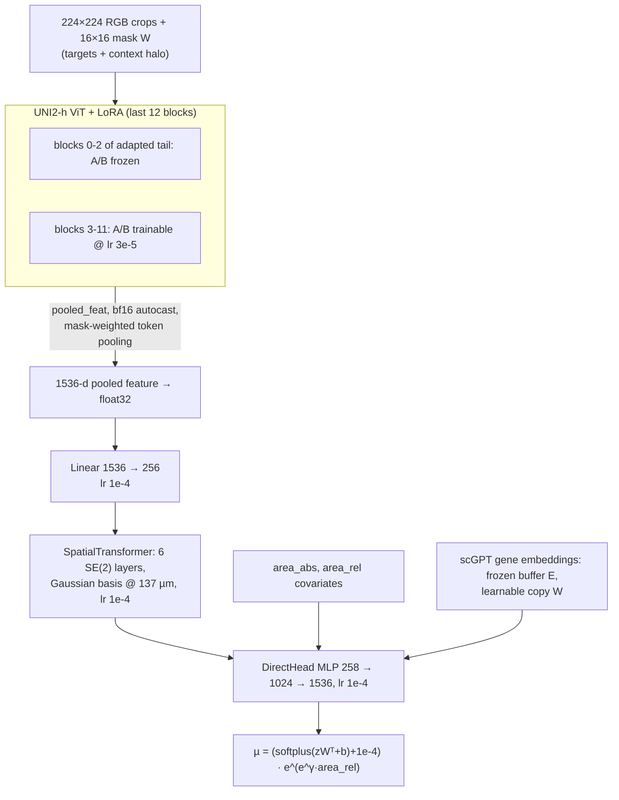
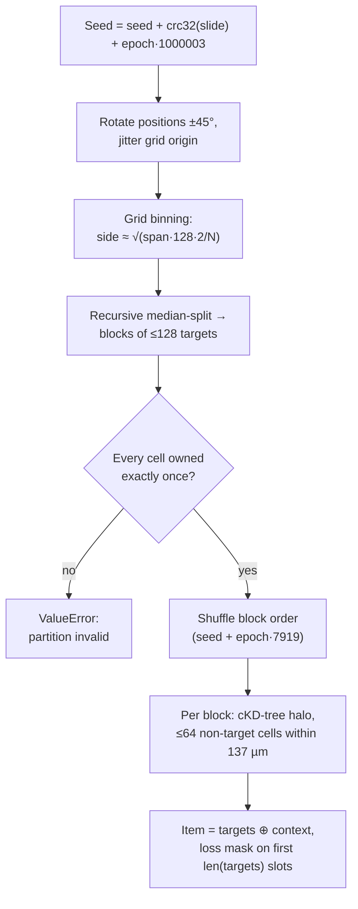

Stage 2 is where Morph2Mol learns to *predict expression from morphology*. It takes the contrastively aligned image encoder from Stage 1, attaches a spatial decoder and a negative-binomial expression head, and fits them against per-cell RNA counts under a fixed three-epoch recipe that guarantees every usable target cell contributes to the loss exactly once per epoch. This page dissects the stage's entry contract, its immutable recipe, the per-slide data store, the trainable parameter surface, the full-coverage spatial sampler, the composite loss, and the checkpoint/resume integrity machinery that binds it all together.

## Pipeline Position and Entry Contract

The stage is launched through a deliberately thin wrapper: `train/train_phase2.py` resolves the shared CLI arguments via `arguments(2)` and immediately delegates to `morph2mol.training.stage2.main`, so all orchestration logic lives in the training package rather than the entry script. The CLI requires `--dataset`, `--work-dir`, `--uni2h`, and — unique to stage 2 — `--stage1`, the path to the completed Stage-1 checkpoint, with `--workers` (default 8), `--save-every` (default 5000, ten times Stage 1's cadence), and `--resume` as the only runtime knobs.
Sources: [train_phase2.py](train/train_phase2.py#L1-L17), [_entry.py](train/_entry.py#L5-L28), [docs/training.md](docs/training.md#L96-L103)

Before any tensor is touched, the run is bound to a **dataset contract**. `dataset_contract` reads the four split files and enforces the set algebra `stage2_global_training == training_set \ inslide_test_set`, disjointness from the cross-slide test set, and that both `retrieval_references` and `gate_fit_references` equal the Stage-2 set exactly — plus a SHA-256 of `MANIFEST.csv` recorded into the contract for later checkpoint binding. When slides are actually loaded, `check_members` rejects the run unless the materialized sample list matches the approved `stage2_global_training` set with no missing or extra members.
Sources: [training_contract.py](morph2mol/training_contract.py#L16-L41), [stage2.py](morph2mol/training/stage2.py#L113-L137)

The stage writes exactly one artifact family: `checkpoints/expression/stage2_last.pt` inside the work directory, atomically replaced on every save. That single rolling checkpoint is simultaneously the resume cursor and, after the final step, the input to release export.
Sources: [stage2.py](morph2mol/training/stage2.py#L111-L224), [docs/training.md](docs/training.md#L114-L115)

## The Fixed Stage-2 Recipe

Every hyperparameter of the stage is frozen in `stage2_settings`, and the constructor enforces immutability structurally: supplying any key that collides with a recipe field raises `TypeError`, so callers may only pass runtime arguments (`tag`, `lora_ckpt`, `workers`, `save_every`, `resume`). This recipe is re-validated twice downstream — `check_stage2_settings` compares exported checkpoints against it field-by-field, and `STAGE2_RECIPE` (a 25-key subset covering model geometry, optimizer rates, sampling, and loss weights) is diffed against any resume checkpoint to reject recipe drift.
Sources: [recipe.py](morph2mol/recipe.py#L26-L40), [training_resume.py](morph2mol/training_resume.py#L12-L17)

| Setting | Value | Meaning |
| --- | --- | --- |
| `epochs` | 3 | Fixed training duration, shared with Stage 1 |
| `sampling` | `full_coverage` | Every target cell owns exactly one block per epoch |
| `target_cells` / `context_cells` | 128 / 64 | Supervised block size; bounded attention halo |
| `max_dist` | 137.0 µm | Spatial attention radius and halo selection radius |
| `d_model` / `n_layers` | 256 / 6 | SE(2) decoder width and layer count |
| `nblocks` / `lora_r` / `lora_alpha` / `lora_dropout` | 12 / 16 / 32 / 0.05 | LoRA on the last 12 encoder blocks, matching Stage 1 |
| `freeze_frac` | 0.2 | Recorded frozen-adapter fraction (see freezing below) |
| `lr_lora` / `lr_se2` | 3e-5 / 1e-4 | Two AdamW parameter groups |
| `grad_ckpt` | `True` | Encoder gradient checkpointing enabled |
| `d4` | 0 | Augmentation disabled during expression training |
| `lam_aux` / `lam_mse` | 1.0 / 1.0 | Equal weight on NB likelihood and log1p MSE |
| `gene_emb` / `free_head` | `scgpt` / `True` | Head rows initialized from scGPT gene embeddings |
| `seed` | 1 | Governs partitions, block shuffles, and RNG capture |

Sources: [recipe.py](morph2mol/recipe.py#L4-L40), [training_resume.py](morph2mol/training_resume.py#L12-L17), [docs/training.md](docs/training.md#L104-L113)

## Per-Slide Data Store: LiveStore

`LiveStore` materializes, for each slide, the four arrays the training loop needs — crop paths, 16×16 token masks, micron positions, and expression targets — in a single pass. Polygon masks come from a precomputed `cmask.npz` under the work directory's `features/` tree when available (renormalized so weights sum to one), falling back to `cells_of` reconstruction otherwise; positions stored in pixels are converted to microns using the slide's `um_per_pixel_source`, which is what makes the 137 µm attention radius physically meaningful across platforms. Both masks and targets are wrapped in an optional content-addressed cache whose signatures stamp the source files (`patch_cell_boundaries.npz`, `expression.npz`, `genes.tsv`), so a changed corpus invalidates stale arrays automatically.
Sources: [stage2.py](morph2mol/training/stage2.py#L29-L70)

Gene mapping is the subtle part: each slide's `genes.tsv` symbols are matched — first occurrence only — against the model gene space stored in `direct/gene_space_all.npz` (the sorted union of training-split genes), yielding `head_idx`, the permutation from slide columns to head rows. Targets `y` are then gathered as `X[expr_rows][:, matched_cols]` and held in float16, and the loss later slices per-gene dispersion by the same `head_idx`, so predictions and likelihoods always operate on measured genes in a globally consistent order.
Sources: [stage2.py](morph2mol/training/stage2.py#L52-L66), [head.py](morph2mol/head.py#L40-L42)

Cell geometry enters the model as **area covariates** rather than raw shapes: `cell_areas` computes each cell's shoelace polygon area in µm² (degenerate polygons fall back to the slide median instead of zero), and the store derives `area_abs = log(area+1)` and `area_rel = area_abs − log(median+1)`. The relative term is what the head uses as a multiplicative exposure correction, decoupling per-cell size from tissue-wide scale. Crop decoding in `load` is strictly deterministic — RGB, bilinear resize to 224×224, no augmentation — consistent with the recipe's `d4=0`.
Sources: [head.py](morph2mol/head.py#L9-L20), [stage2.py](morph2mol/training/stage2.py#L67-L77)

## Model Assembly and the Trainable Surface

`ExpressionModel` is a four-stage pipeline: a LoRA-adapted UNI2-h encoder, a 1536→256 linear projection, a six-layer SE(2) spatial transformer, and the negative-binomial `DirectHead`. Only the encoder pass runs under bf16 autocast (`C.AMP_DTYPE`); features are cast back to float32 before the projection, keeping the spatial decoder and head in full precision. The SE(2) decoder is architecture-fixed: three pre- and three post-attention `SE2Layer(256, 64, 8)` blocks over a Gaussian distance basis scaled to 137 µm, with pairwise cell distances in microns as the only geometric signal.
Sources: [stage2.py](morph2mol/training/stage2.py#L80-L91), [contrastive.py](morph2mol/training/contrastive.py#L9), [se2.py](morph2mol/se2.py#L7-L22)

Before reading the diagram, note the prerequisite: LoRA adapters `A`/`B` are low-rank side-branches injected into the last 12 transformer blocks' `qkv` and `proj` modules; Stage 2 re-injects them with identical geometry and loads Stage 1's weights into them.



Sources: [stage2.py](morph2mol/training/stage2.py#L80-L104), [head.py](morph2mol/head.py#L23-L38), [se2.py](morph2mol/se2.py#L7-L22)

The trainable surface is shaped in three moves. First, only parameters ending in `.A`/`.B` — the LoRA tensors — are marked trainable on the encoder; everything else stays frozen. Second, `freeze_first_lora` freezes the first three of the last twelve adapted blocks (the `freeze_frac` recipe slot), so low-level morphology features from Stage 1 are preserved while higher blocks adapt to the expression objective. Third, the optimizer receives two AdamW groups: LoRA at 3e-5 and everything else (`inp`, `se2`, `head`, including the learnable gene matrix `W`, bias `b`, area exponent `log_gamma`, and per-gene dispersion `log_theta`) at 1e-4, both with zero weight decay. The stage also refuses a malformed starting point: the Stage-1 checkpoint must target `scgpt`, span exactly 3 epochs, and be fully stepped, and `load_lora_checked(complete=True)` demands the entire LoRA key set with shape-verified tensors.
Sources: [stage2.py](morph2mol/training/stage2.py#L142-L157), [training_contract.py](morph2mol/training_contract.py#L72-L78), [docs/training.md](docs/training.md#L111-L112)

| Component | Initialization | Trainable | LR group |
| --- | --- | --- | --- |
| Encoder body + towers | Pretrained UNI2-h | Frozen | — |
| LoRA A/B, adapted blocks 0–2 | Stage-1 checkpoint | Frozen | — |
| LoRA A/B, adapted blocks 3–11 | Stage-1 checkpoint | Yes | 3e-5 |
| `inp` projection | Random linear | Yes | 1e-4 |
| `se2` decoder | Random | Yes | 1e-4 |
| `head.W` gene rows | scGPT embeddings (via `E` buffer) | Yes | 1e-4 |
| `head.b`, `log_gamma`, `log_theta` | Zeros | Yes | 1e-4 |

Sources: [stage2.py](morph2mol/training/stage2.py#L150-L169), [head.py](morph2mol/head.py#L23-L38)

## Full-Coverage Spatial Sampling

Stage 2's central guarantee — *every usable target cell contributes loss exactly once per epoch* — is implemented by `CoveragePlan` and `FullCoverageDataset` rather than by a sampler over shuffled cells. For each epoch, `partition_cells` derives a deterministic RNG from `(seed, crc32(slide_id), epoch)`, rotates the slide's cell positions by up to ±45°, jitters the grid origin, and bins cells into a grid whose side length is derived from the slide's span and the 128-target budget; any oversized grid cell is recursively median-split along its longest axis into blocks of at most 128 targets. An ownership assertion then verifies that every cell appears in exactly one block, and blocks are shuffled for step order with a separate per-epoch RNG. Across the three epochs the rotation angle, origin jitter, and shuffle all change, so no cell is repeatedly stuck in the same neighborhood configuration.
Sources: [full_coverage.py](morph2mol/full_coverage.py#L14-L44), [full_coverage.py](morph2mol/full_coverage.py#L61-L91), [docs/training.md](docs/training.md#L114-L115)

The following flowchart shows one epoch's construction; the KD-tree prerequisite is that each slide's micron positions are indexed once and reused for halo queries across all its blocks.



Sources: [full_coverage.py](morph2mol/full_coverage.py#L14-L58), [full_coverage.py](morph2mol/full_coverage.py#L118-L134)

`CoveragePlan.locate` maps a global step number to `(epoch, slide, targets)` via binary search over epoch boundaries and a rank-strided slot decode, which is how the training loop can resume at an arbitrary step and reconstruct the exact data position. Steps per rank are `ceil(blocks_per_epoch / world)`, and the plan additionally exposes `supervised_before(step, rank)` — an exact recomputation of how many targets a rank has already consumed — which becomes the ground truth against which resume checkpoints are audited. Everything the partition depends on is fingerprinted under `REVISION = 'full_coverage_halo_v1'` and cached per slide-epoch, so a partition scheme change invalidates old caches rather than silently changing training data.
Sources: [full_coverage.py](morph2mol/full_coverage.py#L93-L115), [full_coverage.py](morph2mol/full_coverage.py#L8), [stage2.py](morph2mol/training/stage2.py#L138-L141)

## Loss and Distributed Optimization

Each training item is one spatial block: up to 128 targets plus up to 64 context cells, batch size 1 at the DataLoader level with a pass-through collate. The forward pass predicts `µ` for all cells in the block, but `supervised_sums` masks to owned targets only — context cells participate in SE(2) attention yet never touch the loss, satisfying the docstring contract "Context labels do not enter either loss". The composite objective sums two masked means with equal weight: the per-gene negative-binomial likelihood `nb_nll(y, µ, log_theta[hi])` with dispersion clamped to [1e-4, 1e4], and a log1p-domain MSE that stabilizes optimization on heavy-tailed counts.
Sources: [stage2.py](morph2mol/training/stage2.py#L174-L197), [full_coverage.py](morph2mol/full_coverage.py#L136-L145), [head.py](morph2mol/head.py#L40-L42)

The DDP loss normalization is worth reading closely. Each block's `(nll + mse)` is a *mean over its own targets*, so blocks with different target counts would otherwise contribute unequally per optimizer step. The loop counteracts this by all-reducing the block's target count across ranks and scaling the loss by `world / total.clamp_min(1)`, making the per-target gradient contribution uniform across the entire distributed batch regardless of partition geometry. Gradients are then globally clipped to norm 1.0 over trainable parameters only, and DDP is constructed with `gradient_as_bucket_view=True` and `broadcast_buffers=False` — the latter avoiding needless buffer synchronization since the head's `E` buffer is constant.
Sources: [stage2.py](morph2mol/training/stage2.py#L190-L201), [stage2.py](morph2mol/training/stage2.py#L167-L173)

> [!TIP]
> The `world / total.clamp_min(1)` scaling is what turns "every cell counts once" from a sampling promise into a gradient-level invariant: without it, a rank holding several 40-cell tail blocks would down-weight those targets relative to ranks holding full 128-cell blocks, and the epoch coverage audit below would still pass while gradients were subtly biased.

Coverage is not just promised — it is *audited at runtime*. `supervised` accumulates per-rank target counts during the loop, and whenever `step` lands on an epoch boundary (`coverage.step_ends`), the all-reduced count must equal `epoch × coverage.cells` exactly or training aborts with `Target-cell coverage differs from the epoch budget`. This converts any silent partition, sharding, or skip-logic bug into an immediate, loud failure instead of a subtly undertrained model.
Sources: [stage2.py](morph2mol/training/stage2.py#L202-L210)

> [!TIP]
> When debugging a crash at an epoch boundary, the mismatch size in `seen.item()` vs `epoch * coverage.cells` localizes the fault: a deficit that is a multiple of `world` points to rank-sharding drift, while a deficit matching one slide's cell count points to a stale or invalidated coverage cache for that slide.

## Checkpointing, Resume, and Integrity

Every `save_every` steps (default 5000) and at the final step, rank 0 writes `stage2_last.pt` via `atomic_torch_save`, which saves to a PID-suffixed temporary file and `os.replace`s it into place — a concurrent reader never observes a torn checkpoint. The payload is deliberately complete: trainable LoRA tensors (keyed by parameter name), the three non-encoder modules, optimizer state, the full frozen `args` namespace, the step cursor, world size, the dataset contract, the gene-order hash, the Stage-1 checkpoint's SHA-256 identity, the coverage revision, per-rank supervised counts, and per-rank RNG states for Python, NumPy, CPU-torch, and CUDA.
Sources: [stage2.py](morph2mol/training/stage2.py#L211-L224), [training_resume.py](morph2mol/training_resume.py#L137-L144)

Resume (`--resume stage2_last.pt`) runs a gauntlet of checks before a single weight is restored, all aimed at the same goal: guaranteeing that a resumed run is bit-for-bit the continuation of the original:

| Check | Failure condition |
| --- | --- |
| `check_stage2_resume` completeness | Missing `rng_per_rank`, `coverage_revision`, or `supervised_cells_per_rank` |
| Contract + gene-order binding | Different corpus splits or `gene_head_sha256` mismatch |
| Stage-1 lineage | `stage1_identity.sha256` differs from the currently supplied `--stage1` file |
| World size | Resume under a different DDP world size |
| Recipe drift | Any of the 25 `STAGE2_RECIPE` keys differs from the live `stage2_settings` |
| Epoch budget | Checkpoint `step` outside `[0, total_steps]` |
| Coverage audit | `coverage_revision` changed or per-rank counts ≠ recomputed `supervised_before(step, r)` |
| Trainable-set equality | Resume LoRA keys ≠ current `requires_grad` parameter names (freezing changed) |

Sources: [training_resume.py](morph2mol/training_resume.py#L96-L110), [training_resume.py](morph2mol/training_resume.py#L12-L17), [stage2.py](morph2mol/training/stage2.py#L158-L166)

After the checks pass, restoration order matters for reproducibility: LoRA weights and `inp`/`se2`/`head` state dicts load strictly, the optimizer state restores AdamW moments and step counters, the dataset starts at `start=step`, and only then does `restore_main_rng` rewind every rank's RNG streams from the checkpoint — ensuring that halo queries, any downstream sampling, and future checkpoint RNG captures continue on the original trajectory. If the loaded step already equals `total_steps`, the stage exits cleanly with "Three training epochs are already complete", making reruns idempotent.
Sources: [stage2.py](morph2mol/training/stage2.py#L158-L186), [training_resume.py](morph2mol/training_resume.py#L112-L135)

## Running Stage 2

The canonical invocation matches the released Morph2Mol-25M recipe on three GPUs; a single-GPU run needs only `python train/train_phase2.py` with the same flags and no `torchrun`:

```bash
torchrun --standalone --nproc_per_node=3 train/train_phase2.py \
  --dataset /data/corpus --work-dir /runs/morph2mol --uni2h /models/uni2h \
  --stage1 /runs/morph2mol/checkpoints/alignment/stage1_final.pt
```

Sources: [docs/training.md](docs/training.md#L96-L103), [_entry.py](train/_entry.py#L5-L28)

Runtime behavior is observable through three log families emitted by rank 0: `[data]` reports each slide's cell count and measured-gene count as stores build; `[coverage]` prints the per-epoch target budget and total steps per rank, then audits each epoch boundary; and `[train]` emits loss and elapsed seconds every 200 steps. Progress beyond step 4000 with default settings indicates the rolling checkpoint at `checkpoints/expression/stage2_last.pt` is being refreshed roughly every epoch for a typical corpus.
Sources: [stage2.py](morph2mol/training/stage2.py#L136-L141), [stage2.py](morph2mol/training/stage2.py#L202-L210), [_entry.py](train/_entry.py#L14-L17)

## Next Steps

Stage 2's output feeds directly into release packaging, and its recovery machinery deserves its own deep dive. Continue with [Resume, Caching, and Reproducibility](16-resume-caching-and-reproducibility) for the shared cursor/RNG/cache architecture across both stages, or jump to [Model Export and Release Packaging](17-model-export-and-release-packaging) to see how `stage2_last.pt` is distilled into the deployable release alongside `gene_space_all.npz` and the scGPT gene table. For the upstream alignment objective that produced the `--stage1` input, see [Stage 1 Contrastive Alignment](14-stage-1-contrastive-alignment), and for the split algebra consumed by `dataset_contract`, see [Training Data Contracts](13-training-data-contracts).