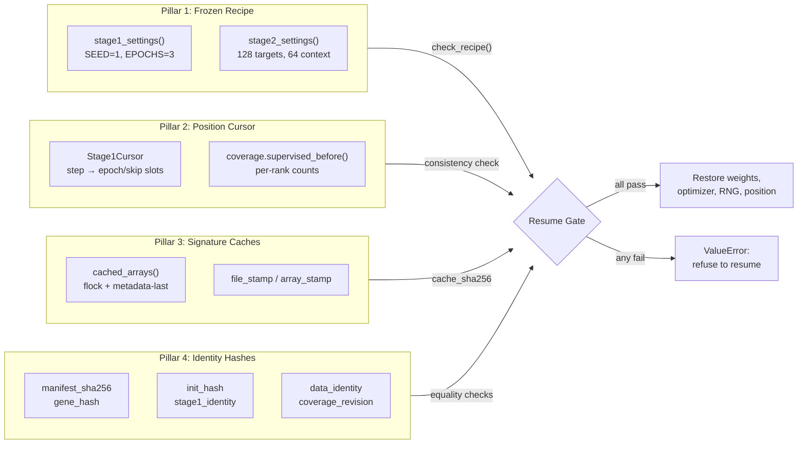
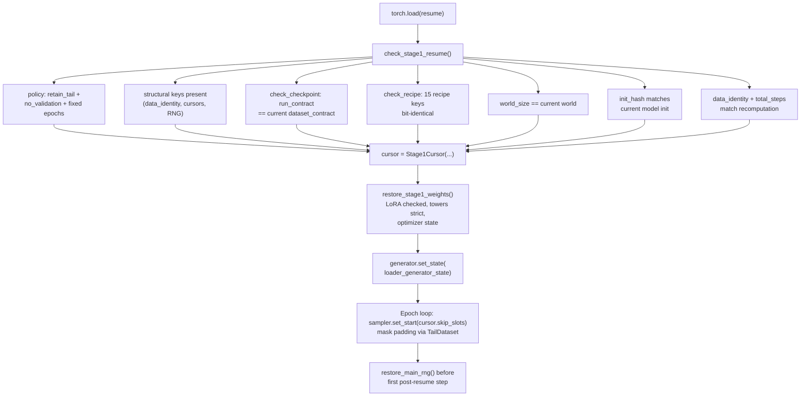
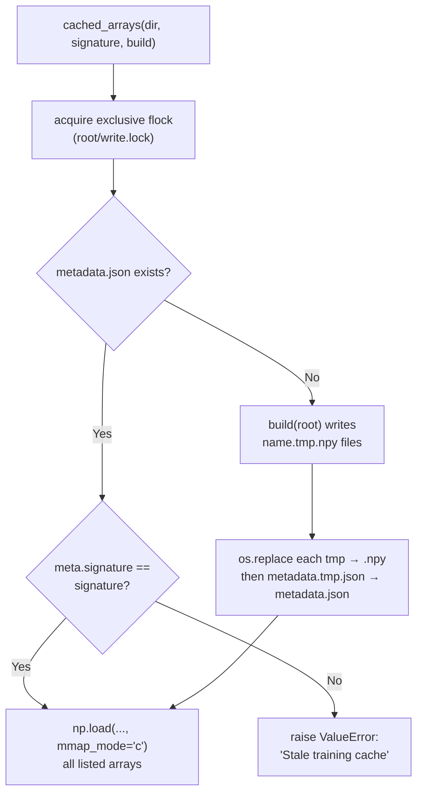

Morph2Mol's training pipeline is built for long-running jobs on shared GPU allocations, where preemption, hardware failure, and multi-process contention are normal events rather than exceptions. The system therefore treats **determinism as a first-class architectural constraint**: every checkpoint carries enough identity, cursor, and RNG state to reconstruct the exact training position, while every expensive derived artifact (scGPT embeddings, cell crops, coverage partitions, dense expression targets) is persisted behind content-derived signatures that make stale reuse impossible. This page explains the three cooperating mechanisms — checkpoint/resume, signature-gated disk caches, and identity hashing — as one integrated design.

Sources: [training.md](docs/training.md#L9-L11), [training_resume.py](morph2mol/training_resume.py#L1-L18)

## Design Principles: Four Pillars of Deterministic Training

The architecture rests on four pillars that interact at every checkpoint boundary. The **frozen recipe** (`recipe.py`) hard-codes all hyperparameters with `SEED = 1` and rejects any runtime attempt to override them — only paths, workers, chunk size, save frequency, and resume targets may vary. The **cursor** encodes position within the fixed epoch budget. The **cache signatures** bind disk artifacts to their inputs via file stamps and array hashes. The **identity hashes** (manifest, gene list, data identity, stage-1 checkpoint bytes, initialization tensors) let a resumed process prove that its corpus, gene order, and weight initialization are bit-identical to the original run.



Any mismatch at the gate aborts the resume with a descriptive `ValueError` — the code never silently adapts to a changed environment. This "verify-then-restore" pattern is applied identically in both training stages, differing only in which checks apply.

Sources: [recipe.py](morph2mol/recipe.py#L4-L19), [recipe.py](morph2mol/recipe.py#L22-L39), [training_resume.py](morph2mol/training_resume.py#L99-L128)

## Checkpoint Anatomy and Atomic Publication

Checkpoints are complete snapshots: resuming never requires re-deriving anything from logs or file listings. Stage 1 saves LoRA adapters, both projection towers, the optimizer state, full `args`, the run contract, the data identity, a coverage cursor record, per-rank RNG states, and the DataLoader generator state. Stage 2 additionally saves the decoder input projection, SE(2) transformer, expression head, gene-list hash, stage-1 checkpoint hash, the coverage plan revision, and gathered per-rank supervised-cell counts.

| Payload key | Stage 1 | Stage 2 | Purpose |
| --- | --- | --- | --- |
| `lora` | ✓ | ✓ (trainable only) | Image adapter weights |
| `he_tower` / `scf_tower` | ✓ | — | Contrastive projection heads |
| `inp` / `se2` / `head` | — | ✓ | Decoder + expression head |
| `opt` | ✓ | ✓ (required) | Exact optimizer momenta |
| `run_contract` | ✓ | ✓ | Split sets + `manifest_sha256` |
| `data_identity` | ✓ | — | Slide order + cache SHA |
| `stage1_identity` | — | ✓ | SHA-256 of the stage-1 `.pt` file |
| `coverage_cursor` / `coverage_revision` + `supervised_cells_per_rank` | ✓ cursor record | ✓ revision + counts | Position + plan consistency |
| `rng_per_rank` | ✓ | ✓ | Per-rank RNG states |
| `loader_generator_state` | ✓ | — | Sampler permutation state |
| `init_hash` | ✓ | — | Initialization fingerprint |

All writes go through `atomic_torch_save`, which serializes to a PID-suffixed temporary file and publishes via `os.replace` — readers can never observe a half-written checkpoint even after a crash mid-save. Stage 2 writes a single rolling `stage2_last.pt` (guarded by a distributed barrier so rank 0 never snapshots while peers are mid-step), whereas Stage 1 keeps a timestamped series `stage1_step{N}.pt` plus a terminal `stage1_final.pt`.

Sources: [training_resume.py](morph2mol/training_resume.py#L179-L188), [stage1.py](morph2mol/training/stage1.py#L171-L176), [stage1.py](morph2mol/training/stage1.py#L200-L219), [stage2.py](morph2mol/training/stage2.py#L211-L226)

> [!TIP]
> The stage-2 save collects `supervised` counts from every rank via `dist.all_gather_object` *before* rank 0 writes, then barriers afterward — this ordering guarantees the saved `supervised_cells_per_rank` vector is mutually consistent with the saved `step`, which is exactly what `check_stage2_resume` later recomputes and compares.

## Stage-1 Resume: The Cursor Model

Stage 1 uses a compact cursor algebra. `Stage1Cursor` is a frozen dataclass holding `(cells, world, chunk, accumulation, epochs, step)` and *derives* everything else: epoch boundaries, batches to skip, sampler slots to skip, and the cumulative supervised-cell count per rank. Because the recipe fixes three epochs and the effective batch of 2,048 cells per rank, the entire trajectory is a pure function of these six integers — position recovery requires no history.



The elegant part is skip semantics in the sampler. `ResumeTailSampler` reproduces the identical seed+epoch permutation of `DistributedSampler` and uses `islice` to discard already-processed slots **in C, before any `Dataset.__getitem__` call** — so a resume near the end of an epoch does not decode thousands of JPEG crops just to throw them away. Because DDP pads uneven ranks, each yielded item carries a `valid` flag that masks sampler padding out of the supervision count, and the loader-generator state plus per-rank RNG restore make the post-resume stream byte-identical to the original run.

Sources: [training_resume.py](morph2mol/training_resume.py#L25-L82), [stage1.py](morph2mol/training/stage1.py#L164-L187), [clip_coverage.py](morph2mol/clip_coverage.py#L6-L31)

## Stage-2 Resume: Coverage-Plan Recomputation

Stage 2 cannot use a lightweight cursor because its per-step supervision load varies with the spatial block sizes. Instead, resume validation *replays the entire coverage plan*: the constructor builds `CoveragePlan` for all epochs deterministically (each object seeded by `zlib.crc32(obj)`, each epoch offset by `epoch * 1000003`, shuffle by `seed + epoch * 7919`), then `check_stage2_resume` recomputes `coverage.supervised_before(step, rank)` for every rank and demands equality with the checkpoint's `supervised_cells_per_rank`. It also pins the plan revision string (`full_coverage_halo_v1`) so a future change to partitioning or halo logic invalidates old checkpoints rather than silently misaligning them.

Two additional gates protect the stage boundary. The stage-1 checkpoint must be a *completed* run (`step == args.steps`, scGPT target, three epochs), and its raw file bytes are hashed by `checkpoint_identity` into `stage1_identity` — so even a functionally identical but byte-different re-export of stage 1 is rejected. On the resume path itself, the trainable-parameter set must match exactly, decoder components load with `strict=True`, the optimizer restores, and `FullCoverageDataset` is constructed with `start=step` so iteration resumes at the exact global step. A checkpoint that has already reached `total_steps` triggers a clean early exit instead of a wasted relaunch.

Sources: [training_resume.py](morph2mol/training_resume.py#L138-L153), [full_coverage.py](morph2mol/full_coverage.py#L55-L105), [stage2.py](morph2mol/training/stage2.py#L144-L185), [training_contract.py](morph2mol/training_contract.py#L43-L49)

## The Cache Layer: Signature-Gated Disk Arrays

The cache system answers one question: *can these arrays be trusted without reading them?* `cached_arrays(directory, signature, build)` implements a write-once, read-many protocol. All participants serialize on an exclusive `fcntl` lock; the first writer builds arrays into `.tmp.npy` files, `os.replace`s each into place, and publishes `metadata.json` **last** — making metadata publication the atomic commit point. Any later reader either finds valid metadata (and mmaps the arrays read-only with `mmap_mode='c'` to prevent accidental mutation) or finds none and rebuilds. Crucially, if metadata exists but its signature differs from the current inputs, the call **raises** — a stale cache is an error, not a silent fallback.



Signatures come from two stamp functions with different cost/precision trade-offs. `file_stamp` is O(1) — resolved path, size, and `st_mtime_ns` — suitable for large immutable inputs like NPZ archives and model weights. `array_stamp` hashes the full contiguous bytes of a small array, suitable for index vectors like expression-row selections where a same-sized same-mtime rewrite must still invalidate. The pipeline uses both together: stage-1 crop caching stamps the embedding file, cell boundaries, and manifest; stage-2 `LiveStore` stamps boundaries and mask files plus an `array_stamp` of the row selection, and `sparse_targets` materializes the dense float16 expression matrix chunk-wise into a memmap whose signature additionally includes stamps of the row and column indices.

| Cache site | Contents | Signature inputs | Cost avoided on re-run |
| --- | --- | --- | --- |
| `cache/stage1/{obj}` | Cell paths, masks, float16 scGPT targets | `file_stamp` × 3 (embeddings, boundaries, manifest) | Crop decode + embedding gather |
| `cache/stage2/{obj}/masks` | Normalized boundary masks | `file_stamp` × 2 + `array_stamp(rows)` | NPZ mask re-normalization |
| `cache/stage2/{obj}/targets` | Dense float16 expression matrix `Y` | file stamps + `array_stamp` rows/cols | Sparse-to-dense projection |
| `cache/coverage/{obj}/epoch{N}` | Partition `order` + `ptr` arrays | revision, `array_stamp(pos)`, object seed, epoch, target budget | KD-grid partition per epoch |
| `scgpt_cells/{obj}.npy` | 512-d cell embeddings (pre-training) | existence check only | Full scGPT forward pass |

Note the two cache generations have different rigor: `embed_scgpt.py` uses simple skip-if-exists with atomic `os.replace` publication, seeded deterministically per object via `zlib.crc32(name)` (explicitly because Python's `str` hash is salted per process), while the in-training caches add full signature validation. This division is deliberate — embedding generation is idempotent and content-addressed by output row alignment, which stage 1 re-verifies anyway through `target_path` shape/row checks.

Sources: [training_cache.py](morph2mol/training_cache.py#L10-L49), [stage1.py](morph2mol/training/stage1.py#L44-L63), [stage2.py](morph2mol/training/stage2.py#L42-L66), [full_coverage.py](morph2mol/full_coverage.py#L64-L76), [embed_scgpt.py](train/embed_scgpt.py#L61-L125)

> [!TIP]
> Stage-2 resume correctness depends on the coverage cache being *regenerable*: if you delete `cache/coverage/`, `CoveragePlan` recomputes partitions from the same seed equations, and `supervised_before` still matches the checkpoint. Never reuse a work-dir across corpora though — the `cached_arrays` signature will correctly refuse, and so will `run_contract`.

## Reproducibility Mechanics: RNG and Identity Chains

Reproducibility here means *bit-level continuation*, achieved through a layered chain of hashes and RNG captures. At process start, both stages seed Python, NumPy, and all CUDA generators from the fixed recipe seed, and stage 1 creates a dedicated `torch.Generator(manual_seed=1)` that drives sampler shuffling independently of global RNG. At every checkpoint, `capture_rng_per_rank` snapshots `random`, NumPy, and torch CPU/CUDA states per rank, using `dist.all_gather_object` in DDP so all ranks' states are stored together; `restore_main_rng` reinstalls the exact per-rank state after resume, validating world-size equality first.

The identity chain then closes every loophole:

| Hash | Computed over | Detects |
| --- | --- | --- |
| `manifest_sha256` | `MANIFEST.csv` bytes | Corpus content changes |
| Split-set checks | `splits/*.txt` membership rules | Split rearrangement, duplicate IDs |
| `gene_hash` | JSON-serialized gene list | Gene-head reordering |
| `data_identity.cache_sha256` | Per-slide metadata + path-array lengths | Data order or completed-cache changes |
| `init_hash` | Sorted trainable tensors + tower state dicts | Different initialization (e.g., changed weights file) |
| `stage1_identity.sha256` | Stage-1 checkpoint file bytes | Any byte-level stage-1 difference |
| `coverage_revision` / `resume_revision` | Literal version strings | Algorithm-version drift between runs |

Because `check_checkpoint` compares the entire `run_contract` dict (which embeds the resolved dataset path and all split ID sets), and `check_recipe` compares every recipe-relevant CLI argument, the resume gate collectively proves: same corpus, same splits, same genes, same data order, same initialization, same world size, same hyperparameters — before a single tensor is loaded.

Sources: [training_resume.py](morph2mol/training_resume.py#L156-L176), [training_contract.py](morph2mol/training_contract.py#L7-L49), [stage1.py](morph2mol/training/stage1.py#L130-L163), [stage2.py](morph2mol/training/stage2.py#L124-L138)

## Failure Semantics: What Refuses to Resume

The design philosophy is fail-loud: every resume-invalidating condition raises immediately with the offending key. The table below maps each failure condition to its check site and error, which doubles as a troubleshooting guide.

| Condition | Detected by | Error surfaced |
| --- | --- | --- |
| Corpus/split membership changed | `check_checkpoint` via `run_contract` | `Checkpoint training split differs from the current corpus` |
| Any of 15 (or 23) recipe args changed | `check_recipe` | `Resume training recipe differs: {key}` |
| DDP world size differs | explicit comparison | `Stage-1 resume requires the original DDP world size` / `RNG checkpoint world size differs` |
| UNI2-h weights file differs → new init | `init_hash` comparison | `Stage-1 initialization differs from the saved run` |
| Data order or per-slide cache changed | `data_identity` inequality | `Stage-1 data order/cache identity changed` |
| Effective cells or epoch budget changed | cursor `total_steps` recomputation | `Stage-1 effective cell count or total epoch budget changed` |
| Gene-head order differs (stage 2) | `gene_head_sha256` | `Checkpoint gene-head order differs from this run` |
| Coverage plan logic changed | `coverage_revision != REVISION` | `Resume coverage plan/count differs from the checkpoint` |
| Cache directory reused with new inputs | `cached_arrays` signature check | `Stale training cache; use a fresh cache directory` |
| Missing scGPT embeddings at resume | `target_path` | `Missing scGPT embeddings: {path}` |
| Stage-1 checkpoint not a completed run | `step != args.steps` gate | `Initialize expression training with a completed three-epoch scGPT Stage-1 checkpoint` |

Each epoch additionally runs a **coverage audit**: stage 1 all-reduces the per-rank supervised count and demands it equal `len(dataset)` exactly once per cell; stage 2 demands `seen == epoch * coverage.cells` at each epoch boundary. These invariants turn silent data-loading bugs (duplicated or dropped cells) into immediate failures rather than subtly biased models.

Sources: [training_resume.py](morph2mol/training_resume.py#L106-L153), [training_cache.py](morph2mol/training_cache.py#L20-L37), [stage1.py](morph2mol/training/stage1.py#L206-L211), [stage2.py](morph2mol/training/stage2.py#L202-L208), [stage1.py](morph2mol/training/stage1.py#L19-L28)

## Practical Resume Workflow

Operationally, both entry points expose identical resume flags. `--save-every` defaults to 500 steps for stage 1 and 5,000 for stage 2, and `--resume <path>` points at any prior checkpoint from the *same stage*. The documented contract: resume restores "weights, optimizer state, and data position; use the same world size and corpus when resuming."

| Flag | Stage 1 default | Stage 2 default | Notes |
| --- | --- | --- | --- |
| `--save-every` | 500 steps | 5000 steps | Trigger also fires at final step |
| `--resume` | empty | empty | Path to same-stage checkpoint |
| `--chunk` | 256 (must divide 2048) | n/a | Changing it changes `accumulation` → recipe check fails |
| `--workers` | 8 | 8 | Loader parallelism only; does not affect determinism |

A typical interruption/recovery sequence looks like:

```bash
# After preemption — resume stage 1 from the latest periodic snapshot:
torchrun --standalone --nproc_per_node=3 train/train_phase1.py \
  --dataset /data/corpus --work-dir /runs/morph2mol \
  --uni2h /models/uni2h --cell-embeddings /runs/scgpt_cells \
  --resume /runs/morph2mol/checkpoints/alignment/stage1_step1500.pt

# Resume stage 2 from its rolling snapshot (same world size, same work-dir):
torchrun --standalone --nproc_per_node=3 train/train_phase2.py \
  --dataset /data/corpus --work-dir /runs/morph2mol --uni2h /models/uni2h \
  --stage1 /runs/morph2mol/checkpoints/alignment/stage1_final.pt \
  --resume /runs/morph2mol/checkpoints/expression/stage2_last.pt
```

Three practical rules follow from the verification design. First, **never edit the work-dir contents between interruption and resume** — the cache signatures and data identity will detect and reject any drift. Second, the checkpoint filename encodes the step, but the cursor inside is authoritative; stage 2's rolling file means you always resume from the newest state, while stage 1's numbered files let you pick an earlier point deliberately. Third, caches make interactive-scale re-runs cheap by design — deleting `checkpoints/` while keeping `cache/` reconstructs training from scratch in minutes rather than hours, since all crop decoding, mask normalization, target materialization, and per-epoch partitioning skip the expensive build paths.

Sources: [_entry.py](train/_entry.py#L16-L27), [training.md](docs/training.md#L58-L97), [training_cache.py](morph2mol/training_cache.py#L20-L37)

## Where This Fits in the Pipeline

Resume and caching are the reliability substrate beneath both training stages, but each stage has its own semantic story: the data contracts verified here are introduced in [Training Data Contracts](13-training-data-contracts), the stage-1 objective and gradient caching appear in [Stage 1 Contrastive Alignment](14-stage-1-contrastive-alignment), and the stage-2 coverage plan's spatial semantics are detailed in [Stage 2 Expression Training](15-stage-2-expression-training). When training completes, the same checkpoints flow into [Model Export and Release Packaging](17-model-export-and-release-packaging), where `check_stage2_settings` re-validates the recipe against the Morph2Mol-25M release profile before anything ships.
