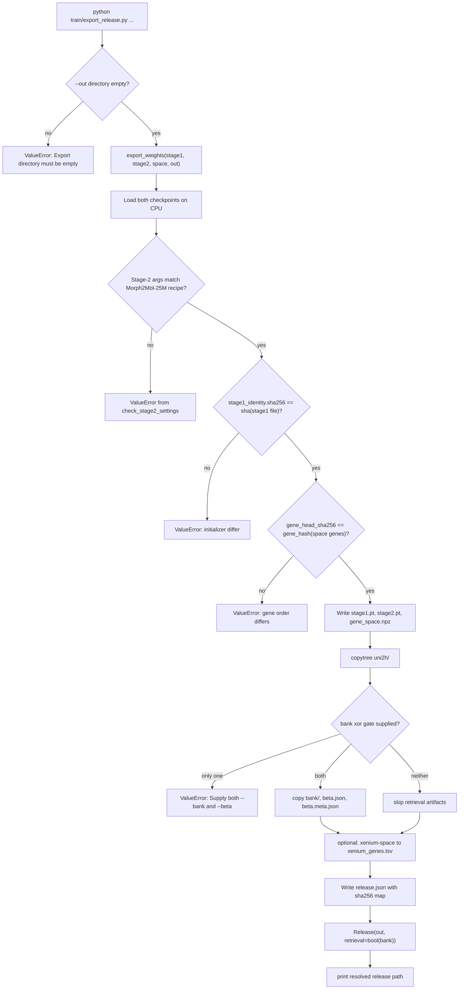
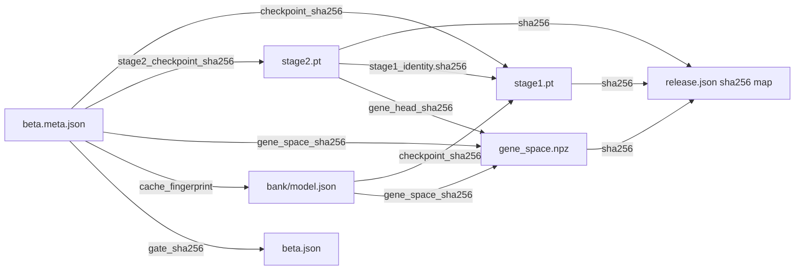
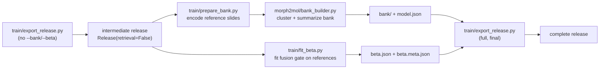

This page documents how Morph2Mol turns training checkpoints into a portable, self-contained release directory that inference machines can consume without access to the training corpus. The export process is **verification-first**: before a single byte is written, checkpoints are checked against the frozen 25M recipe, stage lineage, and gene ordering; after everything is written, the assembled directory is re-opened and validated exactly as a downstream consumer would. We cover the release directory anatomy, the `export_release.py` pipeline, the hash-based integrity contract, the `release.json` manifest, and the two-phase packaging workflow used when a reference bank and fusion gate are involved.

## Why a Self-Contained Release Directory

The release layer is designed around a strict portability principle: *"Portable release paths and identities. No training corpus is required at inference"* ([release.py](morph2mol/release.py#L1)). Everything a prediction machine needs — the frozen vision tower, LoRA adapters, decoder weights, gene vocabulary, retrieval bank, and fusion gate — lives inside one directory, addressed exclusively by **relative paths** recorded in `release.json`. Checkpoints written during export contain only inference tensors: the docstring of `export_weights` states it saves *"inference tensors without optimizer state or training-machine paths"* ([export_release.py](train/export_release.py#L11-L12)).

The schema field in the manifest guards against version drift. A release is only accepted if its schema is `morph2mol-release-v1` or the legacy alias `voice25m-release-v1`; anything else raises `Unsupported release.json schema` ([release.py](morph2mol/release.py#L11-L12)). The legacy alias mirrors the `Voice25M = Morph2Mol` compatibility shim in the inference model ([model.py](predict/model.py#L71-L72)), so older analysis scripts keep working against new releases.

Sources: [release.py](morph2mol/release.py#L1-L12), [export_release.py](train/export_release.py#L11-L12), [model.py](predict/model.py#L71-L72)

## Release Directory Anatomy

A complete release, as documented in the weights README and produced by the exporter, contains the following layout:

```text
morph2mol/
  release.json          # manifest: relative paths + sha256 pins
  stage1.pt             # stripped Stage-1 LoRA adapters
  stage2.pt             # Stage-2 LoRA + inp + se2 + head tensors
  gene_space.npz        # ordered gene symbol vocabulary
  xenium_genes.tsv      # optional Xenium panel subset
  beta.json             # per-gene/per-stratum fusion weights
  beta.meta.json        # gate fitting metadata (hashes, K, tau)
  beta/                 # per organ/width weight files + manifest
  uni2h/                # frozen UNI2-h vision tower (e.g. pytorch_model.bin)
  bank/                 # reference bank: model.json, summaries/...
```

The layout is documented verbatim in the weights README ([README.md](weights/README.md#L7-L27)), and each entry below maps to the exact statement in the exporter that writes it.

| Artifact | Role | Written by | Integrity anchor |
|---|---|---|---|
| `release.json` | Manifest: relative paths + sha256 map | `main()` | schema check + `sha256` block |
| `stage1.pt` | `{'lora': ...}` only — no optimizer state | `export_weights` | `stage1_identity.sha256` inside `stage2.pt` |
| `stage2.pt` | `lora`, `inp`, `se2`, `head` + frozen recipe args | `export_weights` | recipe freeze + `gene_head_sha256` |
| `gene_space.npz` | Ordered gene symbols for the expression head | byte-for-byte copy | `gene_head_sha256` |
| `uni2h/` | Frozen vision tower directory | `copytree` | loaded by name at inference |
| `bank/` | Cluster retrieval summaries + `model.json` | `copytree(symlinks=False)` | `model.json` identity fields |
| `beta.json` / `beta.meta.json` | Gate weights + fitting provenance | `copy2` (sibling pair) | 5-of-7 cross-checks in `Release` |
| `xenium_genes.tsv` | One gene symbol per line, no header | generated from npz | gene-order semantics |

Sources: [README.md](weights/README.md#L7-L27), [export_release.py](train/export_release.py#L27-L62)

## The Export Pipeline

`train/export_release.py` is a standalone script with a deliberately small CLI: `--uni2h`, `--stage1`, `--stage2`, `--space`, `--out` are required; `--bank`, `--beta`, and `--xenium-space` are optional ([export_release.py](train/export_release.py#L36-L40)). The full flow is:



The single most important step is `export_weights` ([export_release.py](train/export_release.py#L11-L33)). It performs three validations before writing anything. First, `check_stage2_settings(second['args'])` compares every training hyperparameter recorded in the Stage-2 checkpoint against the frozen `stage2_settings()` recipe — any mismatch on any key aborts with the exact offending key ([recipe.py](morph2mol/recipe.py#L36-L40)). Second, the Stage-2 checkpoint's embedded `stage1_identity['sha256']` must equal the streaming SHA-256 of the supplied Stage-1 checkpoint file, proving the expression model was initialized from *this* alignment checkpoint ([export_release.py](train/export_release.py#L21-L22)). Third, `gene_head_sha256` must equal `gene_hash()` of the gene symbols loaded from the gene-space file, pinning head-column order to vocabulary order ([export_release.py](train/export_release.py#L23-L25)).

Only then are the artifacts written. The exported `stage1.pt` is reduced to just `{'lora': first['lora']}`. The exported `stage2.pt` keeps `['lora','inp','se2','head']` and adds `args=vars(stage2_settings())` (re-serialized from the frozen recipe, not from the checkpoint), `step`, `gene_head_sha256`, and — critically — a **recomputed** `stage1_identity={'sha256': sha(out/'stage1.pt')}` pointing at the *exported* Stage-1 file rather than the original training checkpoint ([export_release.py](train/export_release.py#L27-L32)).

> [!TIP]
> The `stage1_identity` inside the exported `stage2.pt` is hashed against the *exported* `stage1.pt`, not the original training checkpoint. Since the export strips `stage1.pt` down to LoRA tensors only, its bytes (and therefore its hash) differ from the training file — the exporter recomputes the hash after writing so downstream validation in `predict/model.py` will pass against the release-local file.

After writing, `main()` copies the UNI2-h tower, enforces bank/gate pairing (`bool(a.bank) != bool(a.gate)` is rejected), copies the bank with `symlinks=False` so the release contains real bytes rather than dangling links, and requires the gate's `beta.meta.json` to sit next to `beta.json` via `with_suffix('.meta.json')` ([export_release.py](train/export_release.py#L49-L55)). Finally the manifest is assembled with a `sha256` map over `stage1`, `stage2`, `gene_space`, and the directory is handed to `Release(out, retrieval=...)` for a full cold-start validation before the script prints the path ([export_release.py](train/export_release.py#L61-L65)).

Sources: [export_release.py](train/export_release.py#L11-L68), [recipe.py](morph2mol/recipe.py#L36-L40), [README.md](weights/README.md#L33-L46)

## The Integrity Contract: Hashes and Cross-Artifact Identity

Three hashing primitives underpin the entire release contract:

| Primitive | Location | Definition | Used for |
|---|---|---|---|
| `sha(path)` | `morph2mol/retrieval.py` | Streaming SHA-256 in 8 MiB blocks | File-level pins in `release.json`, checkpoint identity |
| `gene_hash(genes)` | `morph2mol/training_contract.py` | SHA-256 of `json.dumps(list(genes))` | Order-sensitive gene-vocabulary identity |
| `fingerprint(value)` | `morph2mol/bank_io.py` | SHA-256 of `json.dumps(value, sort_keys=True)` | Bank cache fingerprint (`cache_fingerprint`) |

Sources: [retrieval.py](morph2mol/retrieval.py#L16-L21), [training_contract.py](morph2mortraining_contract.py#L39-L40), [bank_io.py](morph2mol/bank_io.py#L30-L31)

Note that `gene_hash` serializes the *ordered list* — it is not a set hash, so a permuted gene vocabulary produces a different digest and is rejected. This is what makes the head-column ordering contract enforceable at export time *and* at inference time.

The `Release` class is the contract's enforcer. Given a directory, it loads `release.json`, resolves each declared path, and fails fast with `FileNotFoundError` naming the missing artifact ([release.py](morph2mol/release.py#L13-L20)). It then recomputes the three file hashes and compares them to the manifest's `sha256` block; a mismatch aborts with `Release checksum mismatch: <key>` ([release.py](morph2mol/release.py#L21-L26)).

For releases with retrieval enabled, seven cross-artifact identity checks run as a single conjunction — if *any* fails, the entire release is rejected with `Model checkpoints, genes, reference bank and fusion weights do not match`:

| # | Field in bank / gate metadata | Must equal | Meaning |
|---|---|---|---|
| 1 | `bank['checkpoint_sha256']` | `hashes['stage1']` | Bank features were encoded with this Stage-1 model |
| 2 | `bank['gene_space_sha256']` | `hashes['gene_space']` | Bank panels index this exact vocabulary |
| 3 | `gate_meta['checkpoint_sha256']` | `hashes['stage1']` | Gate was fitted against this Stage-1 model |
| 4 | `gate_meta['stage2_checkpoint_sha256']` | `hashes['stage2']` | Gate calibration used this expression model |
| 5 | `gate_meta['gene_space_sha256']` | `hashes['gene_space']` | Gate gene indices match this vocabulary |
| 6 | `gate_meta['cache_fingerprint']` | `bank['cache_fingerprint']` | Gate calibration used the same bank cache |
| 7 | `gate_meta['gate_sha256']` | `sha(gate file)` | The gate file itself is unmodified since fitting |

Sources: [release.py](morph2mol/release.py#L27-L39), [fit_beta.py](train/fit_beta.py#L91-L99)

Two protocol checks follow: if the gate metadata records a `spatial_context` protocol, it is validated against the current prediction protocol ([release.py](morph2mol/release.py#L40-L42)), and the retrieval settings must agree — `gate_meta['K']` and `gate_meta['tau']` must equal the bank's `retrieval_K` and `tau` (both fixed at 50 and 0.03 in the builder) or the release is rejected ([release.py](morph2mol/release.py#L43-L45), [bank_builder.py](morph2mol/bank_builder.py#L93-L100)).

> [!TIP]
> These checks mean a release is not a bag of files but a **hash-connected identity graph**: mutating any one artifact breaks at least two independent edges. This is also why the exporter refuses to write into a non-empty directory — partial or stale files could otherwise satisfy some checks while masking an inconsistent combination.

The identity relationships can be read as a graph over artifacts:



Sources: [release.py](morph2mol/release.py#L7-L46), [bank_builder.py](morph2mol/bank_builder.py#L93-L100)

## The release.json Manifest

The manifest is intentionally minimal — a schema tag plus relative paths, optionally a `sha256` block written by the exporter. The example configuration shows the full field set ([release.example.json](configs/release.example.json#L1-L10)):

| Field | Purpose | Written by exporter |
|---|---|---|
| `schema` | Always `morph2mol-release-v1` for new exports | yes (hard-coded) |
| `uni2h` | Relative path to vision tower directory | yes (always) |
| `stage1` / `stage2` / `gene_space` | Core model artifacts | yes (always), sha256-pinned |
| `xenium_genes` | Optional Xenium panel TSV | only with `--xenium-space` |
| `bank` / `gate` | Retrieval artifacts | only when both `--bank` and `--beta` are given |
| `sha256` | Map of file → digest for `stage1`, `stage2`, `gene_space` | yes (always) |

Only the four core fields plus (conditionally) `bank` and `gate` are *required* to exist at load time; `Release` resolves them and rejects missing artifacts ([release.py](morph2mol/release.py#L14-L20)). Because all values are relative to the release root, the directory can be moved or renamed without breaking anything.

Sources: [configs/release.example.json](configs/release.example.json#L1-L10), [release.py](morph2mol/release.py#L13-L20), [export_release.py](train/export_release.py#L46-L47)

## Two-Phase Packaging Workflow

The exporter supports an **intermediate release mode**: run it *without* `--bank`/`--beta` to produce a minimal release (tower + checkpoints + gene space + manifest) that downstream preparation tools consume. The weights README makes this explicit: *"Omit both `--bank` and `--beta` when exporting the intermediate checkpoints used by reference preparation during model training"* ([README.md](weights/README.md#L46)). Both consumers open it with retrieval disabled:



`train/prepare_bank.py` documents this in its own CLI help — `--release` is *"Direct release from export_release.py (bank/gate not needed)"* ([prepare_bank.py](train/prepare_bank.py#L12)) — and constructs `Release(a.release, retrieval=False)` ([prepare_bank.py](train/prepare_bank.py#L26)). It stamps every per-object `feature_meta.json` with the Stage-1 hash and feature protocol, and the bank builder later elevates those identities into `model.json`'s top-level `checkpoint_sha256` / `gene_space_sha256` — the very fields check #1 and #2 verify against ([bank_builder.py](morph2mol/bank_builder.py#L88-L99)). `train/fit_beta.py` likewise opens the intermediate release without retrieval and records the full identity tuple (`checkpoint_sha256`, `stage2_checkpoint_sha256`, `gene_space_sha256`, `cache_fingerprint`, `gate_sha256`) into `beta.meta.json`, which becomes the other half of the final release's integrity web ([fit_beta.py](train/fit_beta.py#L28-L32), [fit_beta.py](train/fit_beta.py#L91-L99)).

This phased design means the expensive bank-building and gate-fitting runs happen against a *hash-pinned* model snapshot: if any checkpoint changes mid-pipeline, the intermediate release's hashes change, and the final full export fails loudly rather than silently mixing artifacts from different training runs.

Sources: [README.md](weights/README.md#L46), [prepare_bank.py](train/prepare_bank.py#L12-L26), [fit_beta.py](train/fit_beta.py#L28-L32), [bank_builder.py](morph2mol/bank_builder.py#L88-L99)

## Consuming a Release at Inference

The released model class re-validates the same invariants at construction time, independent of the CLI: it compares `stage2`'s embedded `stage1_identity['sha256']` against `release.hashes['stage1']`, re-checks `gene_head_sha256` against the loaded gene space, and re-applies the recipe freeze before building the encoder ([model.py](predict/model.py#L21-L29)). This defense-in-depth means even a hand-edited `release.json` that passed file-hash checks would still be caught if the internal checkpoint identities disagree.

One subtlety worth knowing when reading exported tensors: Stage-2 saves *only the trainable LoRA subset*, while frozen adapters still come from Stage-1 — the constructor loads Stage-1 LoRA with `complete=True` first, then overlays the Stage-2 subset ([model.py](predict/model.py#L33-L46)). The training-side loader enforces the same subset discipline via `load_lora_checked` ([training_contract.py](morph2mol/training_contract.py#L68-L78)). A practical consequence: `stage1.pt` in a release is never optional, even though Stage-2 alone defines final behavior.

For the downstream side of this contract — how releases are verified after download or transfer, and how the CLI consumes `--release` — see [Release Integrity Verification](21-release-integrity-verification) and [Inference CLI Reference](3-inference-cli-reference). The bank and gate artifacts themselves are covered in [Reference Bank Construction](10-reference-bank-construction) and [Gated Fusion Weights](12-gated-fusion-weights).

Sources: [model.py](predict/model.py#L21-L48), [training_contract.py](morph2mol/training_contract.py#L68-L78)

## Packaging Checklist

To package a newly trained model, run the exporter as documented ([README.md](weights/README.md#L33-L46)):

```bash
python train/export_release.py \
  --uni2h /models/uni2h \
  --stage1 /runs/morph2mol/checkpoints/alignment/stage1_final.pt \
  --stage2 /runs/morph2mol/checkpoints/expression/stage2_last.pt \
  --space /runs/morph2mol/direct/gene_space_all.npz \
  --xenium-space /runs/morph2mol/direct/gene_space_xen.npz \
  --bank /runs/bank --beta /runs/beta.json \
  --out /models/morph2mol
```

| Failure you might see | Root cause | Fix |
|---|---|---|
| `Export directory must be empty` | Non-empty `--out` | Point at a fresh directory |
| `Checkpoint does not use the Morph2Mol-25M setting: key=...` | Checkpoint trained with non-recipe hyperparameters | Retrain or use the correct checkpoint |
| `Expression checkpoint and alignment initializer differ` | Stage-2 wasn't initialized from this Stage-1 file | Supply the matching Stage-1 |
| `Expression checkpoint and exported gene order differ` | `--space` doesn't match the checkpoint's head | Export with the training-time gene space |
| `Supply both --bank and --beta` | Only one of the pair given | Pass both, or neither |
| `Missing release artifact <key>` / `Release checksum mismatch` | Release directory altered after export | Re-export; never edit a release in place |
| `...bank and fusion weights do not match` | One of the 7 cross-checks failed | Rebuild bank/gate against this exact model |

Note the licensing constraint: the UNI2-h tower must be obtained under approved access and redistribution must follow its terms ([README.md](weights/README.md#L3-L3), [README.md](weights/README.md#L46-L46)).

Sources: [README.md](weights/README.md#L3-L46), [export_release.py](train/export_release.py#L44-L55)

## Next Steps

With packaging covered, natural continuations are:

- **Verify a shipped release end-to-end**: [Release Integrity Verification](21-release-integrity-verification)
- **Run inference against a release**: [Inference CLI Reference](3-inference-cli-reference) and [Reading Prediction Outputs](4-reading-prediction-outputs)
- **Understand the artifacts you just packaged**: [Reference Bank Construction](10-reference-bank-construction) and [Gated Fusion Weights](12-gated-fusion-weights)
- **Trace where the exported checkpoints came from**: [Stage 1 Contrastive Alignment](14-stage-1-contrastive-alignment) and [Stage 2 Expression Training](15-stage-2-expression-training)