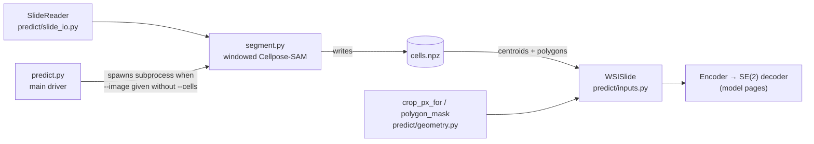
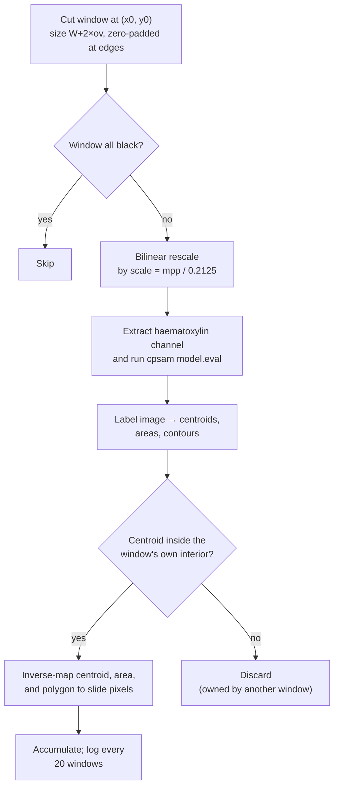

This page explains how Morph2Mol turns a whole-slide H&E image into per-nucleus boundaries — the first, and most quality-sensitive, step of every image-based inference run. It covers the standalone CLI `predict/segment.py`, the slide-reading layer beneath it, the seam-handling rule that guarantees each nucleus is segmented exactly once, the `cells.npz` output contract, and how the segmentation is spawned automatically and consumed by the prediction pipeline. Segmentation is the only stage of inference that does not involve the Morph2Mol model itself: it delegates entirely to Cellpose-SAM (`cpsam`), an off-the-shelf segmentation foundation model.

Sources: [segment.py](predict/segment.py#L1-L27), [predict.py](predict/predict.py#L14-L16)

## Why Segmentation Sits at the Front of the Pipeline

Every downstream computation in Morph2Mol is anchored to a cell boundary. The per-cell image feature is a **mask-weighted average over the encoder's patch tokens**, so the polygon boundary decides which image evidence is attributed to this cell rather than to its neighbour. A slightly wrong boundary shifts the 16×16 token weighting in `predict/geometry.py`, which directly perturbs the encoder input. This is why the module documentation explicitly recommends substituting your own boundaries — for example from a pipeline paired with a spatial assay — when they exist.

Sources: [segment.py](predict/segment.py#L25-L27), [geometry.py](predict/geometry.py#L19-L33)

There are two entry paths into segmentation. You can run `predict/segment.py` standalone to produce a reusable `cells.npz`, or you can omit `--cells` when calling `predict/predict.py`, in which case the prediction driver spawns `segment.py` as a subprocess and saves the result next to the prediction output. The module-interaction diagram below shows both paths; it is worth reading before the detailed sections because it names every component this page discusses.

Sources: [predict.py](predict/predict.py#L52-L71), [inputs.py](predict/inputs.py#L9-L14), [geometry.py](predict/geometry.py#L1-L9)

## Reading Slides: The SlideReader Backend Chain

`SlideReader` in `predict/slide_io.py` is the only component that touches image bytes. It tries three readers in order — **OpenSlide** (SVS, NDPI, MRXS, pyramidal TIFF), **tifffile** (OME-TIFF and plain TIFF), then **Pillow** (PNG, JPEG, small TIFFs). Each import is lazy, so a user who only processes PNGs never needs the OpenSlide C library installed, while a user with an SVS file gets an error message naming the missing package rather than an opaque decode failure. The backend that won is reported on the class as `backend` and echoed in the segmentation log line.

Sources: [slide_io.py](predict/slide_io.py#L1-L11), [slide_io.py](predict/slide_io.py#L27-L43)

Two `SlideReader` behaviours matter for segmentation. First, `region()` extracts an arbitrary rectangular window and **zero-pads wherever the window leaves the image**, which lets the tiling loop request windows that straddle slide edges without special-casing. Second, `_guess_mpp_openslide()` recovers physical resolution from slide properties in priority order: `openslide.mpp-x`, then `aperio.MPP`, then `tiff.XResolution` (inverted as `10000/f`). If none is present, resolution stays `None` and the caller must supply `--mpp` — there is no silent fallback, because physical scale is load-bearing for both segmentation and cropping.

Sources: [slide_io.py](predict/slide_io.py#L64-L88), [segment.py](predict/segment.py#L117-L120)

## Loading the Cellpose-SAM Model

`load_model()` requires `cellpose>=4.0` (checked with a friendly install hint via `_require`) and constructs a `models.CellposeModel`. The weights resolve in one of two ways: a local checkpoint passed via `--model` (validated to exist, expanded to an absolute path), or — by default — the official `cpsam` checkpoint downloaded from the Hugging Face Hub repository `mouseland/cellpose-sam` through `hf_hub_download`. `--cpu` flips the `gpu` flag for machines without CUDA.

Sources: [segment.py](predict/segment.py#L41-L58), [segment.py](predict/segment.py#L100-L101), [segment.py](predict/segment.py#L114)

## Channel Selection and Scale Normalization

Cellpose-SAM does not run on the full RGB image. `segment_window()` reduces each window to a **single channel before inference**: channel index 3 (the blue channel) by default, because in H&E staining the haematoxylin signal — which marks nuclei — lives in blue. The `--channel` flag is 1-based and validated to be 1, 2, or 3; greyscale input skips the extraction entirely. Flow-threshold parameters are passed straight through to `model.eval()`: `niter=250`, `flow_threshold=0.4`, `cellprob_threshold=0.0` by default.

Sources: [segment.py](predict/segment.py#L61-L66), [segment.py](predict/segment.py#L110-L113)

Cellpose has a trained-in prior for nucleus diameter, and scanners disagree about microns-per-pixel. The script therefore normalizes scale with a reference constant: `MPP_REF = 0.2125`, the resolution at which Cellpose's nucleus-diameter prior is quoted. Each window's scale factor is `mpp / MPP_REF` — greater than 1 means the slide is coarser than the reference, so the window is **upsampled** with PIL bilinear resizing (floored at 32 px per side) before inference. After segmentation, `inv_x`/`inv_y` inverse factors map every centroid and polygon vertex back to true slide pixels, and areas are corrected by `inv_x * inv_y`.

> [!TIP]
> This segmentation scale constant is deliberately decoupled from the model's crop geometry: the comment at `segment.py#L36-L37` states that the 55-µm crop contract lives in `predict/geometry.py` and is independent of `MPP_REF`. Changing one must never be assumed to affect the other.

Sources: [segment.py](predict/segment.py#L36-L38), [segment.py](predict/segment.py#L123-L127), [segment.py](predict/segment.py#L146-L158)

## Windowed Tiling and the Centroid-Ownership Rule

A whole slide fits in neither memory nor a single forward pass, so segmentation proceeds in windows. The tiling grid is `ceil(width/window) × ceil(height/window)` with `--window` defaulting to 2048 slide pixels. Each window is cut with `2 × overlap` extra context on every side (`--overlap`, default 128 px): the context exists so nuclei near a seam are segmented with their full surroundings rather than truncated at the window edge. Purely black windows (`rgb.max() == 0`) are skipped as a cheap background filter.

Sources: [segment.py](predict/segment.py#L7-L11), [predict.py](predict/predict.py#L28-L29), [segment.py](predict/segment.py#L131-L146)

The subtle part is **deduplication at seams**. Because windows overlap, a nucleus near a seam appears in two or more segmentations. The rule is: a nucleus is kept only if its centroid lies inside the window's *non-overlapping interior* — the check `x0 <= gx < x0 + tile_width and y0 <= gy < y0 + tile_height`, where `tile_width`/`tile_height` are clamped at slide edges. Since interiors partition the slide, every nucleus is assigned to **exactly one** window: straddling nuclei are neither duplicated nor dropped, and the owning window's overlap context guarantees the segmenting pass saw them whole. A second bounds check discards anything mapping outside the slide entirely.

> [!TIP]
> The overlap is what makes the centroid rule sound — it is not just a safety margin. The docstring notes the window whose interior contains the centroid also contains enough context around the nucleus to segment it properly, which is precisely what the overlap is for; `--overlap` must comfortably exceed one nucleus diameter, and the script warns at run time if it drops below 64 px.

Sources: [segment.py](predict/segment.py#L107-L109), [segment.py](predict/segment.py#L155-L166)

The per-window processing sequence, as executed by the main loop, is:

Sources: [segment.py](predict/segment.py#L137-L168)

## Polygon Extraction and Size Filtering

`polygons_from_labels()` converts each label image into per-nucleus records without ever doing a full-image comparison per label — which the comment notes would be O(n × image) and would never finish on a slide. Instead, a single `scipy.ndimage.find_objects` pass yields every label's bounding box; each box is sliced, the area computed, and contours extracted with OpenCV `findContours` using `RETR_EXTERNAL` and `CHAIN_APPROX_SIMPLE`, keeping the largest contour per label. Labels smaller than `MIN_AREA_PX = 15` (Cellpose's `min_size`, applied in the rescaled window frame) are dropped as debris.

Sources: [segment.py](predict/segment.py#L69-L95), [segment.py](predict/segment.py#L38)

## The cells.npz Output Contract

The script's output contract is stated as complete in its own docstring: *"write them yourself if you already have segmentations."* This makes the file a stable interchange format — anything producing these keys slots into the pipeline without touching `segment.py`.

| Key | Shape / dtype | Meaning |
| --- | --- | --- |
| `y_pixel`, `x_pixel` | [N] float32 | Centroids in **slide** pixels |
| `indptr` | [N+1] int64 | Polygon vertex offsets (CSR-style) into `vertex_*` |
| `vertex_x`, `vertex_y` | [V] float32 | Polygon vertices in slide pixels |
| `cell_id` | [N] str | Identifiers; `cell_0 … cell_{N-1}` from this script |
| `area_px` | [N] float32 | Area at full resolution (diagnostic only) |
| `mpp` | scalar float32 | Source resolution, stored so downstream code can recover it |
| `image` | str | Basename of the segmented image |

Sources: [segment.py](predict/segment.py#L17-L23), [segment.py](predict/segment.py#L174-L186), [formats.md](docs/formats.md#L7-L15)

Validation is strict where scale matters and lenient where it doesn't. A positive, finite `--mpp` is mandatory — resolved from the flag or slide metadata, otherwise the run aborts. If no nuclei are found at all, the script exits with a pointed hint to check `--channel` and `--mpp`. As a **post-run self-check**, it prints the median nucleus diameter derived from `area_px`; typical nuclei are 6–12 µm, and a value far from that range signals a wrong `--mpp` or `--channel` long before any model inference wastes time.

Sources: [segment.py](predict/segment.py#L117-L122), [segment.py](predict/segment.py#L171-L173), [segment.py](predict/segment.py#L187-L191)

## CLI Reference

`predict/segment.py` arguments, all verified against the parser:

| Argument | Default | Purpose |
| --- | --- | --- |
| `--image` | required | Slide to segment (any `SlideReader`-supported format) |
| `--out` | required | Destination `.npz` path (parent dirs auto-created) |
| `--model` | official `cpsam` | Local Cellpose-SAM checkpoint; omitted downloads from Hugging Face |
| `--mpp` | slide metadata | Microns per pixel; required when metadata lacks it |
| `--window` | 2048 | Window side in slide pixels |
| `--overlap` | 128 | Context margin per side; must exceed one nucleus diameter |
| `--channel` | 3 | 1-based RGB channel; 3 = blue = haematoxylin in H&E |
| `--niter` | 250 | Cellpose flow-iteration count |
| `--flow_threshold` | 0.4 | Cellpose flow threshold |
| `--cellprob_threshold` | 0.0 | Cellpose cell-probability threshold |
| `--cpu` | off | Force CPU inference |

Sources: [segment.py](predict/segment.py#L98-L115)

The prediction driver exposes a passthrough subset — `--segment-window`, `--segment-overlap`, `--segment-model` — and constructs the segmentation output path as `<output-stem>.cells.npz` beside the prediction. It refuses to overwrite an existing segmentation file unless `--overwrite` is given, protecting you from silently re-segmenting a slide you already curated.

Sources: [predict.py](predict/predict.py#L28-L33), [predict.py](predict/predict.py#L52-L71)

## Choosing Between Automatic and Supplied Boundaries

Because the boundary quality bounds prediction quality, the pipeline offers three input modes. The comparison below reflects documented behaviour only:

| Mode | Mechanism | Boundaries | When to use |
| --- | --- | --- | --- |
| Automatic | `--image` without `--cells` | Cellpose-SAM nuclei, generated on the fly and saved to `cells.npz` | No measured segmentation available |
| Supplied | `--image` + `--cells cells.npz` | Your own polygons in source-image pixels (same contract) | Boundaries exist from your pipeline or a paired spatial assay |
| Prepared | `--prepared slide_dir` | Pre-cut crops with `patch_cell_boundaries.npz` | Training/benchmark layout; skips live slide access entirely |

Sources: [predict.py](predict/predict.py#L13-L16), [predict.py](predict/predict.py#L43-L44), [segment.py](predict/segment.py#L25-L27), [README.md](README.md#L68-L80)

## Downstream Consumption of cells.npz

`WSISlide` in `predict/inputs.py` is the consumer. It loads `y_pixel`/`x_pixel` into a position array, optionally the polygon triplet (`indptr`, `vertex_x`, `vertex_y`) — absent polygons degrade gracefully to a centre-token mask rather than an error — and `cell_id` with a positional fallback naming scheme. Its resolution recovery is a three-step fallback chain, checked in order:

| Priority | Source of mpp | Mechanism |
| --- | --- | --- |
| 1 | CLI `--mpp` | Passed explicitly to `WSISlide(image, cells, mpp)` |
| 2 | Slide metadata | Fresh `SlideReader` probe (`openslide.mpp-x`, `aperio.MPP`, `tiff.XResolution`) |
| 3 | `cells.npz` `mpp` scalar | Stored by `segment.py` at write time |

Sources: [inputs.py](predict/inputs.py#L14-L33)

From the resolved `mpp`, `WSISlide` computes the crop side via `crop_px_for()` — `55 µm / mpp`, the physical field-of-view contract every training slide shares — and batches cell-centred crops resized to the encoder's 224 px input. Polygon vertices are translated into crop-local coordinates, scaled from slide pixels to the crop frame, and rasterized by `polygon_mask()` into a normalized **16×16 token mask** that mirrors the training-time construction exactly; degenerate polygons fall back to the centre token so no cell yields a zero-weight feature.

Sources: [inputs.py](predict/inputs.py#L49-L64), [geometry.py](predict/geometry.py#L6-L16), [geometry.py](predict/geometry.py#L19-L33)

Note that `SlideReader` handles are opened per worker inside `WSISlide` because slide handles are not fork-safe — a detail that matters if you embed this class in your own multiprocessing code.

Sources: [inputs.py](predict/inputs.py#L43-L47)

## Troubleshooting

Symptoms map to a small set of root causes, all checkable before model inference:

| Symptom | Likely cause | Fix |
| --- | --- | --- |
| `Physical resolution is required` at start | Metadata lacks mpp and no `--mpp` | Pass `--mpp` in µm/pixel |
| `no nuclei found` after all windows | Wrong channel or absurd scale | Check `--channel` (3 = blue for H&E) and `--mpp` |
| Median diameter far outside 6–12 µm | Wrong `--mpp` or `--channel` | Use the post-run diagnostic to recalibrate inputs |
| Nuclei cut at seams in results | `--overlap` too small | Increase overlap; warning fires below 64 px |
| Missing SVS/NDPI support | OpenSlide not installed | Install `openslide-python` + the OpenSlide C library |
| Prediction run refuses to start: `cells.npz exists` | Prior segmentation beside output | Pass it via `--cells`, or rerun with `--overwrite` |

Sources: [segment.py](predict/segment.py#L117-L127), [segment.py](predict/segment.py#L171-L173), [segment.py](predict/segment.py#L186-L191), [predict.py](predict/predict.py#L60-L62), [slide_io.py](predict/slide_io.py#L46-L62)

## Where to Go Next

Segmentation output feeds directly into spatial processing: [Spatial Context Blocking](19-spatial-context-blocking) explains how the centroids and cell ordering produced here organize cells into attention blocks, and [Streaming Output and Fault Tolerance](20-streaming-output-and-fault-tolerance) covers how per-cell results reach disk without holding a slide's worth of predictions in memory. For the command-line surface surrounding this workflow, see [Inference CLI Reference](3-inference-cli-reference); for interpreting what lands in the `.h5ad` after segmentation-driven inference, see [Reading Prediction Outputs](4-reading-prediction-outputs). The architecture behind the mask-weighted features that boundaries control is detailed in [Image Encoder and LoRA Adapters](6-image-encoder-and-lora-adapters).