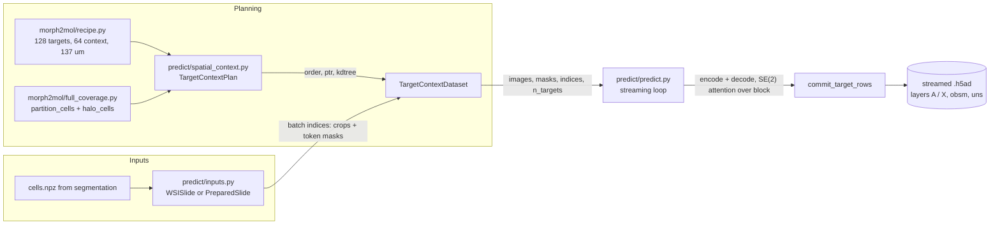
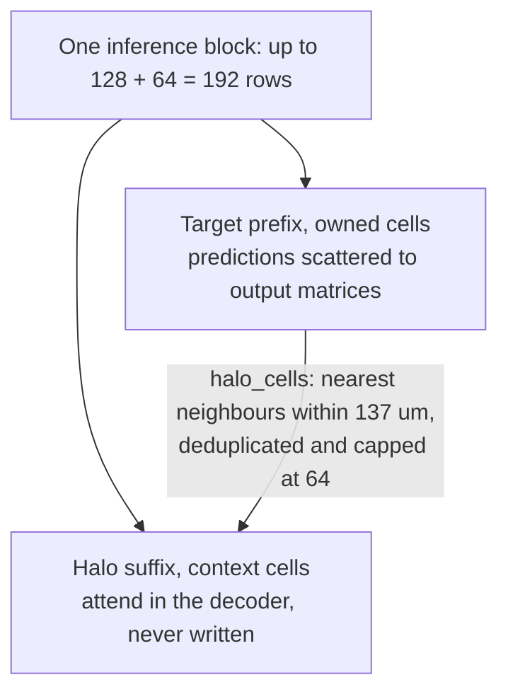

Spatial context blocking is the inference-side mechanism that turns a whole-slide cell list into a deterministic stream of **target/context blocks**: each block owns up to 128 target cells whose predictions are committed exactly once, plus up to 64 surrounding context cells that sharpen the SE(2) distance-attention decode but are never written. The blocking module, `predict/spatial_context.py`, deliberately reuses the *exact* partition and halo kernels that Stage-2 training used, so that every inference batch reproduces the spatial statistics the decoder was trained on — with no expression values read at inference time. This page dissects the planning objects, the partition kernel, halo assembly, and the streaming/commit loop that consumes blocks.



## Why Blocks Exist: Training-Matched Spatial Batching

The SE(2) expression decoder consumes a *set* of cells with micron coordinates, not a single crop: predictions for target cells are conditioned on neighbors within a spatial radius. At training time, Stage 2 batches "up to 128 supervised cells and 64 additional context cells" per step with a maximum decoder distance of 137 µm, and context cells attend but never enter the loss. Inference must reproduce this receptive field exactly — a cell predicted in isolation would see an attention neighborhood the decoder never encountered. Blocking therefore serves three simultaneous purposes: **training-matched batching** (identical target/context composition), **bounded memory** (each block is at most 192 crops of 55 µm, streamed one at a time through a `batch_size=None` DataLoader), and **exactly-once output ownership** (partitioned ownership lets the streaming HDF5 writer scatter rows without collisions). The module docstring states the invariant plainly: reuse the actual training partition/halo functions; commit only the target prefix, once per cell.

Sources: [spatial_context.py](predict/spatial_context.py#L1-L5), [stage2.py](morph2mol/training/stage2.py#L186-L196), [training.md](docs/training.md#L62-L95), [predict.py](predict/predict.py#L135-L136)

## Block Anatomy and Recipe Constants

Every numeric constant in the block contract comes from the frozen Morph2Mol-25M recipe, shared verbatim by training and inference. The recipe module raises if any runtime argument attempts to override these values, so the geometry below is a hard contract, not a default.

| Constant | Value | Role in blocking |
| --- | --- | --- |
| `TARGET_CELLS` | 128 | Maximum owned targets per block |
| `CONTEXT_CELLS` | 64 | Maximum halo cells appended after targets |
| `RADIUS_UM` | 137.0 | Context query radius (≈2.5 × the 55 µm crop side) |
| `SEED` | 1 | Base seed; per-slide seed derives from `crc32` of the object name |
| `FOV_UM` (geometry) | 55.0 | Physical crop side every cell image covers |
| Partition epoch | 0 (frozen) | Training rotates the partition per epoch; inference pins epoch 0 |

A block is therefore a flat index array `[targets, context]` of length ≤ 192, paired with the integer `n_targets` that marks the ownership boundary. The 55 µm crop field of view and the 137 µm halo radius are dimensionally compatible by design: context cells are typically the immediate ring of neighbors whose own crops overlap the target's surroundings.



Sources: [recipe.py](morph2mol/recipe.py#L4-L8), [geometry.py](predict/geometry.py#L6-L9), [spatial_context.py](predict/spatial_context.py#L20-L27)

## TargetContextPlan: Deterministic Ownership Planning

`TargetContextPlan` is constructed once per run from the slide's micron positions — derived as source pixels × mpp in `covariates.geometry` — and the sample identity, which defaults to the input file stem (`--sample-id` overrides it). Determinism is anchored in a content-derived seed: `object_seed = (SEED + zlib.crc32(object_name)) % (2**31 - 1)`, so the *same sample id always yields the same partition*, while different slides get independent, decorrelated block layouts. The plan computes the ownership ordering eagerly via `partition_cells` and builds its `cKDTree` lazily on the first halo query; iteration then reduces to slicing contiguous ranges from the `order` array through the `ptr` offset table.

```python
self.object_seed = (SEED + zlib.crc32(self.object_name.encode())) % (2**31 - 1)
self.order, self.ptr = partition_cells(self.pos, self.target_cells, self.object_seed, self.epoch)
```

> [!TIP]
> Because `object_seed` hashes the *name* rather than the coordinates, renaming the input file (or changing `--sample-id`) changes the partition entirely — still valid and still exactly-once, but block boundaries will differ. Downstream consumers comparing block-level logs across runs should pin `--sample-id`.

Sources: [spatial_context.py](predict/spatial_context.py#L15-L40), [covariates.py](predict/covariates.py#L22-L37), [predict.py](predict/predict.py#L107-L108)

## The Partition Kernel: `partition_cells`

The shared kernel in `morph2mol/full_coverage.py` converts N unordered cell positions into a flattened, non-overlapping ownership sequence in five deterministic steps, all driven by the seeded RNG:

1. **Seeded rotation** — the grid axis is rotated by an angle uniform in `[-π/4, π/4)` derived from `(seed + epoch*1000003) % (2**31-1)`, decorrelating partitions across epochs.
2. **Raster grid with 2× sizing** — the grid cell side is `sqrt(span_x·span_y·target_cells·2/N)`, i.e. sized to hold roughly *twice* the target budget on average.
3. **Jittered origin** — the grid origin is offset by a random fraction of one cell side, preventing systematic alignment artifacts with tissue structure.
4. **Median bisection** — each raster cell holding more than 128 points is recursively split along its widest axis at the median (ties broken by original index), so every emitted block satisfies the target budget.
5. **Ownership proof** — a `bincount` assertion verifies every cell appears exactly once in the flattened output before `order`/`ptr` are returned.

> [!TIP]
> The 2× grid-sizing factor means nearly every raster cell bisects into two ~128-cell blocks, blending the cache-friendly locality of raster blocking with the budget guarantee of kd-splitting. Blocks are emitted in rotated-grid raster order, and within a block targets are sorted along the split axis — spatially coherent, fully deterministic.

Sources: [full_coverage.py](morph2mol/full_coverage.py#L14-L40)

## Halo Assembly: `halo_cells`

For each block, context is assembled by a bounded nearest-neighbor query over the plan's k-d tree. The algorithm exploits an ordering invariant rather than a heap or set:

1. Query the `k = min(16, N)` nearest neighbors of every target — at most 128 × 16 = 2048 candidate entries.
2. Mask candidates to those within `RADIUS_UM` = 137 µm that are **not** owned targets of this block.
3. Reshape the mask to *neighbor-rank-major* order (`ids.T[valid.T]`), so candidates appear rank-0 neighbors of all targets first, then rank-1, and so on.
4. `np.unique(..., return_index=True)` keeps each distinct context cell at its **first occurrence** — which, given the rank-major ordering, is its closest announcing target.
5. `np.sort(first)` restores rank-major order among survivors, and `[:context_cells]` truncates to the 64-cell cap.

The result is a halo that prioritizes globally nearest cells with fully deterministic ordering — with one edge case: when a single block owns the entire slide, there are no *outside* cells and the halo is legitimately empty. The same kernel serves training's `FullCoverageDataset`, where the halo additionally feeds a boolean `mask` (`arange(len(idx)) < n_targets`) separating supervised rows from context rows.

Sources: [full_coverage.py](morph2mol/full_coverage.py#L43-L52), [full_coverage.py](morph2mol/full_coverage.py#L113-L127)

## Streaming Blocks Through the Prediction Loop

`TargetContextDataset` is a thin adapter: for block `b` it asks the plan for `indices` and `n_targets`, calls `source.batch(indices)` to cut 55 µm crops and rasterize cell polygons into normalized 16×16 token masks, and returns tensors. The prediction loop consumes it with `DataLoader(batch_size=None)` — each `__getitem__` yields one complete block, distributed across CPU workers (slide handles are opened per worker because they are not fork-safe). Per block, the loop encodes all 192 images with the Stage-2 LoRA adapters, decodes with micron coordinates and area covariates for **targets and context alike** (the SE(2) attention needs the full neighborhood), then commits only the owned prefix:

| Payload tensor | Committed rows | Condition |
| --- | --- | --- |
| `A` (direct expression, `layers/A`) | owned prefix only | always |
| `X` (final matrix in reference mode) | owned prefix only | `reference=True` calibration |
| `H2` stage-2 features, `Z` SE(2) features (`obsm`) | owned prefix only | `--save-embeddings` |
| `H1` phase-1 features (`obsm`) | owned prefix only | encoded separately from `images[:n_targets]` — context never re-encoded |

```mermaid
flowchart LR
    P["pos_um micron coordinates<br/>from covariates.geometry"] --> A["partition_cells<br/>seeded rotation, raster grid, median bisection"]
    A --> O["order + ptr<br/>every cell owned exactly once"]
    O --> H["halo_cells<br/>k nearest within 137 um, dedup, cap 64"]
    H --> I["indices = targets, then context"]
    I --> L["source.batch<br/>55 um crops + 16x16 token masks"]
    L --> M["encode + decode over the full block"]
    M --> W["commit_target_rows<br/>scatter owned prefix only"]
    W --> F["written counter == 1 for every cell"]
```



Sources: [spatial_context.py](predict/spatial_context.py#L50-L61), [predict.py](predict/predict.py#L135-L157), [inputs.py](predict/inputs.py#L46-L62)

## Exactly-Once Commit and Integrity Guards

`commit_target_rows` is the serialization gate between the GPU and the streamed HDF5 file. It validates the ownership prefix before any scatter: `n_targets` must be in `(0, len(indices)]`, the owned ids must be unique, and the write-counter must still be zero for every one of them. Each payload is then scattered in sorted-id order (a deterministic write order independent of within-block target ordering), and the counter increments. The loop finishes with a global assertion that `written == 1` for all N cells — the full-coverage guarantee that no cell was silently dropped by a worker failure or an off-by-one in partitioning.

| Guard | Trigger | Raised error |
| --- | --- | --- |
| Position shape | non-empty `[cells, 2]` required in plan init | `ValueError: Expected nonempty [cells, 2] micron positions` |
| Partition validity | any cell owned ≠ once after `partition_cells` | `ValueError: Spatial partition must own every target exactly once` |
| Prefix sanity | `n_targets` outside `(0, len(indices)]` | `ValueError: Invalid owned target prefix` |
| Duplicate write | owned ids repeat or counter already nonzero | `ValueError: A target cell would be written more than once` |
| Payload width | model output shorter than the block | `ValueError: Model output does not cover the complete target/context batch` |
| Numeric sanity | nonfinite direct prediction | `RuntimeError: Nonfinite direct prediction` |
| Final coverage | any cell with `written != 1` after the loop | `RuntimeError: Prediction must write each target cell exactly once` |

Sources: [spatial_context.py](predict/spatial_context.py#L64-L78), [predict.py](predict/predict.py#L144-L161)

## Provenance Metadata and the Calibration Protocol

Every block plan exposes a `metadata()` dict that is committed verbatim into the output file at `uns['morph2mol']['spatial_context']`: the partition `revision` (`full_coverage_halo_v1`), target/context budgets, context radius, base seed, the hashed object seed, partition object and epoch, block count, and the two policy flags `output_policy='targets_once_only'` and `partition_fixed_for_inference=True`. This makes any output file self-describing with respect to *how* its cells were blocked. Alongside it, `prediction_protocol()` returns the canonical protocol values, and `check_prediction_protocol(metadata)` rejects any metadata that diverges from the deployed settings — the handshake ensuring that fusion-gate calibration and spatial prediction were computed under identical blocking rules.

Sources: [spatial_context.py](predict/spatial_context.py#L42-L47), [spatial_context.py](predict/spatial_context.py#L81-L90), [predict.py](predict/predict.py#L116-L117), [full_coverage.py](morph2mol/full_coverage.py#L11)

## Training and Inference: One Kernel, Two Schedules

The deepest design decision in this page is that inference imports the *training* kernel rather than reimplementing it. Stage 2 wraps the same `partition_cells`/`halo_cells` in `CoveragePlan`, which generates an epoch-specific partition per slide, shuffles block order across ranks, and caches partitions on disk; inference pins epoch 0, iterates blocks sequentially, and recomputes the plan in-process (slides are far smaller than training corpora). Both sides rely on `supervised_sums`-style masking — in training via a boolean mask that keeps context out of the negative-binomial and MSE losses, in inference via the `n_targets` prefix that keeps context out of the output writer.

| Dimension | Stage-2 training (`CoveragePlan`) | Inference (`TargetContextPlan`) |
| --- | --- | --- |
| Kernel functions | `partition_cells` + `halo_cells` | identical imports |
| Epoch schedule | new seeded partition per epoch (3 epochs) | fixed `epoch=0` |
| Block order | per-rank stride + seeded permutation | sequential, raster order |
| Context role | SE(2) attention; masked out of both losses | SE(2) attention; never committed to outputs |
| Coverage contract | every usable target once *per epoch* | every target once *per run* |
| Partition reuse | `cached_arrays` disk cache with signature stamps | recomputed in memory |
| Failure semantics | mask zeroed for invalid slots (padding) | hard errors on any coverage violation |

This table explains why a released model can be pointed at arbitrary new tissue: the decoder's neighborhood statistics at inference are drawn from the same distribution of block compositions it was optimized under.

Sources: [full_coverage.py](morph2mol/full_coverage.py#L55-L105), [full_coverage.py](morph2mol/full_coverage.py#L130-L139), [stage2.py](morph2mol/training/stage2.py#L133-L139), [docs](docs/training.md#L62-L95)

## Where to Go Next

To see what the context cells actually *do* inside the decoder, continue to [SE(2) Distance Attention Decoder](7-se-2-distance-attention-decoder) and [Negative-Binomial Expression Head](8-negative-binomial-expression-head); for the training-side schedule these blocks replicate, read [Stage 2 Expression Training](15-stage-2-expression-training). The commit guards interact directly with the streamed writer covered in [Streaming Output and Fault Tolerance](20-streaming-output-and-fault-tolerance), and the `spatial_context` block embedded in `uns` is one of the fields to inspect in [Reading Prediction Outputs](4-reading-prediction-outputs). Upstream, the micron positions consumed by `TargetContextPlan` originate from [Nuclei Segmentation with Cellpose-SAM](18-nuclei-segmentation-with-cellpose-sam), and the `--sample-id` flag that seeds the partition is documented in the [Inference CLI Reference](3-inference-cli-reference).