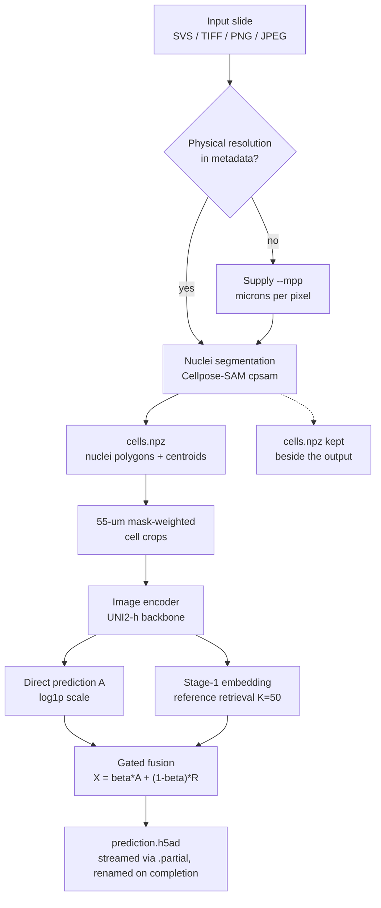

This page takes you from a fresh clone of Morph2Mol to your first predicted single-cell expression matrix. Morph2Mol predicts spatial single-cell gene expression directly from H&E histology images: an image encoder reads cell-centered crops, a spatial decoder produces direct expression predictions, and a reference bank of cells with measured expression refines those predictions through retrieval and gated fusion. You need no measured expression and no precomputed image features for your target slide — only the image itself and the downloaded model release.

By the end of this page you will have: a working Python environment, a verified model release directory under `models/morph2mol`, a `results/prediction.h5ad` file readable with `anndata`, and enough CLI familiarity to adapt the workflow to your own slides.

Sources: [README.md](/README.md#L1-L3)

## What You Need Before Starting

| Requirement | Detail |
| --- | --- |
| Python | **3.10 or later** (enforced by `requires-python` in `pyproject.toml`) |
| PyTorch | `torch>=2.6,<3`; install a CUDA build matching your GPU, or run CPU-only |
| GPU | CUDA is the default device; CPU works with `--device cpu --amp fp32` |
| Model access | Public Hugging Face repo `zchx/Morph2Mol` **plus** separately gated access to `MahmoodLab/UNI2-h` (the image-encoder backbone) |
| Slide formats | SVS, NDPI, MRXS via OpenSlide; PNG, JPEG, TIFF also supported |

The UNI2-h gating step is the one prerequisite beginners most often miss: the Morph2Mol download alone is not enough, because the encoder checkpoint `pytorch_model.bin` must be fetched from MahmoodLab's gated repository with an account that has been granted access. Apply for access before you start; approval is not instantaneous.

Sources: [pyproject.toml](/pyproject.toml#L6-L10), [requirements.txt](/requirements.txt#L1-L13), [README.md](/README.md#L13-L25), [weights/README.md](/weights/README.md#L1-L4)

## Step 1: Install the Environment

Clone the repository and install the pinned dependency set. The requirements file locks the inference stack: `torch>=2.6`, `timm==1.0.16`, `cellpose==4.2.1.1` (segmentation), `anndata>=0.10` (output format), `huggingface_hub` (model download), plus `numpy`, `pandas`, `scipy`, `Pillow`, `h5py`, `tifffile`, and OpenCV.

```bash
git clone https://github.com/zchxhcz1/Morph2Mol.git
cd Morph2Mol
pip install -r requirements.txt
```

If you plan to use SVS, NDPI, or MRXS whole-slide images, also install the OpenSlide system library and `openslide-python`. Large slides should use an OpenSlide-readable format so the image is windowed rather than loaded whole into memory; plain PNG or JPEG works for smaller images. The package itself is declared in `pyproject.toml` as version 0.3.0 covering the `morph2mol`, `predict`, `train`, and `voice` packages.

Sources: [README.md](/README.md#L13-L25), [requirements.txt](/requirements.txt#L1-L13), [pyproject.toml](/pyproject.toml#L14-L17)

## Step 2: Download the Model Release

A **release** is a portable directory that bundles everything inference needs: checkpoints, gene information, fusion weights, and the reference bank. Authenticate once, then download both model parts into `models/morph2mol`:

```bash
hf auth login
python - <<'PYTHON'
from huggingface_hub import snapshot_download, hf_hub_download

model_dir = "models/morph2mol"
snapshot_download("zchx/Morph2Mol", local_dir=model_dir)
hf_hub_download("MahmoodLab/UNI2-h", "pytorch_model.bin", local_dir=f"{model_dir}/uni2h")
PYTHON
```

Keep the release directory intact and together — the loader cross-checks its contents against each other, as described below.

Sources: [README.md](/README.md#L27-L44), [weights/README.md](/weights/README.md#L1-L4)

## Inside the Release Directory

The complete directory consumed by `--release` looks like this:

```text
models/morph2mol/
  release.json          # manifest: relative paths + checksums (schema morph2mol-release-v1)
  stage1.pt             # Stage 1 retrieval/alignment checkpoint
  stage2.pt             # Stage 2 expression checkpoint
  gene_space.npz        # model gene space (18,580 genes)
  xenium_genes.tsv      # ordered Xenium panel gene list
  beta.json             # combined fusion weights, all organ/panel groups
  beta.meta.json        # fusion-weight metadata
  beta/                 # per-group gene-weight tables (e.g. lung/narrow.json)
  uni2h/pytorch_model.bin   # UNI2-h encoder weights (downloaded separately)
  bank/                 # reference bank: summaries per reference object
```

| Artifact | Role at inference |
| --- | --- |
| `stage1.pt`, `stage2.pt` | The two model checkpoints whose SHA-256 hashes are recorded in `release.json` |
| `gene_space.npz` | Defines the model gene head your `--genes` selection must draw from |
| `beta.json` + `beta/` | Fusion weights; the root file is used automatically, per-group tables under `beta/ORGAN/WIDTH.json` |
| `bank/` | Reference cells with measured expression used for retrieval-augmented refinement |

The example config `configs/release.example.json` shows the same contract: keys `uni2h`, `stage1`, `stage2`, `gene_space`, `xenium_genes`, `bank`, and `gate` under schema `morph2mol-release-v1`. When prediction starts, the `Release` loader checks that every required artifact exists, verifies recorded SHA-256 checksums, and confirms that the bank, fusion weights, and checkpoints all reference the same model identity — if any of these fail you get a fast, explicit error rather than silent wrong predictions. A deeper treatment belongs to [Release Integrity Verification](21-release-integrity-verification).

> [!TIP]
> Never mix files between release directories. The loader cross-checks `checkpoint_sha256`, `gene_space_sha256`, and `cache_fingerprint` across the bank, the gate, and the checkpoints; a single mismatched file fails the whole release load with `Model checkpoints, genes, reference bank and fusion weights do not match`.

Sources: [weights/README.md](/weights/README.md#L5-L31), [configs/release.example.json](/configs/release.example.json#L1-L11), [morph2mol/release.py](/morph2mol/release.py#L8-L45)

## Step 3: Run Your First Prediction

One command produces a complete prediction. It segments nuclei, extracts cell-centered crops, predicts expression, retrieves reference expression, fuses both sources, and streams the result to disk — also saving the segmentation beside the output:

```bash
python predict/predict.py \
  --image /path/to/slide.svs \
  --release models/morph2mol \
  --out results/prediction.h5ad
```

The pipeline your first command triggers:



Three first-run behaviors are worth knowing in advance. First, if the image carries no physical-resolution metadata, the command exits with an explicit error telling you to pass `--mpp`; a typical scanned-slide value is `0.25`, but you must use your own image's true resolution. Second, the segmentation step runs as a subprocess invoking `predict/segment.py`, and **on the very first run Cellpose-SAM weights are downloaded automatically** from `mouseland/cellpose-sam` via Hugging Face Hub — a network connection is needed even if your model download is complete. Third, the resulting `cells.npz` is written next to your output file; re-running on the same output path without `--overwrite` protects both files from accidental clobbering.

Sources: [README.md](/README.md#L46-L73), [predict/predict.py](/predict/predict.py#L13-L68), [predict/segment.py](/predict/segment.py#L48-L58)

## Key Options for Your First Runs

The full flag surface is documented in [Inference CLI Reference](3-inference-cli-reference). These are the options a beginner needs on day one:

| Flag | Default | Purpose |
| --- | --- | --- |
| `--image` / `--prepared` | one is required | Input slide (auto-segmented) or a pre-prepared directory of cell crops and boundaries |
| `--release` | required | Path to your model release directory (`models/morph2mol`) |
| `--out` | required | Output `.h5ad` path |
| `--mpp` | from metadata | Microns per pixel; **required** when slide metadata lacks resolution |
| `--genes` | `all` | `all` (18,580 model genes), `xenium`, or a text file of gene symbols, one per line |
| `--tissue` | global weights | Organ or organ/width fusion group, e.g. `lung` or `lung/wide` |
| `--device` / `--amp` | `cuda` / `bf16` | CPU inference: `--device cpu --amp fp32` |
| `--enc-chunk` / `--query-batch` | `64` / `256` | Lower both to reduce transient GPU memory |
| `--workers` | `4` | CPU workers loading cell crops |
| `--overwrite` | off | Allow reusing an existing output or partial path |

Fusion-weight groups cover 15 reference organs (bone, brain, breast, cervix, colon, heart, kidney, liver, lung, lymph_node, ovary, pancreas, prostate, skin, tonsil) across 20 organ/panel combinations. `narrow` groups fit fewer than 1,000 measured model genes; `wide` at least 1,000. Omitting `--tissue` applies global weights — a safe default for a first run.

Sources: [predict/predict.py](/predict/predict.py#L13-L38), [README.md](/README.md#L74-L89)

## Inspect the Result

Read the output with `anndata`; the file contains per-cell predictions over your requested genes:

```python
import anndata as ad
prediction = ad.read_h5ad("results/prediction.h5ad")
```

| Field | Contents |
| --- | --- |
| `X` | Combined scores: `beta * A + (1 - beta) * R` |
| `layers['A']` | Direct image-based predictions in `log1p(mu)` scale |
| `layers['R']` | Reference-derived scores; `NaN` where reference coverage is unavailable |
| `var['beta']` / `var['covered']` | Per-gene fusion weight and reference coverage |
| `obsm['spatial']` | Cell centroids as x,y coordinates in source-image pixels |

One interpretation rule matters from the start: combined scores describe **variation across cells within each gene** — they are per-gene scores, not molecule counts. Genes without reference coverage or fitted weights fall back to the direct prediction. Full field semantics belong to [Reading Prediction Outputs](4-reading-prediction-outputs).

Sources: [README.md](/README.md#L91-L115), [predict/predict.py](/predict/predict.py#L108-L121)

## Troubleshooting the First Run

| Symptom | Cause | Fix |
| --- | --- | --- |
| `Image has no physical resolution metadata. Supply --mpp` | Slide lacks resolution tags | Re-run with your true microns-per-pixel, e.g. `--mpp 0.25` |
| `Missing release artifact …` | Incomplete download (usually UNI2-h or bank) | Re-run the Step 2 download; check `models/morph2mol` against the directory tree above |
| `Release checksum mismatch: …` | Corrupted or partially transferred checkpoint | Delete and re-download the affected file |
| `Model checkpoints, genes, reference bank and fusion weights do not match` | Files mixed from different releases | Keep one release directory intact; re-download as a unit |
| `FileExistsError: Output/partial exists` | Previous run wrote to the same path | Choose a new `--out` or pass `--overwrite` |
| CUDA out of memory | Large slide, big batch defaults | `--enc-chunk 32 --query-batch 64` (or lower); CPU fallback: `--device cpu --amp fp32` |
| `cellpose is required by predict/segment.py` | Segmentation dependency missing | `pip install cellpose>=4.0` (the requirements file pins `cellpose==4.2.1.1`) |

Sources: [predict/predict.py](/predict/predict.py#L41-L50), [morph2mol/release.py](/morph2mol/release.py#L13-L45), [predict/segment.py](/predict/segment.py#L41-L58), [requirements.txt](/requirements.txt#L10-L10)

> [!TIP]
> Watch for `*.partial` files. Output matrices are streamed to a `.partial` HDF5 file and atomically renamed to the final `.h5ad` only after every cell has been written exactly once — a leftover `.partial` means an interrupted run, not a usable result.

## Where to Go Next

You have now completed the minimum loop: install → download → predict → inspect. Recommended progression from here:

- [Inference CLI Reference](3-inference-cli-reference) — every flag, including `--prepared`, `--cells`, and reference-exclusion options, before scaling to production slides
- [Reading Prediction Outputs](4-reading-prediction-outputs) — complete output schema, embedding fields, and interpretation guidance
- [Architecture Overview](5-architecture-overview) — how the encoder, SE(2) decoder, retrieval bank, and gate fit together
- [Release Integrity Verification](21-release-integrity-verification) — what the release loader checks and why, useful when sharing releases across machines
- Training your own model requires paired H&E images and measured spatial expression; start with [Training Data Contracts](13-training-data-contracts) and the repository guide [docs/training.md](/docs/training.md#L1-L1)
